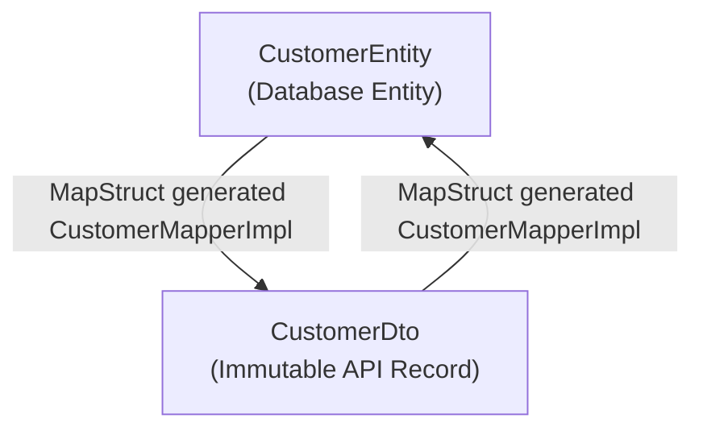

# Topic 101: Boilerplate Elimination: Project Lombok & MapStruct

> 🎯 **Roadmap Seal:** **`[MUST-KNOW / CORE]`** — *Essential modern foundation required for backend roles. Master this thoroughly.*

Java has traditionally faced criticism for boilerplate verbosity: writing hundreds of lines of getters, setters, canonical constructors, `equals()`, `hashCode()`, and manual object-to-object DTO mappings. In modern production systems, **Project Lombok** and **MapStruct** completely eliminate this toil at compile-time with zero runtime reflection overhead.

---

## 1. What It Is and Why It Exists

In enterprise architectures, applications are divided into strict architectural layers:
- **Persistence Layer:** Uses mutable `@Entity` classes managed by Hibernate/JPA.
- **Transport / API Layer:** Uses immutable Data Transfer Objects (`DTO` or Java `record`) exposed over HTTP REST endpoints.
- **Domain Layer:** Uses business models with validation logic.

Historically, developers spent up to 40% of their engineering time writing and maintaining repetitive "glue code": accessors, mutators, `toString()` methods, builder hierarchies, and tedious line-by-line field mappings (`dto.setFirstName(entity.getFirstName())`). This manual approach is highly error-prone: forgetting to map a newly added field produces silent null pointer bugs in production.

- **Project Lombok:** Injects methods directly into class bytecode during compilation by modifying the compiler's Abstract Syntax Tree (AST).
- **MapStruct:** Analyzes source and target model structures at compile-time and writes high-performance, human-readable Java mapping implementations (`MapperImpl.java`) that execute as fast as hand-written code.

### Real-World Analogy
Imagine an automotive assembly plant. **Lombok** is an automated robotic arm that instantly molds standard nuts, bolts, and mounting brackets directly onto engine blocks while they travel down the manufacturing line, so engineers only have to design the core cylinders. **MapStruct** is an automated conveyor sorter that takes raw industrial engine parts and repackages them into precision-labeled consumer delivery crates. It verifies every bolt size at the factory door; if any part is mismatched, the line halts immediately before defective goods can ever reach customers.

---

## 2. Prerequisites
Before mastering Lombok and MapStruct, ensure you understand:
- [Topic 16: Classes, Objects & Memory Layout](file:///c:/Users/modym/OneDrive/Desktop/Java-Doc/content/part1-core/16-classes-objects-and-memory-layout.md) — How fields, accessors, and constructors interact in the JVM heap.
- [Topic 26: Java Records](file:///c:/Users/modym/OneDrive/Desktop/Java-Doc/content/part1-core/26-records.md) — Immutability and modern data carrier semantics.
- [Topic 58: Annotations & Metadata](file:///c:/Users/modym/OneDrive/Desktop/Java-Doc/content/part1-core/58-annotations-and-metadata.md) — How compile-time annotation processors (JSR-269) inspect source code.

---

## 3. Syntax Breakdown & Core Mechanics

### 3.1 Project Lombok AST Code Synthesis
Lombok hooks into `javac` via the Annotation Processing Tool (APT). Rather than outputting secondary source files, Lombok intercepts the AST in memory and mutates the syntax tree before the compiler generates bytecode:


#### Essential Lombok Annotations
- `@Getter` / `@Setter`: Synthesizes accessors and mutators on fields or entire classes with custom access levels (`AccessLevel.PROTECTED`).
- `@ToString`: Generates a defensive `toString()` method with options to exclude sensitive fields (`@ToString.Exclude`).
- `@EqualsAndHashCode`: Generates standard equals and hash code based on declared properties.
- `@NoArgsConstructor`, `@RequiredArgsConstructor`, `@AllArgsConstructor`: Generates specific constructor signatures.
- `@Builder`: Implements the full Fluent Builder pattern for readable, immutable instantiation.
- `@Slf4j`: Injects a standard SLF4J logger instance (`private static final org.slf4j.Logger log = ...`) automatically.

### 3.2 MapStruct Compile-Time Mapping Engine
Unlike runtime reflection mappers (e.g. ModelMapper, Dozer) that reflectively inspect bean properties on every HTTP request (incurring heavy CPU and memory penalties), **MapStruct generates plain Java code at build time**:



```java
@Mapper(componentModel = "spring")
public interface CustomerMapper {
    @Mapping(target = "fullName", expression = "java(entity.getFirstName() + ' ' + entity.getLastName())")
    @Mapping(source = "email", target = "contactEmail")
    CustomerDto toDto(CustomerEntity entity);

    @InheritInverseConfiguration
    CustomerEntity toEntity(CustomerDto dto);
}
```

### 3.3 Maven & Gradle Annotation Processor Ordering
Because MapStruct inspects getters and setters on your entities, and Lombok generates those getters and setters, **Lombok must run before MapStruct in the compiler pipeline**. 

In Maven `pom.xml`, configure the `annotationProcessorPaths` with `lombok-mapstruct-binding`:
```xml
<plugin>
    <groupId>org.apache.maven.plugins</groupId>
    <artifactId>maven-compiler-plugin</artifactId>
    <version>3.11.0</version>
    <configuration>
        <annotationProcessorPaths>
            <path>
                <groupId>org.projectlombok</groupId>
                <artifactId>lombok</artifactId>
                <version>1.18.30</version>
            </path>
            <path>
                <groupId>org.projectlombok</groupId>
                <artifactId>lombok-mapstruct-binding</artifactId>
                <version>0.2.0</version>
            </path>
            <path>
                <groupId>org.mapstruct</groupId>
                <artifactId>mapstruct-processor</artifactId>
                <version>1.5.5.Final</version>
            </path>
        </annotationProcessorPaths>
    </configuration>
</plugin>
```

---

## 4. Production Code Examples

### 4.1 Production Entity with Lombok & Immutable DTO Record
```java
package com.handbook.spring.model;

import jakarta.persistence.*;
import lombok.*;

import java.math.BigDecimal;
import java.time.LocalDateTime;

@Entity
@Table(name = "customers")
@Getter
@Setter
@Builder
@NoArgsConstructor
@AllArgsConstructor
@ToString(exclude = "passwordHash")
public class CustomerEntity {

    @Id
    @GeneratedValue(strategy = GenerationType.IDENTITY)
    private Long id;

    @Column(nullable = false)
    private String firstName;

    @Column(nullable = false)
    private String lastName;

    @Column(unique = true, nullable = false)
    private String email;

    @Column(nullable = false)
    private String passwordHash;

    @Builder.Default
    private BigDecimal creditLimit = new BigDecimal("1000.00");

    @Builder.Default
    private boolean active = true;

    private LocalDateTime createdAt;
}
```

### 4.2 Comprehensive MapStruct Mapper Interface
```java
package com.handbook.spring.mapper;

import com.handbook.spring.model.CustomerEntity;
import org.mapstruct.*;

import java.math.BigDecimal;

// Immutable API Data Transfer Object
public record CustomerResponseDto(
    Long id,
    String displayName,
    String email,
    BigDecimal creditLimit,
    boolean active
) {}

@Mapper(componentModel = "spring", unmappedTargetPolicy = ReportingPolicy.ERROR)
public interface CustomerMapper {

    @Mapping(target = "displayName", expression = "java(entity.getFirstName() + \" \" + entity.getLastName())")
    CustomerResponseDto toDto(CustomerEntity entity);

    @Mapping(target = "passwordHash", ignore = true)
    @Mapping(target = "createdAt", expression = "java(java.time.LocalDateTime.now())")
    @Mapping(target = "firstName", source = "displayName", qualifiedByName = "extractFirst")
    @Mapping(target = "lastName", source = "displayName", qualifiedByName = "extractLast")
    CustomerEntity toEntity(CustomerResponseDto dto);

    @Named("extractFirst")
    default String extractFirst(String displayName) {
        if (displayName == null || !displayName.contains(" ")) return displayName;
        return displayName.split(" ")[0];
    }

    @Named("extractLast")
    default String extractLast(String displayName) {
        if (displayName == null || !displayName.contains(" ")) return "";
        return displayName.substring(displayName.indexOf(" ") + 1);
    }
}
```

---

## 5. Common Mistakes & Error Diagnosis

### Pitfall 1: Using `@Data` or `@EqualsAndHashCode` on JPA `@Entity` Classes
**The Bug:**
```java
@Entity
@Data // ANTIPATTERN on JPA entities
public class User {
    @Id @GeneratedValue private Long id;
    @OneToMany(mappedBy = "user")
    private Set<Order> orders;
}
```
**Why it fails:**
1. **StackOverflowError:** `@Data` generates a `toString()` and `hashCode()` that inspects all fields, including `orders`. If `Order` references `User`, Jackson and Hibernate enter an infinite recursive evaluation loop, crashing the thread.
2. **Broken HashSet Identity:** Lombok's `@EqualsAndHashCode` evaluates all fields. Before persisting, `id` is `null`. After persisting, `id` is populated. If the entity is stored in a `HashSet` before saving, its hash code changes after saving, making it impossible to find or remove the entity from the set!
**The Fix:** Use `@Getter`, `@Setter`, and define `equals()` and `hashCode()` based strictly on natural business keys or a consistent ID comparison.

### Pitfall 2: Lombok `@Builder` Ignoring Default Field Values
**The Bug:**
```java
@Builder
public class Account {
    private boolean active = true; // Ignored by Builder!
    private int score = 100;       // Ignored by Builder!
}
Account acc = Account.builder().build();
// acc.isActive() is FALSE, acc.getScore() is 0!
```
**Why it fails:** The generated builder initializes fields to their JVM default type primitives (`false` and `0`), ignoring in-line field initializers unless annotated.
**The Fix:** Annotate defaults with `@Builder.Default`:
```java
@Builder
public class Account {
    @Builder.Default private boolean active = true;
    @Builder.Default private int score = 100;
}
```

### Pitfall 3: MapStruct Compilation Error: "Cannot find symbol: method getId()"
**The Error:** `javac` fails during compilation with `symbol not found` in generated `MapperImpl.java`.
**Why it fails:** MapStruct processor ran before Lombok processor, so getters/setters did not exist yet in the AST.
**The Fix:** Add `lombok-mapstruct-binding` and ensure Lombok precedes MapStruct in the compiler annotation processor configuration.

---

## 6. Best Practices Guide

| Practice | Recommendation | Architectural Justification |
| :--- | :--- | :--- |
| **JPA Entity Safety** | Never use `@Data` on `@Entity` | Prevents infinite `hashCode()` recursion and broken `HashSet` collections. |
| **DTO Modeling** | Favor Java Records over Lombok `@Value` | Java records are native JVM language constructs with pattern matching and zero compiler plugins. |
| **Unmapped Field Policy** | Use `unmappedTargetPolicy = ReportingPolicy.ERROR` | Forces build failure if a developer adds a field to an entity but forgets to map it to the DTO. |
| **Dependency Injection** | Use `@Mapper(componentModel = "spring")` | Generates a Spring `@Component` enabling seamless `@Autowired` constructor injection. |
| **Constructor Injection** | Use `@RequiredArgsConstructor(onConstructor_ = @Autowired)` | Eliminates manual constructor boilerplate while maintaining clean, testable immutable field injection. |

### When NOT to Use
- Do NOT use Lombok in public reusable open-source library modules if consumers may not have the Lombok annotation processor configured in their IDE or build tool.
- Do NOT use runtime reflection mappers (like ModelMapper) in high-throughput microservices where low-latency serialization is critical.

---

## 7. Version Notes & Modern Java Compatibility
- **Java 16+ & Records:** Java native `record` types have largely replaced Lombok's `@Value` for DTOs. MapStruct has first-class native support for mapping directly into Java Records.
- **Java 21 & Lombok 1.18.30+:** Full support for JDK 21 virtual threads, pattern matching, and sealed class hierarchies.
- **MapStruct 1.5.5+:** Native integration with Java Records, builder detection, and Spring Boot 3 Jakarta namespace.

---

## 8. Summary Cheat Sheet

| Feature | Project Lombok | MapStruct | Manual Hand-Written |
| :--- | :--- | :--- | :--- |
| **Execution Phase** | Compile-Time (AST) | Compile-Time (Code Gen) | Compile-Time |
| **Runtime Overhead** | Zero | Zero | Zero |
| **Maintenance Burden** | Extremely Low | Extremely Low | Extremely High |
| **Type Safety** | High | Compiler-Enforced | Manual |
| **Debugging** | Can delombok | Plain readable Java files | Plain Java |

---

## 9. Verification & Architecture Demo

The executable architecture demo `examples/spring/LombokMapStructDemo.java` implements:
- Fluent builder pattern simulation for `CustomerEntity`.
- Compile-time mapper simulation (`CustomerMapperImpl`) mapping entities to immutable `CustomerDto` records.
- Bidirectional transformations verifying zero reflection overhead.

Compile and run the verified test:
```bash
javac -d examples/web/classes examples/spring/LombokMapStructDemo.java
java -ea -cp examples/web/classes com.handbook.spring.LombokMapStructDemo
```

---

## 10. Hands-on Practice Exercises

### Exercise 1: Spot the Bug — The Infinite Bi-directional JSON & ToString Loop
A developer models a one-to-many relationship using Lombok:
```java
@Entity
@Getter
@Setter
@ToString
public class Department {
    @Id private Long id;
    private String name;
    @OneToMany(mappedBy = "department")
    private List<Employee> employees;
}

@Entity
@Getter
@Setter
@ToString
public class Employee {
    @Id private Long id;
    private String name;
    @ManyToOne
    private Department department;
}
```
When logging an employee with `log.info("Loaded: {}", employee);`, the application crashes with `java.lang.StackOverflowError`. Why?

<details>
<summary>View Solution</summary>

**Cause:**
Lombok's `@ToString` on `Employee` includes `department`. In turn, `Department`'s `@ToString` includes `employees`. Evaluating `employee.toString()` triggers `department.toString()`, which calls each employee's `toString()`, entering an infinite recursive loop that exhausts thread stack memory.

**The Fix:**
Defensively exclude the back-reference from the `toString()` generation on the child entity:
```java
@Entity
@Getter
@Setter
@ToString(exclude = "department")
public class Employee {
    @Id private Long id;
    private String name;
    @ManyToOne
    private Department department;
}
```
</details>

---

### Exercise 2: Hands-on Implementation — Complete MapStruct Order DTO Mapper
Write a complete MapStruct mapper interface named `OrderMapper` that converts an `OrderEntity` into an immutable `OrderSummaryDto` record:
- `OrderEntity` has: `Long id`, `String orderReference`, `List<OrderItem> items`, and `LocalDateTime createdAt`.
- `OrderItem` has: `String sku`, `int quantity`, and `BigDecimal unitPrice`.
- `OrderSummaryDto` record has: `Long id`, `String reference`, `int totalItemsCount`, `BigDecimal totalOrderPrice`, and `String formattedDate` (format: `yyyy-MM-dd`).
- Implement custom mapping methods for total item count, total price, and date formatting.

<details>
<summary>View Solution</summary>

```java
package com.handbook.spring.mapper;

import org.mapstruct.*;
import java.math.BigDecimal;
import java.time.LocalDateTime;
import java.time.format.DateTimeFormatter;
import java.util.List;

// Source Entities
public record OrderItem(String sku, int quantity, BigDecimal unitPrice) {}
public record OrderEntity(Long id, String orderReference, List<OrderItem> items, LocalDateTime createdAt) {}

// Target DTO Record
public record OrderSummaryDto(
    Long id,
    String reference,
    int totalItemsCount,
    BigDecimal totalOrderPrice,
    String formattedDate
) {}

@Mapper(componentModel = "spring")
public interface OrderMapper {

    DateTimeFormatter FORMATTER = DateTimeFormatter.ofPattern("yyyy-MM-dd");

    @Mapping(target = "reference", source = "orderReference")
    @Mapping(target = "totalItemsCount", source = "items", qualifiedByName = "calculateItemCount")
    @Mapping(target = "totalOrderPrice", source = "items", qualifiedByName = "calculateTotalPrice")
    @Mapping(target = "formattedDate", source = "createdAt", qualifiedByName = "formatDate")
    OrderSummaryDto toSummaryDto(OrderEntity entity);

    @Named("calculateItemCount")
    default int calculateItemCount(List<OrderItem> items) {
        if (items == null) return 0;
        return items.stream().mapToInt(OrderItem::quantity).sum();
    }

    @Named("calculateTotalPrice")
    default BigDecimal calculateTotalPrice(List<OrderItem> items) {
        if (items == null) return BigDecimal.ZERO;
        return items.stream()
            .map(i -> i.unitPrice().multiply(BigDecimal.valueOf(i.quantity())))
            .reduce(BigDecimal.ZERO, BigDecimal::add);
    }

    @Named("formatDate")
    default String formatDate(LocalDateTime date) {
        if (date == null) return "";
        return date.format(FORMATTER);
    }
}
```

**Verification & Expected Output:**
When passed an `OrderEntity(101L, "ORD-999", List.of(new OrderItem("A", 2, new BigDecimal("10.00")), new OrderItem("B", 1, new BigDecimal("25.00"))), LocalDateTime.of(2026, 11, 20, 10, 0))`:
The generated mapper produces an `OrderSummaryDto` with:
- `id`: `101L`
- `reference`: `"ORD-999"`
- `totalItemsCount`: `3`
- `totalOrderPrice`: `45.00`
- `formattedDate`: `"2026-11-20"`
</details>

---

### Exercise 3: Real-World Edge Case — Handling Circular References in Nested Graphs
<details>
<summary>View Solution</summary>
**Question:** In complex enterprise domain models with bi-directional relationships (e.g., Parent $\leftrightarrow$ Child, or Graph nodes), MapStruct by default causes a compile-time warning or infinite runtime looping when converting nested structures. How do you instruct MapStruct to track already-mapped object identities using a `@Context` cycle avoidance tracker?

**Solution:**
Create a reusable cycle-avoidance context that tracks visited instances using an identity map:
```java
public class CycleAvoidingMappingContext {
    private final Map<Object, Object> knownInstances = new IdentityHashMap<>();

    @BeforeMapping
    public <T> T getMappedInstance(Object source, @TargetType Class<T> targetType) {
        return targetType.cast(knownInstances.get(source));
    }

    @BeforeMapping
    public void storeMappedInstance(Object source, @MappingTarget Object target) {
        knownInstances.put(source, target);
    }
}
```
Pass the context parameter to the mapper method:
```java
@Mapper(componentModel = "spring")
public interface NodeMapper {
    NodeDto toDto(NodeEntity entity, @Context CycleAvoidingMappingContext context);
}
```
During recursion, when MapStruct encounters an entity instance it has already processed, `@BeforeMapping` immediately returns the existing cached DTO reference instead of instantiating a new cycle, cleanly severing the loop with zero memory leakage.
</details>

---

## 11. Verified Official Sources & References
- [Project Lombok Official Features Reference](https://projectlombok.org/features/)
- [MapStruct Official Reference Documentation](https://mapstruct.org/documentation/stable/reference/html/)
- [JSR 269: Pluggable Annotation Processing API](https://jcp.org/en/jsr/detail?id=269)
