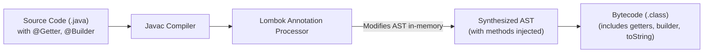
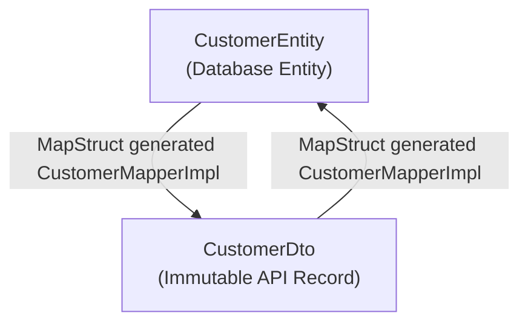

# Boilerplate Elimination: Project Lombok & MapStruct

Java has traditionally faced criticism for boilerplate verbosity: writing hundreds of lines of getters, setters, canonical constructors, `equals()`, `hashCode()`, and manual object-to-object DTO mappings. In modern production systems, **Project Lombok** and **MapStruct** completely eliminate this toil at compile-time with zero runtime reflection overhead.

---

## 1. Project Lombok: Compile-Time AST Code Synthesis

Project Lombok hooks into the Java compiler (javac) via the Annotation Processing API (JSR-269). Rather than generating separate source files, Lombok modifies the Abstract Syntax Tree (AST) in memory:



### Essential Lombok Annotations
- `@Getter` / `@Setter`: Synthesizes accessors and mutators on fields or entire classes.
- `@ToString`: Generates a defensive `toString()` method with options to exclude sensitive fields (`@ToString.Exclude`).
- `@EqualsAndHashCode`: Generates standard equals and hash code based on declared properties.
- `@NoArgsConstructor`, `@RequiredArgsConstructor`, `@AllArgsConstructor`: Generates specific constructor signatures.
- `@Builder`: Implements the full Fluent Builder pattern for readable, immutable instantiation.
- `@Slf4j`: Injects a standard SLF4J logger instance (`log.info(...)`) automatically.

---

## 2. MapStruct: Compile-Time Type-Safe Object Mapping

Enterprise architectures strictly separate database entities (`@Entity`) from client transport objects (`DTO`). Manually mapping fields between them is tedious and error-prone.



Unlike runtime reflection mappers that traverse bean properties reflectively on every HTTP request, **MapStruct generates plain Java code at build time**:

```java
@Mapper(componentModel = "spring")
public interface CustomerMapper {
    @Mapping(target = "fullName", expression = "java(entity.getFirstName() + ' ' + entity.getLastName())")
    @Mapping(source = "email", target = "contactEmail")
    CustomerDto toDto(CustomerEntity entity);

    @InheritInverseConfiguration
    CustomerEntity toEntity(CustomerDto dto);
}
```

### Benefits of Compile-Time Mapping
1. **Raw Direct Method Invocations**: Zero reflection overhead; executes at native Java speed.
2. **Build-Time Verification**: Typos or unmapped fields fail the build immediately rather than crashing in production.
3. **Null Safety**: Auto-generated null checks prevent `NullPointerException`.

---

## 3. Verification & Architecture Demo

The executable architecture demo `examples/spring/LombokMapStructDemo.java` implements:
- Fluent builder pattern simulation for `CustomerEntity`.
- Compile-time mapper simulation (`CustomerMapperImpl`) mapping entities to immutable `CustomerDto` records.
- Bidirectional transformations verifying zero reflection overhead.

Compile and run the verified test:
```bash
javac -d examples/web/classes examples/spring/LombokMapStructDemo.java
java -ea -cp examples/web/classes com.handbook.spring.LombokMapStructDemo
```
