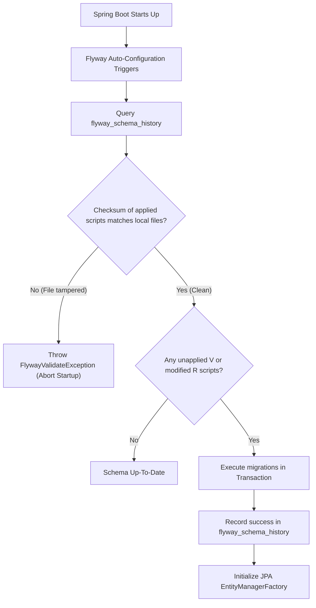

# Topic 102: Versioned Database Migrations with Flyway

> 🎯 **Roadmap Seal:** **`[MUST-KNOW / CORE]`** — *Essential modern foundation required for backend roles. Master this thoroughly.*

In production software engineering, application source code is versioned with Git, but databases possess mutable, persistent state. Relying on Hibernate's `spring.jpa.hibernate.ddl-auto=update` in production is an anti-pattern that causes silent data corruption, unrepeatable states, and table lock deadlocks. **Flyway** provides reliable, automated database schema versioning that runs seamlessly during application bootstrap.

---

## 1. What It Is and Why It Exists

When an enterprise application evolves, its underlying relational schema must change alongside it: adding columns, creating foreign key indexes, modifying enum types, and partitioning historical data.

In legacy workflows, developers emailed SQL scripts to DBAs or manually ran them via SQL clients. This resulted in notorious deployment disasters:
- Staging and production databases diverged in structure ("Schema Drift").
- Scripts were executed multiple times or in the wrong order.
- Rolling back or replicating the production schema to a local development machine was nearly impossible.

**Flyway** treats database schema evolution as code. It applies sequential, deterministic SQL scripts directly at application startup, tracks every applied script in a metadata table, and guarantees that any database connected to the application reaches the exact identical structural state.

### Real-World Analogy
Imagine **Git** for your database tables. While Git tracks line-by-line code commits across developer laptops, **Flyway** tracks structural schema commits across physical database servers. The metadata table (`flyway_schema_history`) acts as the database's commit log: before applying a new migration, Flyway inspects the log, validates that no past migrations were tampered with, and applies only the new, uncommitted schema migrations in strict chronological sequence.

---

## 2. Prerequisites
Before studying Flyway, you should understand:
- [Topic 61: JDBC Fundamentals](#topic-61) — How Java connects to relational databases and executes SQL DDL/DML.
- [Topic 83: Jakarta Persistence JPA & Hibernate](#topic-83) — Object-relational mapping and schema generation hazards.
- [Topic 90: Spring Boot Auto-Configuration Mechanics](#topic-90) — How Spring Boot automatically triggers Flyway beans before the `EntityManagerFactory` initializes.

---

## 3. Syntax Breakdown & Core Mechanics

### 3.1 Migration Script Naming Conventions
Flyway scans the classpath directory `src/main/resources/db/migration` for SQL scripts adhering to strict naming conventions:

```
V1_2_0__create_orders_table.sql
[-] [-----] [--] [-----------------] [--]
pre  ver    sep     description     ext
```

1. **Prefix**:
   - `V`: **Versioned Migration**. Runs exactly once in strict alphanumeric version order.
   - `U`: **Undo Migration** (Commercial). Reverts the corresponding versioned migration.
   - `R`: **Repeatable Migration**. Has no version number. Re-runs whenever its script checksum changes.
2. **Version**: Numeric components separated by dots or underscores (`1`, `1.1`, `2026.11.20.01`).
3. **Separator**: Mandatory **two underscores** (`__`). Single underscores are parsed as part of the version number.
4. **Description**: Human-readable label separated by single underscores or spaces.
5. **Suffix**: File extension, typically `.sql`.

### 3.2 The `flyway_schema_history` Metadata Table
On its initial run, Flyway creates an internal tracking table in the application's default schema:

| installed_rank | version | description | type | script | checksum | installed_by | execution_time | success |
| :---: | :---: | :--- | :---: | :--- | :---: | :---: | :---: | :---: |
| `1` | `1.0` | `create users table` | `SQL` | `V1_0__create_users_table.sql` | `148920194` | `postgres` | `45ms` | `true` |
| `2` | `1.1` | `create orders table` | `SQL` | `V1_1__create_orders_table.sql` | `-89230112` | `postgres` | `32ms` | `true` |
| `3` | `null` | `customer order summary` | `SQL` | `R__customer_order_summary.sql` | `549102831` | `postgres` | `12ms` | `true` |

#### Application Startup Lifecycle


### 3.3 Spring Boot Configuration (`application.yml`)
```yaml
spring:
  datasource:
    url: jdbc:postgresql://localhost:5432/ecommerce_prod
    username: app_user
    password: secret_password
  jpa:
    hibernate:
      # NEVER use 'update' in production with Flyway
      ddl-auto: validate
    show-sql: false
  flyway:
    enabled: true
    locations: classpath:db/migration
    baseline-on-migrate: true
    baseline-version: "0"
    out-of-order: false
```

---

## 4. Production Migration Script Examples

### 4.1 Initial Base Schema: `V1__initial_schema.sql`
```sql
-- V1__initial_schema.sql
CREATE TABLE customers (
    id BIGSERIAL PRIMARY KEY,
    email VARCHAR(255) NOT NULL UNIQUE,
    first_name VARCHAR(100) NOT NULL,
    last_name VARCHAR(100) NOT NULL,
    created_at TIMESTAMP WITH TIME ZONE DEFAULT CURRENT_TIMESTAMP NOT NULL
);

CREATE TABLE orders (
    id BIGSERIAL PRIMARY KEY,
    customer_id BIGINT NOT NULL REFERENCES customers(id) ON DELETE RESTRICT,
    order_reference VARCHAR(64) NOT NULL UNIQUE,
    total_amount NUMERIC(12, 2) NOT NULL,
    status VARCHAR(32) NOT NULL DEFAULT 'PENDING',
    created_at TIMESTAMP WITH TIME ZONE DEFAULT CURRENT_TIMESTAMP NOT NULL
);

CREATE INDEX idx_orders_customer_id ON orders(customer_id);
```

### 4.2 Non-Blocking Index Evolution: `V2__add_order_status_index.sql`
```sql
-- V2__add_order_status_index.sql
-- In PostgreSQL production, create indexes CONCURRENTLY to prevent locking writes
CREATE INDEX CONCURRENTLY IF NOT EXISTS idx_orders_status_created 
ON orders(status, created_at DESC);
```

### 4.3 Repeatable View Migration: `R__customer_order_summary_view.sql`
```sql
-- R__customer_order_summary_view.sql
-- Re-runs automatically whenever its SQL changes
CREATE OR REPLACE VIEW view_customer_order_summary AS
SELECT 
    c.id AS customer_id,
    c.email,
    COUNT(o.id) AS total_orders,
    COALESCE(SUM(o.total_amount), 0.00) AS total_lifetime_spend
FROM customers c
LEFT JOIN orders o ON c.id = o.customer_id
GROUP BY c.id, c.email;
```

---

## 5. Common Mistakes & Error Diagnosis

### Pitfall 1: Modifying an Already-Applied Migration Script in Git
**The Error:**
`org.flywaydb.core.api.exception.FlywayValidateException: Validate failed: Migration checksum mismatch for migration version 1.0`
**Why it fails:** A developer edited `V1_0__create_users_table.sql` after it had already executed on the staging or production database. Flyway compares the SHA-256 / CRC32 checksum of the file against the hash stored in `flyway_schema_history`. Any character change triggers immediate startup rejection.
**The Fix:** Never modify an applied versioned migration file. Create a new sequential migration script: `V1_1__alter_users_table.sql`. If on local development, run `flyway repair` after intentional changes.

### Pitfall 2: Using `spring.jpa.hibernate.ddl-auto=update` alongside Flyway
**The Hazard:** Both Flyway and Hibernate attempt to mutate the schema at the same time. Hibernate generates unindexed foreign keys, alters column constraints silently, and creates schema collisions.
**The Fix:** Set `spring.jpa.hibernate.ddl-auto=validate` (or `none`). Let Flyway be the **sole owner** of database structural changes. Hibernate should only validate that its `@Entity` models match the Flyway-managed tables.

### Pitfall 3: Single Underscore Separator Typo (`V1_0_create_tables.sql`)
**The Hazard:** Using `V1_0_create_tables.sql` instead of `V1_0__create_tables.sql`.
**Why it fails:** Flyway parses `1_0_create_tables` as the version string and looks for an empty description, or fails to recognize the file as a valid migration script. The migration is silently skipped, leading to `Table 'users' does not exist` errors.
**The Fix:** Always verify the **double underscore** separator (`__`).

---

## 6. Best Practices Guide

| Practice | Recommendation | Architectural Justification |
| :--- | :--- | :--- |
| **Zero-Downtime Deployments** | Use the Expand/Contract Pattern | Prevents breaking currently running application instances during rolling Kubernetes updates. |
| **DDL Transactions** | Keep each migration transactional | If a statement fails halfway, the entire script rolls back cleanly, avoiding partially applied schema corruptions. |
| **Repeatable Migrations** | Use `R__` for Views, Functions, Procedures | Code-like database objects can be edited in place; Flyway re-applies them whenever the script content changes. |
| **Baseline on Existing DBs** | Use `baseline-on-migrate: true` | Allows introducing Flyway to legacy databases with existing tables without wiping data. |
| **Feature Branch Conflicts** | Enable `out-of-order: true` in CI | Resolves merge conflicts when two developers merge `V1_2` and `V1_3` out of strict calendar order in branch environments. |

### The Zero-Downtime Expand / Contract Pattern
In continuous deployment (CI/CD) environments, database migrations must never break currently running older instances during rolling deployments:

```mermaid
flowchart TD
    subgraph Step 1: Expand
        A["Deploy V1.1: Add new nullable column 'full_name'"]
        B["Application writes to both 'name' and 'full_name'"]
    end

    subgraph Step 2: Backfill
        C["Run background migration script backfilling existing rows"]
    end

    subgraph Step 3: Switch
        D["Deploy V1.2: Application reads exclusively from 'full_name'"]
    end

    subgraph Step 4: Contract
        E["Deploy V1.3: Drop old legacy column 'name'"]
    end

    Step 1 --> Step 2 --> Step 3 --> Step 4
```

---

## 7. Version Notes & Compatibility
- **Flyway 9 & 10:** Modular database drivers (e.g. `flyway-database-postgresql`). Spring Boot 3 requires explicit dependency declarations for non-H2 database engines.
- **Spring Boot 3.x Compatibility:** Flyway executes before the `EntityManagerFactory` bean creation cycle by default via `FlywayMigrationInitializer`.
- **Java 17 / 21 LTS:** Fully supported with native graalVM AOT compilation in Spring Boot 3.

---

## 8. Summary Cheat Sheet

| Prefix | Type | Execution Rule | Typical Use Case |
| :---: | :--- | :--- | :--- |
| **`V`** | Versioned | Executes exactly once in version order | Tables, columns, foreign keys, primary keys |
| **`R`** | Repeatable | Executes whenever script checksum changes | Views, stored procedures, triggers |
| **`U`** | Undo | Rolls back the corresponding `V` migration | Reverting emergency migrations (Teams edition) |
| **`B`** | Baseline | Marks an existing DB state as the baseline | Legacy database onboarding |

---

## 9. Verification & Architecture Demo

The executable architecture demo `examples/spring/FlywayMigrationDemo.java` implements:
- `FlywayEngine` maintaining versioned scripts and schema history rank.
- Checksum verification preventing tampering with already applied past migrations.
- Sequential application of new migrations (`V1.0` -> `V1.1` -> `V1.2`).

Compile and run the verified test:
```bash
javac -d examples/web/classes examples/spring/FlywayMigrationDemo.java
java -ea -cp examples/web/classes com.handbook.spring.FlywayMigrationDemo
```

---

## 10. Hands-on Practice Exercises

### Exercise 1: Spot the Bug — The Checksum Mismatch Startup Crash
A developer on an eCommerce project opens `V1_0__init_schema.sql` in their IDE and fixes a typo in a comment:
```diff
--- a/src/main/resources/db/migration/V1_0__init_schema.sql
+++ b/src/main/resources/db/migration/V1_0__init_schema.sql
@@ -1,5 +1,5 @@
--- Initialise Custmer table
+-- Initialise Customer table
 CREATE TABLE customers (
```
When deploying to the staging server, Spring Boot crashes with:
`FlywayValidateException: Validate failed: Migration checksum mismatch for migration version 1.0`.
Why did this happen, and what is the proper production procedure?

<details>
<summary>View Solution</summary>

**Cause:**
Flyway computes a cryptographic checksum (CRC32/SHA-256) of the entire file content, including comments and whitespace. Because `V1_0__init_schema.sql` was already applied on the staging database, modifying the file altered its checksum. Flyway detects this as potential unauthorized schema tampering and aborts startup to protect database integrity.

**The Fix:**
1. **Never edit an applied migration file.** Revert the comment in `V1_0__init_schema.sql` back to its original state so its checksum matches `flyway_schema_history`.
2. If structural modifications are required, write a new forward migration script: `V1_1__fix_customer_indexes.sql`.
3. In local development only, developers can run `flyway repair` (or `mvn flyway:repair`) to recalculate and update the stored checksum in their local metadata table.
</details>

---

### Exercise 2: Hands-on Implementation — Zero-Downtime Column Rename
You must rename a column in the `users` table from `phone_number` to `contact_phone` without causing downtime for older microservice instances currently serving production traffic. Write the two sequential Flyway migration scripts implementing the **Expand** and **Contract** phases:
1. `V2_1__expand_contact_phone.sql`
2. `V2_2__contract_legacy_phone.sql`

<details>
<summary>View Solution</summary>

**Step 1: Expand Migration (`V2_1__expand_contact_phone.sql`)**
```sql
-- 1. Add new column as nullable so old application instances can still insert records
ALTER TABLE users ADD COLUMN contact_phone VARCHAR(32);

-- 2. Backfill existing records from the old column
UPDATE users SET contact_phone = phone_number WHERE contact_phone IS NULL;

-- 3. In PostgreSQL/MySQL, add a trigger or sync rule if dual-writing is required 
-- during the multi-hour rolling deployment transition.
```

**Step 2: Deploy Application Version 2**
The new version of the microservice writes to both columns and reads exclusively from `contact_phone`.

**Step 3: Contract Migration (`V2_2__contract_legacy_phone.sql`)**
Once all legacy application containers are decommissioned:
```sql
-- Enforce NOT NULL on the new column if required
ALTER TABLE users ALTER COLUMN contact_phone SET NOT NULL;

-- Safely drop the legacy column
ALTER TABLE users DROP COLUMN phone_number;
```

**Verification & Expected Result:**
Running `V2_1` leaves the table schema backwards-compatible with active Version 1 instances. Only after Version 2 is 100% active is `V2_2` executed to drop the legacy column, achieving true zero-downtime database evolution.
</details>

---

### Exercise 3: Real-World Edge Case — Non-Transactional DDL & `flyway repair` in MySQL
<details>
<summary>View Solution</summary>
**Question:** In PostgreSQL, DDL statements (like `CREATE TABLE`, `ALTER TABLE`) execute inside transactions and roll back automatically if a syntax error occurs. In MySQL, however, DDL statements cause an **implicit commit**. What happens when a Flyway migration script containing three `ALTER TABLE` statements fails on the third statement in MySQL, and how do you resolve the resulting corrupted state?

**Solution:**
1. **The MySQL Partial DDL Failure Problem:** In MySQL, statements 1 and 2 succeed and are immediately committed to the physical storage engine. When statement 3 throws a SQL error, MySQL cannot roll back statements 1 and 2. Flyway catches the error and records `success = false` in `flyway_schema_history`.
2. **Subsequent Boot Lockout:** On the next application restart, Flyway inspects `flyway_schema_history`, sees a failed migration record (`success = 0`), and immediately aborts startup with: `Migration V... failed! Please restore your database to its prior state and call repair!`.
3. **The Recovery Protocol:**
   - Manually inspect the database and determine which DDL statements were partially committed.
   - Either manually run statement 3 or revert statements 1 and 2 via SQL.
   - Execute the Flyway repair command (`flyway:repair` or via `Flyway.configure().dataSource(...).load().repair()`), which deletes the failed record from `flyway_schema_history`.
   - Re-run the application to continue migrations cleanly.
</details>

---

## 11. Verified Official Sources & References
- [Flyway Official Documentation](https://documentation.red-gate.com/fd/)
- [Spring Boot Database Initialization & Flyway Integration](https://docs.spring.io/spring-boot/reference/data/sql.html#data.sql.datasource.flyway)
- [Martin Fowler — Evolutionary Database Design & The Expand/Contract Pattern](https://martinfowler.com/articles/evodb.html)
