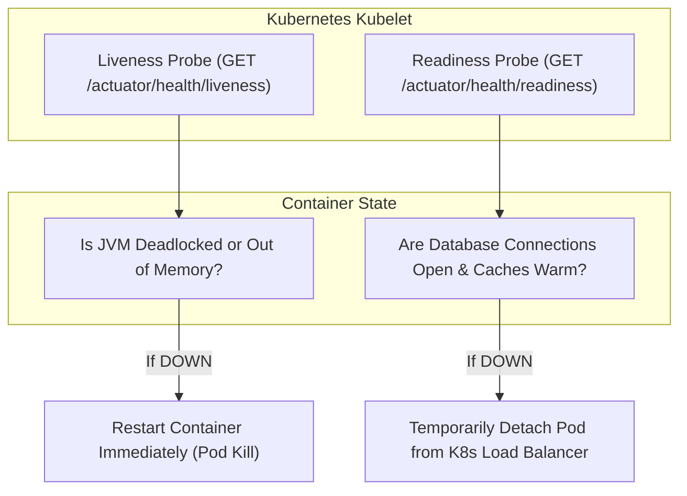

Running microservices in cloud environments (like Kubernetes or AWS ECS) requires comprehensive visibility into application runtime health, garbage collection overhead, thread pool saturation, and HTTP response latencies. **Spring Boot Actuator** combined with **Micrometer** provides a standardized, battle-tested observability engine.

---

## Overview
Spring Boot Actuator exposes production-ready operational endpoints (/actuator/health, /actuator/metrics) for monitoring application status, while Micrometer translates application dimensional metrics into Prometheus scrape formats.

---

---

## Architecture & Core Mechanics

### Spring Boot Actuator Architecture & Endpoints
Actuator exposes management endpoints grouped under the `/actuator` root context path:

| Endpoint | Purpose | Default State | Security Sensitivity |
| :--- | :--- | :---: | :---: |
| `/actuator/health` | Application status (`UP`, `DOWN`) and subsystem health indicators | Enabled | Low (summary) / High (details) |
| `/actuator/info` | Git commit hash, build timestamps, and application version | Enabled | Low |
| `/actuator/metrics` | Inventory of all dimensional metrics in JVM memory | Disabled | Medium |
| `/actuator/prometheus` | Prometheus-formatted text exposition scrape target | Disabled | Medium |
| `/actuator/loggers` | Inspect and dynamically mutate log levels at runtime | Disabled | High |
| `/actuator/threaddump`| Generates a full JVM thread stack dump for deadlock analysis | Disabled | High |
| `/actuator/env` | Active environment variables and configuration properties | Disabled | Critical (leaks secrets!) |
| `/actuator/heapdump` | Downloads a GZip compressed JVM memory heap dump | Disabled | Critical (contains passwords) |

### Kubernetes Probes: Liveness vs Readiness
Container orchestrators like Kubernetes rely on distinct health semantics to manage container lifecycles:



- **Liveness (`/actuator/health/liveness`):** Checks if the container's internal process is running and not deadlocked. If Liveness fails, Kubernetes forcefully terminates and restarts the pod. **Never check external dependencies (databases, third-party APIs) in the liveness probe!**
- **Readiness (`/actuator/health/readiness`):** Checks if the container is ready to accept incoming client network traffic. If the database is briefly unreachable during a failover, the pod marks itself unready. Kubernetes temporarily removes the pod from the Service routing pool without killing it.

### Micrometer Metric Primitives
Micrometer structures metrics using **dimensional tags** (key-value label pairs):

1. **`Counter`:** Monotonically increasing cumulative metric tracking event occurrences (e.g. `http_requests_total`, `orders_placed_total`). Can only increase or reset to zero on process restart.
2. **`Gauge`:** Instantaneous numerical snapshot of a fluctuating value (e.g. `jvm_memory_used_bytes`, `db_connection_pool_active_connections`).
3. **`Timer`:** Measures both event rate and execution latency distributions with percentiles ($p50, p95, p99$).
4. **`DistributionSummary`:** Tracks distribution of values not related to time (e.g. payload payload size in bytes, order cart item counts).

---

## Production Implementation

### Custom Spring Boot `HealthIndicator`
```java
package com.handbook.spring.actuator;

import org.springframework.boot.actuate.health.Health;
import org.springframework.boot.actuate.health.HealthIndicator;
import org.springframework.stereotype.Component;

import java.net.HttpURLConnection;
import java.net.URL;

@Component
public class PaymentGatewayHealthIndicator implements HealthIndicator {

    private static final String GATEWAY_HEALTH_URL = "https://payment-partner.internal/health";

    @Override
    public Health health() {
        try {
            long start = System.currentTimeMillis();
            URL url = new URL(GATEWAY_HEALTH_URL);
            HttpURLConnection conn = (HttpURLConnection) url.openConnection();
            conn.setConnectTimeout(1000);
            conn.setReadTimeout(1000);
            conn.setRequestMethod("HEAD");

            int responseCode = conn.getResponseCode();
            long latencyMs = System.currentTimeMillis() - start;

            if (responseCode == 200) {
                return Health.up()
                    .withDetail("gateway", "PayMaster API")
                    .withDetail("latencyMs", latencyMs)
                    .withDetail("status", "AVAILABLE")
                    .build();
            } else {
                return Health.down()
                    .withDetail("gateway", "PayMaster API")
                    .withDetail("httpCode", responseCode)
                    .withDetail("error", "Gateway returned non-200 status")
                    .build();
            }
        } catch (Exception ex) {
            return Health.down(ex)
                .withDetail("gateway", "PayMaster API")
                .withDetail("error", "Connection timeout to payment provider")
                .build();
        }
    }
}
```

### Production Business Metric Instrumentation with `MeterRegistry`
```java
package com.handbook.spring.service;

import io.micrometer.core.instrument.Counter;
import io.micrometer.core.instrument.MeterRegistry;
import io.micrometer.core.instrument.Timer;
import org.springframework.stereotype.Service;

import java.time.Duration;

@Service
public class OrderFulfillmentService {

    private final MeterRegistry registry;
    private final Timer fulfillmentTimer;

    public OrderFulfillmentService(MeterRegistry registry) {
        this.registry = registry;

        // SLA Timer publishing 95th and 99th percentiles
        this.fulfillmentTimer = Timer.builder("orders.fulfillment.duration")
            .description("Time taken to validate, charge, and fulfill customer order")
            .publishPercentileHistogram(true)
            .serviceLevelObjectives(Duration.ofMillis(200), Duration.ofMillis(500), Duration.ofSeconds(1))
            .register(registry);
    }

    public void processOrder(String paymentType, String customerTier, Runnable fulfillmentAction) {
        fulfillmentTimer.record(() -> {
            try {
                fulfillmentAction.run();

                // Increment success counter with dimensional tags
                Counter.builder("orders.fulfillment.status")
                    .tag("payment_type", paymentType)
                    .tag("tier", customerTier)
                    .tag("status", "SUCCESS")
                    .register(registry)
                    .increment();

            } catch (Exception ex) {
                Counter.builder("orders.fulfillment.status")
                    .tag("payment_type", paymentType)
                    .tag("tier", customerTier)
                    .tag("status", "FAILURE")
                    .tag("exception", ex.getClass().getSimpleName())
                    .register(registry)
                    .increment();
                throw ex;
            }
        });
    }
}
```

### Production `application.yml` Observability Configuration
```yaml
server:
  port: 8080 # Public application traffic port

management:
  server:
    # Isolate actuator to internal port not accessible from public internet load balancers
    port: 8081
  endpoints:
    web:
      exposure:
        # Expose only safe and necessary endpoints
        include: health,info,prometheus,metrics
  endpoint:
    health:
      show-details: when_authorized
      probes:
        enabled: true # Automatically generates /actuator/health/liveness & /readiness
    prometheus:
      enabled: true
  metrics:
    tags:
      # Common global tags appended to every single metric emitted by this container
      application: ${spring.application.name:order-service}
      environment: ${ENVIRONMENT:production}
      region: ${AWS_REGION:us-east-1}
    distribution:
      percentiles-histogram:
        http.server.requests: true
```

---

## Common Pitfalls & Traps

### Pitfall 1: High Cardinality Metric Tag Explosion (Prometheus Killer)
**The Disastrous Bug:**
```java
// CRITICAL ARCHITECTURAL FLAW:
Counter.builder("api.user.requests")
    .tag("userId", user.getId())      // 10 Million distinct user IDs!
    .tag("email", user.getEmail())    // 10 Million distinct emails!
    .register(registry).increment();
```
**Why it fails:** In Prometheus, every unique combination of key-value tag labels creates a brand-new **Time-Series Buffer** in RAM. Injecting high-cardinality values (user IDs, UUIDs, timestamps, email addresses) creates millions of unique metric series in the JVM heap, causing massive Garbage Collection pauses, crashing the Prometheus server with OutOfMemoryError, and taking down the entire monitoring infrastructure.
**The Fix:** Metric tags must have **finite, low cardinality** (e.g. `http_status: 200, 404, 500`, `region: us-east, eu-west`, `payment_method: card, paypal`). Store high-cardinality attributes in **distributed logs or traces**, never metric tags!

### Pitfall 2: Checking External Databases in Kubernetes Liveness Probes
**The Cascading Outage:** A developer adds database health checks to the Kubernetes Liveness probe (`/actuator/health/liveness`).
**What happens in production:** When the database experiences a temporary 10-second failover or network hiccup, all 50 microservice pods fail their liveness checks simultaneously. Kubernetes panics and terminates all 50 pods at the exact same instant! As all 50 containers reboot concurrently, they slam the recovering database with 50 simultaneous connection storms, causing a complete system-wide self-inflicted cascade outage.
**The Fix:** Liveness should **only verify internal container health** (JVM memory and thread locks). Put external dependency checks strictly in **Readiness Probes**, allowing pods to gracefully shed traffic while remaining alive.

### Pitfall 3: Exposing Actuator Directly to the Public Internet
**The Vulnerability:** Running `/actuator/env` on public port 8080 without Spring Security.
**Why it fails:** Attackers crawl for `/actuator/env` or `/actuator/heapdump`. Even with masked passwords (`******`), environment properties can leak internal Eureka/Consul addresses, cloud IAM metadata, and database connection strings.
**The Fix:** Run Actuator on an isolated internal port (`management.server.port=8081`), block port 8081 at the Kubernetes ingress controller, and enforce HTTP Basic or mTLS authentication.

---

## Best Practices Guide

| Practice | Recommendation | Architectural Justification |
| :--- | :--- | :--- |
| **Port Separation** | Use `management.server.port = 8081` | Physically prevents internet traffic from reaching management endpoints. |
| **Probe Responsibility** | Liveness = Process Only; Readiness = Dependencies | Prevents cascading container restarts during external service hiccups. |
| **Tag Cardinality** | Keep label permutations $< 100$ | Prevents JVM heap exhaustion and Prometheus scraper crashes. |
| **Scrape Frequency** | Scrape Prometheus every 15–30s | Balances real-time alerting responsiveness against scrape network and CPU overhead. |
| **Percentile Metrics** | Use `publishPercentileHistogram(true)` | Enables precise Grafana calculation of true p95 and p99 latencies using Prometheus `histogram_quantile()`. |

---

## Version Notes & Compatibility
- **Spring Boot 3.0+ & Micrometer 1.10+:** Integrated Micrometer Tracing (replacing legacy Spring Cloud Sleuth), unifying metrics, logs, and distributed traces under a single context propagation model.
- **Prometheus OpenMetrics Format:** Supported natively by `/actuator/prometheus`, enabling exemplar tracing linking metrics directly to Grafana Tempo traces.
- **Java 21 Virtual Threads Observability:** Micrometer tracks virtual thread executor queue depth and carrier thread pin counts.

---

## Summary Cheat Sheet

| Metric Type | Measurement Type | Monotonic? | Typical Example | Grafana Aggregation Query |
| :--- | :--- | :---: | :--- | :--- |
| **`Counter`** | Total count of events | Yes (up only) | `http_server_requests_total` | `rate(http_server_requests_total[5m])` |
| **`Gauge`** | Instantaneous value | No (up & down) | `jvm_memory_used_bytes` | `jvm_memory_used_bytes{area="heap"}` |
| **`Timer`** | Duration & event count | Latency | `orders_processing_duration` | `histogram_quantile(0.99, sum(rate(...)))` |
| **`DistributionSummary`** | Non-time values | Arbitrary | `cart_item_count` | `sum(rate(cart_item_count_sum[5m]))` |

---

## Verification & Architecture Demo

The executable architecture demo `examples/spring/ActuatorObservabilityDemo.java` implements:
- `DatabaseHealthIndicator` simulating Actuator `/actuator/health` response formatting.
- `MeterRegistrySimulator` tracking dimensional counters and gauges with sorted tags.
- Prometheus text format serializer exporting metrics for scrapers.

Compile and run the verified test:
```bash
javac -d examples/web/classes examples/spring/ActuatorObservabilityDemo.java
java -ea -cp examples/web/classes com.handbook.spring.ActuatorObservabilityDemo
```

---

## Hands-on Practice Exercises

### Exercise 1: Spot the Bug — Tag Cardinality Explosion
A developer introduces payment metrics in an eCommerce service:
```java
public void recordTransaction(String status, String orderId, double amount) {
    Counter.builder("payment.transactions")
        .tag("status", status)
        .tag("order_id", orderId) // E.g., "ORD-9823471092"
        .register(meterRegistry)
        .increment();
}
```
After 3 days in production under 100,000 orders per day, Prometheus stops scraping metrics, and the JVM crashes with `java.lang.OutOfMemoryError: Java heap space`. Identify the root cause and provide the production fix.

<details>
<summary>View Solution</summary>

**Cause:**
`order_id` is an unbounded, unique identifier. Adding `order_id` as a metric tag created over 300,000 unique `Meter` instances inside the `MeterRegistry` within 3 days. Each meter maintains internal atomic counters and tag maps in memory, exhausting the JVM heap and generating an un-scrapable 500 MB text response for Prometheus.

**The Fix:**
Remove high-cardinality tags from metrics. Use finite tags, and record specific order IDs inside structured logs:
```java
public void recordTransaction(String status, String orderId, double amount) {
    // Finite, low-cardinality tags only
    Counter.builder("payment.transactions")
        .tag("status", status)
        .register(meterRegistry)
        .increment();

    // High cardinality belongs in structured logs or distributed traces
    log.info("Transaction processed. OrderId={}, Status={}, Amount={}", orderId, status, amount);
}
```
</details>

---

### Exercise 2: Hands-on Implementation — Custom Disk Space HealthIndicator
Write a complete Spring Boot `DiskSpaceHealthIndicator` implementing `HealthIndicator` that:
1. Inspects the filesystem path `/data`.
2. Calculates the percentage of free disk space remaining.
3. If free space is greater than or equal to 15%, returns `Health.up()` with total, free, and threshold megabytes.
4. If free space falls below 15%, returns `Health.down()` with an alert status.

<details>
<summary>View Solution</summary>

```java
package com.handbook.spring.actuator;

import org.springframework.boot.actuate.health.Health;
import org.springframework.boot.actuate.health.HealthIndicator;
import org.springframework.stereotype.Component;

import java.io.File;

@Component
public class DiskSpaceHealthIndicator implements HealthIndicator {

    private static final String DATA_PATH = "/data";
    private static final double MIN_FREE_THRESHOLD_PERCENT = 15.0;

    @Override
    public Health health() {
        File partition = new File(DATA_PATH);
        if (!partition.exists()) {
            partition = new File("."); // Fallback to current working directory
        }

        long totalSpaceBytes = partition.getTotalSpace();
        long freeSpaceBytes = partition.getFreeSpace();

        if (totalSpaceBytes <= 0) {
            return Health.unknown().withDetail("error", "Partition unreadable").build();
        }

        double freePercent = ((double) freeSpaceBytes / totalSpaceBytes) * 100.0;
        long totalMB = totalSpaceBytes / (1024 * 1024);
        long freeMB = freeSpaceBytes / (1024 * 1024);

        Health.Builder builder = (freePercent >= MIN_FREE_THRESHOLD_PERCENT)
            ? Health.up()
            : Health.down();

        return builder
            .withDetail("path", partition.getAbsolutePath())
            .withDetail("totalSpaceMB", totalMB)
            .withDetail("freeSpaceMB", freeMB)
            .withDetail("freePercentage", String.format("%.2f%%", freePercent))
            .withDetail("minimumThresholdPercent", MIN_FREE_THRESHOLD_PERCENT)
            .build();
    }
}
```

**Verification & Expected Output:**
When queried via `GET /actuator/health`, Actuator outputs:
```json
{
  "status": "UP",
  "components": {
    "diskSpace": {
      "status": "UP",
      "details": {
        "path": "C:\\data",
        "totalSpaceMB": 476837,
        "freeSpaceMB": 128450,
        "freePercentage": "26.94%",
        "minimumThresholdPercent": 15.0
      }
    }
  }
}
```
</details>

---

### Exercise 3: Real-World Edge Case — Managing Separate Internal Actuator Ports in Kubernetes Ingress
<details>
<summary>View Solution</summary>
**Question:** In Kubernetes deployments, why is configuring `management.server.port=8081` considered an essential security defense-in-depth practice, and how do Kubernetes Ingress Controllers and Prometheus Scrape Configurations interact with this dual-port setup?

**Solution:**
1. **Network Boundary Segmentation:** By default, application APIs and Actuator share port 8080. If an ingress routing rule forwards all traffic matching `/` to the service, public internet users can accidentally access `/actuator/metrics` or `/actuator/health`. Setting `management.server.port=8081` forces Spring Boot to start two distinct embedded web server listeners on separate ports.
2. **Kubernetes Ingress Protection:** The Kubernetes `Service` and `Ingress` resource exposed to the external internet only exposes port 8080. External requests to `/actuator/*` return HTTP 404 because the public listener has zero management routes registered.
3. **Internal Prometheus & Kubelet Access:** Inside the internal VPC / Kubernetes cluster network, the Prometheus Operator and Kubelet target port 8081 directly using Pod annotations:
```yaml
metadata:
  annotations:
    prometheus.io/scrape: "true"
    prometheus.io/port: "8081"
    prometheus.io/path: "/actuator/prometheus"
```
This guarantees that operational telemetry is 100% accessible to internal monitoring agents while remaining physically unreachable from the public internet.
</details>

---

## Verified Official Sources & References
- [Spring Boot Actuator Production-Ready Features](https://docs.spring.io/spring-boot/reference/actuator/index.html)
- [Micrometer Documentation & Concept Guides](https://micrometer.io/docs/concepts)
- [Prometheus Exposition Formats Standard](https://prometheus.io/docs/instrumenting/exposition_formats/)
- [Kubernetes Pod Lifecycle: Liveness, Readiness, and Startup Probes](https://kubernetes.io/docs/tasks/configure-pod-container/configure-liveness-readiness-startup-probes/)

---

## Practice

### Q: Why should the `/actuator/env` and `/actuator/heapdump` endpoints be protected from public internet exposure in Spring Boot?
<details data-type="solution">
<summary>Reveal Answer</summary>

> **Answer:** Actuator endpoints expose deep internal system telemetry. Exposing `/env` can leak database credentials, API secrets, and encryption keys. Exposing `/heapdump` allows attackers to download complete JVM memory snapshots containing unencrypted passwords, personal user data, and active session tokens.
</details>
