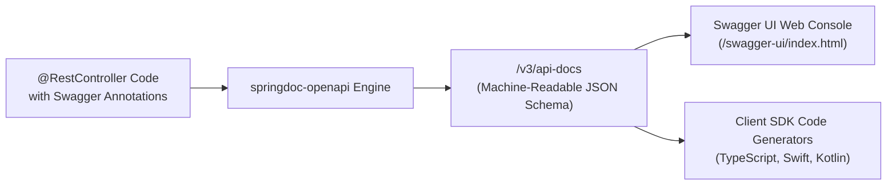

Maintaining manual API documentation (such as static markdown files, Postman collections, or Confluence pages) inevitably leads to **documentation drift**: backend developers alter controller request signatures or add validation constraints, but documentation remains outdated. **OpenAPI 3** and **Swagger UI** solve this by deriving interactive, machine-readable specifications directly from Spring Boot source code and annotations.

---

## Overview
Springdoc OpenAPI 3 inspects REST controllers and annotations at runtime to generate OpenAPI 3.0 specifications and interactive Swagger UI web consoles for live API exploration and documentation.

---

---

## Architecture & Core Mechanics

### The `springdoc-openapi` Architecture
Adding `springdoc-openapi-starter-webmvc-ui` to your Spring Boot project automatically hooks into the Spring DispatcherServlet:



### OpenAPI 3 Specification Document Structure
The generated `/v3/api-docs` JSON consists of standardized top-level keys:
- `openapi`: Specifies the specification version (e.g. `3.0.1`).
- `info`: Application title, description, version, and license.
- `servers`: Target environment URLs (e.g. `https://api.production.com/v1`).
- `paths`: The URI routes (`/api/v1/products`) mapped to HTTP verbs (`get`, `post`).
- `components.schemas`: Reusable data models derived from Java DTO classes.
- `components.securitySchemes`: Authentication protocols (e.g. JWT `BearerAuth`, OAuth2, API Keys).

### Core OpenAPI 3 Annotations
| Annotation | Placement | Purpose |
| :--- | :--- | :--- |
| `@Tag` | Class level | Groups related endpoints under a named category in Swagger UI |
| `@Operation` | Method level | Specifies endpoint `summary`, detailed `description`, and deprecation status |
| `@ApiResponse` | Method level | Documents expected HTTP status codes (`200`, `201`, `400`, `404`) and schemas |
| `@Parameter` | Parameter level | Documents query, path, or header parameters with examples and constraints |
| `@Schema` | Class / Field level | Defines data property descriptions, example values, and format hints |
| `@SecurityRequirement` | Class / Method level | Declares which security scheme (e.g. Bearer JWT) is required to call the API |

---

## Production Implementation

### Global OpenAPI Configuration with JWT Security Scheme
```java
package com.handbook.spring.config;

import io.swagger.v3.oas.models.Components;
import io.swagger.v3.oas.models.OpenAPI;
import io.swagger.v3.oas.models.info.Contact;
import io.swagger.v3.oas.models.info.Info;
import io.swagger.v3.oas.models.info.License;
import io.swagger.v3.oas.models.security.SecurityRequirement;
import io.swagger.v3.oas.models.security.SecurityScheme;
import io.swagger.v3.oas.models.servers.Server;
import org.springframework.context.annotation.Bean;
import org.springframework.context.annotation.Configuration;

import java.util.List;

@Configuration
public class OpenApiConfig {

    private static final String SECURITY_SCHEME_NAME = "BearerAuth";

    @Bean
    public OpenAPI customOpenAPI() {
        return new OpenAPI()
            .info(new Info()
                .title("Enterprise eCommerce Core API")
                .version("v1.2.0")
                .description("Production REST API supporting high-volume catalog search, ordering, and fulfillment.")
                .contact(new Contact().name("API Platform Team").email("platform@example.com"))
                .license(new License().name("Apache 2.0").url("https://www.apache.org/licenses/LICENSE-2.0")))
            .servers(List.of(
                new Server().url("https://api.production.internal").description("Production Cluster"),
                new Server().url("http://localhost:8080").description("Local Development")
            ))
            // Global JWT Bearer Authentication Definition
            .addSecurityItem(new SecurityRequirement().addList(SECURITY_SCHEME_NAME))
            .components(new Components()
                .addSecuritySchemes(SECURITY_SCHEME_NAME, new SecurityScheme()
                    .name(SECURITY_SCHEME_NAME)
                    .type(SecurityScheme.Type.HTTP)
                    .scheme("bearer")
                    .bearerFormat("JWT")
                    .description("Enter your JWT Bearer token to authorize requests")));
    }
}
```

### Documented DTO Record with `@Schema` Metadata
```java
package com.handbook.spring.dto;

import io.swagger.v3.oas.annotations.media.Schema;
import jakarta.validation.constraints.DecimalMin;
import jakarta.validation.constraints.NotBlank;
import jakarta.validation.constraints.NotNull;
import jakarta.validation.constraints.Pattern;

import java.math.BigDecimal;

@Schema(description = "Payload representing a new product creation request")
public record CreateProductRequest(

    @Schema(description = "Unique alphanumeric stock keeping unit", example = "ELEC-8842", requiredMode = Schema.RequiredMode.REQUIRED)
    @NotBlank
    @Pattern(regexp = "^[A-Z]{4}-[0-9]{4}$", message = "SKU must match format ABCD-1234")
    String sku,

    @Schema(description = "Public customer-facing product title", example = "Noise-Cancelling Wireless Headphones")
    @NotBlank
    String title,

    @Schema(description = "Unit price in US Dollars", example = "199.99", minimum = "0.01")
    @NotNull
    @DecimalMin("0.01")
    BigDecimal price,

    @Schema(description = "Category taxonomy code", example = "ELECTRONICS")
    @NotBlank
    String category
) {}
```

### Fully-Enriched Production REST Controller
```java
package com.handbook.spring.controller;

import com.handbook.spring.dto.CreateProductRequest;
import com.handbook.spring.dto.ProductResponse;
import com.handbook.spring.service.ProductService;
import io.swagger.v3.oas.annotations.Operation;
import io.swagger.v3.oas.annotations.Parameter;
import io.swagger.v3.oas.annotations.media.Content;
import io.swagger.v3.oas.annotations.media.Schema;
import io.swagger.v3.oas.annotations.responses.ApiResponse;
import io.swagger.v3.oas.annotations.responses.ApiResponses;
import io.swagger.v3.oas.annotations.tags.Tag;
import jakarta.validation.Valid;
import org.springframework.http.ProblemDetail;
import org.springframework.http.ResponseEntity;
import org.springframework.web.bind.annotation.*;
import org.springframework.web.util.UriComponentsBuilder;

import java.net.URI;

@RestController
@RequestMapping("/api/v1/products")
@Tag(name = "Product Catalog", description = "Endpoints for searching, creating, and modifying catalog inventory")
public class ProductController {

    private final ProductService productService;

    public ProductController(ProductService productService) {
        this.productService = productService;
    }

    @Operation(
        summary = "Create a new catalog product",
        description = "Persists a new product item into inventory. Rejects duplicate SKU codes."
    )
    @ApiResponses({
        @ApiResponse(
            responseCode = "201",
            description = "Product created successfully",
            content = @Content(schema = @Schema(implementation = ProductResponse.class))
        ),
        @ApiResponse(
            responseCode = "400",
            description = "Invalid payload constraints (Bean Validation violation)",
            content = @Content(schema = @Schema(implementation = ProblemDetail.class))
        ),
        @ApiResponse(
            responseCode = "409",
            description = "Duplicate SKU conflict",
            content = @Content(schema = @Schema(implementation = ProblemDetail.class))
        )
    })
    @PostMapping
    public ResponseEntity<ProductResponse> createProduct(
        @Valid @RequestBody CreateProductRequest request,
        UriComponentsBuilder ucb
    ) {
        ProductResponse created = productService.createProduct(request);
        URI location = ucb.path("/api/v1/products/{id}").buildAndExpand(created.id()).toUri();
        return ResponseEntity.created(location).body(created);
    }

    @Operation(summary = "Fetch product by database identifier")
    @ApiResponses({
        @ApiResponse(responseCode = "200", description = "Product found"),
        @ApiResponse(responseCode = "404", description = "Product identifier not found in catalog")
    })
    @GetMapping("/{id}")
    public ResponseEntity<ProductResponse> getById(
        @Parameter(description = "Primary numeric database identifier", example = "42")
        @PathVariable Long id
    ) {
        return ResponseEntity.ok(productService.findById(id));
    }
}
```

---

## Common Pitfalls & Traps

### Pitfall 1: Undocumented Error Responses (The "Happy Path Only" Fallacy)
**The Flaw:** Documenting only `200 OK` on every endpoint, omitting error scenarios.
**Why it fails:** Frontend and mobile clients generate SDKs that expect successful payloads. When the backend returns an undocumented `400 Bad Request` or `409 Conflict` containing an RFC 7807 `ProblemDetail` JSON body, client deserializers crash because the schema was never declared.
**The Fix:** Always document standard client and server error responses (`400`, `401`, `403`, `404`, `409`, `500`) with appropriate error schema references.

### Pitfall 2: Missing SecurityScheme Leading to Unusable "Try It Out" Console
**The Flaw:** Adding `@SecurityRequirement` to endpoints without registering the matching `SecurityScheme` bean in the `OpenAPI` configuration.
**What happens in Swagger UI:** The "Authorize" padlock button does not appear in the web browser, or clicking "Try it out" sends raw HTTP requests without the `Authorization: Bearer <token>` header, causing all requests to fail with HTTP 401 Unauthorized.
**The Fix:** Register a global `SecurityScheme` of type `HTTP` with scheme `bearer` and bearer format `JWT` as shown in Section 4.1.

### Pitfall 3: Duplicate Schema Name Collisions Across Packages
**The Flaw:** Having `com.example.admin.OrderDto` and `com.example.customer.OrderDto`.
**Why it fails:** By default, Swagger UI derives the schema name from the simple class name (`OrderDto`). The second class silently overwrites the schema definition of the first class in `/v3/api-docs`, leading to corrupted property definitions.
**The Fix:** Use unique class names, or configure `springdoc.use-fqn=true` in `application.yml` to use fully-qualified class names.

---

## Best Practices Guide

| Practice | Recommendation | Architectural Justification |
| :--- | :--- | :--- |
| **Realistic Examples** | Use realistic `@Schema(example = "...")` | Allows frontend teams to mock payloads accurately without guessing valid formats. |
| **Production Disabling** | Disable Swagger UI in public production | Setting `springdoc.swagger-ui.enabled=false` prevents exposing internal API surface to attackers. |
| **Tag Categorization** | Group by business domain with `@Tag` | Keeps large microservices with 50+ endpoints organized into clean navigation sections. |
| **Client Code Generation** | Integrate `openapi-generator-cli` in CI/CD | Automatically synchronizes TypeScript and mobile API client code on every backend commit. |
| **RFC 7807 Standardization** | Document `ProblemDetail` schemas for errors | Guarantees consistent error structures across all HTTP status codes. |

---

## Version Notes & Compatibility
- **Springfox vs Springdoc:** `Springfox` is obsolete and abandoned. All modern Spring Boot 3 applications strictly use `springdoc-openapi-starter-webmvc-ui`.
- **OpenAPI 3.1 Support:** `springdoc-openapi 2.2+` supports both OpenAPI 3.0 and 3.1 JSON Schema dialects.
- **Spring Boot 3 Jakarta Namespace:** Seamless integration with `jakarta.validation` annotations and Java 21 Records.

---

## Summary Cheat Sheet

| Requirement | Annotation | Generated OpenAPI Location |
| :--- | :--- | :--- |
| **Group Controller** | `@Tag(name = "Orders")` | `tags: [{ name: "Orders" }]` |
| **Endpoint Summary** | `@Operation(summary = "...")` | `paths./api/v1/orders.post.summary` |
| **Status Code Doc** | `@ApiResponse(responseCode = "201")` | `paths./api/v1/orders.post.responses.201` |
| **Path / Query Parameter** | `@Parameter(description = "...")` | `paths./api/v1/orders.get.parameters` |
| **Field Example & Range** | `@Schema(example = "100.00")` | `components.schemas.OrderDto.properties` |
| **JWT Authorization Lock** | `@SecurityRequirement(name = "...")` | `paths./api/v1/orders.security` |

---

## Verification & Architecture Demo

The executable architecture demo `examples/spring/OpenApiSwaggerDemo.java` implements:
- `OpenApiSpecification` generating standard OpenAPI 3.0.1 compliant JSON schemas.
- `OpenApiEndpoint` modeling paths, HTTP verbs, summaries, and responses (200, 201, 400, 404).
- Contract verification matching `/v3/api-docs` and `/swagger-ui/index.html` semantics.

Compile and run the verified test:
```bash
javac -d examples/web/classes examples/spring/OpenApiSwaggerDemo.java
java -ea -cp examples/web/classes com.handbook.spring.OpenApiSwaggerDemo
```

---

## Hands-on Practice Exercises

### Exercise 1: Spot the Bug — Missing Security Requirement in Swagger Console
A developer configures the following controller:
```java
@RestController
@RequestMapping("/api/v1/admin/reports")
public class AdminReportController {

    @GetMapping
    @PreAuthorize("hasRole('ADMIN')")
    public ResponseEntity<ReportDto> generateReport() {
        return ResponseEntity.ok(reportService.generate());
    }
}
```
In Swagger UI, the developer clicks the global "Authorize" button, pastes a valid JWT, and clicks "Execute". However, the request immediately fails with HTTP 403 / 401. Why did the Swagger UI console fail to send the JWT header?

<details>
<summary>View Solution</summary>

**Cause:**
Declaring a global `SecurityScheme` registers the capability in Swagger UI, but unless the controller or method specifies `@SecurityRequirement(name = "BearerAuth")`, springdoc does not attach the security requirement to the generated endpoint schema in `/v3/api-docs`. Swagger UI assumes the endpoint is public and strips the `Authorization` header during execution.

**The Fix:**
Decorate the controller or method with `@SecurityRequirement`:
```java
@RestController
@RequestMapping("/api/v1/admin/reports")
@SecurityRequirement(name = "BearerAuth")
public class AdminReportController {
    // Endpoints now automatically send the Authorization: Bearer <token> header in Swagger UI
}
```
</details>

---

### Exercise 2: Hands-on Implementation — Global OpenAPI Configuration Bean
Write a complete Spring `@Configuration` class named `SwaggerDocumentationConfig` that:
1. Provides API metadata: Title `"Fintech Settlement Gateway"`, Version `"2.0"`, Description `"Core financial ledger API"`.
2. Registers two server target environments: `https://api.fintech.prod` (Production) and `http://localhost:8080` (Local Sandbox).
3. Defines an HTTP Bearer JWT security scheme named `"FintechJwtAuth"`.

<details>
<summary>View Solution</summary>

```java
package com.handbook.spring.config;

import io.swagger.v3.oas.models.Components;
import io.swagger.v3.oas.models.OpenAPI;
import io.swagger.v3.oas.models.info.Info;
import io.swagger.v3.oas.models.security.SecurityRequirement;
import io.swagger.v3.oas.models.security.SecurityScheme;
import io.swagger.v3.oas.models.servers.Server;
import org.springframework.context.annotation.Bean;
import org.springframework.context.annotation.Configuration;

import java.util.List;

@Configuration
public class SwaggerDocumentationConfig {

    private static final String SCHEME_NAME = "FintechJwtAuth";

    @Bean
    public OpenAPI settlementOpenAPI() {
        return new OpenAPI()
            .info(new Info()
                .title("Fintech Settlement Gateway")
                .version("2.0")
                .description("Core financial ledger API supporting real-time cross-border settlements."))
            .servers(List.of(
                new Server().url("https://api.fintech.prod").description("Production"),
                new Server().url("http://localhost:8080").description("Local Sandbox")
            ))
            .addSecurityItem(new SecurityRequirement().addList(SCHEME_NAME))
            .components(new Components()
                .addSecuritySchemes(SCHEME_NAME, new SecurityScheme()
                    .name(SCHEME_NAME)
                    .type(SecurityScheme.Type.HTTP)
                    .scheme("bearer")
                    .bearerFormat("JWT")
                    .description("Provide valid RSA-signed JWT")));
    }
}
```

**Verification & Expected Output:**
When visiting `http://localhost:8080/v3/api-docs`:
The JSON output contains:
```json
{
  "openapi": "3.0.1",
  "info": { "title": "Fintech Settlement Gateway", "version": "2.0" },
  "servers": [
    { "url": "https://api.fintech.prod", "description": "Production" },
    { "url": "http://localhost:8080", "description": "Local Sandbox" }
  ],
  "components": {
    "securitySchemes": {
      "FintechJwtAuth": { "type": "http", "scheme": "bearer", "bearerFormat": "JWT" }
    }
  }
}
```
</details>

---

### Exercise 3: Real-World Edge Case — Automated Client SDK Generation & Breaking Change Detection
<details>
<summary>View Solution</summary>
**Question:** In microservice ecosystems, when backend engineers modify a REST API response (e.g., removing a field, renaming a property, or changing an integer to a string), how do CI/CD pipelines use the generated `/v3/api-docs` schema to automatically detect breaking contract changes before deploying to production?

**Solution:**
1. **Automated SDK Generation:** During build time, tools like `openapi-generator-cli` download `/v3/api-docs` and synthesize strongly-typed client libraries:
   ```bash
   npx @openapitools/openapi-generator-cli generate \
     -i http://localhost:8080/v3/api-docs \
     -g typescript-axios \
     -o ./frontend-sdk
   ```
2. **Schema Diffing & Breaking Change Gates:** In the CI/CD pipeline, the build compares the newly generated OpenAPI schema against the currently running production schema using `openapi-diff`:
   ```bash
   openapi-diff --fail-on-incompatible production-schema.json new-schema.json
   ```
   If any breaking change is detected (such as deleting an existing field, changing an existing property type, or adding a new non-optional request parameter), the CI build immediately fails with a detailed compatibility report, preventing breaking deployments from reaching production clients.
</details>

---

## Verified Official Sources & References
- [OpenAPI Specification v3.0.3 Official Standard](https://spec.openapis.org/oas/v3.0.3)
- [Springdoc-OpenAPI Official Guide](https://springdoc.org/)
- [Swagger UI Official Documentation](https://swagger.io/tools/swagger-ui/)

---

## Practice

### Q: How does `springdoc-openapi` generate interactive API documentation without requiring manual YAML synchronization?
<details data-type="solution">
<summary>Reveal Answer</summary>

> **Answer:** `springdoc-openapi` examines Spring Web MVC controller mappings (`@GetMapping`, `@PostMapping`), parameter annotations (`@PathVariable`, `@RequestBody`), and Bean Validation constraints at runtime via reflection, automatically generating compliant OpenAPI 3 JSON specifications and rendering the interactive Swagger UI dynamically.
</details>
