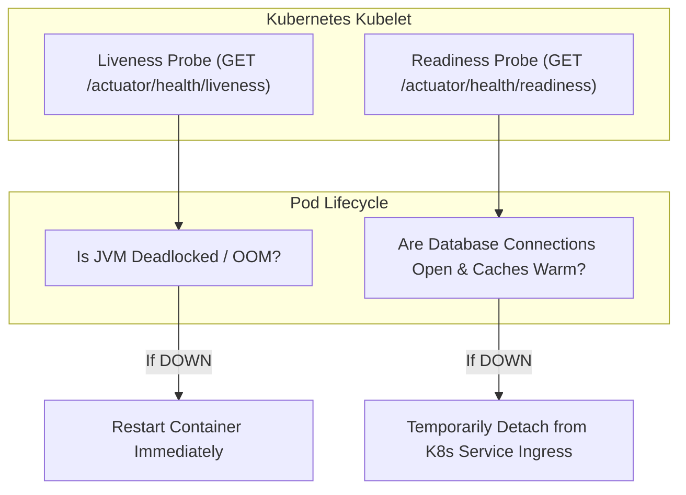

# Production Observability: Spring Boot Actuator, Micrometer & Prometheus

Running microservices in cloud environments (like Kubernetes or AWS ECS) requires comprehensive visibility into application runtime health, garbage collection overhead, thread pool saturation, and HTTP response latencies. **Spring Boot Actuator** combined with **Micrometer** provides a standardized, battle-tested observability engine.

---

## 1. Spring Boot Actuator Endpoints

Actuator automatically provides management endpoints over HTTP or JMX:

| Endpoint | Purpose | Default State |
| :--- | :--- | :--- |
| `/actuator/health` | Application status (`UP`, `DOWN`) and subsystem health indicators | Enabled (restricted summary) |
| `/actuator/info` | Git commit metadata, build timestamps, and application version | Enabled |
| `/actuator/metrics` | Inventory of all dimensional metrics in JVM memory | Disabled by default |
| `/actuator/prometheus` | Prometheus-formatted metrics scrape target | Disabled by default |
| `/actuator/env` | Active configuration properties and environment variables | Disabled (sensitive) |

Exposing management endpoints securely in `application.yml`:
```yaml
management:
  endpoints:
    web:
      exposure:
        include: health,info,prometheus,metrics
  endpoint:
    health:
      show-details: when_authorized
      probes:
        enabled: true # Enables /actuator/health/liveness and /actuator/health/readiness
```

---

## 2. Kubernetes Probes: Liveness vs Readiness



---

## 3. Micrometer: Dimensional Metrics & Prometheus

Micrometer structures metrics using **dimensional tags** (key-value pairs), allowing DevOps teams to slice and aggregate metrics dynamically in Grafana:

```java
@Service
public class OrderProcessingService {

    private final Counter orderCounter;
    private final Timer orderProcessingTimer;

    public OrderProcessingService(MeterRegistry registry) {
        this.orderCounter = Counter.builder("orders.placed.total")
            .description("Total placed orders")
            .tag("channel", "mobile")
            .tag("region", "us-east")
            .register(registry);

        this.orderProcessingTimer = Timer.builder("orders.processing.duration")
            .publishPercentiles(0.5, 0.95, 0.99)
            .register(registry);
    }

    public void processOrder(Order order) {
        orderProcessingTimer.record(() -> {
            // Business logic
            orderCounter.increment();
        });
    }
}
```

---

## 4. Verification & Architecture Demo

The executable architecture demo `examples/spring/ActuatorObservabilityDemo.java` implements:
- `DatabaseHealthIndicator` simulating Actuator `/actuator/health` response formatting.
- `MeterRegistrySimulator` tracking dimensional counters and gauges with sorted tags.
- Prometheus text format serializer exporting metrics for scrapers.

Compile and run the verified test:
```bash
javac -d examples/web/classes examples/spring/ActuatorObservabilityDemo.java
java -ea -cp examples/web/classes com.handbook.spring.ActuatorObservabilityDemo
```
