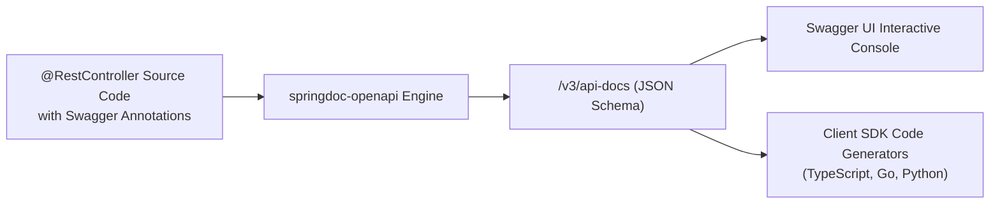

# Automated Interactive API Documentation with OpenAPI 3 & Swagger UI

Maintaining manual API documentation (such as Postman collections or static Confluence pages) inevitably leads to documentation drift as backend code evolves. **OpenAPI 3** and **Swagger UI** solve this by deriving interactive, machine-readable specifications directly from Spring Boot source code and annotations.

---

## 1. The `springdoc-openapi` Architecture

Adding `springdoc-openapi-starter-webmvc-ui` to your Spring Boot project automatically exposes two primary endpoints:
- `/v3/api-docs`: The machine-readable OpenAPI 3.0 specification in JSON format.
- `/swagger-ui/index.html`: The human-readable interactive documentation UI.



---

## 2. Declarative OpenAPI Annotations

While Spring MVC annotations (`@GetMapping`, `@RequestParam`, `@Valid`) provide baseline metadata, OpenAPI annotations enrich contracts with semantic documentation:

```java
@RestController
@RequestMapping("/api/v1/customers")
@Tag(name = "Customer Management", description = "Operations for onboarding and managing banking accounts")
public class CustomerController {

    @Operation(
        summary = "Retrieve customer profile by ID",
        description = "Fetches complete customer details. Requires active bearer token."
    )
    @ApiResponses({
        @ApiResponse(responseCode = "200", description = "Customer profile retrieved successfully",
            content = @Content(schema = @Schema(implementation = CustomerDto.class))),
        @ApiResponse(responseCode = "404", description = "Customer not found (RFC 7807 ProblemDetail)")
    })
    @GetMapping("/{id}")
    public ResponseEntity<CustomerDto> getById(
        @Parameter(description = "Customer unique ID", example = "CUST-1001")
        @PathVariable String id
    ) {
        return ResponseEntity.ok(service.findById(id));
    }
}
```

---

## 3. Automated Client Code Generation

Because the `/v3/api-docs` JSON endpoint produces an exact schema definition of all inputs, outputs, and validation rules, frontend and mobile engineering teams can run code generators (like `openapi-generator-cli`) to generate fully-typed TypeScript, Kotlin, or Swift client SDKs automatically during CI/CD builds.

---

## 4. Verification & Architecture Demo

The executable architecture demo `examples/spring/OpenApiSwaggerDemo.java` implements:
- `OpenApiSpecification` generating standard OpenAPI 3.0.1 compliant JSON schemas.
- `OpenApiEndpoint` modeling paths, HTTP verbs, summaries, and responses (200, 201, 400, 404).
- Contract verification matching `/v3/api-docs` and `/swagger-ui/index.html` semantics.

Compile and run the verified test:
```bash
javac -d examples/web/classes examples/spring/OpenApiSwaggerDemo.java
java -ea -cp examples/web/classes com.handbook.spring.OpenApiSwaggerDemo
```
