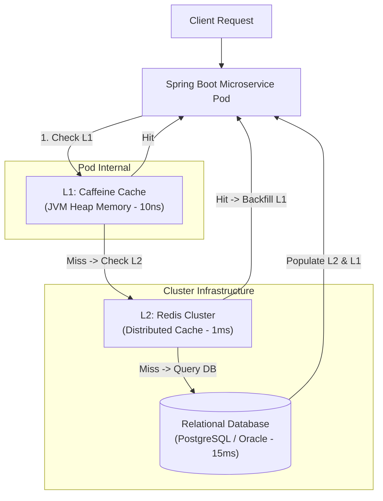

In high-throughput microservices, disk I/O and relational database query latencies frequently bottleneck application performance. By implementing a multi-tiered caching architecture, systems achieve sub-millisecond response times while reducing database read pressure by over 95%.

---

## Overview
Spring Cache abstraction provides declarative caching via @Cacheable, @CachePut, and @CacheEvict. Multi-tier architectures combine in-memory Caffeine L1 caches with distributed Redis L2 caches to optimize read performance and prevent cache stampedes.

---

---

## Architecture & Core Mechanics

### Multi-Tiered Caching Architecture Flow



### Spring Cache Abstraction Annotations
Spring provides declarative caching via Spring AOP proxies enabled by `@EnableCaching`:

| Annotation | Behavior | Typical Usage |
| :--- | :--- | :--- |
| `@Cacheable` | Checks cache first; if present, returns value immediately; if missing, invokes method and stores result | Read operations (`findById`) |
| `@CachePut` | Always executes the underlying method and updates the cache with the returned result | Update operations (`save`, `update`) |
| `@CacheEvict` | Removes one or all entries from the specified cache | Deletion operations (`deleteById`) |
| `@Caching` | Combines multiple cache operations on a single method | Complex updates invalidating multiple caches |

### Spring Expression Language (SpEL) Cache Keys
- `#id`: Resolves the method parameter named `id`.
- `#root.methodName`: The name of the executing method.
- `#result`: The returned object instance (usable in `unless = "#result == null"`).
- `condition = "#price > 100"`: Only caches if the condition evaluates to `true`.
- `sync = true`: Thread synchronization lock preventing cache stampede.

---

## Production Implementation

### Production Redis Configuration with JSON Serialization
```java
package com.handbook.spring.config;

import com.fasterxml.jackson.databind.ObjectMapper;
import com.fasterxml.jackson.datatype.jsr310.JavaTimeModule;
import org.springframework.cache.annotation.EnableCaching;
import org.springframework.context.annotation.Bean;
import org.springframework.context.annotation.Configuration;
import org.springframework.data.redis.cache.RedisCacheConfiguration;
import org.springframework.data.redis.cache.RedisCacheManager;
import org.springframework.data.redis.connection.RedisConnectionFactory;
import org.springframework.data.redis.serializer.GenericJackson2JsonRedisSerializer;
import org.springframework.data.redis.serializer.RedisSerializationContext;
import org.springframework.data.redis.serializer.StringRedisSerializer;

import java.time.Duration;
import java.util.HashMap;
import java.util.Map;

@Configuration
@EnableCaching
public class DistributedCacheConfig {

    @Bean
    public RedisCacheManager cacheManager(RedisConnectionFactory connectionFactory) {
        ObjectMapper mapper = new ObjectMapper();
        mapper.registerModule(new JavaTimeModule());

        // Default configuration for all caches
        RedisCacheConfiguration defaultConfig = RedisCacheConfiguration.defaultCacheConfig()
            .entryTtl(Duration.ofMinutes(30))
            .disableCachingNullValues()
            .serializeKeysWith(RedisSerializationContext.SerializationPair.fromSerializer(new StringRedisSerializer()))
            .serializeValuesWith(RedisSerializationContext.SerializationPair.fromSerializer(
                new GenericJackson2JsonRedisSerializer(mapper)
            ));

        // Custom TTL per specific cache region
        Map<String, RedisCacheConfiguration> cacheConfigurations = new HashMap<>();
        cacheConfigurations.put("products", defaultConfig.entryTtl(Duration.ofHours(2)));
        cacheConfigurations.put("exchangeRates", defaultConfig.entryTtl(Duration.ofMinutes(5)));
        cacheConfigurations.put("userSessions", defaultConfig.entryTtl(Duration.ofMinutes(15)));

        return RedisCacheManager.builder(connectionFactory)
            .cacheDefaults(defaultConfig)
            .withInitialCacheConfigurations(cacheConfigurations)
            .build();
    }
}
```

### Production Catalog Service with Caching and Stampede Lock
```java
package com.handbook.spring.service;

import com.handbook.spring.dto.ProductDto;
import com.handbook.spring.repository.ProductRepository;
import org.slf4j.Logger;
import org.slf4j.LoggerFactory;
import org.springframework.cache.annotation.CacheEvict;
import org.springframework.cache.annotation.CachePut;
import org.springframework.cache.annotation.Cacheable;
import org.springframework.stereotype.Service;
import org.springframework.transaction.annotation.Transactional;

@Service
public class ProductCatalogService {

    private static final Logger log = LoggerFactory.getLogger(ProductCatalogService.class);
    private final ProductRepository productRepository;

    public ProductCatalogService(ProductRepository productRepository) {
        this.productRepository = productRepository;
    }

    // sync = true prevents cache stampede by synchronizing concurrent callers on the key
    @Cacheable(value = "products", key = "#sku", sync = true, unless = "#result == null")
    public ProductDto getProductBySku(String sku) {
        log.info("Cache miss for SKU: [{}]. Fetching from relational database...", sku);
        return productRepository.findBySku(sku)
            .map(entity -> new ProductDto(entity.getId(), entity.getSku(), entity.getTitle(), entity.getPrice()))
            .orElse(null);
    }

    @Transactional
    @CachePut(value = "products", key = "#dto.sku()")
    public ProductDto updateProduct(ProductDto dto) {
        log.info("Updating product in DB and refreshing cache for SKU: [{}]", dto.sku());
        productRepository.updatePrice(dto.sku(), dto.price());
        return dto;
    }

    @Transactional
    @CacheEvict(value = "products", key = "#sku")
    public void deleteProduct(String sku) {
        log.info("Evicting product from cache and deleting from DB for SKU: [{}]", sku);
        productRepository.deleteBySku(sku);
    }

    // Bulk invalidation
    @CacheEvict(value = "products", allEntries = true)
    public void evictEntireProductCatalog() {
        log.warn("Clearing entire 'products' cache region!");
    }
}
```

---

## Common Pitfalls & Traps

### Pitfall 1: Internal Self-Invocation Bypassing the AOP Cache Proxy
**The Bug:**
```java
@Service
public class CatalogService {
    public ProductDto getCatalogItem(String sku) {
        // Calling another method in the SAME class instance
        return this.getProductBySku(sku);
    }

    @Cacheable(value = "products", key = "#sku")
    public ProductDto getProductBySku(String sku) {
        return database.query(sku); // Cache is NEVER touched!
    }
}
```
**Why it fails:** Spring's `@Cacheable` operates via an AOP dynamic proxy. Calling `this.getProductBySku(sku)` invokes the method directly on the raw Java instance, completely bypassing the Spring cache interceptor! Every request hits the database.
**The Fix:** Invoke the cached method through an external collaborating service bean, or inject the self-proxy bean.

### Pitfall 2: Java Default Serialization Hell in Redis
**The Hazard:** Using Spring's default `JdkSerializationRedisSerializer`.
**Why it fails:** Java binary serialization serializes the compiled class `serialVersionUID`. When you deploy an updated microservice version with an added field, Redis fails with `InvalidClassException: local class incompatible` when reading existing cache entries, crashing all customer requests. Furthermore, binary blobs cannot be inspected or debugged in Redis CLI.
**The Fix:** Always configure **`GenericJackson2JsonRedisSerializer`**. JSON is human-readable, language-agnostic, and resilient to additive field changes.

### Pitfall 3: Cache Stampede (The Thundering Herd Disaster)
**The Scenario:** A popular product (`SKU-SUPERBOWL`) is viewed 5,000 times per second. Its cache entry expires at 12:00:00.
**What happens:** At 12:00:01, 5,000 concurrent threads detect a cache miss simultaneously. All 5,000 threads execute the exact same database query at the exact same millisecond, locking tables and crashing the database engine.
**The Fix:** Use `@Cacheable(sync = true)`. Spring locks concurrent requests for the same key so only **one thread** queries the database while the remaining 4,999 threads wait and consume the cached value.

### Pitfall 4: Cache Avalanche on Fixed TTL Expiration
**The Hazard:** Setting a flat `TTL = 1 hour` for all 500,000 catalog items during a morning batch load.
**What happens:** Exactly 60 minutes later, all 500,000 cache keys expire at the exact same second, causing a catastrophic "avalanche" of database traffic.
**The Fix:** Add **TTL Jitter** (randomness): `TTL = baseTTL + random(0, 300) seconds`, distributing expiration smoothly across time.

---

## Best Practices Guide

| Practice | Recommendation | Architectural Justification |
| :--- | :--- | :--- |
| **Mandatory TTL** | Always set Time-To-Live on every cache | Prevents stale data accumulation and infinite Redis memory exhaustion. |
| **JSON Serialization** | Use `GenericJackson2JsonRedisSerializer` | Resilient to microservice redeployments; inspectable in Redis CLI. |
| **Stampede Lock** | Set `sync = true` on hot read endpoints | Protects databases from concurrent thundering herd queries on key expiration. |
| **Negative Caching** | Cache nulls with short TTL (e.g. 60s) | Defends against Cache Penetration attacks querying non-existent IDs. |
| **W-TinyLFU Algorithm** | Choose Caffeine for L1 caching | Outperforms traditional LRU algorithms by tracking both recency and frequency. |

---

## Version Notes & Compatibility
- **Caffeine 3.x:** Modern high-performance in-memory caching engine using the Window-TinyLFU algorithm (successor to Google Guava cache).
- **Spring Boot 3.x & Spring Data Redis 3.x:** Native integration with Jakarta EE and Java 21 Records.
- **Redis 7.x:** Enhanced cluster failover, active memory defragmentation, and function scripting.

---

## Summary Cheat Sheet

| Feature | L1 Cache (Caffeine) | L2 Cache (Redis) |
| :--- | :--- | :--- |
| **Storage Location** | JVM Heap Memory | Dedicated Remote In-Memory Cluster |
| **Access Latency** | $\sim 10\text{ nanoseconds}$ | $\sim 1\text{--}2\text{ milliseconds}$ |
| **Network Overhead** | Zero (in-process memory) | TCP / Socket Network Call |
| **Scope** | Single Pod / Process | Shared across entire Microservice Cluster |
| **Pod Restart Behavior** | Cache wipes completely | Cache persists across container reboots |
| **Eviction Policy** | Window TinyLFU, Size, Time | Volatile-LRU, Allkeys-LRU, TTL |

---

## Verification & Architecture Demo

The executable architecture demo `examples/spring/DistributedCachingDemo.java` implements:
- `MultiTierCacheManager` managing L1 Caffeine and L2 Redis simulation.
- Cold cache loading (database query increment).
- Warm cache hits (L1 hit counter).
- Pod restart simulation (L1 miss -> L2 Redis hit backfilling L1).
- Complete cache eviction across both tiers.

Compile and run the verified test:
```bash
javac -d examples/web/classes examples/spring/DistributedCachingDemo.java
java -ea -cp examples/web/classes com.handbook.spring.DistributedCachingDemo
```

---

## Hands-on Practice Exercises

### Exercise 1: Spot the Bug — Internal Class Self-Invocation
Review the following service implementation:
```java
@Service
public class OrderService {

    @Autowired
    private OrderRepository orderRepository;

    public OrderDto getOrderSummary(Long id) {
        // Internal call
        return fetchFromDatabaseWithCache(id);
    }

    @Cacheable(value = "orders", key = "#id")
    public OrderDto fetchFromDatabaseWithCache(Long id) {
        return orderRepository.findById(id).map(this::toDto).orElseThrow();
    }
}
```
When monitoring metrics, why does every call to `getOrderSummary(101L)` hit the database, completely ignoring the `@Cacheable` annotation?

<details>
<summary>View Solution</summary>

**Cause:**
Spring's `@Cacheable` annotation is implemented using Spring AOP (Dynamic JDK or CGLIB Proxies). When an external controller invokes `orderService.getOrderSummary(id)`, the call passes through the proxy. However, inside `getOrderSummary`, calling `fetchFromDatabaseWithCache(id)` is executed as `this.fetchFromDatabaseWithCache(id)` on the underlying unproxied Java instance. Because the AOP proxy wrapper is bypassed, the Spring Cache Interceptor never runs, and caching is completely circumvented.

**The Fix:**
1. Annotate the entry-point method `getOrderSummary(id)` directly with `@Cacheable(value = "orders", key = "#id")`.
2. Or move `fetchFromDatabaseWithCache` into a dedicated repository/collaborator service bean so the call crosses a Spring bean boundary.
</details>

---

### Exercise 2: Hands-on Implementation — Multi-TTL RedisCacheManager
Write a Spring `@Configuration` class named `CustomRedisCacheConfig` that:
1. Enables caching via `@EnableCaching`.
2. Uses `GenericJackson2JsonRedisSerializer` for object values and `StringRedisSerializer` for keys.
3. Configures a default TTL of 10 minutes.
4. Customizes specific TTLs:
   - `"product_catalog"`: 6 hours
   - `"exchange_rates"`: 2 minutes

<details>
<summary>View Solution</summary>

```java
package com.handbook.spring.config;

import org.springframework.cache.annotation.EnableCaching;
import org.springframework.context.annotation.Bean;
import org.springframework.context.annotation.Configuration;
import org.springframework.data.redis.cache.RedisCacheConfiguration;
import org.springframework.data.redis.cache.RedisCacheManager;
import org.springframework.data.redis.connection.RedisConnectionFactory;
import org.springframework.data.redis.serializer.GenericJackson2JsonRedisSerializer;
import org.springframework.data.redis.serializer.RedisSerializationContext;
import org.springframework.data.redis.serializer.StringRedisSerializer;

import java.time.Duration;
import java.util.HashMap;
import java.util.Map;

@Configuration
@EnableCaching
public class CustomRedisCacheConfig {

    @Bean
    public RedisCacheManager redisCacheManager(RedisConnectionFactory connectionFactory) {
        // Base configuration
        RedisCacheConfiguration baseConfig = RedisCacheConfiguration.defaultCacheConfig()
            .entryTtl(Duration.ofMinutes(10))
            .disableCachingNullValues()
            .serializeKeysWith(RedisSerializationContext.SerializationPair.fromSerializer(new StringRedisSerializer()))
            .serializeValuesWith(RedisSerializationContext.SerializationPair.fromSerializer(new GenericJackson2JsonRedisSerializer()));

        // Specific cache TTL mappings
        Map<String, RedisCacheConfiguration> cacheTtls = new HashMap<>();
        cacheTtls.put("product_catalog", baseConfig.entryTtl(Duration.ofHours(6)));
        cacheTtls.put("exchange_rates", baseConfig.entryTtl(Duration.ofMinutes(2)));

        return RedisCacheManager.builder(connectionFactory)
            .cacheDefaults(baseConfig)
            .withInitialCacheConfigurations(cacheTtls)
            .build();
    }
}
```

**Verification & Expected Runtime Behavior:**
- Saving a product into `"product_catalog"` generates a Redis key `product_catalog::SKU-100` with an expiration TTL of 21,600 seconds (6 hours).
- Saving an exchange rate generates a Redis key `exchange_rates::USD_EUR` with a TTL of 120 seconds (2 minutes).
- Inspecting keys in Redis CLI (`redis-cli TTL "exchange_rates::USD_EUR"`) confirms the configured duration without binary class corruption.
</details>

---

### Exercise 3: Real-World Edge Case — Distributed L1 Invalidation via Redis Pub/Sub
<details>
<summary>View Solution</summary>
**Question:** In a multi-tiered caching architecture with 10 Spring Boot pods, each pod has an in-memory L1 Caffeine cache and shares an L2 Redis cache. When Pod 1 updates a product price and evicts its local Caffeine cache and Redis, the remaining 9 pods still have the old price cached in their local JVM heap memory for the next 15 minutes! How do production architectures synchronize L1 cache evictions across all cluster pods in real time?

**Solution:**
Modern enterprise architectures use **Redis Pub/Sub Event Invalidation**:
1. When Pod 1 executes `@CacheEvict(value = "products", key = "#sku")`, it publishes a lightweight eviction message to a Redis Pub/Sub topic:
   ```java
   redisTemplate.convertAndSend("cache:evict:products", sku);
   ```
2. All 10 pods subscribe to the `"cache:evict:products"` topic using a `MessageListener`:
   ```java
   @Component
   public class CacheEvictionListener implements MessageListener {
       @Autowired
       private CacheManager caffeineCacheManager;

       @Override
       public void onMessage(Message message, byte[] pattern) {
           String skuToEvict = new String(message.getBody());
           caffeineCacheManager.getCache("products").evict(skuToEvict);
       }
   }
   ```
3. Within 2 milliseconds, all pods receive the broadcast event and invalidate their internal JVM heap Caffeine caches simultaneously, guaranteeing strict cluster-wide data consistency without polling.
</details>

---

## Verified Official Sources & References
- [Spring Framework Cache Abstraction Guide](https://docs.spring.io/spring-framework/reference/integration/cache.html)
- [Caffeine Cache Architecture & TinyLFU Design](https://github.com/ben-manes/caffeine/wiki)
- [Redis Official Documentation on Cache Eviction and Patterns](https://redis.io/docs/latest/develop/use/eviction/)
