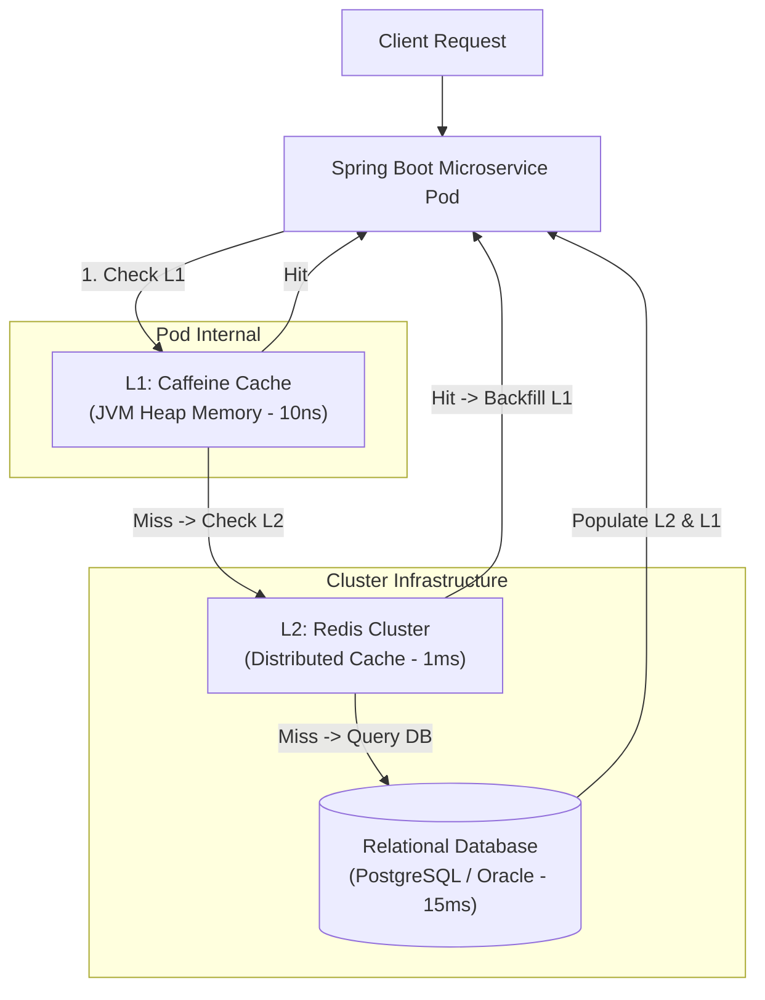

# High-Performance Distributed Caching with Caffeine & Redis

In high-throughput microservices, disk I/O and database query latencies frequently bottleneck application performance. By implementing a multi-tiered caching architecture, systems achieve sub-millisecond response times while reducing database load by over 95%.

---

## 1. Multi-Tiered Caching Architecture (L1 + L2)



1. **L1 (Local JVM Heap - Caffeine)**: Provides near-instantaneous access ($< 10\text{ ns}$) with zero network serialization. Ideal for high-frequency, read-heavy reference data.
2. **L2 (Distributed Key-Value - Redis)**: Shared across all container instances in the cluster. Prevents repeated database queries when autoscaling pods spawn or restart.

---

## 2. Spring Cache Abstraction Annotations

Spring Boot enables caching declaratively via `@EnableCaching`:

```java
@Service
public class AccountService {

    // Populates cache if absent; returns cached value on subsequent calls
    @Cacheable(value = "accounts", key = "#id", sync = true)
    public AccountDto getAccountById(String id) {
        return repository.findById(id).map(this::toDto).orElseThrow();
    }

    // Always executes method and updates cache entry
    @CachePut(value = "accounts", key = "#dto.id")
    public AccountDto updateAccount(AccountDto dto) {
        return repository.save(dto);
    }

    // Removes entry from cache upon deletion
    @CacheEvict(value = "accounts", key = "#id")
    public void deleteAccount(String id) {
        repository.deleteById(id);
    }
}
```

---

## 3. Mitigating Cache Stampede with `sync = true`

When a hot cache key expires under heavy load, hundreds of concurrent threads might detect a cache miss simultaneously and flood the database with the exact same expensive query. Setting `@Cacheable(sync = true)` causes the Spring cache interceptor to synchronize on the cache key, ensuring **only one thread executes the database query** while all other concurrent requests wait and read the freshly cached result.

---

## 4. Verification & Architecture Demo

The executable architecture demo `examples/spring/DistributedCachingDemo.java` implements:
- `MultiTierCacheManager` managing L1 Caffeine and L2 Redis simulation.
- Cold cache loading (database query increment).
- Warm cache hits (L1 hit counter).
- Pod restart simulation (L1 miss -> L2 Redis hit backfilling L1).
- Complete cache eviction across both tiers.

Compile and run the verified test:
```bash
javac -d examples/web/classes examples/spring/DistributedCachingDemo.java
java -ea -cp examples/web/classes com.handbook.spring.DistributedCachingDemo
```
