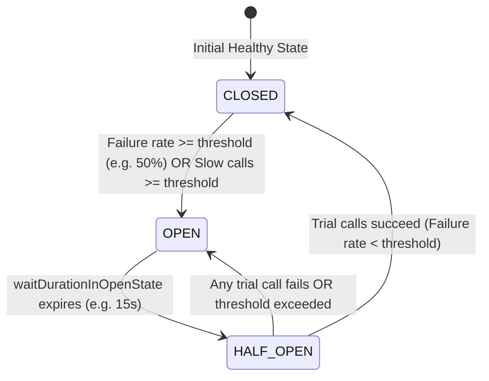

In distributed microservice architectures, applications communicate across unreliable networks. Remote payment gateways, shipping calculators, and recommendation microservices will inevitably suffer latency spikes, network partitions, and full outages. Without defensive resilience mechanisms, slow downstream dependencies cause **cascading thread exhaustion**: Tomcat worker threads back up waiting for socket reads, exhausting server memory and crashing unrelated subsystems. **Resilience4j** provides lightweight, fault tolerance patterns to isolate failures and maintain high system availability.

---

## Overview
Resilience4j protects distributed architectures against cascading failures through Circuit Breaker state transitions (CLOSED, OPEN, HALF-OPEN), RateLimiter throttling, Retry policies, and fallback method execution.

---

---

## Architecture & Core Mechanics

### The Circuit Breaker State Machine



#### State Definitions:
1. **`CLOSED` (Normal Operation):** The breaker is healthy. Invocations execute normally. Call outcomes (success, failure, slow latency) are tracked in a ring buffer sliding window.
2. **`OPEN` (Short-Circuited):** The error or slow-call threshold was breached. **All incoming calls are immediately rejected** with `CallNotPermittedException` without attempting network calls, instantly invoking fallback methods.
3. **`HALF_OPEN` (Trial Probe):** After a configured duration (`waitDurationInOpenState`), the breaker permits a small number of trial requests (`permittedNumberOfCallsInHalfOpenState`) to probe the downstream service. If they succeed, the breaker returns to `CLOSED`. If any fail, it trips back to `OPEN`.

### Sliding Window Types
- **Count-Based (`COUNT_BASED`):** Evaluates the outcome of the last $N$ calls (e.g. the last 100 requests).
- **Time-Based (`TIME_BASED`):** Evaluates call outcomes over the last $N$ seconds (e.g. the last 60 seconds).

### Resilience4j Core Architectural Modules

| Module | Annotation | Primary Responsibility |
| :--- | :--- | :--- |
| **CircuitBreaker** | `@CircuitBreaker` | Stops cascading outages; short-circuits calls to degraded fallbacks |
| **RateLimiter** | `@RateLimiter` | Enforces request rate limits (e.g. 100 req/sec) using Token Bucket |
| **Retry** | `@Retry` | Retries transient network failures with exponential backoff and jitter |
| **Bulkhead** | `@Bulkhead` | Limits concurrent calls using Semaphores or isolated Thread Pools |
| **TimeLimiter** | `@TimeLimiter` | Enforces strict timeout execution deadlines on asynchronous calls |

### Fallback Method Rules
A Resilience4j fallback method must adhere to strict rules:
1. Must have the **exact same return type** as the target method.
2. Must accept the **exact same input parameters** as the target method.
3. Must include one additional **trailing `Throwable` (or specific Exception)** parameter.

---

## Production Implementation

### Production `application.yml` Circuit Breaker Configuration
```yaml
resilience4j:
  circuitbreaker:
    instances:
      paymentGateway:
        sliding-window-type: COUNT_BASED
        sliding-window-size: 20
        minimum-number-of-calls: 10
        failure-rate-threshold: 50.0 # Trip if >= 50% fail
        slow-call-rate-threshold: 75.0 # Trip if >= 75% take longer than slow-call-duration
        slow-call-duration-threshold: 2000ms # Calls taking > 2s are flagged as slow
        wait-duration-in-open-state: 15000ms # Wait 15s before entering HALF_OPEN
        permitted-number-of-calls-in-half-open-state: 5
        automatic-transition-from-open-to-half-open-enabled: true
        record-exceptions:
          - java.io.IOException
          - java.util.concurrent.TimeoutException
          - org.springframework.web.client.ResourceAccessException
        ignore-exceptions:
          - com.handbook.spring.exception.InvalidPaymentPayloadException

  ratelimiter:
    instances:
      paymentApiLimiter:
        limit-for-period: 50
        limit-refresh-period: 1s
        timeout-duration: 100ms # Block up to 100ms waiting for token before rejecting
```

### Production Payment Service with Circuit Breaker, Retry, and Fallbacks
```java
package com.handbook.spring.service;

import com.handbook.spring.dto.PaymentRequest;
import com.handbook.spring.dto.PaymentResponse;
import io.github.resilience4j.circuitbreaker.annotation.CircuitBreaker;
import io.github.resilience4j.ratelimiter.annotation.RateLimiter;
import io.github.resilience4j.retry.annotation.Retry;
import org.slf4j.Logger;
import org.slf4j.LoggerFactory;
import org.springframework.stereotype.Service;
import org.springframework.web.client.RestTemplate;

@Service
public class PaymentProcessingService {

    private static final Logger log = LoggerFactory.getLogger(PaymentProcessingService.class);
    private final RestTemplate restTemplate;

    public PaymentProcessingService(RestTemplate restTemplate) {
        this.restTemplate = restTemplate;
    }

    @CircuitBreaker(name = "paymentGateway", fallbackMethod = "handlePaymentFallback")
    @Retry(name = "paymentGateway")
    @RateLimiter(name = "paymentApiLimiter")
    public PaymentResponse executeCharge(PaymentRequest request) {
        log.info("Attempting charge for customer [{}] of amount [{}]", request.customerId(), request.amount());

        // Remote synchronous HTTP call to external acquiring bank
        return restTemplate.postForObject(
            "https://acquirer.bank.internal/v1/charge",
            request,
            PaymentResponse.class
        );
    }

    // Fallback executed when circuit is OPEN, rate-limited, or retries exhausted
    public PaymentResponse handlePaymentFallback(PaymentRequest request, Throwable ex) {
        log.warn("Payment gateway circuit open or call failed ({}: {}). Degrading gracefully.",
            ex.getClass().getSimpleName(), ex.getMessage());

        // Graceful degradation: Queue transaction into offline message broker for async reconciliation
        return new PaymentResponse(
            "QUEUED_FOR_RECONCILIATION",
            "Payment is queued for asynchronous processing. You will receive an email confirmation shortly."
        );
    }
}
```

---

## Common Pitfalls & Traps

### Pitfall 1: Fallback Method Signature Mismatch (`NoSuchMethodException`)
**The Bug:**
```java
@CircuitBreaker(name = "bank", fallbackMethod = "myFallback")
public OrderDto createOrder(OrderRequest req) { ... }

// BUG: Missing Throwable parameter!
public OrderDto myFallback(OrderRequest req) { ... }
```
**Why it fails:** Resilience4j reflects over the target class looking for `myFallback(OrderRequest, Throwable)`. When the breaker trips, Resilience4j fails with `NoSuchMethodException: class ... has no method myFallback(OrderRequest, Throwable)` and throws an unhandled exception, completely defeating the purpose of having a fallback!
**The Fix:** Always append `Throwable ex` (or the specific matching exception class) as the **final parameter**.

### Pitfall 2: Retrying Non-Idempotent HTTP Operations
**The Disaster:** Applying `@Retry` to an HTTP POST order checkout endpoint.
**What happens in production:** The network drops packets on the return acknowledgment path. The remote payment provider successfully charged the customer's card, but the client experienced a socket timeout. The `@Retry` interceptor immediately re-sends the POST charge request 3 times, **charging the customer's credit card 4 times!**
**The Fix:** Only apply `@Retry` to **strictly idempotent operations** (GET, PUT, DELETE) or endpoints utilizing unique cryptographic idempotency keys (`Idempotency-Key: UUID`).

### Pitfall 3: Ignoring Slow Calls (The Hanging Thread Pool Trap)
**The Flaw:** Configuring `failure-rate-threshold = 50%` but omitting `slow-call-rate-threshold`.
**What happens:** Downstream servers do not throw exceptions; instead, they hang for 29 seconds before returning HTTP 200. Because the calls technically succeed, the error rate is 0%, and the circuit never trips! Meanwhile, all 200 Tomcat worker threads are frozen, bringing the entire application down.
**The Fix:** Always configure **both** `slow-call-duration-threshold: 2000ms` and `slow-call-rate-threshold: 50%`.

---

## Best Practices Guide

| Practice | Recommendation | Architectural Justification |
| :--- | :--- | :--- |
| **Combined Thresholds** | Configure both Failure Rate & Slow Call Rate | Prevents thread pool freezing from hanging sockets that do not throw immediate errors. |
| **Idempotent Retries** | Only retry idempotent requests | Prevents duplicate billing and multiple resource creation on network drops. |
| **Exponential Backoff** | Use exponential backoff with jitter on Retry | Prevents "Retry Storms" slamming a recovering service at the exact same interval. |
| **Bulkhead Isolation** | Isolate non-critical endpoints with Semaphore Bulkheads | Ensures that an analytical export report cannot consume 100% of the web worker threads. |
| **Actuator Telemetry** | Expose `/actuator/circuitbreakers` to Prometheus | Enables real-time alerting when circuits trip from CLOSED to OPEN in production. |

---

## Version Notes & Compatibility
- **Hystrix Deprecation:** Netflix Hystrix is completely deprecated. Resilience4j is the official industry replacement supported by Spring Cloud Circuit Breaker.
- **Resilience4j 2.x:** Full compatibility with Spring Boot 3, Java 21, and modern reactive stacks (Project Reactor, WebFlux).
- **Virtual Threads Integration:** On JDK 21 Virtual Threads, Semaphore Bulkheads prevent pinned carrier thread deadlocks.

---

## Summary Cheat Sheet

| Resilience Primitive | Primary Function | Failure Trigger | Production Benefit |
| :--- | :--- | :--- | :--- |
| **`CircuitBreaker`** | Halts traffic to failing services | Error / Latency Threshold | Preserves caller resources and allows callee recovery |
| **`RateLimiter`** | Regulates incoming/outgoing throughput | Rate Token Depletion | Enforces SLA quotas and prevents DDoS abuse |
| **`Retry`** | Re-attempts transient failures | Network IO Exceptions | Absorbs temporary micro-outages seamlessly |
| **`Bulkhead`** | Partitions resource allocations | Max Concurrent Execution Limit | Prevents one endpoint from monopolizing thread pools |
| **`TimeLimiter`** | Cancels slow asynchronous futures | Duration Deadline Exceeded | Prevents unbounded thread blocking |

---

## Verification & Architecture Demo

The executable architecture demo `examples/spring/Resilience4jDemo.java` implements:
- `CircuitBreakerSimulator` tracking a 4-call sliding window with a 50% failure threshold.
- State transitions from `CLOSED` to `OPEN` upon consecutive downstream exceptions.
- Immediate short-circuiting to fallback handlers when `OPEN`.
- `RateLimiterSimulator` enforcing token bucket request quotas and rejecting bursts.

Compile and run the verified test:
```bash
javac -d examples/web/classes examples/spring/Resilience4jDemo.java
java -ea -cp examples/web/classes com.handbook.spring.Resilience4jDemo
```

---

## Hands-on Practice Exercises

### Exercise 1: Spot the Bug — The Broken Fallback Method Signature
A developer implements a currency exchange service with Resilience4j:
```java
@Service
public class CurrencyConversionService {

    @CircuitBreaker(name = "forexApi", fallbackMethod = "defaultExchangeRate")
    public BigDecimal getExchangeRate(String fromCurrency, String toCurrency) {
        return restTemplate.getForObject("https://forex.api/rates/" + fromCurrency + "/" + toCurrency, BigDecimal.class);
    }

    public BigDecimal defaultExchangeRate(String fromCurrency, String toCurrency) {
        return BigDecimal.ONE;
    }
}
```
When the remote `forex.api` goes offline, the application throws:
`NoSuchMethodException: CurrencyConversionService.defaultExchangeRate(String, String, Throwable)`
and crashes with HTTP 500 instead of returning `BigDecimal.ONE`. Explain why and provide the fix.

<details>
<summary>View Solution</summary>

**Cause:**
Resilience4j's Spring AOP aspect requires all fallback methods to accept a trailing `Throwable` (or a specific Exception subclass matching the thrown exception). Without `Throwable`, Resilience4j cannot match the method signature and fails during runtime reflection.

**The Fix:**
Add `Throwable ex` as the final parameter:
```java
@Service
public class CurrencyConversionService {

    @CircuitBreaker(name = "forexApi", fallbackMethod = "defaultExchangeRate")
    public BigDecimal getExchangeRate(String fromCurrency, String toCurrency) {
        return restTemplate.getForObject("https://forex.api/rates/" + fromCurrency + "/" + toCurrency, BigDecimal.class);
    }

    // Correct signature: must accept Throwable at the end
    public BigDecimal defaultExchangeRate(String fromCurrency, String toCurrency, Throwable ex) {
        log.warn("Forex API unavailable ({}). Returning parity fallback 1.0", ex.getMessage());
        return BigDecimal.ONE;
    }
}
```
</details>

---

### Exercise 2: Hands-on Implementation — Configuring a Production CircuitBreaker in YAML
Write the complete `application.yml` fragment configuring a Resilience4j circuit breaker instance named `inventoryService` that:
1. Uses a `COUNT_BASED` sliding window of size 10.
2. Trips to `OPEN` if the failure rate exceeds 40%.
3. Trips to `OPEN` if more than 50% of calls take longer than 1500 milliseconds.
4. Waits 20 seconds in `OPEN` before automatically entering `HALF_OPEN`.
5. Permitting 3 trial calls in `HALF_OPEN`.

<details>
<summary>View Solution</summary>

```yaml
resilience4j:
  circuitbreaker:
    instances:
      inventoryService:
        sliding-window-type: COUNT_BASED
        sliding-window-size: 10
        minimum-number-of-calls: 5
        failure-rate-threshold: 40.0
        slow-call-rate-threshold: 50.0
        slow-call-duration-threshold: 1500ms
        wait-duration-in-open-state: 20000ms
        permitted-number-of-calls-in-half-open-state: 3
        automatic-transition-from-open-to-half-open-enabled: true
```

**Verification & Expected Runtime Behavior:**
- Under normal operation (10 calls with 1 failure and latencies $< 1500\text{ms}$), the failure rate is 10%, slow call rate is 0%, and state remains `CLOSED`.
- If 5 out of 10 calls take 1800ms, the slow call rate reaches 50%, immediately tripping the state to `OPEN`.
- For the next 20 seconds, all calls short-circuit in 0ms to fallback methods.
- At 20.001s, state enters `HALF_OPEN`, allowing exactly 3 trial calls through to test inventory service recovery.
</details>

---

### Exercise 3: Real-World Edge Case — In-Memory vs Distributed Rate Limiting Across Pods
<details>
<summary>View Solution</summary>
**Question:** Resilience4j's `@RateLimiter` enforces rate quotas using an in-memory token bucket inside a single JVM. If your microservice is scaled horizontally across 10 Kubernetes pods and a client has an SLA limit of 100 requests per second, what happens if you configure `limit-for-period: 100` in Resilience4j? How do production architectures enforce true global distributed rate limits?

**Solution:**
1. **The Multi-Pod In-Memory Flaw:** Each of the 10 pods runs its own isolated in-memory token bucket. A client whose requests are evenly distributed across the 10 pods by the Kubernetes load balancer can actually send $10 \times 100 = 1,000\text{ requests/second}$ before getting rate-limited! If traffic is imbalanced, one pod might throttle while others have spare capacity.
2. **The Production Fix: Distributed Rate Limiting:**
   - **API Gateway Layer:** Enforce global rate limiting at the ingress gateway (e.g. Spring Cloud Gateway, Kong, Envoy) backed by a centralized **Redis Token Bucket** using Lua scripts (`ratelimit.lua`).
   - **Resilience4j Role:** Use Resilience4j `@RateLimiter` for **local client-side outbound throttling** (e.g. ensuring your microservice does not exceed a third-party partner's API quota), while relying on the API Gateway / Redis for **inbound global customer tier enforcement**.
</details>

---

## Verified Official Sources & References
- [Resilience4j Official Documentation & Architecture Guide](https://resilience4j.readme.io/)
- [Spring Cloud Circuit Breaker Documentation](https://docs.spring.io/spring-cloud-circuitbreaker/reference/)
- [Martin Fowler — CircuitBreaker Architectural Pattern](https://martinfowler.com/bliki/CircuitBreaker.html)
