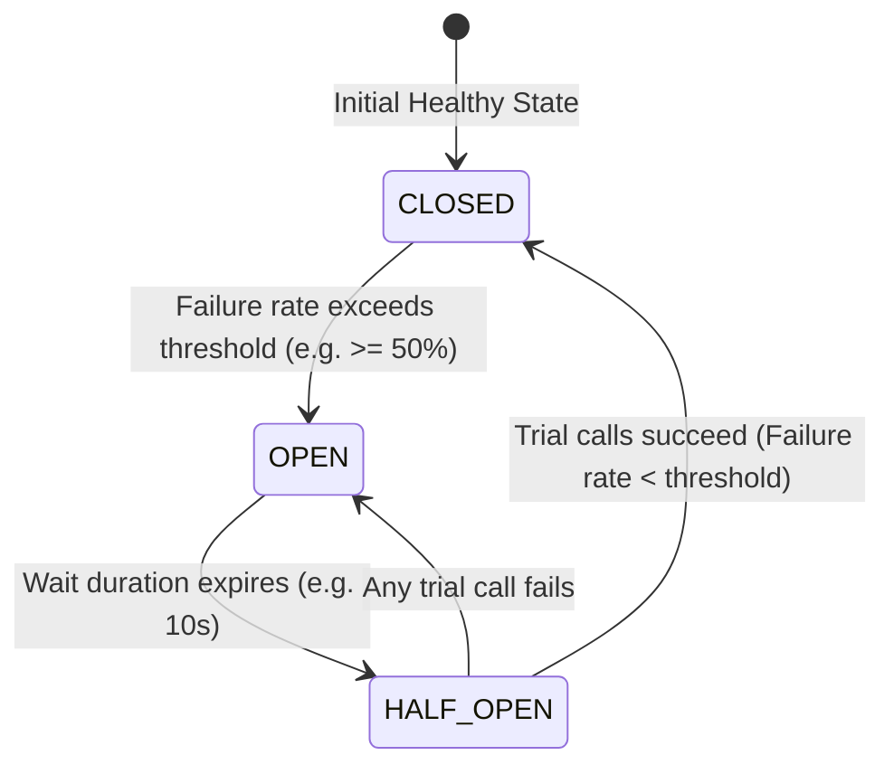

# Resilience & Fault Tolerance with Resilience4j (Circuit Breaker, RateLimiter)

In microservice architectures, services communicate over networks subject to latency spikes, packet loss, and third-party outages. If a downstream service hangs or fails, calling threads back up, exhausting Tomcat worker pools and causing cascading failures across unrelated subsystems. **Resilience4j** provides lightweight, functional fault tolerance patterns to isolate failures and maintain high availability.

---

## 1. The Circuit Breaker State Machine

The Circuit Breaker pattern prevents an application from repeatedly attempting an operation that is guaranteed to fail.



### The Three States Explained:
1. **`CLOSED`**: The circuit breaker is healthy. Invocations execute normally. The breaker records call results in a sliding window (e.g. the last 100 calls).
2. **`OPEN`**: The failure rate exceeded the configured threshold. All incoming requests are **immediately short-circuited** without attempting network calls, instantly redirecting to fallback methods.
3. **`HALF_OPEN`**: After a configured `waitDurationInOpenState`, the breaker enters a trial state, allowing a limited number of requests through to test whether the downstream dependency has recovered.

---

## 2. Declarative Annotations with Resilience4j & Spring Boot

```java
@Service
public class PaymentProcessingService {

    @CircuitBreaker(name = "paymentGateway", fallbackMethod = "fallbackPayment")
    @RateLimiter(name = "paymentRateLimiter")
    @Retry(name = "paymentRetry")
    public PaymentResponse processTransaction(PaymentRequest request) {
        // External HTTP call to third-party bank gateway
        return restTemplate.postForObject("/charge", request, PaymentResponse.class);
    }

    // Fallback executed when circuit is OPEN, rate-limited, or calls fail
    public PaymentResponse fallbackPayment(PaymentRequest request, Throwable ex) {
        log.warn("Payment gateway unavailable ({}); queuing for background reconciliation.", ex.getMessage());
        return new PaymentResponse("QUEUED", "Transaction queued for async processing");
    }
}
```

---

## 3. Resilience4j Core Modules

- **CircuitBreaker**: Stops cascading failures and allows failing downstreams time to recover.
- **RateLimiter**: Limits call rates to prevent resource abuse or adhere to third-party API tiers.
- **Retry**: Automatically re-attempts transient network errors with exponential backoff and jitter.
- **Bulkhead**: Limits concurrent execution count using semaphores or isolated thread pools to prevent one endpoint from consuming all server resources.
- **TimeLimiter**: Enforces strict timeout execution deadlines on asynchronous calls.

---

## 4. Verification & Architecture Demo

The executable architecture demo `examples/spring/Resilience4jDemo.java` implements:
- `CircuitBreakerSimulator` tracking a 4-call sliding window with a 50% failure threshold.
- State transitions from `CLOSED` to `OPEN` upon consecutive downstream exceptions.
- Immediate short-circuiting to fallback handlers when `OPEN`.
- `RateLimiterSimulator` enforcing token bucket request quotas and rejecting bursts.

Compile and run the verified test:
```bash
javac -d examples/web/classes examples/spring/Resilience4jDemo.java
java -ea -cp examples/web/classes com.handbook.spring.Resilience4jDemo
```
