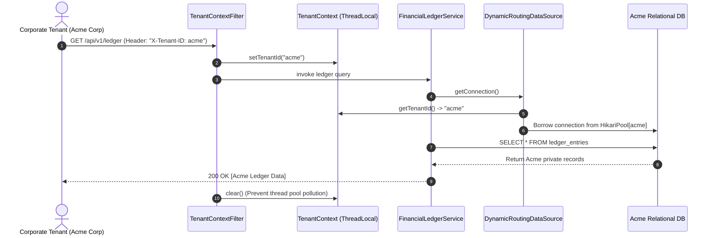

# Topic 111: Multi-Tenancy Architecture in Spring Boot (Database-per-Tenant & Schema-per-Tenant)

> 🚀 **Roadmap Seal:** **`[ADVANCED / DEEP-DIVE]`** — *Advanced enterprise specialization & architecture. Study once core fundamentals are solid.*

## 1. What It Is and Why It Exists

Modern Software-as-a-Service (SaaS) platforms serve thousands of corporate clients (tenants) from a single shared software deployment. Multi-tenancy is the architectural paradigm that allows a single runtime application cluster to securely isolate each tenant's private business data while sharing infrastructure, computing power, and deployment pipelines.

### The Three Multi-Tenancy Isolation Models

```
┌────────────────────────────────────────────────────────────────────────┐
│ Model 1: Database-per-Tenant (Highest Isolation & Compliance)          │
│ App Cluster ───► Router ───┬──► [Tenant Alpha DB: alpha_finance]       │
│                            └──► [Tenant Beta DB: beta_finance]         │
├────────────────────────────────────────────────────────────────────────┤
│ Model 2: Schema-per-Tenant (Shared DB Instance, Separate Namespaces)   │
│ App Cluster ───► DB Instance ──┬──► SCHEMA alpha_schema                │
│                                └──► SCHEMA beta_schema                 │
├────────────────────────────────────────────────────────────────────────┤
│ Model 3: Column / Discriminator (Shared Table, Filtered by tenant_id)  │
│ App Cluster ───► SELECT * FROM accounts WHERE tenant_id = 'ALPHA'      │
└────────────────────────────────────────────────────────────────────────┘
```

1. **Database-per-Tenant:** Each tenant owns a distinct physical or cloud database instance. Guarantees absolute hardware/file isolation and simplifies tenant backups, but carries higher infrastructure cost.
2. **Schema-per-Tenant:** A single relational database engine holds separate SQL schemas per tenant (e.g. `CREATE SCHEMA tenant_alpha`). Offers high isolation with shared database server memory.
3. **Discriminator Column:** All tenants share identical tables containing a `tenant_id` column. Highly cost-effective for B2C apps, but requires bulletproof row-level security to prevent data leakage.

### Dynamic DataSource Routing Architecture

In Spring Boot, dynamic connection switching is accomplished via `AbstractRoutingDataSource`. Every incoming HTTP request carries a tenant identifier (via `X-Tenant-ID` header or JWT claim). A servlet filter writes this identifier to a thread-local `TenantContext`, and the routing datasource dynamically fetches a database connection for that specific tenant key:



### Real-World Analogy
Consider a modern luxury apartment tower (**The SaaS Infrastructure**).
- **Discriminator Column:** One giant dormitory room where 100 residents sleep in bunk beds with name tags taped to their pillows. If someone misreads a tag, they take someone else's wallet (**Data Leak Risk**).
- **Schema-per-Tenant:** Private separate apartments inside the same building sharing the foundation, elevator, and main water pipes.
- **Database-per-Tenant:** 100 separate stand-alone private houses, each with its own locked perimeter fence and private water well.

---

## 2. Prerequisites
Before studying multi-tenancy, ensure you have mastered:
- [Topic 82: JDBC Connection Pooling in Web Applications](#topic-82) — HikariCP pool architecture.
- [Topic 91: Externalized Configuration, YAML Hierarchies & Multi-Profile Deployment](#topic-91) — Dynamic datasource binding.
- [Topic 95: Spring Data JPA Architecture: Repository Hierarchy & JpaRepository](#topic-95) — Persistence contexts and repository execution.

---

## 3. Syntax Breakdown & Core Mechanics

### 3.1 The Thread-Safe `TenantContext` Carrier

```java
public final class TenantContext {
    private static final ThreadLocal<String> CURRENT_TENANT = new ThreadLocal<>();

    private TenantContext() {}

    public static void setTenantId(String tenantId) {
        CURRENT_TENANT.set(tenantId);
    }

    public static String getTenantId() {
        return CURRENT_TENANT.get();
    }

    public static void clear() {
        CURRENT_TENANT.remove();
    }
}
```

---

### 3.2 The `TenantContextFilter` Servlet Interceptor

```java
@Component
@Order(Ordered.HIGHEST_PRECEDENCE)
public class TenantContextFilter extends OncePerRequestFilter {

    private static final String TENANT_HEADER = "X-Tenant-ID";
    private static final String DEFAULT_TENANT = "master";

    @Override
    protected void doFilterInternal(HttpServletRequest request, 
                                    HttpServletResponse response, 
                                    FilterChain filterChain) throws ServletException, IOException {
        String tenantId = request.getHeader(TENANT_HEADER);
        if (tenantId == null || tenantId.isBlank()) {
            tenantId = DEFAULT_TENANT;
        }

        try {
            TenantContext.setTenantId(tenantId);
            filterChain.doFilter(request, response);
        } finally {
            // CRITICAL: Prevent ThreadLocal memory leaks and tenant context bleed
            TenantContext.clear();
        }
    }
}
```

---

### 3.3 Dynamic Routing with `AbstractRoutingDataSource`

```java
public class MultiTenantRoutingDataSource extends AbstractRoutingDataSource {

    @Override
    protected Object determineCurrentLookupKey() {
        String tenantId = TenantContext.getTenantId();
        return (tenantId != null) ? tenantId : "master";
    }
}
```

Configuration in Spring Boot:
```java
@Configuration
public class MultiTenantDataSourceConfiguration {

    @Bean
    public DataSource dataSource() {
        Map<Object, Object> targetDataSources = new HashMap<>();
        targetDataSources.put("tenant_alpha", createHikariDataSource("jdbc:postgresql://localhost:5432/tenant_alpha"));
        targetDataSources.put("tenant_beta", createHikariDataSource("jdbc:postgresql://localhost:5432/tenant_beta"));

        MultiTenantRoutingDataSource routingSource = new MultiTenantRoutingDataSource();
        routingSource.setDefaultTargetDataSource(targetDataSources.get("tenant_alpha"));
        routingSource.setTargetDataSources(targetDataSources);
        routingSource.afterPropertiesSet();
        return routingSource;
    }
}
```

---

## 4. Code Examples

### 4.1 Basic Example: Simulating Dynamic Multi-Tenant Data Retrieval
```java
package com.handbook.spring;

import java.util.*;

public class BasicMultiTenantSimulationDemo {

    public static class SimpleTenantStore {
        private final Map<String, List<String>> tenantData = new HashMap<>();

        public SimpleTenantStore() {
            tenantData.put("tenant_alpha", List.of("Contract Alpha-101", "Contract Alpha-102"));
            tenantData.put("tenant_beta", List.of("Invoice Beta-901", "Invoice Beta-902"));
        }

        public List<String> getTenantRecords(String tenantId) {
            return tenantData.getOrDefault(tenantId, List.of());
        }
    }

    public static void main(String[] args) {
        System.out.println("--- Spring Boot: Multi-Tenancy Isolation Simulation ---");
        SimpleTenantStore store = new SimpleTenantStore();

        String activeTenant = "tenant_beta";
        System.out.println("Current active tenant: " + activeTenant);
        System.out.println("Loaded private records: " + store.getTenantRecords(activeTenant));
    }
}
```

**Expected Terminal Output:**
```text
--- Spring Boot: Multi-Tenancy Isolation Simulation ---
Current active tenant: tenant_beta
Loaded private records: [Invoice Beta-901, Invoice Beta-902]
```

---

### 4.2 Realistic Enterprise Example: Verified MultiTenantRoutingDemo
```java
package com.handbook.spring;

import java.util.*;

public class MultiTenantRoutingDemo {

    public record TenantAccount(String tenantId, String accountNumber, double balance) {}

    public static class TenantRoutingEngine {
        private final Map<String, List<TenantAccount>> databaseClusters = new HashMap<>();

        public void registerDatabase(String tenantId, List<TenantAccount> accounts) {
            databaseClusters.put(tenantId, accounts);
        }

        public List<TenantAccount> queryAccountsForTenant(String tenantId) {
            List<TenantAccount> accounts = databaseClusters.get(tenantId);
            if (accounts == null) {
                throw new IllegalStateException("Access Denied: Unrecognized tenant ID: " + tenantId);
            }
            return accounts;
        }
    }

    public static void main(String[] args) {
        System.out.println("=== Topic 111: Multi-Tenancy Architecture & Routing DataSource ===");

        TenantRoutingEngine engine = new TenantRoutingEngine();
        engine.registerDatabase("TENANT-ACME", List.of(
            new TenantAccount("TENANT-ACME", "ACME-01", 150000.00),
            new TenantAccount("TENANT-ACME", "ACME-02", 45000.00)
        ));
        engine.registerDatabase("TENANT-STARK", List.of(
            new TenantAccount("TENANT-STARK", "STARK-99", 9800000.00)
        ));

        System.out.println("Switching context to TENANT-ACME:");
        List<TenantAccount> acmeAccounts = engine.queryAccountsForTenant("TENANT-ACME");
        acmeAccounts.forEach(a -> System.out.println("  -> " + a.accountNumber() + ": $" + a.balance()));

        System.out.println("Switching context to TENANT-STARK:");
        List<TenantAccount> starkAccounts = engine.queryAccountsForTenant("TENANT-STARK");
        starkAccounts.forEach(a -> System.out.println("  -> " + a.accountNumber() + ": $" + a.balance()));

        if (acmeAccounts.size() != 2 || starkAccounts.size() != 1) {
            throw new AssertionError("Multi-tenant isolation validation failed!");
        }

        System.out.println("Topic 111 Multi-Tenancy Architecture and Routing DataSource verified successfully.");
    }
}
```

---

## 5. Common Mistakes & Error Diagnosis

### Pitfall 1: Context Bleed & Memory Leaks via Missing `TenantContext.clear()`
- **Symptom:** Tenant A randomly sees confidential financial records belonging to Tenant B under concurrent load.
- **Cause:** Web servers (Tomcat, Jetty) maintain a pool of reusable worker threads. If a servlet filter sets `TenantContext.setTenantId("TenantA")` and the request encounters an unhandled exception before reaching cleanup, the thread returns to the pool with `TenantA` still attached. When Tenant B executes a subsequent request on that recycled thread, they inherit Tenant A's database connection!
- **Diagnosis & Fix:** Always clear the context in a mandatory `finally` block inside the servlet filter:
  ```java
  try {
      TenantContext.setTenantId(tenantId);
      chain.doFilter(request, response);
  } finally {
      TenantContext.clear(); // MANDATORY!
  }
  ```

### Pitfall 2: Connection Pool Exhaustion with Naive Dynamic DataSource Allocation
- **Symptom:** Database server runs out of connection handles (`FATAL: remaining connection slots are reserved for non-superuser connections`).
- **Cause:** Creating a standard 20-connection HikariCP pool for 500 tenants requires $500 \times 20 = 10,000$ open database connections, crashing PostgreSQL/MySQL.
- **Diagnosis & Fix:** In Database-per-Tenant architectures with many tenants, use dynamic connection eviction with low idle connection limits (`minimumIdle = 1`, `maximumPoolSize = 5`, `idleTimeout = 60000`), or adopt the **Schema-per-Tenant** model where a single unified Hikari pool shares connections across all schemas.

### Pitfall 3: Caching Across Tenants in Shared Second-Level Cache
- **Symptom:** Entity queries return cached entity objects belonging to other corporate tenants.
- **Cause:** Using Redis or Ehcache as a shared L2 Hibernate cache without including the tenant identifier in the cache key.
- **Diagnosis & Fix:** Prefix all cache region keys with the active tenant ID:
  ```java
  @Cacheable(value = "customers", key = "T(com.handbook.spring.TenantContext).getTenantId() + '-' + #id")
  public Customer getCustomer(Long id) { ... }
  ```

---

## 6. Best Practices Guide

| Practice | Recommendation | Architectural Justification |
| :--- | :--- | :--- |
| **Context Hygiene** | Always clear `TenantContext` in `finally` | Prevents catastrophic cross-tenant data leaks caused by recycled servlet threads. |
| **Model Choice** | Schema-per-Tenant for Medium SaaS (< 500 tenants) | Perfect balance of strong logical isolation, low hardware cost, and shared connection pooling. |
| **Model Choice** | Database-per-Tenant for Enterprise Compliance | Necessary when enterprise contracts require dedicated encryption keys and customer-managed backups. |
| **Migration Safety** | Run Flyway dynamically across all tenant schemas | Guarantees that schema updates propagate to every tenant simultaneously during deployment. |
| **Header Validation** | Enforce tenant membership checks against JWT | Never trust raw `X-Tenant-ID` headers without verifying that the authenticated user actually belongs to that tenant. |

---

## 7. Version Notes & Compatibility

- **Hibernate 5.x / Spring Boot 2.x:** Supported multi-tenancy via `MultiTenantConnectionProvider` and `CurrentTenantIdentifierResolver`.
- **Hibernate 6.x / Spring Boot 3.x:**
  - Standardized multi-tenancy configuration through `org.hibernate.context.spi.CurrentTenantIdentifierResolver`.
  - Redesigned connection acquisition contracts with full support for virtual threads (Project Loom) in JDK 21+.

---

## 8. Summary & Cheat Sheet

| Dimension | Database-per-Tenant | Schema-per-Tenant | Discriminator Column |
| :--- | :--- | :--- | :--- |
| **Data Isolation** | Maximum (Separate DB files) | High (Separate Schemas) | Low (Logical SQL filter) |
| **Hardware Cost** | High | Low to Moderate | Lowest |
| **Schema Migrations** | Complex (Iterate over all DBs) | Moderate (Iterate over schemas) | Simplest (Single migration script) |
| **Compliance (GDPR/HIPAA)**| Easiest to certify | Certified for most regulations | Requires strict row-level auditing |
| **Recommended Scope** | High-value B2B enterprise SaaS | Mid-market SaaS platforms | Consumer B2C applications |

---

## 9. Hands-on Practice Exercises

### Exercise 1: Spot the Bug — ThreadLocal Context Bleeding Across Worker Threads
Review the following filter:
```java
@Component
public class SimpleTenantFilter implements Filter {
    @Override
    public void doFilter(ServletRequest req, ServletResponse res, FilterChain chain) throws Exception {
        String tenant = ((HttpServletRequest) req).getHeader("X-Tenant");
        TenantContext.set(tenant);
        chain.doFilter(req, res);
    }
}
```
What fatal defect exists in this filter, and under what conditions does cross-tenant data leakage occur?

<details>
<summary>View Solution</summary>

**Cause:**
The filter fails to clear `TenantContext` in a `finally` block. If downstream business logic throws an unhandled exception or completes normally without an explicit clear, the Tomcat worker thread retains the tenant identifier. Because web servers reuse threads from a pool, subsequent requests handled by that thread will execute under the previous tenant's identity!

**The Fix:**
```java
@Component
public class SimpleTenantFilter implements Filter {
    @Override
    public void doFilter(ServletRequest req, ServletResponse res, FilterChain chain) throws Exception {
        try {
            String tenant = ((HttpServletRequest) req).getHeader("X-Tenant");
            TenantContext.set(tenant);
            chain.doFilter(req, res);
        } finally {
            TenantContext.clear(); // Guarantees thread sanitation
        }
    }
}
```
</details>

---

### Exercise 2: Hands-on Implementation — Configuring Dynamic AbstractRoutingDataSource
Implement a custom `AbstractRoutingDataSource` that routes queries to either `"US_CLUSTER"` or `"EU_CLUSTER"` based on the active `TenantContext`.

<details>
<summary>View Solution</summary>

```java
package com.handbook.spring.datasource;

import com.handbook.spring.context.TenantContext;
import org.springframework.jdbc.datasource.lookup.AbstractRoutingDataSource;

public class RegionalRoutingDataSource extends AbstractRoutingDataSource {

    @Override
    protected Object determineCurrentLookupKey() {
        String region = TenantContext.getRegion();
        return (region != null && region.equalsIgnoreCase("EU")) ? "EU_CLUSTER" : "US_CLUSTER";
    }
}
```
</details>

---

### Exercise 3: Real-World Edge Case — Cross-Tenant Flyway Database Migrations
<details>
<summary>View Solution</summary>
**Question:** In a SaaS application supporting 200 tenants on a Schema-per-Tenant model, how does a Spring Boot application automate Flyway database migrations across all 200 tenant schemas upon application startup?

**Solution:**
Implement an `ApplicationRunner` bean that queries the master tenant registry and executes Flyway migrations programmatically across each tenant schema:
```java
@Component
public class MultiTenantFlywayMigrator implements ApplicationRunner {

    private final DataSource dataSource;
    private final TenantRegistryRepository tenantRegistry;

    public MultiTenantFlywayMigrator(DataSource dataSource, TenantRegistryRepository tenantRegistry) {
        this.dataSource = dataSource;
        this.tenantRegistry = tenantRegistry;
    }

    @Override
    public void run(ApplicationArguments args) {
        List<String> tenantSchemas = tenantRegistry.findAllActiveTenantSchemas();
        
        for (String schema : tenantSchemas) {
            log.info("Applying Flyway migrations for tenant schema: {}", schema);
            Flyway flyway = Flyway.configure()
                .dataSource(dataSource)
                .schemas(schema)
                .locations("classpath:db/migration/tenants")
                .load();
            flyway.migrate();
        }
    }
}
```
</details>

---

## 10. Verified Official Sources
- [Spring Framework Reference: Dynamic DataSource Routing](https://docs.spring.io/spring-framework/reference/data-access/jdbc/datasource.html)
- [Hibernate ORM User Guide: Multi-Tenancy Architecture](https://docs.jboss.org/hibernate/orm/current/userguide/html_single/Hibernate_User_Guide.html#multitenancy)
- [Baeldung: Multitenancy with Spring Data JPA](https://www.baeldung.com/multitenancy-with-spring-data-jpa)
