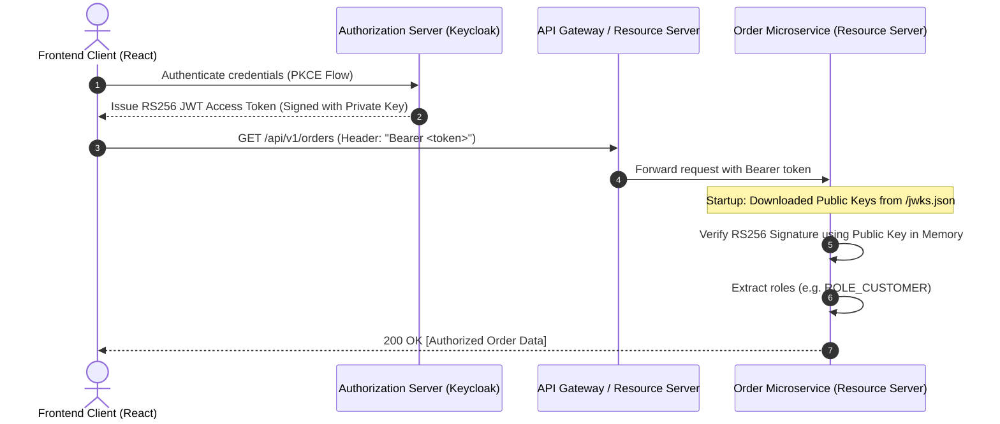

# Topic 112: Spring Security OAuth2 Resource Server & Asymmetric JWT Validation

> 🚀 **Roadmap Seal:** **`[ADVANCED / DEEP-DIVE]`** — *Advanced enterprise specialization & architecture. Study once core fundamentals are solid.*

## 1. What It Is and Why It Exists

In enterprise Service-Oriented Architectures (SOA) and microservice ecosystems, dozens of backend services must authenticate requests originating from web single-page apps (SPAs), mobile applications, and partner APIs.

### Why Symmetric Signing Fails in Distributed Systems
In basic JWT implementations (Topic 99), services use symmetric encryption (**HS256**), where a shared secret key both signs and validates tokens. In a microservices cluster with 50 services, sharing the private secret key across all 50 codebases introduces a catastrophic vulnerability: if a single reporting microservice is compromised, an attacker extracts the shared secret and can forge administrator tokens for the entire corporate network!

**OAuth2 Resource Server with Asymmetric Cryptography (RS256 / ES256)** completely eliminates this hazard:
1. **The Authorization Server (Keycloak, Okta, Auth0):** Possesses the **Private Key** (kept in high-security hardware modules) and signs access tokens.
2. **The Resource Servers (Spring Boot Microservices):** Possess only the **Public Key** exposed over a standard HTTPS **JSON Web Key Set (JWKS)** endpoint (`/.well-known/jwks.json`). Microservices verify token cryptographic signatures mathematically without ever possessing the signing key!



### Real-World Analogy
Consider a passport control checkpoint at an international airport.
- **The Authorization Server:** The national passport issuance printing authority holds the classified engraved printing plates (**Private Key**) used to stamp passports with unique cryptographic watermarks.
- **The Resource Server:** Border control officers at gate terminals across the world have optical scanners loaded with public verification profiles (**Public Key**). The officers can verify that a passport is 100% genuine in 2 seconds without ever needing access to the classified printing factory in the capital.

---

## 2. Prerequisites
Before studying OAuth2 Resource Servers, ensure you have mastered:
- [Topic 98: Modern SecurityFilterChain Architecture & Password Encryption](#topic-98) — Security filter chain architecture.
- [Topic 99: Stateless REST Security with JWT & Method-Level Role Authorization](#topic-99) — JWT token fundamentals and method security.

---

## 3. Syntax Breakdown & Core Mechanics

### 3.1 Externalized Configuration in `application.yml`

Spring Boot Auto-Configuration provisions a fully operational JWT decoder when the JWK Set URI or OIDC Issuer is declared:

```yaml
spring:
  security:
    oauth2:
      resourceserver:
        jwt:
          issuer-uri: https://auth.enterprise.com/realms/production-corp
          jwk-set-uri: https://auth.enterprise.com/realms/production-corp/protocol/openid-connect/certs
```

---

### 3.2 Configuring the `SecurityFilterChain` for OAuth2

```java
@Configuration
@EnableWebSecurity
@EnableMethodSecurity
public class OAuth2ResourceServerConfig {

    @Bean
    public SecurityFilterChain securityFilterChain(HttpSecurity http) throws Exception {
        return http
            .csrf(AbstractHttpConfigurer::disable)
            .sessionManagement(s -> s.sessionCreationPolicy(SessionCreationPolicy.STATELESS))
            .authorizeHttpRequests(auth -> auth
                .requestMatchers("/public/**").permitAll()
                .requestMatchers("/api/v1/admin/**").hasRole("ADMIN")
                .anyRequest().authenticated()
            )
            .oauth2ResourceServer(oauth2 -> oauth2
                .jwt(jwt -> jwt.jwtAuthenticationConverter(jwtAuthenticationConverter()))
            )
            .build();
    }

    @Bean
    public JwtAuthenticationConverter jwtAuthenticationConverter() {
        JwtAuthenticationConverter converter = new JwtAuthenticationConverter();
        converter.setJwtGrantedAuthoritiesConverter(new KeycloakRoleConverter());
        return converter;
    }
}
```

---

### 3.3 Custom Role Converter for Enterprise Identity Providers

Enterprise identity providers (e.g. Keycloak) nest roles inside claims (e.g. `realm_access.roles` or `resource_access`). A custom converter maps these claims to Spring's `GrantedAuthority`:

```java
public class KeycloakRoleConverter implements Converter<Jwt, Collection<GrantedAuthority>> {

    @Override
    @SuppressWarnings("unchecked")
    public Collection<GrantedAuthority> convert(Jwt jwt) {
        Map<String, Object> realmAccess = jwt.getClaim("realm_access");
        if (realmAccess == null || realmAccess.isEmpty()) {
            return Collections.emptyList();
        }

        Collection<String> roles = (Collection<String>) realmAccess.get("roles");
        if (roles == null) {
            return Collections.emptyList();
        }

        return roles.stream()
            .map(roleName -> new SimpleGrantedAuthority("ROLE_" + roleName))
            .collect(Collectors.toList());
    }
}
```

---

## 4. Code Examples

### 4.1 Basic Example: Simulating Asymmetric Key Verification
```java
package com.handbook.spring;

import java.security.*;
import java.util.Base64;

public class BasicAsymmetricSignatureDemo {

    public static void main(String[] args) throws Exception {
        System.out.println("--- Spring Security: Asymmetric RS256 Signature Simulation ---");

        // 1. Generate RSA Key Pair (Authorization Server owns Private, Microservice owns Public)
        KeyPairGenerator keyGen = KeyPairGenerator.getInstance("RSA");
        keyGen.initialize(2048);
        KeyPair pair = keyGen.generateKeyPair();
        PrivateKey privateKey = pair.getPrivate();
        PublicKey publicKey = pair.getPublic();

        String payload = "sub=sarah_connor;roles=[ROLE_ADMIN];exp=2026-11-20T23:59:59Z";

        // 2. Auth Server Signs with Private Key
        Signature signer = Signature.getInstance("SHA256withRSA");
        signer.initSign(privateKey);
        signer.update(payload.getBytes());
        byte[] digitalSignature = signer.sign();

        System.out.println("Payload: " + payload);
        System.out.println("Digital Signature (Base64): " + Base64.getEncoder().encodeToString(digitalSignature));

        // 3. Microservice Verifies with Public Key
        Signature verifier = Signature.getInstance("SHA256withRSA");
        verifier.initVerify(publicKey);
        verifier.update(payload.getBytes());
        boolean isAuthentic = verifier.verify(digitalSignature);

        System.out.println("Microservice Cryptographic Signature Verification: " + (isAuthentic ? "VALID [OK]" : "FORGED [X]"));
    }
}
```

**Expected Terminal Output:**
```text
--- Spring Security: Asymmetric RS256 Signature Simulation ---
Payload: sub=sarah_connor;roles=[ROLE_ADMIN];exp=2026-11-20T23:59:59Z
Digital Signature (Base64): ...
Microservice Cryptographic Signature Verification: VALID [OK]
```

---

### 4.2 Realistic Enterprise Example: Verified OAuth2ResourceServerDemo
```java
package com.handbook.spring;

import java.util.*;

public class OAuth2ResourceServerDemo {

    public record JwtClaims(String sub, String iss, List<String> roles) {}

    public static class ResourceServerSecurityGuard {
        private final String expectedIssuer;

        public ResourceServerSecurityGuard(String expectedIssuer) {
            this.expectedIssuer = expectedIssuer;
        }

        public boolean validateToken(JwtClaims token, String requiredRole) {
            if (!expectedIssuer.equals(token.iss())) {
                System.out.println("  -> [Security Error] Token Issuer Mismatch! Expected: " + expectedIssuer);
                return false;
            }
            return token.roles().contains(requiredRole);
        }
    }

    public static void main(String[] args) {
        System.out.println("=== Topic 112: Spring Security OAuth2 Resource Server & JWT Validation ===");

        String keycloakIssuer = "https://auth.enterprise.com/realms/production-corp";
        ResourceServerSecurityGuard guard = new ResourceServerSecurityGuard(keycloakIssuer);

        JwtClaims validAdminToken = new JwtClaims("sarah_connor", keycloakIssuer, List.of("ROLE_USER", "ROLE_ADMIN"));
        JwtClaims rogueToken = new JwtClaims("mallory", "https://untrusted-auth.darknet.org", List.of("ROLE_ADMIN"));

        System.out.println("1. Validating genuine Keycloak Token for Admin resource: " + 
            guard.validateToken(validAdminToken, "ROLE_ADMIN"));
        System.out.println("2. Validating rogue Token from unauthorized issuer: " + 
            guard.validateToken(rogueToken, "ROLE_ADMIN"));

        if (!guard.validateToken(validAdminToken, "ROLE_ADMIN") || guard.validateToken(rogueToken, "ROLE_ADMIN")) {
            throw new AssertionError("OAuth2 token validation rules failed!");
        }

        System.out.println("Topic 112 OAuth2 Resource Server verified successfully.");
    }
}
```

---

## 5. Common Mistakes & Error Diagnosis

### Pitfall 1: Microservice Startup Failure When Keycloak is Temporarily Unreachable
- **Symptom:** Microservice crashes on startup: `IllegalArgumentException: Unable to resolve Configuration with the provided Issuer of "https://auth..."`.
- **Cause:** By default, Spring Security eagerly attempts to contact the issuer's discovery endpoint (`/.well-known/openid-configuration`) upon application context initialization.
- **Diagnosis & Fix:** Point directly to the `jwk-set-uri` instead of `issuer-uri` if eager discovery is undesirable, or configure connection timeouts and retry templates.

### Pitfall 2: Default Scope vs Role Prefix Collision
- **Symptom:** API returns `403 Forbidden` on `@PreAuthorize("hasRole('ADMIN')")` even though the JWT contains `scope: "ADMIN"`.
- **Cause:** Spring's default `JwtGrantedAuthoritiesConverter` maps the `scope` or `scp` claim with prefix `SCOPE_`, producing `SCOPE_ADMIN`. Evaluating `hasRole('ADMIN')` looks for `ROLE_ADMIN`!
- **Diagnosis & Fix:** Configure the authority prefix explicitly or author a custom converter:
  ```java
  JwtGrantedAuthoritiesConverter grantedAuthoritiesConverter = new JwtGrantedAuthoritiesConverter();
  grantedAuthoritiesConverter.setAuthorityPrefix("ROLE_");
  ```

### Pitfall 3: Failing to Validate the Audience (`aud`) Claim
- **Symptom:** Tokens issued for an internal mobile application can unexpectedly access high-privilege billing APIs.
- **Cause:** By default, Spring validates expiration and signature, but does not assert that the audience claim matches your specific microservice identifier.
- **Diagnosis & Fix:** Add an audience validator to your `JwtDecoder`:
  ```java
  @Bean
  public JwtDecoder jwtDecoder() {
      NimbusJwtDecoder jwtDecoder = (NimbusJwtDecoder) JwtDecoders.fromIssuerLocation(issuerUri);
      OAuth2TokenValidator<Jwt> withAudience = new DelegatingOAuth2TokenValidator<>(
          JwtValidators.createDefaultWithIssuer(issuerUri),
          new JwtClaimValidator<List<String>>("aud", aud -> aud != null && aud.contains("billing-api"))
      );
      jwtDecoder.setJwtValidator(withAudience);
      return jwtDecoder;
  }
  ```

---

## 6. Best Practices Guide

| Practice | Recommendation | Architectural Justification |
| :--- | :--- | :--- |
| **Algorithm Selection** | Use RS256 or ES256 | Asymmetric cryptography guarantees microservices only need public keys to verify access. |
| **Audience Validation** | Always validate `aud` claim | Prevents confused-deputy attacks where tokens issued for one service are replayed against another. |
| **Key Caching** | Cache JWKS keys in memory with 24-hr TTL | Eliminates network latency: microservices verify tokens in < 1ms without calling Keycloak per request. |
| **Role Extraction** | Implement `Converter<Jwt, Collection<GrantedAuthority>>` | Adapts custom identity provider claims (Keycloak, Azure AD) into standard Spring authorities. |

---

## 7. Version Notes & Compatibility

- **Spring Security 5.x:** Required verbose XML or custom OAuth2 token services.
- **Spring Security 6.x (Spring Boot 3.x):**
  - Out-of-the-box support for `spring-boot-starter-oauth2-resource-server`.
  - Built-in support for Nimbus Jose JWT engine with multi-tenant dynamic issuer resolution.
  - Native integration with modern Java 17+ HTTP clients.

---

## 8. Summary & Cheat Sheet

| Feature | Symmetric JWT (HS256) | Asymmetric OAuth2 (RS256) |
| :--- | :--- | :--- |
| **Key Distribution** | Shared Secret Key on all servers | **Private Key on Auth Server, Public Key everywhere** |
| **Security Blast Radius** | Compromising 1 service compromises all | Compromising a service reveals only public keys |
| **Key Rotation** | Requires synchronized redeploy of all services | Zero-downtime rotation via published JWKS endpoints |
| **Best Used For** | Small, isolated single-service backends | **Enterprise microservices, SOA, and multi-team clusters** |

---

## 9. Hands-on Practice Exercises

### Exercise 1: Spot the Bug — Missing Keycloak Realm Role Converter
Review the following security configuration:
```java
@Bean
public SecurityFilterChain filterChain(HttpSecurity http) throws Exception {
    return http
        .authorizeHttpRequests(auth -> auth
            .requestMatchers("/admin/**").hasRole("ADMIN")
        )
        .oauth2ResourceServer(oauth -> oauth.jwt(Customizer.withDefaults()))
        .build();
}
```
In Keycloak, the administrator user has role `ADMIN` inside the `realm_access.roles` JSON array. Why does accessing `/admin/users` return `403 Forbidden`?

<details>
<summary>View Solution</summary>

**Cause:**
`Customizer.withDefaults()` uses the default `JwtGrantedAuthoritiesConverter`, which only looks for claims named `scope` or `scp`. It completely ignores Keycloak's proprietary `realm_access` claim.

**The Fix:**
Provide a custom `JwtAuthenticationConverter` that parses `realm_access.roles` and maps them to `ROLE_` authorities.
</details>

---

### Exercise 2: Hands-on Implementation — Configuring OAuth2 Resource Server with Custom Claim Extraction
Write a Spring Boot `@Configuration` class declaring an `OAuth2ResourceServer` that parses a custom claim `tenant_id` and adds it to the authenticated principal details.

<details>
<summary>View Solution</summary>

```java
package com.handbook.spring.config;

import org.springframework.context.annotation.Bean;
import org.springframework.context.annotation.Configuration;
import org.springframework.core.convert.converter.Converter;
import org.springframework.security.authentication.AbstractAuthenticationToken;
import org.springframework.security.config.annotation.web.builders.HttpSecurity;
import org.springframework.security.config.http.SessionCreationPolicy;
import org.springframework.security.oauth2.jwt.Jwt;
import org.springframework.security.oauth2.server.resource.authentication.JwtAuthenticationToken;
import org.springframework.security.oauth2.server.resource.authentication.JwtGrantedAuthoritiesConverter;
import org.springframework.security.web.SecurityFilterChain;

@Configuration
public class CustomOAuth2ResourceServerConfig {

    @Bean
    public SecurityFilterChain securityFilterChain(HttpSecurity http) throws Exception {
        return http
            .sessionManagement(s -> s.sessionCreationPolicy(SessionCreationPolicy.STATELESS))
            .authorizeHttpRequests(auth -> auth.anyRequest().authenticated())
            .oauth2ResourceServer(oauth -> oauth.jwt(jwt -> jwt.jwtAuthenticationConverter(customJwtConverter())))
            .build();
    }

    private Converter<Jwt, ? extends AbstractAuthenticationToken> customJwtConverter() {
        JwtGrantedAuthoritiesConverter authoritiesConverter = new JwtGrantedAuthoritiesConverter();
        authoritiesConverter.setAuthorityPrefix("ROLE_");

        return jwt -> {
            var authorities = authoritiesConverter.convert(jwt);
            String tenantId = jwt.getClaimAsString("tenant_id");
            var token = new JwtAuthenticationToken(jwt, authorities, jwt.getSubject());
            token.setDetails(tenantId != null ? tenantId : "DEFAULT_TENANT");
            return token;
        };
    }
}
```
</details>

---

### Exercise 3: Real-World Edge Case — Rotating Asymmetric Signing Keys with Zero Downtime
<details>
<summary>View Solution</summary>
**Question:** How does an Authorization Server (Keycloak/Okta) rotate its RSA private signing keys without logging out millions of active users or causing token verification failures across backend microservices?

**Solution:**
1. **The JWK Set Model (RFC 7517):** The Authorization Server publishes a set of public keys inside `/.well-known/jwks.json`, each tagged with a unique Key ID (`kid`):
   ```json
   {
     "keys": [
       {"kid": "key-2025-v1", "alg": "RS256", "n": "...", "e": "AQAB"},
       {"kid": "key-2026-v2", "alg": "RS256", "n": "...", "e": "AQAB"}
     ]
   }
   ```
2. **Every JWT Header declares its `kid`:**
   ```json
   {"alg": "RS256", "typ": "JWT", "kid": "key-2026-v2"}
   ```
3. **Graceful Zero-Downtime Rotation:**
   - The Auth Server creates a new key `key-2026-v2` and adds its public key to `jwks.json` alongside the old key `key-2025-v1`.
   - Microservices poll or auto-refresh `jwks.json`.
   - The Auth Server begins signing new tokens with `key-2026-v2`.
   - Existing active tokens signed with `key-2025-v1` remain valid because microservices still have `key-2025-v1` in their public key cache.
   - Once all old tokens expire (e.g. after 24 hours), the old key is decommissioned.
</details>

---

## 10. Verified Official Sources
- [Spring Security Reference: OAuth 2.0 Resource Server](https://docs.spring.io/spring-security/reference/servlet/oauth2/resource-server/index.html)
- [RFC 6749: The OAuth 2.0 Authorization Framework](https://datatracker.ietf.org/doc/html/rfc6749)
- [RFC 7517: JSON Web Key (JWK) Specification](https://datatracker.ietf.org/doc/html/rfc7517)
