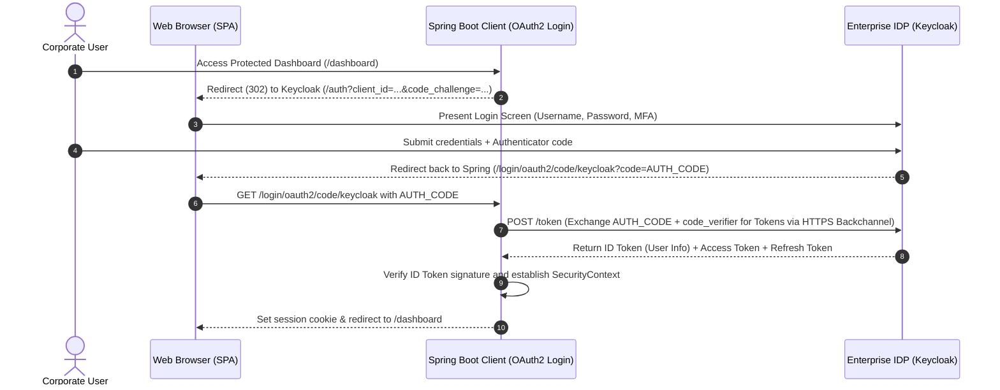

# Topic 113: OpenID Connect (OIDC) & Identity Provider Integration (Keycloak / Okta)

> 🚀 **Roadmap Seal:** **`[ADVANCED / DEEP-DIVE]`** — *Advanced enterprise specialization & architecture. Study once core fundamentals are solid.*

## 1. What It Is and Why It Exists

In modern enterprise architectures, employees and customers interact with dozens of interconnected portals and services. Forcing users to register separate usernames and passwords for every application introduces password fatigue, security vulnerabilities, and exorbitant IT administration costs.

### OAuth 2.0 vs OpenID Connect (OIDC)
- **OAuth 2.0 (Authorization Only):** A delegated authorization framework designed to grant third-party applications access to HTTP resources on behalf of a user. OAuth 2.0 answers: *"What is this application permitted to do?"* It does **not** provide identity verification.
- **OpenID Connect (Identity & Authentication):** A thin identity layer built directly on top of OAuth 2.0. OIDC answers: *"Who is the user, and how were they authenticated?"* It introduces a standardized **ID Token** containing user profile information (email, name, picture, authentication time).

### Authorization Code Flow with PKCE (Proof Key for Code Exchange)

The gold standard for enterprise authentication across web and mobile clients is the **Authorization Code Grant with PKCE (RFC 7636)**:



### Real-World Analogy
Consider checking into a high-security international conference center.
- **OAuth 2.0 Access Token:** The plastic badge that unlocks the elevator and the 4th-floor laboratory door. The door scanner doesn't care who you are; it only cares that the badge is programmed with door access permissions.
- **OIDC ID Token:** The government-issued biometric passport you present to the reception desk upon arrival. The badge printing station reads your name, nationality, and photo from the passport to print your identity badge.

---

## 2. Prerequisites
Before studying OIDC integration, ensure you have mastered:
- [Topic 98: Modern SecurityFilterChain Architecture & Password Encryption](#topic-98) — Security filter chain architecture.
- [Topic 112: Spring Security OAuth2 Resource Server & Asymmetric JWT Validation](#topic-112) — Asymmetric cryptography and token verification.

---

## 3. Syntax Breakdown & Core Mechanics

### 3.1 Externalized Configuration in `application.yml`

Using `spring-boot-starter-oauth2-client`, Spring Boot configures the entire OIDC handshake declaratively:

```yaml
spring:
  security:
    oauth2:
      client:
        registration:
          keycloak:
            client-id: corporate-web-portal
            client-secret: ${KEYCLOAK_CLIENT_SECRET}
            scope: openid, profile, email, roles
            authorization-grant-type: authorization_code
            redirect-uri: "{baseUrl}/login/oauth2/code/{registrationId}"
        provider:
          keycloak:
            issuer-uri: https://auth.enterprise.com/realms/production-corp
            user-name-attribute: preferred_username
```

---

### 3.2 Configuring `oauth2Login` in the Security Filter Chain

```java
@Configuration
@EnableWebSecurity
public class OidcClientSecurityConfig {

    @Bean
    public SecurityFilterChain securityFilterChain(HttpSecurity http) throws Exception {
        return http
            .authorizeHttpRequests(auth -> auth
                .requestMatchers("/", "/public/**").permitAll()
                .anyRequest().authenticated()
            )
            .oauth2Login(oauth2 -> oauth2
                .defaultSuccessUrl("/dashboard", true)
                .userInfoEndpoint(userInfo -> userInfo
                    .oidcUserService(customOidcUserService())
                )
            )
            .logout(logout -> logout
                .logoutSuccessHandler(oidcLogoutSuccessHandler())
            )
            .build();
    }

    @Bean
    public OAuth2UserService<OidcUserRequest, OidcUser> customOidcUserService() {
        final OidcUserService delegate = new OidcUserService();

        return userRequest -> {
            OidcUser oidcUser = delegate.loadUser(userRequest);
            // Map Keycloak realm roles into Spring Security GrantedAuthorities
            Set<GrantedAuthority> mappedAuthorities = new HashSet<>(oidcUser.getAuthorities());
            
            Map<String, Object> realmAccess = oidcUser.getClaim("realm_access");
            if (realmAccess != null && realmAccess.containsKey("roles")) {
                List<String> roles = (List<String>) realmAccess.get("roles");
                roles.forEach(role -> mappedAuthorities.add(new SimpleGrantedAuthority("ROLE_" + role)));
            }

            return new DefaultOidcUser(mappedAuthorities, oidcUser.getIdToken(), oidcUser.getUserInfo());
        };
    }
}
```

---

### 3.3 Accessing the Authenticated `OidcUser` in Controllers

```java
@Controller
public class UserDashboardController {

    @GetMapping("/dashboard")
    public String getDashboard(Model model, @AuthenticationPrincipal OidcUser principal) {
        model.addAttribute("username", principal.getPreferredUsername());
        model.addAttribute("email", principal.getEmail());
        model.addAttribute("roles", principal.getAuthorities());
        return "dashboard";
    }
}
```

---

## 4. Code Examples

### 4.1 Basic Example: Simulating the OIDC Token Exchange
```java
package com.handbook.spring;

import java.util.*;

public class BasicOidcExchangeSimulationDemo {

    public record IdToken(String sub, String email, String name, String iss) {}
    public record AccessToken(String tokenValue, List<String> scopes, long expiresInSeconds) {}

    public static class KeycloakTokenEndpoint {
        public Map<String, Object> exchangeAuthorizationCode(String code, String codeVerifier) {
            System.out.println("[IDP] Validating auth code: " + code + " with PKCE verifier: " + codeVerifier);
            IdToken idToken = new IdToken("USR-9901", "sarah@enterprise.com", "Sarah Connor", "https://auth.corp.com");
            AccessToken accessToken = new AccessToken("at_live_891238479", List.of("openid", "profile", "email"), 300);

            Map<String, Object> response = new HashMap<>();
            response.put("id_token", idToken);
            response.put("access_token", accessToken);
            return response;
        }
    }

    public static void main(String[] args) {
        System.out.println("--- Spring Security: OIDC Backchannel Token Exchange ---");
        KeycloakTokenEndpoint idp = new KeycloakTokenEndpoint();
        Map<String, Object> tokens = idp.exchangeAuthorizationCode("AUTH_CODE_xyz789", "PKCE_VERIFIER_abc123");
        
        System.out.println("Received ID Token: " + tokens.get("id_token"));
        System.out.println("Received Access Token: " + tokens.get("access_token"));
    }
}
```

**Expected Terminal Output:**
```text
--- Spring Security: OIDC Backchannel Token Exchange ---
[IDP] Validating auth code: AUTH_CODE_xyz789 with PKCE verifier: PKCE_VERIFIER_abc123
Received ID Token: IdToken[sub=USR-9901, email=sarah@enterprise.com, name=Sarah Connor, iss=https://auth.corp.com]
Received Access Token: AccessToken[tokenValue=at_live_891238479, scopes=[openid, profile, email], expiresInSeconds=300]
```

---

### 4.2 Realistic Enterprise Example: Verified OidcKeycloakIntegrationDemo
```java
package com.handbook.spring;

import java.util.*;

public class OidcKeycloakIntegrationDemo {

    public record OidcPrincipal(String sub, String email, Set<String> roles) {}

    public static class EnterpriseOidcAuthenticator {
        public static boolean authenticateUserSession(OidcPrincipal principal, String requiredRole) {
            System.out.printf("Evaluating OIDC session for User: %s (%s)%n", principal.sub(), principal.email());
            return principal.roles().contains(requiredRole);
        }
    }

    public static void main(String[] args) {
        System.out.println("=== Topic 113: OpenID Connect (OIDC) & Identity Provider Integration ===");

        OidcPrincipal enterpriseAdmin = new OidcPrincipal(
            "emp_4401", "sarah.connor@cyberdyne.corp", Set.of("ROLE_USER", "ROLE_SECURITY_ADMIN")
        );

        boolean isAuthorized = EnterpriseOidcAuthenticator.authenticateUserSession(
            enterpriseAdmin, "ROLE_SECURITY_ADMIN"
        );

        System.out.println("OIDC Security Admin authorization result: " + isAuthorized);

        if (!isAuthorized) {
            throw new AssertionError("OIDC Authorization evaluation failed!");
        }

        System.out.println("Topic 113 OpenID Connect and Keycloak integration verified successfully.");
    }
}
```

---

## 5. Common Mistakes & Error Diagnosis

### Pitfall 1: Redirect URI Mismatch (`redirect_uri_mismatch`)
- **Symptom:** User clicks login, Keycloak presents an error page stating: `Invalid parameter: redirect_uri`.
- **Cause:** The redirect URI registered in the Keycloak admin console (e.g. `https://portal.enterprise.com/login/oauth2/code/keycloak`) does not match the exact scheme, host, port, or path sent by the Spring Boot client (e.g. `http://` behind a reverse proxy).
- **Diagnosis & Fix:** Ensure your reverse proxy forwards headers (`X-Forwarded-Proto`, `X-Forwarded-Host`) and configure `server.forward-headers-strategy: framework` in `application.yml`. Add the exact authorized redirect URI pattern to Keycloak client settings.

### Pitfall 2: Confusing the ID Token with the Access Token
- **Symptom:** Backend microservices reject tokens sent by the client frontend with `401 Unauthorized` or invalid signature errors.
- **Cause:** Sending the **ID Token** to a downstream REST API instead of the **Access Token**. The ID Token is meant solely for the client application to read profile claims. Access tokens are designed for backend resource servers.
- **Diagnosis & Fix:** Extract the `OAuth2AuthorizedClient` and transmit `authorizedClient.getAccessToken().getTokenValue()` in the `Authorization: Bearer` header.

### Pitfall 3: Not Implementing RP-Initiated Single Logout (OIDC End Session)
- **Symptom:** User clicks "Log Out" in the Spring Boot application, but when clicking "Log In" again, they are logged in automatically without prompting for credentials.
- **Cause:** Logging out of Spring Boot only clears the local application session cookie (`JSESSIONID`). The user's Single Sign-On (SSO) session cookie inside Keycloak remains fully active.
- **Diagnosis & Fix:** Implement the OIDC RP-Initiated Logout specification by redirecting the user to Keycloak's `/protocol/openid-connect/logout?id_token_hint=...&post_logout_redirect_uri=...` upon logout.

---

## 6. Best Practices Guide

| Practice | Recommendation | Architectural Justification |
| :--- | :--- | :--- |
| **Flow Type** | Use Authorization Code with PKCE | Protects against authorization code interception attacks across all client types. |
| **Token Separation** | Use ID Token for UI, Access Token for APIs | Respects OIDC and OAuth 2.0 specifications. |
| **Single Logout** | Implement OIDC RP-Initiated Logout | Guarantees that logging out terminates sessions across both local apps and the central IDP. |
| **Reverse Proxy** | Enable `server.forward-headers-strategy: framework` | Prevents HTTPS redirect URI degradation behind AWS ALB, NGINX, or Cloudflare. |

---

## 7. Version Notes & Compatibility

- **Spring Security 5.x:** Introduced `oauth2Login()` with initial OIDC support.
- **Spring Security 6.x (Spring Boot 3.x):**
  - PKCE enabled by default for all Authorization Code requests.
  - Native integration with Jakarta Servlet 6.0 and Spring Framework 6 HTTP interfaces.
  - Modernized `OidcLogoutSuccessHandler` implementing the latest OpenID Foundation RP-Initiated Logout 1.0 specification.

---

## 8. Summary & Cheat Sheet

| Token Type | Standard | Primary Consumer | Contains |
| :--- | :--- | :--- | :--- |
| **ID Token** | OpenID Connect (OIDC) | **Client Web Application / UI** | User identity, email, name, authentication time (`auth_time`). |
| **Access Token** | OAuth 2.0 | **Resource Server (Microservices API)** | Scopes, permissions, roles, audience (`aud`), expiration (`exp`). |
| **Refresh Token**| OAuth 2.0 | **Client Application (Secure Storage)**| Opaque string used to obtain new tokens without re-prompting the user. |

---

## 9. Hands-on Practice Exercises

### Exercise 1: Spot the Bug — The Insecure Implicit Grant Anti-Pattern
Review the following OAuth2 registration:
```yaml
spring:
  security:
    oauth2:
      client:
        registration:
          customer-portal:
            authorization-grant-type: implicit # Legacy grant
```
Why is the `implicit` grant considered an obsolete, critical security vulnerability in modern enterprise architectures?

<details>
<summary>View Solution</summary>

**Cause:**
In the Implicit Grant flow, access tokens are returned directly in the browser's URL fragment (`#access_token=...`). This exposes tokens to browser history leakage, access logs, malicious browser extensions, and Referer header propagation.

**The Fix:**
Deprecated by the OAuth Working Group. Always use `authorization_code` combined with PKCE.
</details>

---

### Exercise 2: Hands-on Implementation — Configuring Keycloak OAuth2 Login in Spring Boot
Write a minimal `application.yml` and `@Configuration` class establishing OAuth 2.0 Login with Keycloak running on `http://localhost:8080/realms/enterprise-corp`.

<details>
<summary>View Solution</summary>

```yaml
# application.yml
spring:
  security:
    oauth2:
      client:
        registration:
          keycloak:
            client-id: enterprise-portal
            client-secret: secret123
            scope: openid, profile, email
            authorization-grant-type: authorization_code
        provider:
          keycloak:
            issuer-uri: http://localhost:8080/realms/enterprise-corp
```

```java
// SecurityConfig.java
package com.handbook.spring.config;

import org.springframework.context.annotation.Bean;
import org.springframework.context.annotation.Configuration;
import org.springframework.security.config.Customizer;
import org.springframework.security.config.annotation.web.builders.HttpSecurity;
import org.springframework.security.web.SecurityFilterChain;

@Configuration
public class SecurityConfig {

    @Bean
    public SecurityFilterChain filterChain(HttpSecurity http) throws Exception {
        return http
            .authorizeHttpRequests(auth -> auth
                .requestMatchers("/").permitAll()
                .anyRequest().authenticated()
            )
            .oauth2Login(Customizer.withDefaults())
            .build();
    }
}
```
</details>

---

### Exercise 3: Real-World Edge Case — OIDC Back-Channel Logout vs Front-Channel Logout
<details>
<summary>View Solution</summary>
**Question:** In high-security banking portals, why is **OIDC Back-Channel Logout** preferred over Front-Channel Logout when an administrator terminates a compromised employee account from the Keycloak dashboard?

**Solution:**
1. **The Front-Channel Limitation:** Front-Channel Logout relies on loading hidden `<iframe>` tags in the user's browser. If the user closes their laptop lid, disconnects WiFi, or if browser cookie tracking blockers block the third-party iframe, the logout signal never reaches the application.
2. **The Back-Channel Guarantee:** With Back-Channel Logout (OpenID Connect Back-Channel Logout 1.0), the Authorization Server transmits an HTTP `POST` request directly over the private internal network to the Spring Boot microservice's `/logout/connect/back-channel/{registrationId}` endpoint. The application immediately invalidates the user's session in server memory, terminating access regardless of whether the user's browser is open or closed.
</details>

---

## 10. Verified Official Sources
- [OpenID Connect Core 1.0 Specification](https://openid.net/specs/openid-connect-core-1_0.html)
- [Spring Security Reference: OAuth 2.0 Login](https://docs.spring.io/spring-security/reference/servlet/oauth2/login/index.html)
- [Keycloak Documentation: Securing Applications](https://www.keycloak.org/docs/latest/securing_apps/)
