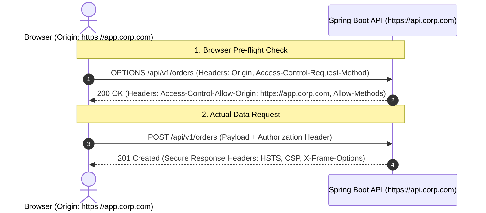

# Topic 114: Production CORS, CSRF Defense & Security Headers for Modern SPAs

> 🎯 **Roadmap Seal:** **`[MUST-KNOW / CORE]`** — *Essential modern foundation required for backend roles. Master this thoroughly.*

## 1. What It Is and Why It Exists

In modern enterprise architectures, web applications are decoupled: a Single-Page Application (SPA) built with React, Vue, or Angular hosted on `https://portal.enterprise.com` communicates with a backend REST API hosted on `https://api.enterprise.com`.

Web browsers enforce the **Same-Origin Policy (SOP)**: scripts running under one origin cannot read data from a different origin unless the server explicitly grants permission via **Cross-Origin Resource Sharing (CORS)** headers.

Furthermore, production backends must defend against client-side exploitation via:
- **Cross-Site Request Forgery (CSRF):** Forcing browsers to execute unintended state mutations.
- **Cross-Site Scripting (XSS) & Clickjacking:** Stealing credentials or overlaying invisible iframe click traps, mitigated by **HTTP Security Headers** (CSP, HSTS, X-Frame-Options).



### Real-World Analogy
Consider an international embassy checkpoint.
- **CORS:** The embassy guard checks the visitor's passport origin. If the visitor comes from an approved diplomatic partner (**Allowed Origins**), they are admitted. If they come from an unrecognized jurisdiction, the gate stays shut.
- **CSRF Token:** A one-time handwritten password verification slip that the visitor must hand to the teller; without it, requests are rejected even if the visitor wears an official visitor badge.
- **Security Headers (HSTS, CSP, X-Frame-Options):** The reinforced bulletproof glass, soundproof walls, and surveillance cameras preventing visitors from recording conversations or tampering with official documents.

---

## 2. Prerequisites
Before studying production web security, ensure you have mastered:
- [Topic 73: Web Security Essentials (XSS, CSRF Sanitization)](#topic-73) — Web vulnerabilities and browser sandbox policies.
- [Topic 98: Modern SecurityFilterChain Architecture & Password Encryption](#topic-98) — Spring Security filter chain configuration.

---

## 3. Syntax Breakdown & Core Mechanics

### 3.1 Production CORS Configuration

Never use raw `@CrossOrigin(origins = "*")` on production controllers. Instead, declare a centralized `CorsConfigurationSource` bean:

```java
@Bean
public CorsConfigurationSource corsConfigurationSource() {
    CorsConfiguration configuration = new CorsConfiguration();
    
    // Explicit allowed origins (Never use "*" when allowCredentials is true)
    configuration.setAllowedOrigins(List.of("https://app.enterprise.com", "https://admin.enterprise.com"));
    configuration.setAllowedMethods(List.of("GET", "POST", "PUT", "PATCH", "DELETE", "OPTIONS"));
    configuration.setAllowedHeaders(List.of("Authorization", "Content-Type", "X-XSRF-TOKEN", "X-Tenant-ID"));
    configuration.setExposedHeaders(List.of("X-Total-Count", "X-Trace-Id"));
    configuration.setAllowCredentials(true);
    configuration.setMaxAge(3600L); // Cache pre-flight OPTIONS for 1 hour

    UrlBasedCorsConfigurationSource source = new UrlBasedCorsConfigurationSource();
    source.registerCorsConfiguration("/**", configuration);
    return source;
}
```

---

### 3.2 Hybrid CSRF Protection with `CookieCsrfTokenRepository`

For Single-Page Applications that send state-changing requests (`POST`, `PUT`, `DELETE`), configure `CookieCsrfTokenRepository`:

```java
http
    .csrf(csrf -> csrf
        .csrfTokenRepository(CookieCsrfTokenRepository.withHttpOnlyFalse())
        .csrfTokenRequestHandler(new SpaCsrfTokenRequestHandler())
    )
```

- **`withHttpOnlyFalse()`:** Allows JavaScript frameworks (Axios, Angular, React) to read the `XSRF-TOKEN` cookie value.
- **Verification:** The client script reads the cookie and echoes it back inside the `X-XSRF-TOKEN` HTTP header on state-changing requests.

---

### 3.3 Enforcing Hardened HTTP Security Headers

```java
http
    .headers(headers -> headers
        // 1. Content Security Policy (Prevents XSS by restricting script origins)
        .contentSecurityPolicy(csp -> csp
            .policyDirectives("default-src 'self'; script-src 'self'; object-src 'none'; frame-ancestors 'none';")
        )
        // 2. Strict Transport Security (Forces HTTPS for 1 year including subdomains)
        .httpStrictTransportSecurity(hsts -> hsts
            .includeSubDomains(true)
            .maxAgeInSeconds(31536000)
            .preload(true)
        )
        // 3. Prevent Clickjacking
        .frameOptions(HeadersConfigurer.FrameOptionsConfig::deny)
        // 4. Prevent MIME-sniffing
        .contentTypeOptions(Customizer.withDefaults())
    );
```

---

## 4. Code Examples

### 4.1 Basic Example: Simulating CORS Pre-Flight Evaluation
```java
package com.handbook.spring;

import java.util.*;

public class BasicCorsPreflightDemo {

    public static class CorsValidator {
        private final Set<String> allowedOrigins = Set.of("https://app.enterprise.com", "https://portal.enterprise.com");

        public boolean evaluatePreflight(String origin, String method) {
            System.out.printf("[CORS Pre-Flight] Validating Origin: %s | Method: %s%n", origin, method);
            if (!allowedOrigins.contains(origin)) {
                System.out.println("  -> [CORS REJECT] Disallowed Origin!");
                return false;
            }
            System.out.println("  -> [CORS PERMIT] Origin allowed.");
            return true;
        }
    }

    public static void main(String[] args) {
        System.out.println("--- Spring Security: CORS Pre-Flight Simulation ---");
        CorsValidator validator = new CorsValidator();

        validator.evaluatePreflight("https://app.enterprise.com", "POST");
        validator.evaluatePreflight("https://malicious-attacker.org", "POST");
    }
}
```

**Expected Terminal Output:**
```text
--- Spring Security: CORS Pre-Flight Simulation ---
[CORS Pre-Flight] Validating Origin: https://app.enterprise.com | Method: POST
  -> [CORS PERMIT] Origin allowed.
[CORS Pre-Flight] Validating Origin: https://malicious-attacker.org | Method: POST
  -> [CORS REJECT] Disallowed Origin!
```

---

### 4.2 Realistic Enterprise Example: Verified ProductionCorsCsrfSecurityDemo
```java
package com.handbook.spring;

import java.util.*;

public class ProductionCorsCsrfSecurityDemo {

    public record SecurityHeaders(String csp, String hsts, String frameOptions, String contentTypeOptions) {}

    public static SecurityHeaders createHardenedHeaders() {
        return new SecurityHeaders(
            "default-src 'self'; frame-ancestors 'none';",
            "max-age=31536000; includeSubDomains; preload",
            "DENY",
            "nosniff"
        );
    }

    public static void main(String[] args) {
        System.out.println("=== Topic 114: Production CORS, CSRF Defense & Security Headers ===");

        SecurityHeaders headers = createHardenedHeaders();
        System.out.println("Applied Production HTTP Security Headers:");
        System.out.println("  - Content-Security-Policy   : " + headers.csp());
        System.out.println("  - Strict-Transport-Security : " + headers.hsts());
        System.out.println("  - X-Frame-Options           : " + headers.frameOptions());
        System.out.println("  - X-Content-Type-Options    : " + headers.contentTypeOptions());

        if (!"DENY".equals(headers.frameOptions()) || !headers.hsts().contains("max-age=31536000")) {
            throw new AssertionError("Production Security Headers verification failed!");
        }

        System.out.println("Topic 114 Production CORS, CSRF and Security Headers verified successfully.");
    }
}
```

---

## 5. Common Mistakes & Error Diagnosis

### Pitfall 1: Wildcard Origin with Credentials Collision
- **Symptom:** Browser blocks HTTP request with console error: `The value of the 'Access-Control-Allow-Origin' header in the response must not be the wildcard '*' when the request's credentials mode is 'include'`.
- **Cause:** W3C CORS specification strictly forbids `allowedOrigins("*")` when `allowCredentials(true)` is enabled.
- **Diagnosis & Fix:** Always explicitly declare exact allowed origins or use `allowedOriginPatterns("https://*.enterprise.com")`.

### Pitfall 2: Custom Filter Executed Before `CorsFilter` Rejects Pre-flight `OPTIONS`
- **Symptom:** Browser reports `401 Unauthorized` or `403 Forbidden` on pre-flight `OPTIONS` requests before the actual `POST` request can ever be sent.
- **Cause:** A custom authentication filter (e.g. JWT filter) placed ahead of the `CorsFilter` intercepts the `OPTIONS` request. Because browsers do not attach `Authorization` headers to pre-flight requests, the filter rejects the request.
- **Diagnosis & Fix:** Always ensure the `CorsFilter` executes first:
  ```java
  http.cors(Customizer.withDefaults()); // Inserts CorsFilter at highest priority
  ```

### Pitfall 3: Angular / React Requests Blocked with `403 Invalid CSRF Token`
- **Symptom:** Single-page application login succeeds, but all subsequent `POST` or `PUT` calls fail with `403 Forbidden`.
- **Cause:** In Spring Security 6, `CsrfToken` is loaded lazily by default. If the token is never referenced in a template or controller, the `XSRF-TOKEN` cookie is never written to the client browser!
- **Diagnosis & Fix:** Provide an `ApplicationListener` or custom `OncePerRequestFilter` that explicitly forces evaluation of `CsrfToken.class.getName()` into the request attributes so the cookie is emitted.

---

## 6. Best Practices Guide

| Practice | Recommendation | Architectural Justification |
| :--- | :--- | :--- |
| **CORS Origins** | Use exact origins or whitelisted patterns | Thwarts cross-origin data theft from rogue domains. |
| **Pre-Flight Caching** | Set `maxAge(3600L)` | Eliminates redundant `OPTIONS` round-trips for 1 hour per user. |
| **Strict Transport** | Enable HSTS with `includeSubDomains` | Mandates browser HTTPS encryption and prevents SSL-stripping attacks. |
| **Clickjacking** | Set `X-Frame-Options: DENY` | Prevents malicious sites from embedding your application inside invisible iframes. |
| **Content Sniffing** | Enable `nosniff` | Forces browsers to strictly respect declared `Content-Type` headers. |

---

## 7. Version Notes & Compatibility

- **Spring Security 5.x:** Used chaining DSL for headers (`http.headers().frameOptions().deny()`).
- **Spring Security 6.x (Spring Boot 3.x):**
  - Lambda DSL mandatory for all header, CORS, and CSRF declarations.
  - Introduced lazy CSRF token resolution (`XorCsrfTokenRequestAttributeHandler`) defending against BREACH attacks.
  - Native integration with modern browser standards including Permissions-Policy and Referrer-Policy headers.

---

## 8. Summary & Cheat Sheet

| HTTP Header | Example Production Value | Purpose |
| :--- | :--- | :--- |
| **`Access-Control-Allow-Origin`** | `https://portal.enterprise.com` | Authorizes specific origins to read response payloads. |
| **`Content-Security-Policy`** | `default-src 'self'; frame-ancestors 'none';` | Restricts scripts, styles, and iframe embeds to prevent XSS. |
| **`Strict-Transport-Security`** | `max-age=31536000; includeSubDomains; preload`| Enforces HTTPS transport for all current and future requests. |
| **`X-Frame-Options`** | `DENY` | Completely blocks rendering inside `<iframe>` tags (Anti-Clickjacking). |
| **`X-Content-Type-Options`** | `nosniff` | Disables browser MIME-type guessing to prevent script execution via uploads. |

---

## 9. Hands-on Practice Exercises

### Exercise 1: Spot the Bug — Wildcard Origin with Credentials Collision
Review the following CORS configuration:
```java
CorsConfiguration config = new CorsConfiguration();
config.addAllowedOrigin("*");
config.setAllowCredentials(true);
```
Why will modern browsers (Chrome, Firefox, Safari) refuse to execute authenticated requests against this API, and how is it fixed?

<details>
<summary>View Solution</summary>

**Cause:**
The CORS security standard strictly prohibits combining wildcard `*` origins with credentials (`cookies`, `Authorization` headers).

**The Fix:**
Specify exact domain origins or use pattern matching:
```java
CorsConfiguration config = new CorsConfiguration();
config.setAllowedOriginPatterns(List.of("https://*.enterprise.com"));
config.setAllowCredentials(true);
```
</details>

---

### Exercise 2: Hands-on Implementation — Configuring a Hardened SecurityFilterChain with CSP and HSTS
Implement a complete `SecurityFilterChain` bean enforcing CORS, HSTS, CSP, and denying frames.

<details>
<summary>View Solution</summary>

```java
package com.handbook.spring.config;

import org.springframework.context.annotation.Bean;
import org.springframework.context.annotation.Configuration;
import org.springframework.security.config.Customizer;
import org.springframework.security.config.annotation.web.builders.HttpSecurity;
import org.springframework.security.config.annotation.web.configurers.HeadersConfigurer;
import org.springframework.security.web.SecurityFilterChain;

@Configuration
public class HardenedWebSecurityConfig {

    @Bean
    public SecurityFilterChain securityFilterChain(HttpSecurity http) throws Exception {
        return http
            .cors(Customizer.withDefaults())
            .headers(headers -> headers
                .contentSecurityPolicy(csp -> csp
                    .policyDirectives("default-src 'self'; frame-ancestors 'none';")
                )
                .httpStrictTransportSecurity(hsts -> hsts
                    .maxAgeInSeconds(31536000)
                    .includeSubDomains(true)
                )
                .frameOptions(HeadersConfigurer.FrameOptionsConfig::deny)
            )
            .build();
    }
}
```
</details>

---

### Exercise 3: Real-World Edge Case — Handling CORS Pre-Flight Requests in Custom Filters
<details>
<summary>View Solution</summary>
**Question:** If an application implements a custom API Key validation filter, how must the filter handle HTTP `OPTIONS` requests to avoid breaking CORS pre-flight handshakes?

**Solution:**
Browsers do not attach custom headers (like `X-API-KEY` or `Authorization`) during the pre-flight `OPTIONS` handshake. If the custom filter attempts to validate the key on an `OPTIONS` request, it will reject the request with `401 Unauthorized`!
The filter must immediately bypass validation if the HTTP method is `OPTIONS`:
```java
@Override
protected void doFilterInternal(HttpServletRequest request, 
                                HttpServletResponse response, 
                                FilterChain filterChain) throws ServletException, IOException {
    if ("OPTIONS".equalsIgnoreCase(request.getMethod())) {
        filterChain.doFilter(request, response);
        return;
    }

    String apiKey = request.getHeader("X-API-KEY");
    if (apiKey == null || !isValidKey(apiKey)) {
        response.sendError(HttpServletResponse.SC_UNAUTHORIZED, "Invalid API Key");
        return;
    }

    filterChain.doFilter(request, response);
}
```
</details>

---

## 10. Verified Official Sources
- [Spring Security Reference: CORS](https://docs.spring.io/spring-security/reference/servlet/integrations/cors.html)
- [Spring Security Reference: Security HTTP Response Headers](https://docs.spring.io/spring-security/reference/servlet/exploits/headers.html)
- [OWASP Secure Headers Project](https://owasp.org/www-project-secure-headers/)
