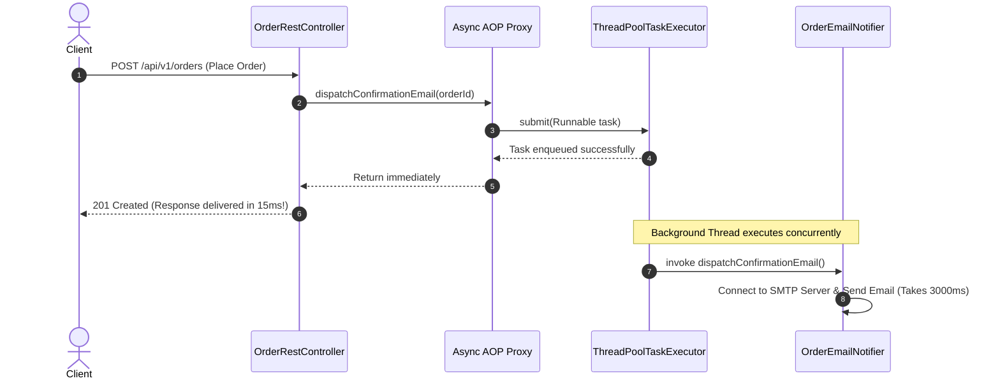

# Topic 115: Asynchronous Task Execution (@Async, ThreadPoolTaskExecutor & CompletableFuture)

> 🚀 **Roadmap Seal:** **`[ADVANCED / DEEP-DIVE]`** — *Advanced enterprise specialization & architecture. Study once core fundamentals are solid.*

## 1. What It Is and Why It Exists

In enterprise web architectures, an incoming HTTP request is allocated a dedicated container worker thread (e.g. from Tomcat's default 200-thread pool). If a user action requires executing heavy, time-consuming operations—such as generating a 50-page PDF report, dispatching notification emails, encoding videos, or calling slow third-party partner APIs—holding the HTTP worker thread idle while waiting for I/O causes catastrophic **thread starvation**.

When all 200 container threads are blocked waiting for external calls, the server cannot accept new user connections, resulting in HTTP 504 Gateway Timeouts and complete application freezes.

**Spring Asynchronous Execution (`@Async`)** resolves this bottleneck by immediately releasing the client HTTP worker thread. The heavy background work is offloaded to a dedicated, tuned background thread pool, allowing the HTTP endpoint to return an instantaneous HTTP 202 Accepted response or an asynchronous `CompletableFuture`:



### Real-World Analogy
Consider a busy postal parcel office.
- **Synchronous (Blocking):** The clerk takes your package, locks the service window, walks to the warehouse in the next town, packages the box, drives it to the airport, and walks back 3 hours later before serving the next customer in line. The line outside stretches for 5 miles.
- **Asynchronous (`@Async`):** The clerk accepts your package, hands you an immediate receipt slip (**HTTP 202 / Tracking ID**), drops the parcel into an internal conveyor hopper (**Task Queue**), and serves the very next customer in 5 seconds. Dedicated warehouse sorters (**ThreadPool Workers**) process parcels continuously in the background.

---

## 2. Prerequisites
Before studying asynchronous task execution, ensure you have mastered:
- [Topic 51: Executor Framework & Thread Pools](file:///c:/Users/modym/OneDrive/Desktop/Java-Doc/content/part1-core/51-executor-framework-and-thread-pools.md) — Thread pools, queues, and executors.
- [Topic 52: Asynchronous Pipelines with CompletableFuture](file:///c:/Users/modym/OneDrive/Desktop/Java-Doc/content/part1-core/52-completablefuture-and-async.md) — Non-blocking futures and composition.
- [Topic 89: Component Scanning, Injection Strategies & Bean Lifecycle Callbacks](file:///c:/Users/modym/OneDrive/Desktop/Java-Doc/content/part3-spring/89-component-scanning-injection-strategies-bean-lifecycle.md) — Spring AOP proxies and bean wiring.

---

## 3. Syntax Breakdown & Core Mechanics

### 3.1 Enabling Async & Tuning `ThreadPoolTaskExecutor`

Never rely on Spring Boot's default fallback executor in production. Always configure an explicit, tuned `ThreadPoolTaskExecutor`:

```java
@Configuration
@EnableAsync
public class AsyncConfiguration implements AsyncConfigurer {

    @Bean(name = "orderProcessingExecutor")
    public ThreadPoolTaskExecutor orderProcessingExecutor() {
        ThreadPoolTaskExecutor executor = new ThreadPoolTaskExecutor();
        executor.setCorePoolSize(10);             // Threads maintained alive permanently
        executor.setMaxPoolSize(50);              // Max threads allocated under high burst
        executor.setQueueCapacity(500);           // Memory buffer before pool expands
        executor.setKeepAliveSeconds(60);         // Idle time before shrinking back to core
        executor.setThreadNamePrefix("OrderAsync-");
        
        // Saturated Pool Rejection Policy: Forces caller thread to execute task under heavy load
        executor.setRejectedExecutionHandler(new ThreadPoolExecutor.CallerRunsPolicy());
        
        executor.setWaitForTasksToCompleteOnShutdown(true); // Graceful shutdown
        executor.setAwaitTerminationSeconds(30);
        executor.initialize();
        return executor;
    }

    @Override
    public AsyncUncaughtExceptionHandler getAsyncUncaughtExceptionHandler() {
        return (throwable, method, params) -> {
            log.error("Unhandled exception in async method: {} with params: {}", 
                method.getName(), Arrays.toString(params), throwable);
        };
    }
}
```

---

### 3.2 Asynchronous Method Signatures

Methods annotated with `@Async` support two distinct invocation styles:

#### A. Fire-and-Forget (`void`)
```java
@Service
public class AuditNotificationService {

    @Async("orderProcessingExecutor")
    public void recordSecurityAuditAsync(String userId, String action) {
        // Executed asynchronously in background; returns immediately to caller
        auditRepository.save(new SecurityAudit(userId, action, Instant.now()));
    }
}
```

#### B. Asynchronous Computation with `CompletableFuture<T>`
```java
@Service
public class CreditScoringService {

    @Async("orderProcessingExecutor")
    public CompletableFuture<CreditScore> calculateCreditScoreAsync(String nationalId) {
        // Perform expensive scoring computation
        CreditScore score = externalBureauClient.fetchScore(nationalId);
        return CompletableFuture.completedFuture(score);
    }
}
```

---

## 4. Code Examples

### 4.1 Basic Example: Simulating Asynchronous Task Offloading
```java
package com.handbook.spring;

import java.time.Instant;
import java.util.concurrent.*;

public class BasicAsyncSimulationDemo {

    public static void main(String[] args) throws Exception {
        System.out.println("--- Spring Boot: Asynchronous Execution Simulation ---");

        ExecutorService executor = Executors.newFixedThreadPool(2);
        System.out.println("[Main Thread] Request received at: " + Instant.now());

        CompletableFuture<String> asyncResult = CompletableFuture.supplyAsync(() -> {
            System.out.println("[Worker Thread] Processing heavy background calculation on: " + 
                Thread.currentThread().getName());
            try { Thread.sleep(200); } catch (InterruptedException ignored) {}
            return "SUCCESS_CALCULATION_TOKEN_9901";
        }, executor);

        System.out.println("[Main Thread] Returned HTTP response immediately! Doing other work...");
        System.out.println("[Main Thread] Awaiting background result: " + asyncResult.get());
        executor.shutdown();
    }
}
```

**Expected Terminal Output:**
```text
--- Spring Boot: Asynchronous Execution Simulation ---
[Main Thread] Request received at: ...
[Main Thread] Returned HTTP response immediately! Doing other work...
[Worker Thread] Processing heavy background calculation on: pool-1-thread-1
[Main Thread] Awaiting background result: SUCCESS_CALCULATION_TOKEN_9901
```

---

### 4.2 Realistic Enterprise Example: Verified AsyncExecutionThreadPoolDemo
```java
package com.handbook.spring;

import java.util.*;
import java.util.concurrent.*;
import java.util.concurrent.atomic.AtomicInteger;

public class AsyncExecutionThreadPoolDemo {

    public static class ResilientTaskDispatcher {
        private final ThreadPoolExecutor executor;
        private final AtomicInteger completedCount = new AtomicInteger(0);

        public ResilientTaskDispatcher(int core, int max, int queueCapacity) {
            this.executor = new ThreadPoolExecutor(
                core, max, 60L, TimeUnit.SECONDS,
                new ArrayBlockingQueue<>(queueCapacity),
                new ThreadPoolExecutor.CallerRunsPolicy()
            );
        }

        public void submitTask(String taskId) {
            executor.submit(() -> {
                completedCount.incrementAndGet();
                System.out.printf("  -> Executed Task: %s on Thread: %s%n", 
                    taskId, Thread.currentThread().getName());
            });
        }

        public int getCompletedCount() { return completedCount.get(); }
        public void shutdown() { executor.shutdown(); }
    }

    public static void main(String[] args) throws Exception {
        System.out.println("=== Topic 115: Asynchronous Task Execution & ThreadPool Tuning ===");

        ResilientTaskDispatcher dispatcher = new ResilientTaskDispatcher(2, 4, 10);
        for (int i = 1; i <= 5; i++) {
            dispatcher.submitTask("ORDER_INVOICE_JOB_" + i);
        }

        Thread.sleep(150);
        System.out.println("Total background tasks completed: " + dispatcher.getCompletedCount());

        if (dispatcher.getCompletedCount() != 5) {
            throw new AssertionError("Not all asynchronous tasks completed successfully!");
        }

        dispatcher.shutdown();
        System.out.println("Topic 115 Asynchronous Task Execution verified successfully.");
    }
}
```

---

## 5. Common Mistakes & Error Diagnosis

### Pitfall 1: Calling `@Async` Method Internally Within the Same Class (Self-Invocation)
- **Symptom:** Methods annotated with `@Async` execute synchronously on the caller thread, blocking the HTTP response.
- **Cause:** Spring's `@Async` relies on AOP dynamic proxies. Calling `this.asyncMethod()` directly bypasses the proxy; the method executes synchronously.
- **Diagnosis & Fix:** Always move `@Async` methods to a separate collaborator `@Service` bean:
  ```java
  // INCORRECT (Synchronous execution):
  public void handleOrder() {
      this.sendEmailAsync(); // Direct call bypasses proxy!
  }

  // CORRECT:
  @Service
  public class OrderCoordinator {
      private final EmailNotificationService emailService;
      public void handleOrder() {
          emailService.sendEmailAsync(); // Crosses proxy boundary cleanly!
      }
  }
  ```

### Pitfall 2: Relying on Default `SimpleAsyncTaskExecutor` in Production
- **Symptom:** Server crashes with `java.lang.OutOfMemoryError: unable to create new native thread` under moderate traffic spikes.
- **Cause:** If no `TaskExecutor` bean is configured, Spring defaults to `SimpleAsyncTaskExecutor`, which does not pool threads. It spawns an unconstrained new OS thread for every single task.
- **Diagnosis & Fix:** Always define an explicit `ThreadPoolTaskExecutor` bean with bounded `corePoolSize`, `maxPoolSize`, and `queueCapacity`.

### Pitfall 3: Context Loss (SecurityContext & TenantContext Empty in Worker Threads)
- **Symptom:** `@Async` methods throw `AccessDeniedException` or write data to the wrong database schema.
- **Cause:** `SecurityContextHolder` and `TenantContext` use `ThreadLocal`. Background threads in the thread pool do not inherit parent thread-local values.
- **Diagnosis & Fix:** Configure a `TaskDecorator` to copy thread-local contexts from the calling thread into the worker thread before dispatch:
  ```java
  executor.setTaskDecorator(runnable -> {
      SecurityContext securityContext = SecurityContextHolder.getContext();
      String tenantId = TenantContext.getTenantId();
      return () -> {
          try {
              SecurityContextHolder.setContext(securityContext);
              TenantContext.setTenantId(tenantId);
              runnable.run();
          } finally {
              SecurityContextHolder.clearContext();
              TenantContext.clear();
          }
      };
  });
  ```

---

## 6. Best Practices Guide

| Practice | Recommendation | Architectural Justification |
| :--- | :--- | :--- |
| **Rejection Policy** | Use `CallerRunsPolicy` | Provides graceful backpressure: if background queues fill up, the caller thread throttles itself. |
| **Naming Prefix** | Set `setThreadNamePrefix("OrderWorker-")` | Simplifies log analysis and thread dump troubleshooting in production. |
| **Graceful Shutdown** | Set `setWaitForTasksToCompleteOnShutdown(true)` | Prevents data loss during Docker container rolling updates. |
| **Virtual Threads** | In Java 21+, evaluate Virtual Threads for I/O tasks | Eliminates thread pool size constraints for network/database bound tasks. |

---

## 7. Version Notes & Compatibility

- **Spring 5.x / Boot 2.x:** Supported classic `ThreadPoolTaskExecutor` wrapping Java 8 `ThreadPoolExecutor`.
- **Spring 6.x / Boot 3.x:**
  - Full native support for **Java 21 Virtual Threads (Project Loom)**:
    ```yaml
    spring:
      threads:
        virtual:
          enabled: true
    ```
  - When enabled, `@Async` tasks run on lightweight virtual threads rather than operating system platform threads.

---

## 8. Summary & Cheat Sheet

| Saturation Policy | Behavior When Queue & Pool Full | Risk | Recommended Scope |
| :--- | :--- | :--- | :--- |
| **`AbortPolicy` (Default)** | Throws `RejectedExecutionException` | Unhandled task loss | Non-critical background telemetry |
| **`CallerRunsPolicy`** | **Caller thread executes task itself** | Slows caller down slightly | **Production enterprise backends (Built-in Backpressure)** |
| **`DiscardPolicy`** | Silently drops the task | Silent data loss | Analytics pings |
| **`DiscardOldestPolicy`** | Drops the oldest unhandled task in queue | Oldest jobs lost | High-frequency sensor feeds |

---

## 9. Hands-on Practice Exercises

### Exercise 1: Spot the Bug — Internal Self-Invocation on Async Task
Review the following service class:
```java
@Service
public class InvoiceService {

    public void generateCustomerInvoice(Long invoiceId) {
        log.info("Generating invoice: {}", invoiceId);
        sendPdfViaEmailAsync(invoiceId);
    }

    @Async
    public void sendPdfViaEmailAsync(Long invoiceId) {
        // Connect to SMTP and send PDF
    }
}
```
Why does `sendPdfViaEmailAsync` execute on the HTTP container thread, and how is it corrected?

<details>
<summary>View Solution</summary>

**Cause:**
`generateCustomerInvoice` directly invokes `sendPdfViaEmailAsync` via `this`. Because it bypasses the Spring AOP dynamic proxy, no `AsyncExecutionInterceptor` intercepts the call.

**The Fix:**
Extract `sendPdfViaEmailAsync` into a dedicated `EmailDispatchService`.
</details>

---

### Exercise 2: Hands-on Implementation — Configuring a Production ThreadPoolTaskExecutor with Custom Rejection Handler
Write a `@Configuration` class declaring a bean `paymentTaskExecutor` with 5 core threads, 20 max threads, queue capacity 100, and `CallerRunsPolicy`.

<details>
<summary>View Solution</summary>

```java
package com.handbook.spring.config;

import org.springframework.context.annotation.Bean;
import org.springframework.context.annotation.Configuration;
import org.springframework.scheduling.annotation.EnableAsync;
import org.springframework.scheduling.concurrent.ThreadPoolTaskExecutor;

import java.util.concurrent.ThreadPoolExecutor;

@Configuration
@EnableAsync
public class AsyncThreadPoolConfig {

    @Bean(name = "paymentTaskExecutor")
    public ThreadPoolTaskExecutor paymentTaskExecutor() {
        ThreadPoolTaskExecutor executor = new ThreadPoolTaskExecutor();
        executor.setCorePoolSize(5);
        executor.setMaxPoolSize(20);
        executor.setQueueCapacity(100);
        executor.setThreadNamePrefix("PaymentWorker-");
        executor.setRejectedExecutionHandler(new ThreadPoolExecutor.CallerRunsPolicy());
        executor.setWaitForTasksToCompleteOnShutdown(true);
        executor.initialize();
        return executor;
    }
}
```
</details>

---

### Exercise 3: Real-World Edge Case — Propagating MDC / Correlation IDs into Asynchronous Workers via TaskDecorator
<details>
<summary>View Solution</summary>
**Question:** In microservices using distributed tracing, why do log messages inside `@Async` methods lose their `traceId` and `spanId`, and how does a `TaskDecorator` restore them?

**Solution:**
1. **The Context Loss:** SLF4J's Mapped Diagnostic Context (MDC) uses `ThreadLocal`. When a task is handed off to a worker thread pool, the worker thread's MDC is completely empty. Logs printed inside the `@Async` method have no `traceId`, making distributed log tracing impossible.
2. **The Solution:** Configure a `TaskDecorator` on `ThreadPoolTaskExecutor`:
   ```java
   executor.setTaskDecorator(runnable -> {
       Map<String, String> contextMap = MDC.getCopyOfContextMap();
       return () -> {
           try {
               if (contextMap != null) MDC.setContextMap(contextMap);
               runnable.run();
           } finally {
               MDC.clear();
           }
       };
   });
   ```
</details>

---

## 10. Verified Official Sources
- [Spring Framework Reference: Task Execution and Scheduling](https://docs.spring.io/spring-framework/reference/integration/scheduling.html)
- [Spring Framework API: ThreadPoolTaskExecutor](https://docs.spring.io/spring-framework/docs/current/javadoc-api/org/springframework/scheduling/concurrent/ThreadPoolTaskExecutor.html)
- [Java Platform SE 21: ThreadPoolExecutor JavaDoc](https://docs.oracle.com/en/java/javase/21/docs/api/java.base/java/util/concurrent/ThreadPoolExecutor.html)
