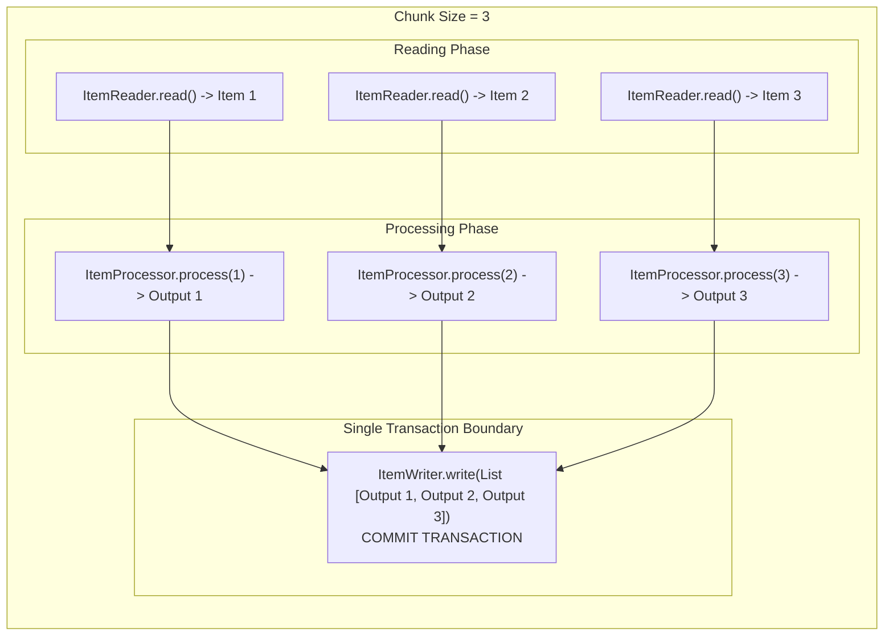

# Topic 117: High-Volume Batch Processing with Spring Batch (Chunk Processing & Readers/Writers)

> 🚀 **Roadmap Seal:** **`[ADVANCED / DEEP-DIVE]`** — *Advanced enterprise specialization & architecture. Study once core fundamentals are solid.*

## 1. What It Is and Why It Exists

Enterprise systems constantly process massive datasets: end-of-month payroll runs for 500,000 employees, nightly processing of 10 million financial transactions, importing millions of catalog items from third-party CSV/XML feeds, or archiving terabytes of historical logs.

### The Failure of Naive Loops
Attempting to process millions of records using simple Java loops (`for (Record r : records)`) fails catastrophically:
1. **`OutOfMemoryError`:** Loading millions of objects into the JVM heap exhausts memory.
2. **Transaction Log Saturation:** Wrapping millions of database mutations into a single transaction overfills relational database undo/redo logs, causing database crashes.
3. **Zero Restartability:** If a failure occurs at record 9,999,999, an unmanaged script must restart from record 0, wasting hours of computing power and risking duplicate data insertion.

**Spring Batch** is the industry-standard, lightweight, comprehensive batch processing framework. It introduces the **Chunk-Oriented Processing Paradigm**: reading items sequentially, transforming them in memory, and committing database writes in fixed, transactional chunks (e.g. 500 records per transaction).



### Real-World Analogy
Consider bricklayers building a high-rise foundation with 10,000 bricks.
- **Naive Approach:** The bricklayer loads all 10,000 bricks onto a giant wheelbarrow. The wheelbarrow collapses, breaks the worker's back, and crushes the foundation (**OutOfMemoryError**).
- **Chunk Processing:** The worker loads a sturdy crate of exactly 50 bricks (**Chunk Size**), rolls them to the site, lays them down, inspects the alignment, stamps the building permit (**Transaction Commit**), and returns for the next 50 bricks. If a rainstorm halts work halfway through, the worker resumes right from brick 5,001 the next morning (**Restartability**).

---

## 2. Prerequisites
Before studying Spring Batch, ensure you have mastered:
- [Topic 51: Executor Framework & Thread Pools](#topic-51) — Multi-threading and task partitioning.
- [Topic 95: Spring Data JPA Architecture: Repository Hierarchy & JpaRepository](#topic-95) — Batch writes and dirty checking.
- [Topic 97: Declarative @Transactional Boundaries, Pagination, Sorting & N+1 Prevention](#topic-97) — Transaction propagation and commit boundaries.

---

## 3. Syntax Breakdown & Core Mechanics

### 3.1 The Spring Batch Domain Model

- **`Job`:** An end-to-end batch process (e.g. `financialStatementJob`) composed of one or more steps.
- **`Step`:** An independent phase of a job. Can be **Chunk-oriented** (Read-Process-Write) or a **Tasklet** (single custom action like creating a folder or executing a clean-up query).
- **`JobRepository`:** The persistence mechanism that manages the lifecycle of jobs and steps, recording execution status in database tables (`BATCH_JOB_INSTANCE`, `BATCH_JOB_EXECUTION`, `BATCH_STEP_EXECUTION`).
- **`JobLauncher`:** The interface used to start a `Job` with a set of `JobParameters`.

---

### 3.2 Defining a Chunk-Oriented Step in Spring Batch 5

In modern Spring Batch 5 (standard in Spring Boot 3), `@EnableBatchProcessing` is no longer required. Jobs and Steps are configured using `JobBuilder` and `StepBuilder`:

```java
@Configuration
public class FinancialBatchJobConfig {

    @Bean
    public Job importTransactionsJob(JobRepository jobRepository, Step processTransactionsStep) {
        return new JobBuilder("importTransactionsJob", jobRepository)
            .incrementer(new RunIdIncrementer())
            .start(processTransactionsStep)
            .build();
    }

    @Bean
    public Step processTransactionsStep(JobRepository jobRepository, 
                                        PlatformTransactionManager txManager,
                                        ItemReader<RawTransaction> reader,
                                        ItemProcessor<RawTransaction, ProcessedTransaction> processor,
                                        ItemWriter<ProcessedTransaction> writer) {
        return new StepBuilder("processTransactionsStep", jobRepository)
            .<RawTransaction, ProcessedTransaction>chunk(100, txManager) // Chunk size: 100 items per commit
            .reader(reader)
            .processor(processor)
            .writer(writer)
            .faultTolerant()
            .skip(InvalidPayloadException.class)
            .skipLimit(10) // Allows skipping up to 10 corrupt records before aborting
            .build();
    }
}
```

---

### 3.3 Authoring Custom Readers, Processors, and Writers

```java
// 1. Processor (Filters and transforms data)
@Component
public class TransactionSanitizingProcessor implements ItemProcessor<RawTransaction, ProcessedTransaction> {
    @Override
    public ProcessedTransaction process(RawTransaction item) {
        if (item.amount() <= 0) return null; // Returning null skips the item completely!
        return new ProcessedTransaction(item.id(), item.amount(), "CLEARED");
    }
}

// 2. Writer (Dispatches batch inserts to relational database)
@Component
public class DatabaseBatchWriter implements ItemWriter<ProcessedTransaction> {
    private final JdbcTemplate jdbcTemplate;

    public DatabaseBatchWriter(JdbcTemplate jdbcTemplate) {
        this.jdbcTemplate = jdbcTemplate;
    }

    @Override
    public void write(Chunk<? extends ProcessedTransaction> chunk) {
        // Dispatches single batch SQL statement for the entire chunk
        jdbcTemplate.batchUpdate(
            "INSERT INTO processed_tx (id, amount, status) VALUES (?, ?, ?)",
            chunk.getItems(),
            chunk.size(),
            (ps, tx) -> {
                ps.setString(1, tx.id());
                ps.setDouble(2, tx.amount());
                ps.setString(3, tx.status());
            }
        );
    }
}
```

---

## 4. Code Examples

### 4.1 Basic Example: Simulating Chunk-Oriented Processing
```java
package com.handbook.spring;

import java.util.*;

public class BasicChunkProcessingDemo {

    public static void main(String[] args) {
        System.out.println("--- Spring Batch: Chunk-Oriented Processing Simulation ---");

        List<Integer> inputDataset = List.of(1, 2, 3, 4, 5, 6, 7, 8);
        int chunkSize = 3;

        List<Integer> chunkBuffer = new ArrayList<>();
        int chunkNumber = 1;

        for (Integer item : inputDataset) {
            // 1. Read & Process
            Integer processed = item * 10;
            chunkBuffer.add(processed);

            // 2. Write on chunk threshold
            if (chunkBuffer.size() == chunkSize) {
                commitChunk(chunkNumber++, chunkBuffer);
                chunkBuffer.clear();
            }
        }

        // 3. Flush remaining items
        if (!chunkBuffer.isEmpty()) {
            commitChunk(chunkNumber, chunkBuffer);
            chunkBuffer.clear();
        }
    }

    private static void commitChunk(int chunkId, List<Integer> items) {
        System.out.printf("[TX Commit] Chunk #%d written to database: %s%n", chunkId, items);
    }
}
```

**Expected Terminal Output:**
```text
--- Spring Batch: Chunk-Oriented Processing Simulation ---
[TX Commit] Chunk #1 written to database: [10, 20, 30]
[TX Commit] Chunk #2 written to database: [40, 50, 60]
[TX Commit] Chunk #3 written to database: [70, 80]
```

---

### 4.2 Realistic Enterprise Example: Verified SpringBatchChunkProcessingDemo
```java
package com.handbook.spring;

import java.util.*;

public class SpringBatchChunkProcessingDemo {

    public record RawOrder(String orderId, double price, boolean valid) {}
    public record SettledOrder(String orderId, double finalAmount, String status) {}

    public static class BatchPipelineEngine {
        public static List<SettledOrder> executeChunkPipeline(List<RawOrder> rawOrders, int chunkSize) {
            List<SettledOrder> settled = new ArrayList<>();
            List<SettledOrder> chunk = new ArrayList<>();

            for (RawOrder raw : rawOrders) {
                // ItemProcessor step: filter invalid and calculate fee
                if (!raw.valid()) {
                    System.out.println("  -> [Skipped Invalid Order]: " + raw.orderId());
                    continue;
                }
                SettledOrder processed = new SettledOrder(raw.orderId(), raw.price() * 1.05, "SETTLED");
                chunk.add(processed);

                // ItemWriter step: commit when chunk is full
                if (chunk.size() == chunkSize) {
                    System.out.printf("  -> [Chunk Commit] Writing %d orders to ledger.%n", chunk.size());
                    settled.addAll(chunk);
                    chunk.clear();
                }
            }

            if (!chunk.isEmpty()) {
                System.out.printf("  -> [Final Chunk Commit] Writing %d orders to ledger.%n", chunk.size());
                settled.addAll(chunk);
                chunk.clear();
            }

            return settled;
        }
    }

    public static void main(String[] args) {
        System.out.println("=== Topic 117: High-Volume Batch Processing with Spring Batch ===");

        List<RawOrder> feed = List.of(
            new RawOrder("ORD-001", 100.00, true),
            new RawOrder("ORD-002", 250.00, true),
            new RawOrder("ORD-003", 0.00, false), // Corrupt record
            new RawOrder("ORD-004", 450.00, true),
            new RawOrder("ORD-005", 90.00, true)
        );

        List<SettledOrder> results = BatchPipelineEngine.executeChunkPipeline(feed, 2);
        System.out.println("Total settled orders committed: " + results.size());

        if (results.size() != 4) {
            throw new AssertionError("Batch pipeline chunk processing count mismatch!");
        }

        System.out.println("Topic 117 Spring Batch Chunk Processing verified successfully.");
    }
}
```

---

## 5. Common Mistakes & Error Diagnosis

### Pitfall 1: Modifying Entities Inside `ItemProcessor` Triggering Unintended Flushes
- **Symptom:** Performance grinds to a halt and database locks proliferate during batch execution.
- **Cause:** Returning a JPA managed entity from an `ItemReader` and mutating it inside an `ItemProcessor`. Hibernate's persistence context automatically flushes changes on every individual entity before the chunk writer finishes.
- **Diagnosis & Fix:** Always detach entities or map them directly to clean immutable DTOs / Records before transformation in `ItemProcessor`.

### Pitfall 2: Memory Exhaustion via Non-Paging Readers
- **Symptom:** `java.lang.OutOfMemoryError: Java heap space` after processing 100,000 records.
- **Cause:** Using `JdbcCursorItemReader` with an unconstrained database fetch size or writing custom repository calls that execute `findAll()`.
- **Diagnosis & Fix:** Always use **`JdbcPagingItemReader`** or **`JpaPagingItemReader`** with `pageSize` matching your step `chunkSize`. Paging readers fetch only the active chunk from disk, guaranteeing constant $O(1)$ memory usage.

### Pitfall 3: Re-Running a Completed Job Instance Without Parameter Variation
- **Symptom:** Spring Batch fails immediately throwing `JobInstanceAlreadyCompleteException`.
- **Cause:** Spring Batch guarantees idempotency. A `JobInstance` is uniquely identified by `(JobName, JobParameters)`. If a job completes with status `COMPLETED`, Spring Batch will refuse to re-run it with the exact same parameters.
- **Diagnosis & Fix:** Add `new RunIdIncrementer()` to the job definition, or pass a timestamp parameter `run.id=System.currentTimeMillis()`.

---

## 6. Best Practices Guide

| Practice | Recommendation | Architectural Justification |
| :--- | :--- | :--- |
| **Chunk Size Tuning** | Set between 100 and 1,000 items | Balances JDBC batch throughput against database memory buffers and rollback cost. |
| **Fault Tolerance** | Use `.faultTolerant().skip(DataValidationException.class)` | Prevents a single corrupt line in a 5-million line CSV from aborting the entire nightly job. |
| **Reader Selection** | Use `JpaPagingItemReader` or `FlatFileItemReader` | Streamlined memory consumption; reads records incrementally without loading entire datasets. |
| **Idempotence** | Design `ItemWriter` with Upsert / Merge semantics | Guarantees that restarting a failed job does not produce duplicate database records. |

---

## 7. Version Notes & Compatibility

- **Spring Batch 4.x (Spring Boot 2.x):** Required `@EnableBatchProcessing` and extended `DefaultBatchConfigurer`.
- **Spring Batch 5.x (Spring Boot 3.x):**
  - Deprecated `@EnableBatchProcessing` (auto-configuration handles configuration automatically).
  - Raised baseline to **Java 17 LTS**.
  - Replaced legacy `JobBuilderFactory` and `StepBuilderFactory` with direct `new JobBuilder(...)` and `new StepBuilder(...)`.
  - Updated `ItemWriter` signature to accept `Chunk<? extends T>` instead of `List<? extends T>`.

---

## 8. Summary & Cheat Sheet

| Component | Responsibility | Typical Implementation |
| :--- | :--- | :--- |
| **`ItemReader<I>`** | Reads one record at a time; returns `null` when stream ends | `FlatFileItemReader`, `JdbcPagingItemReader` |
| **`ItemProcessor<I, O>`** | Validates, filters, and transforms items; returning `null` drops item | Custom business logic bean |
| **`ItemWriter<O>`** | Writes an entire chunk of records in a single database transaction | `JdbcBatchItemWriter`, `JpaItemWriter` |
| **`JobRepository`** | Stores execution checkpoints and enables job restartability | Relational database schema (`BATCH_*` tables) |

---

## 9. Hands-on Practice Exercises

### Exercise 1: Spot the Bug — The Non-Restartable Completed Job Instance
Review the following job execution:
```java
JobParameters params = new JobParametersBuilder()
    .addString("jobName", "dailyLedgerSync")
    .toJobParameters();
jobLauncher.run(dailyLedgerJob, params);
```
When this code runs on Monday, it succeeds. When it runs on Tuesday with the exact same parameters, it crashes with `JobInstanceAlreadyCompleteException`. Why, and how is it fixed?

<details>
<summary>View Solution</summary>

**Cause:**
Spring Batch identifies a `JobInstance` by its parameters. Because the parameters (`jobName=dailyLedgerSync`) are identical to Monday's run, Spring Batch considers the instance already finished and refuses to re-execute.

**The Fix:**
Include a dynamic parameter (such as execution date or run ID):
```java
JobParameters params = new JobParametersBuilder()
    .addString("jobName", "dailyLedgerSync")
    .addLong("run.id", System.currentTimeMillis())
    .toJobParameters();
```
</details>

---

### Exercise 2: Hands-on Implementation — Chunk-Oriented CSV-to-Database Migration Pipeline
Define a Spring Batch `Step` reading customer strings, sanitizing whitespace, and writing to an output repository in chunks of 50.

<details>
<summary>View Solution</summary>

```java
package com.handbook.spring.batch;

import org.springframework.batch.core.Step;
import org.springframework.batch.core.repository.JobRepository;
import org.springframework.batch.core.step.builder.StepBuilder;
import org.springframework.batch.item.ItemProcessor;
import org.springframework.batch.item.ItemReader;
import org.springframework.batch.item.ItemWriter;
import org.springframework.context.annotation.Bean;
import org.springframework.context.annotation.Configuration;
import org.springframework.transaction.PlatformTransactionManager;

@Configuration
public class CustomerMigrationStepConfig {

    @Bean
    public Step customerMigrationStep(JobRepository jobRepository,
                                      PlatformTransactionManager txManager,
                                      ItemReader<String> reader,
                                      ItemWriter<String> writer) {
        ItemProcessor<String, String> processor = String::trim;

        return new StepBuilder("customerMigrationStep", jobRepository)
            .<String, String>chunk(50, txManager)
            .reader(reader)
            .processor(processor)
            .writer(writer)
            .build();
    }
}
```
</details>

---

### Exercise 3: Real-World Edge Case — Handling Corrupt Records with `FaultTolerantStepBuilder.skip()`
<details>
<summary>View Solution</summary>
**Question:** In a 5-million line credit card transaction feed, 3 lines contain corrupted non-numeric characters that throw `NumberFormatException`. How does Spring Batch gracefully log and skip those 3 bad records without aborting the remaining 4,999,997 transactions?

**Solution:**
Configure fault tolerance and a custom `SkipListener`:
```java
@Bean
public Step processTransactionsStep(JobRepository jobRepository, PlatformTransactionManager txManager) {
    return new StepBuilder("processTransactionsStep", jobRepository)
        .<RawTx, ClearedTx>chunk(200, txManager)
        .reader(itemReader())
        .processor(itemProcessor())
        .writer(itemWriter())
        .faultTolerant()
        .skip(NumberFormatException.class)
        .skipLimit(100) // Skip up to 100 bad rows
        .listener(new SkipListener<RawTx, ClearedTx>() {
            @Override
            public void onSkipInProcess(RawTx item, Throwable t) {
                log.warn("Skipping corrupt transaction item: {} due to: {}", item, t.getMessage());
            }
        })
        .build();
}
```
</details>

---

## 10. Verified Official Sources
- [Spring Batch Official Documentation](https://docs.spring.io/spring-batch/reference/)
- [Spring Batch 5 Migration Guide](https://github.com/spring-projects/spring-batch/wiki/Spring-Batch-5.0-Migration-Guide)
- [Baeldung: Introduction to Spring Batch](https://www.baeldung.com/introduction-to-spring-batch)
