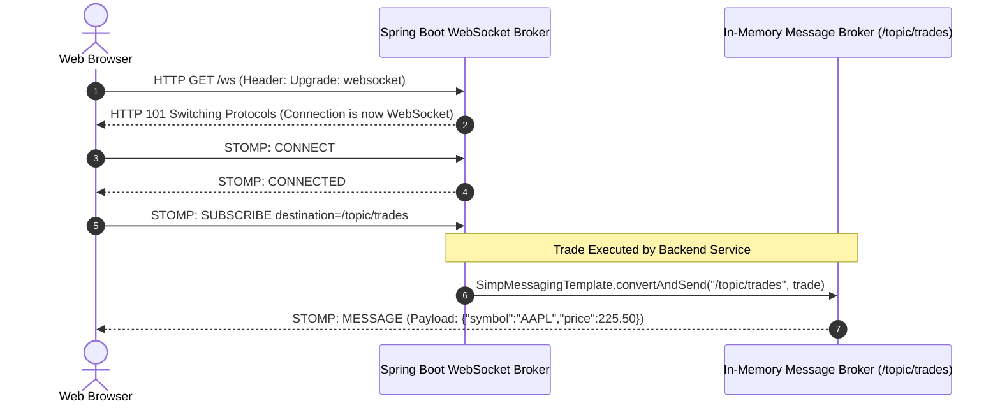

# Topic 118: Real-Time Bidirectional Communication with WebSockets, STOMP & SockJS

> 🚀 **Roadmap Seal:** **`[ADVANCED / DEEP-DIVE]`** — *Advanced enterprise specialization & architecture. Study once core fundamentals are solid.*

## 1. What It Is and Why It Exists

Traditional HTTP architectures follow a strict request-response lifecycle: the client initiates a connection, sends an HTTP verb, waits for the server response, and terminates the connection. For real-time applications—such as live financial stock tickers, chat platforms, collaborative whiteboards, multiplayer gaming, and auction bidding engines—this model introduces severe architectural limitations.

### The Inefficiency of HTTP Polling
In legacy apps, developers implemented **Short Polling** (client sends an HTTP request every 1 second) or **Long Polling** (server holds request open until data arrives). 
- **Header Bloat:** Every polling check sends 1–2 KB of HTTP headers (cookies, user-agents, tokens), wasting bandwidth when no data changed.
- **Server CPU Saturation:** Millions of short polling loops overwhelm web servers and database query caches.

### The WebSocket Full-Duplex Standard (RFC 6455)
WebSockets establish a persistent, bidirectional, full-duplex TCP communication channel between client and server. After a single initial HTTP Handshake (`Upgrade: websocket`), the connection transitions to lightweight binary or text frames with only **2 to 10 bytes** of framing overhead!

### Why STOMP on Top of WebSockets?
Raw WebSockets provide a flat stream of bytes without semantics: the protocol does not define how to send messages to a specific topic, how to format payloads, or how to subscribe to notifications. **STOMP (Simple Text Oriented Messaging Protocol)** acts as a sub-protocol on top of WebSockets, introducing standardized frames (`CONNECT`, `SUBSCRIBE`, `SEND`, `MESSAGE`) that integrate natively with enterprise message brokers (RabbitMQ, ActiveMQ).



### Real-World Analogy
Consider telephone communications.
- **HTTP Polling:** Calling your bank every 30 seconds, hanging up, and dialing again: *"Did my wire transfer arrive yet?"* *"No."* [Click]. Calling back 30 seconds later: *"Did it arrive yet?"*
- **WebSockets with STOMP:** Picking up a secure, direct hotline telephone that stays permanently connected to the bank teller desk. When funds arrive, the teller simply speaks into the phone and you hear the confirmation in real-time.

---

## 2. Prerequisites
Before studying WebSockets and STOMP, ensure you have mastered:
- [Topic 64: Web Architecture Fundamentals (HTTP Protocol, Client-Server)](#topic-64) — HTTP verbs, headers, and TCP handshakes.
- [Topic 92: Production REST Controller Architecture with Spring Web MVC](#topic-92) — Spring MVC request dispatching.
- [Topic 99: Stateless REST Security with JWT & Method-Level Role Authorization](#topic-99) — Authentication tokens and security context.

---

## 3. Syntax Breakdown & Core Mechanics

### 3.1 Enabling WebSocket Message Broker

```java
@Configuration
@EnableWebSocketMessageBroker
public class WebSocketBrokerConfiguration implements WebSocketMessageBrokerConfigurer {

    @Override
    public void registerStompEndpoints(StompEndpointRegistry registry) {
        // HTTP URL where clients initiate the WebSocket handshake
        registry.addEndpoint("/ws-connect")
            .setAllowedOrigins("https://portal.enterprise.com")
            .withSockJS(); // Fallback to HTTP streaming if WebSockets are blocked by proxies
    }

    @Override
    public void configureMessageBroker(MessageBrokerRegistry registry) {
        // Destinations handled directly by @MessageMapping in Spring controllers
        registry.setApplicationDestinationPrefixes("/app");

        // Built-in in-memory broker routing messages to subscribers
        registry.enableSimpleBroker("/topic", "/queue");

        // Specific prefix for targeted point-to-point user messages
        registry.setUserDestinationPrefix("/user");
    }
}
```

---

### 3.2 Handling Incoming Messages: `@MessageMapping` & `@SendTo`

```java
@Controller
public class TradingFloorController {

    private final SimpMessagingTemplate messagingTemplate;

    public TradingFloorController(SimpMessagingTemplate messagingTemplate) {
        this.messagingTemplate = messagingTemplate;
    }

    // Listens for client STOMP SEND to destination "/app/trade"
    @MessageMapping("/trade")
    @SendTo("/topic/trades") // Broadcasts return value to all subscribers of "/topic/trades"
    public TradeNotification processTrade(TradeOrder order, Principal principal) {
        log.info("Processing trade for user: {} | Symbol: {}", principal.getName(), order.symbol());
        return new TradeNotification(order.symbol(), order.price(), Instant.now());
    }

    // Programmatic point-to-point dispatch to a specific individual user
    public void sendDirectAlert(String username, String alertMessage) {
        // Delivers to destination: /user/{username}/queue/alerts
        messagingTemplate.convertAndSendToUser(
            username, "/queue/alerts", new AlertPayload(alertMessage)
        );
    }
}
```

---

## 4. Code Examples

### 4.1 Basic Example: Simulating STOMP Broadcast Messaging
```java
package com.handbook.spring;

import java.util.*;

public class BasicWebSocketBroadcastDemo {

    public static class SimpleStompBroker {
        private final Map<String, List<String>> subscriptions = new HashMap<>();

        public void subscribe(String destination, String subscriberId) {
            subscriptions.computeIfAbsent(destination, k -> new ArrayList<>()).add(subscriberId);
            System.out.printf("[%s] Subscribed to topic: %s%n", subscriberId, destination);
        }

        public void broadcast(String destination, String payload) {
            System.out.printf("[Broker] Broadcasting to %s: '%s'%n", destination, payload);
            List<String> subscribers = subscriptions.getOrDefault(destination, List.of());
            subscribers.forEach(sub -> System.out.printf("  -> Delivered to Client [%s]%n", sub));
        }
    }

    public static void main(String[] args) {
        System.out.println("--- Spring Web: STOMP Pub/Sub Broadcast Simulation ---");
        SimpleStompBroker broker = new SimpleStompBroker();

        broker.subscribe("/topic/forex", "Trader-Client-Alpha");
        broker.subscribe("/topic/forex", "Trader-Client-Beta");

        broker.broadcast("/topic/forex", "TICKER: USD/EUR = 0.9250 [UPDATED]");
    }
}
```

**Expected Terminal Output:**
```text
--- Spring Web: STOMP Pub/Sub Broadcast Simulation ---
[Trader-Client-Alpha] Subscribed to topic: /topic/forex
[Trader-Client-Beta] Subscribed to topic: /topic/forex
[Broker] Broadcasting to /topic/forex: 'TICKER: USD/EUR = 0.9250 [UPDATED]'
  -> Delivered to Client [Trader-Client-Alpha]
  -> Delivered to Client [Trader-Client-Beta]
```

---

### 4.2 Realistic Enterprise Example: Verified WebSocketStompBrokerDemo
```java
package com.handbook.spring;

import java.time.Instant;
import java.util.*;

public class WebSocketStompBrokerDemo {

    public record MarketQuote(String symbol, double price, Instant timestamp) {}

    public static class StompMessageChannelSimulator {
        private final List<MarketQuote> messageLog = new ArrayList<>();

        public void publishMarketQuote(String symbol, double price) {
            MarketQuote quote = new MarketQuote(symbol, price, Instant.now());
            messageLog.add(quote);
            System.out.printf("  -> [STOMP Broadcast /topic/market]: %s = $%.2f (%s)%n", 
                quote.symbol(), quote.price(), quote.timestamp());
        }

        public int getMessageCount() { return messageLog.size(); }
    }

    public static void main(String[] args) {
        System.out.println("=== Topic 118: Real-Time WebSockets & STOMP Messaging Architecture ===");

        StompMessageChannelSimulator channel = new StompMessageChannelSimulator();
        channel.publishMarketQuote("AAPL", 228.45);
        channel.publishMarketQuote("NVDA", 142.10);

        System.out.println("Total real-time frames delivered via STOMP broker: " + channel.getMessageCount());

        if (channel.getMessageCount() != 2) {
            throw new AssertionError("WebSocket message dispatch count mismatch!");
        }

        System.out.println("Topic 118 WebSockets and STOMP messaging verified successfully.");
    }
}
```

---

## 5. Common Mistakes & Error Diagnosis

### Pitfall 1: Attempting to Transmit Bearer JWT Headers During Active WebSocket Frames
- **Symptom:** Client connects cleanly, but subsequent STOMP `SEND` frames fail authentication.
- **Cause:** WebSockets do not support sending standard HTTP `Authorization: Bearer` headers after the initial handshake is established.
- **Diagnosis & Fix:** Authenticate tokens during the STOMP `CONNECT` frame using a `ChannelInterceptor`:
  ```java
  @Override
  public void configureClientInboundChannel(ChannelRegistration registration) {
      registration.interceptors(new ChannelInterceptor() {
          @Override
          public Message<?> preSend(Message<?> message, MessageChannel channel) {
              StompHeaderAccessor accessor = MessageHeaderAccessor.getAccessor(message, StompHeaderAccessor.class);
              if (StompCommand.CONNECT.equals(accessor.getCommand())) {
                  String token = accessor.getFirstNativeHeader("Authorization");
                  // Validate JWT and set Authentication principal on accessor
                  accessor.setUser(jwtTokenProvider.getAuthentication(token));
              }
              return message;
          }
      });
  }
  ```

### Pitfall 2: Multi-Instance Cluster Message Drop with In-Memory SimpleBroker
- **Symptom:** User A connected to Pod 1 sends a message to `/topic/chat`, but User B connected to Pod 2 never receives it!
- **Cause:** `enableSimpleBroker()` runs entirely in local JVM memory. It does not communicate across different container instances.
- **Diagnosis & Fix:** In distributed multi-pod Kubernetes environments, use the **External Stomp Broker Relay** backed by a shared RabbitMQ or ActiveMQ cluster:
  ```java
  registry.enableStompBrokerRelay("/topic", "/queue")
      .setRelayHost("rabbitmq.internal")
      .setRelayPort(61613);
  ```

### Pitfall 3: Intermediate Reverse Proxies Terminating Idle Connections
- **Symptom:** WebSocket connections mysteriously disconnect every 60 seconds.
- **Cause:** AWS ALB, Cloudflare, or NGINX terminate idle TCP connections if no packets travel through the socket.
- **Diagnosis & Fix:** Configure STOMP heartbeats in your broker configuration:
  ```java
  registry.enableSimpleBroker("/topic")
      .setHeartbeatValue(new long[]{10000, 10000}); // Send and receive heartbeat every 10 seconds
  ```

---

## 6. Best Practices Guide

| Practice | Recommendation | Architectural Justification |
| :--- | :--- | :--- |
| **Fallback Protocol** | Always register `.withSockJS()` | Ensures seamless connectivity through restrictive corporate firewalls and legacy proxies. |
| **Clustering** | Use `enableStompBrokerRelay` for multi-node deployments | Guarantees topic broadcast propagation across all horizontal microservice replicas. |
| **Authentication** | Intercept STOMP `CONNECT` frame | Enforces JWT token validation before any subscription or message exchange occurs. |
| **Heartbeats** | Enable bidirectional heartbeats (10s/10s) | Prevents load balancers from terminating idle socket connections. |

---

## 7. Version Notes & Compatibility

- **Spring 5.x / Boot 2.x:** Supported WebSockets on classic Tomcat/Jetty servlet containers.
- **Spring 6.x / Boot 3.x:**
  - Upgraded to Jakarta WebSocket 2.1 specification (`jakarta.websocket.*`).
  - Improved virtual thread support for STOMP broker channel inbound executors.

---

## 8. Summary & Cheat Sheet

| Technology | Directionality | Protocol | Overhead | Best Used For |
| :--- | :--- | :--- | :--- | :--- |
| **Short Polling** | Unidirectional | HTTP | Extremely High (Full headers per sec) | Legacy systems with no real-time requirements. |
| **Server-Sent Events**| Server -> Client | HTTP / Text-Stream | Very Low | Unidirectional live feeds (dashboards, news). |
| **WebSockets (STOMP)**| **Full-Duplex (Bidirectional)**| **TCP / WebSocket Frames** | **Minimal (2–10 bytes framing)** | **Chat apps, collaborative editing, trading platforms.** |

---

## 9. Hands-on Practice Exercises

### Exercise 1: Spot the Bug — In-Memory Broker Multi-Instance Broadcast Failure
Review the following production configuration running on 4 Kubernetes pods:
```java
@Configuration
@EnableWebSocketMessageBroker
public class WebSocketConfig implements WebSocketMessageBrokerConfigurer {
    @Override
    public void configureMessageBroker(MessageBrokerRegistry registry) {
        registry.enableSimpleBroker("/topic");
    }
}
```
Why do clients connected to Pod 1 fail to receive alerts broadcast by Pod 3, and what is the required fix?

<details>
<summary>View Solution</summary>

**Cause:**
`enableSimpleBroker` is an in-memory queue that exists solely within the RAM of the local JVM. Pod 1 has no knowledge of subscriptions registered on Pod 3.

**The Fix:**
Configure the external Stomp Broker Relay backed by a clustered RabbitMQ message broker:
```java
@Override
public void configureMessageBroker(MessageBrokerRegistry registry) {
    registry.enableStompBrokerRelay("/topic", "/queue")
        .setRelayHost("clustered-rabbitmq.messaging")
        .setRelayPort(61613);
}
```
</details>

---

### Exercise 2: Hands-on Implementation — Configuring STOMP Message Broker with Channel Security Interceptor
Write a Spring Boot configuration establishing a STOMP endpoint `/chat-ws` with SockJS, and registering an inbound channel interceptor that validates a dummy token `"Bearer valid_secret"` on `CONNECT`.

<details>
<summary>View Solution</summary>

```java
package com.handbook.spring.config;

import org.springframework.context.annotation.Configuration;
import org.springframework.messaging.Message;
import org.springframework.messaging.MessageChannel;
import org.springframework.messaging.simp.config.ChannelRegistration;
import org.springframework.messaging.simp.config.MessageBrokerRegistry;
import org.springframework.messaging.simp.stomp.StompCommand;
import org.springframework.messaging.simp.stomp.StompHeaderAccessor;
import org.springframework.messaging.support.ChannelInterceptor;
import org.springframework.messaging.support.MessageHeaderAccessor;
import org.springframework.security.authentication.BadCredentialsException;
import org.springframework.web.socket.config.annotation.EnableWebSocketMessageBroker;
import org.springframework.web.socket.config.annotation.StompEndpointRegistry;
import org.springframework.web.socket.config.annotation.WebSocketMessageBrokerConfigurer;

@Configuration
@EnableWebSocketMessageBroker
public class SecureWebSocketConfig implements WebSocketMessageBrokerConfigurer {

    @Override
    public void registerStompEndpoints(StompEndpointRegistry registry) {
        registry.addEndpoint("/chat-ws").setAllowedOrigins("*").withSockJS();
    }

    @Override
    public void configureMessageBroker(MessageBrokerRegistry registry) {
        registry.enableSimpleBroker("/topic", "/queue");
        registry.setApplicationDestinationPrefixes("/app");
    }

    @Override
    public void configureClientInboundChannel(ChannelRegistration registration) {
        registration.interceptors(new ChannelInterceptor() {
            @Override
            public Message<?> preSend(Message<?> message, MessageChannel channel) {
                StompHeaderAccessor accessor = MessageHeaderAccessor.getAccessor(message, StompHeaderAccessor.class);
                if (StompCommand.CONNECT.equals(accessor.getCommand())) {
                    String auth = accessor.getFirstNativeHeader("Authorization");
                    if (!"Bearer valid_secret".equals(auth)) {
                        throw new BadCredentialsException("Unauthorized STOMP connection!");
                    }
                }
                return message;
            }
        });
    }
}
```
</details>

---

### Exercise 3: Real-World Edge Case — Sending Targeted Point-to-Point User Notifications (`/user/queue`)
<details>
<summary>View Solution</summary>
**Question:** When a banking service dispatches a point-to-point alert using `messagingTemplate.convertAndSendToUser("alice", "/queue/alerts", alert)`, how does Spring STOMP resolve which WebSocket connection belongs to `"alice"`?

**Solution:**
1. **User Destination Resolution:** Spring uses `UserDestinationResolver`. When `"alice"` connects, Spring's security interceptor associates her `Principal.getName()` (`"alice"`) with her unique WebSocket session ID (e.g. `session-8891`).
2. **Subscription Mapping:** When Alice's client subscribes to `/user/queue/alerts`, Spring translates this behind the scenes to a unique session destination:
   `/queue/alerts-user-session-8891`
3. **Dispatch:** When `convertAndSendToUser("alice", ...)` is called, the template looks up Alice's active session IDs and publishes the payload directly to that private session destination. Other users subscribed to `/user/queue/alerts` will never receive Alice's notifications.
</details>

---

## 10. Verified Official Sources
- [Spring Framework Reference: WebSockets & STOMP](https://docs.spring.io/spring-framework/reference/web/websocket/stomp.html)
- [STOMP Protocol Specification (v1.2)](https://stomp.github.io/stomp-specification-1.2.html)
- [RFC 6455: The WebSocket Protocol](https://datatracker.ietf.org/doc/html/rfc6455)
