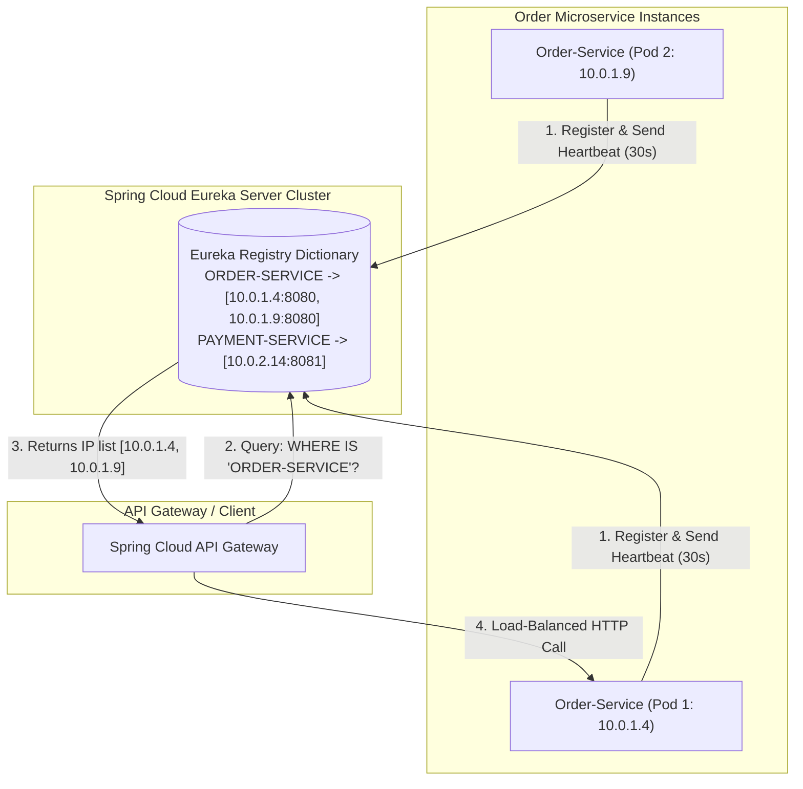

# Topic 120: Service Discovery & Dynamic Registration (Spring Cloud Eureka & Consul)

> 🚀 **Roadmap Seal:** **`[ADVANCED / DEEP-DIVE]`** — *Advanced enterprise specialization & architecture. Study once core fundamentals are solid.*

## 1. What It Is and Why It Exists

In traditional monolithic web architectures, applications ran on a handful of static physical servers with fixed IP addresses (e.g. `192.168.1.50`). Configuration files simply hardcoded these addresses.

In modern cloud-native Service-Oriented Architectures (SOA) and microservices, **static IP addresses are completely obsolete**:
- Applications autoscale dynamically from 2 instances to 50 instances during traffic spikes.
- Containers (Docker / Kubernetes Pods) restart with entirely new ephemeral IP addresses on different physical nodes.
- Rolling deployments replace unhealthy container instances continuously.

Hardcoding network hostnames or IP addresses in microservice configurations is impossible.

**Service Discovery** solves this problem by introducing a dynamic phonebook for microservices: **The Service Registry**. When any microservice boots up, it automatically registers its dynamic IP address and port with the registry under a logical service name (e.g. `ORDER-SERVICE`). When other services need to call it, they query the registry using the logical name:



### Real-World Analogy
Consider an international airport taxi dispatcher.
- **Hardcoded Static Routing:** A traveler writes down a specific taxi driver's personal cell phone number and license plate 3 years in advance. When the traveler lands at 2:00 AM, that taxi driver is in a different city or retired (**Connection Refused**).
- **Service Discovery:** The airport maintains a central taxi dispatch stand (**Eureka Server**). As taxis arrive, they pull into the queue and register with the dispatcher (**Service Registration**). The dispatcher directs arriving travelers to the next active, vetted taxi in line (**Dynamic Discovery**).

---

## 2. Prerequisites
Before studying Service Discovery, ensure you have mastered:
- [Topic 64: Web Architecture Fundamentals (HTTP Protocol, Client-Server)](file:///c:/Users/modym/OneDrive/Desktop/Java-Doc/content/part2-jakarta/64-web-architecture-fundamentals.md) — HTTP networking, DNS, and IP routing.
- [Topic 90: Auto-Configuration Mechanics, Starters & Embedded Runtimes](file:///c:/Users/modym/OneDrive/Desktop/Java-Doc/content/part3-spring/90-auto-configuration-mechanics-starters-embedded-runtimes.md) — Spring Boot starters and embedded runtimes.
- [Topic 91: Externalized Configuration, YAML Hierarchies & Multi-Profile Deployment](file:///c:/Users/modym/OneDrive/Desktop/Java-Doc/content/part3-spring/91-externalized-configuration-yaml-hierarchies-multi-profile.md) — Dynamic profile and environment resolution.

---

## 3. Syntax Breakdown & Core Mechanics

### 3.1 Provisioning a Eureka Service Registry Server

Add `spring-cloud-starter-netflix-eureka-server`:

```java
@SpringBootApplication
@EnableEurekaServer // Activates Eureka Service Registry
public class ServiceRegistryApplication {
    public static void main(String[] args) {
        SpringApplication.run(ServiceRegistryApplication.class, args);
    }
}
```

```yaml
# application.yml for Eureka Server
server:
  port: 8761

eureka:
  instance:
    hostname: localhost
  client:
    register-with-eureka: false # Standalone server does not register with itself
    fetch-registry: false
    service-url:
      defaultZone: http://${eureka.instance.hostname}:${server.port}/eureka/
  server:
    enable-self-preservation: true # Critical network partition defense
```

---

### 3.2 Registering a Microservice Client

Add `spring-cloud-starter-netflix-eureka-client`:

```yaml
# application.yml for Order Microservice
spring:
  application:
    name: order-service # Logical Virtual Host Name registered in Eureka

server:
  port: 8081

eureka:
  client:
    service-url:
      defaultZone: http://localhost:8761/eureka/
  instance:
    prefer-ip-address: true # Register container IP instead of Docker container ID
    lease-renewal-interval-in-seconds: 30 # Send heartbeat ping every 30 seconds
    lease-expiration-duration-in-seconds: 90 # Evict if 3 consecutive heartbeats are missed
```

```java
@SpringBootApplication
@EnableDiscoveryClient // Auto-registers with Eureka / Consul on startup
public class OrderServiceApplication {
    public static void main(String[] args) {
        SpringApplication.run(OrderServiceApplication.class, args);
    }
}
```

---

### 3.3 Eureka Self-Preservation Mode
If a temporary network partition occurs between the Eureka server and an entire availability zone, thousands of client heartbeats will fail simultaneously. 

Rather than panicking and blindly deleting all registered microservices from its directory—which would destroy routing for the entire company—Eureka enters **Self-Preservation Mode**. It halts all instance evictions until heartbeat health metrics recover, preserving existing routing tables.

---

## 4. Code Examples

### 4.1 Basic Example: Simulating Service Registry Lookups
```java
package com.handbook.spring;

import java.util.*;

public class BasicServiceRegistryDemo {

    public static class InProcessServiceRegistry {
        private final Map<String, List<String>> registry = new HashMap<>();

        public void register(String serviceName, String instanceAddress) {
            registry.computeIfAbsent(serviceName.toUpperCase(), k -> new ArrayList<>()).add(instanceAddress);
            System.out.printf("[Registry] Registered '%s' at: %s%n", serviceName, instanceAddress);
        }

        public String discover(String serviceName) {
            List<String> instances = registry.get(serviceName.toUpperCase());
            if (instances == null || instances.isEmpty()) {
                throw new IllegalStateException("Service Unavailable: " + serviceName);
            }
            // Simple Round-Robin pick
            return instances.get(0);
        }
    }

    public static void main(String[] args) {
        System.out.println("--- Spring Cloud: Service Discovery Simulation ---");
        InProcessServiceRegistry registry = new InProcessServiceRegistry();

        registry.register("PAYMENT-SERVICE", "http://10.0.1.15:8082");
        registry.register("PAYMENT-SERVICE", "http://10.0.1.16:8082");

        System.out.println("Discovered active instance for PAYMENT-SERVICE: " + 
            registry.discover("PAYMENT-SERVICE"));
    }
}
```

**Expected Terminal Output:**
```text
--- Spring Cloud: Service Discovery Simulation ---
[Registry] Registered 'PAYMENT-SERVICE' at: http://10.0.1.15:8082
[Registry] Registered 'PAYMENT-SERVICE' at: http://10.0.1.16:8082
Discovered active instance for PAYMENT-SERVICE: http://10.0.1.15:8082
```

---

### 4.2 Realistic Enterprise Example: Verified ServiceDiscoveryEurekaDemo
```java
package com.handbook.spring;

import java.util.*;

public class ServiceDiscoveryEurekaDemo {

    public record ServiceInstance(String serviceId, String host, int port, boolean healthy) {}

    public static class EurekaRegistrySimulator {
        private final Map<String, List<ServiceInstance>> registryMap = new HashMap<>();

        public void registerInstance(ServiceInstance instance) {
            registryMap.computeIfAbsent(instance.serviceId(), k -> new ArrayList<>()).add(instance);
            System.out.printf("  -> [Eureka Register]: %s running on %s:%d%n", 
                instance.serviceId(), instance.host(), instance.port());
        }

        public List<ServiceInstance> getHealthyInstances(String serviceId) {
            return registryMap.getOrDefault(serviceId, List.of()).stream()
                .filter(ServiceInstance::healthy)
                .toList();
        }
    }

    public static void main(String[] args) {
        System.out.println("=== Topic 120: Service Discovery & Dynamic Registration ===");

        EurekaRegistrySimulator eureka = new EurekaRegistrySimulator();
        eureka.registerInstance(new ServiceInstance("INVENTORY-SERVICE", "10.0.4.12", 8083, true));
        eureka.registerInstance(new ServiceInstance("INVENTORY-SERVICE", "10.0.4.18", 8083, true));
        eureka.registerInstance(new ServiceInstance("INVENTORY-SERVICE", "10.0.4.99", 8083, false)); // Unhealthy node

        List<ServiceInstance> activeNodes = eureka.getHealthyInstances("INVENTORY-SERVICE");
        System.out.println("Active healthy nodes available for load balancing: " + activeNodes.size());

        if (activeNodes.size() != 2) {
            throw new AssertionError("Eureka healthy instances count mismatch!");
        }

        System.out.println("Topic 120 Service Discovery with Eureka verified successfully.");
    }
}
```

---

## 5. Common Mistakes & Error Diagnosis

### Pitfall 1: Disabling Self-Preservation Mode in Production
- **Symptom:** Microservices disappear from the Eureka dashboard during brief network congestion, causing cascading HTTP 503 errors.
- **Cause:** Setting `eureka.server.enable-self-preservation: false` instructs Eureka to evict any service that misses heartbeats, even if the issue is a temporary network partition between switches.
- **Diagnosis & Fix:** Always keep `enable-self-preservation: true` in production environments. Only disable it in local integration test suites where immediate cleanup is needed.

### Pitfall 2: Client Registering with Unreachable Container Hostname
- **Symptom:** Eureka dashboard shows services registered as `df83b91a2c:8080`, and calling services fail with `UnknownHostException`.
- **Cause:** In Docker and Kubernetes, containers generate random hexadecimal hostnames. By default, Eureka registers this unresolvable hostname unless configured otherwise.
- **Diagnosis & Fix:** Configure `prefer-ip-address: true` in all microservice clients:
  ```yaml
  eureka:
    instance:
      prefer-ip-address: true
  ```

### Pitfall 3: Client Stale Cache Latency
- **Symptom:** After an unhealthy instance is terminated, client callers continue sending traffic to the dead node for 30 seconds, receiving `ConnectionRefused`.
- **Cause:** Eureka clients cache the service registry locally and refresh every 30 seconds (`eureka.client.registry-fetch-interval-seconds: 30`).
- **Diagnosis & Fix:** Combine Service Discovery with **Resilience4j Circuit Breakers** or **Spring Cloud LoadBalancer Retry** to immediately fail over to a healthy replica upon network errors without waiting for the next 30-second cache poll.

---

## 6. Best Practices Guide

| Practice | Recommendation | Architectural Justification |
| :--- | :--- | :--- |
| **High Availability** | Deploy at least 2 Eureka servers in peer replication | Eliminates Single Point of Failure (SPOF) for entire cloud architecture. |
| **Network Identity** | Set `prefer-ip-address: true` | Eliminates DNS resolution failures inside containerized environments. |
| **Heartbeat Intervals** | Keep defaults (30s renewal, 90s expiration) | Balances network I/O against rapid failure detection. |
| **Kubernetes Notice** | If on pure Kubernetes, evaluate native K8s DNS Services | Avoids running separate Eureka JVMs if your cloud relies entirely on K8s CoreDNS. |

---

## 7. Version Notes & Compatibility

- **Spring Cloud Netflix (Legacy):** Historically bundled Zuul, Ribbon, Hystrix, and Archaius.
- **Spring Cloud 2023.x / 2024.x (Spring Boot 3.x):**
  - Retired legacy Netflix components (Ribbon replaced by Spring Cloud LoadBalancer, Hystrix replaced by Resilience4j, Zuul replaced by Spring Cloud Gateway).
  - Netflix Eureka Server & Client remain actively maintained and fully supported on Spring Boot 3.

---

## 8. Summary & Cheat Sheet

| Feature | Netflix Eureka | HashiCorp Consul | Kubernetes CoreDNS |
| :--- | :--- | :--- | :--- |
| **Architecture** | AP (High Availability over Consistency) | CP (Raft Consensus) | Built into K8s Cluster |
| **Language Support** | Primarily Java / Spring Boot | Multi-language (Go, Python, Java) | Universal (Standard OS DNS) |
| **Health Checks** | Client-driven heartbeats (30s) | Server-driven HTTP / TCP pings | Kubelet liveness / readiness probes |
| **Key-Value Store**| None | Built-in KV configuration | ConfigMaps / Secrets |

---

## 9. Hands-on Practice Exercises

### Exercise 1: Spot the Bug — Hostname vs IP Registration in Docker Containers
Review the following client configuration running inside an AWS ECS Docker task:
```yaml
spring:
  application:
    name: billing-service
server:
  port: 8080
eureka:
  client:
    service-url:
      defaultZone: http://eureka-registry:8761/eureka/
```
Why do other services fail to connect to `billing-service` even though it shows up as "UP" in Eureka?

<details>
<summary>View Solution</summary>

**Cause:**
Without `eureka.instance.prefer-ip-address: true`, the container registers its ephemeral internal Docker hostname (e.g. `ip-10-0-2-14.ec2.internal` or container hash `e28f11bc`). Unless enterprise private DNS is mapped, other containers cannot resolve this hostname.

**The Fix:**
```yaml
eureka:
  instance:
    prefer-ip-address: true
```
</details>

---

### Exercise 2: Hands-on Implementation — Configuring Peer-Aware Clustered Eureka Servers
Write the `application.yml` profiles for two Eureka servers (`eureka-peer-1` on port 8761 and `eureka-peer-2` on port 8762) configured to replicate registered instances to each other.

<details>
<summary>View Solution</summary>

```yaml
---
spring:
  config:
    activate:
      on-profile: peer1
server:
  port: 8761
eureka:
  instance:
    hostname: peer1.eureka.internal
  client:
    register-with-eureka: true
    fetch-registry: true
    service-url:
      defaultZone: http://peer2.eureka.internal:8762/eureka/

---
spring:
  config:
    activate:
      on-profile: peer2
server:
  port: 8762
eureka:
  instance:
    hostname: peer2.eureka.internal
  client:
    register-with-eureka: true
    fetch-registry: true
    service-url:
      defaultZone: http://peer1.eureka.internal:8761/eureka/
```
</details>

---

### Exercise 3: Real-World Edge Case — Handling Graceful Deregistration during Rolling Deployments
<details>
<summary>View Solution</summary>
**Question:** During a zero-downtime rolling deployment, when a container receives `SIGTERM`, how does Spring Boot ensure it deregisters from Eureka immediately before shutting down Tomcat?

**Solution:**
Spring Cloud includes a JVM shutdown hook by default:
1. When Kubernetes sends `SIGTERM`, Spring Cloud's `EurekaAutoServiceRegistration` executes `discoveryClient.shutdown()`.
2. The client transmits an immediate HTTP `DELETE /eureka/apps/{appName}/{instanceId}` to the Eureka server.
3. Eureka instantly sets the instance status to `CANCELLED` and broadcasts the update to peers.
4. Setting `server.shutdown: graceful` gives existing in-flight HTTP requests up to 30 seconds to finish before Tomcat closes connection sockets.
</details>

---

## 10. Verified Official Sources
- [Spring Cloud Netflix Reference Documentation](https://docs.spring.io/spring-cloud-netflix/reference/)
- [Netflix Eureka Open Source Wiki](https://github.com/Netflix/eureka/wiki)
- [Baeldung: Spring Cloud Eureka](https://www.baeldung.com/spring-cloud-netflix-eureka)
