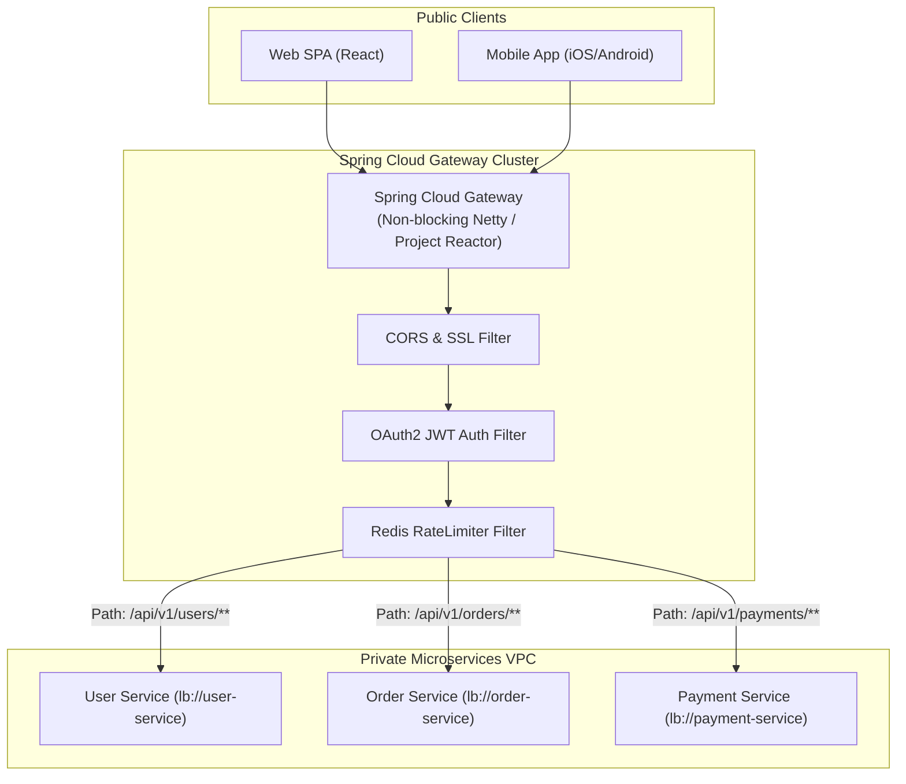

# Topic 121: Enterprise API Gateway Architecture (Spring Cloud Gateway, Routing & Rate Limiting)

> 🚀 **Roadmap Seal:** **`[ADVANCED / DEEP-DIVE]`** — *Advanced enterprise specialization & architecture. Study once core fundamentals are solid.*

## 1. What It Is and Why It Exists

In a complex microservices ecosystem, an enterprise backend may consist of dozens of fine-grained services: `user-service`, `catalog-service`, `payment-service`, `shipping-service`, and `billing-service`.

Exposing dozens of discrete backend microservice endpoints directly to public frontend clients (mobile apps, React web applications) introduces major operational vulnerabilities:
1. **Network Chatiness:** A single screen might require making 10 separate HTTP requests across different ports and domains.
2. **Security Vulnerability:** Every individual microservice must manage SSL certificates, public IP firewalls, CORS origins, and external DDoS attacks.
3. **Refactoring Inflexibility:** Breaking or merging internal services breaks client mobile apps in production.

**The API Gateway Pattern** establishes a single, unified, high-performance reverse proxy that serves as the front door for all external traffic. Built on Project Reactor and non-blocking Netty, **Spring Cloud Gateway** consolidates all cross-cutting infrastructure concerns into a single layer: routing, SSL termination, global authentication, protocol translation, distributed rate limiting, and observability.



### Real-World Analogy
Consider visiting a high-security corporate skyscraper.
- **Without a Gateway:** Visitors wander through parking lots, climb emergency stairwells, knock on internal accounting office doors, and argue with individual project managers for permission.
- **With an API Gateway:** The visitor enters through the grand front lobby. The security desk (**Gateway Security Filter**) checks their ID, the metal detector scans their baggage (**CORS / Payload Filter**), and an automated elevator badge (**Routing Engine**) takes them directly to the exact designated meeting room on the 14th floor.

---

## 2. Prerequisites
Before studying Spring Cloud Gateway, ensure you have mastered:
- [Topic 98: Modern SecurityFilterChain Architecture & Password Encryption](file:///c:/Users/modym/OneDrive/Desktop/Java-Doc/content/part3-spring/98-modern-security-filter-chain-architecture-password-encryption.md) — Security filter chain architecture.
- [Topic 112: Spring Security OAuth2 Resource Server & Asymmetric JWT Validation](file:///c:/Users/modym/OneDrive/Desktop/Java-Doc/content/part3-spring/112-spring-security-oauth2-resource-server.md) — Asymmetric token verification.
- [Topic 120: Service Discovery & Dynamic Registration (Spring Cloud Eureka & Consul)](file:///c:/Users/modym/OneDrive/Desktop/Java-Doc/content/part3-spring/120-service-discovery-registration-eureka-consul.md) — Dynamic service registries and logical routing.

---

## 3. Syntax Breakdown & Core Mechanics

### 3.1 Gateway Triad: Routes, Predicates & Filters

Spring Cloud Gateway operates around three core concepts:
1. **Route:** The primary unit of the gateway, consisting of an ID, target destination URI, collection of predicates, and collection of filters.
2. **Predicate:** A Java `Predicate<ServerWebExchange>` that evaluates incoming HTTP request attributes (`Path`, `Method`, `Header`, `Host`, `Query`, `Cookie`). If the predicate evaluates to `true`, the route is matched.
3. **Filter:** An instance of `GatewayFilter` that intercepts requests and responses before or after proxying to downstream services (modifying headers, rate limiting, rewriting paths).

---

### 3.2 Declarative Routing in `application.yml`

```yaml
spring:
  cloud:
    gateway:
      discovery:
        locator:
          enabled: false # Use explicit defined routes for security
      routes:
        # Route 1: Order Service via Eureka Load-Balancing
        - id: order-service-route
          uri: lb://ORDER-SERVICE # Dynamic discovery routing via Eureka
          predicates:
            - Path=/api/v1/orders/**
            - Method=GET,POST,PUT,DELETE
          filters:
            - StripPrefix=0
            - AddRequestHeader=X-Gateway-Source, Enterprise-Edge
            - name: RequestRateLimiter
              args:
                redis-rate-limiter.replenishRate: 10 # 10 requests allowed per second
                redis-rate-limiter.burstCapacity: 20 # 20 maximum token burst
                key-resolver: "#{@userKeyResolver}"

        # Route 2: Legacy Catalog Path Rewriting
        - id: catalog-rewrite-route
          uri: lb://CATALOG-SERVICE
          predicates:
            - Path=/v1/products/**
          filters:
            - RewritePath=/v1/products/(?<segment>.*), /api/v2/items/${segment}
```

---

### 3.3 Distributed Rate Limiting via Redis Token Bucket

Spring Cloud Gateway integrates with Redis to enforce distributed token-bucket rate limiting across multiple gateway instances:

```java
@Configuration
public class GatewayRateLimiterConfig {

    @Bean
    public KeyResolver userKeyResolver() {
        // Resolve rate-limiting key by Authenticated Username or Client IP address
        return exchange -> exchange.getPrincipal()
            .map(Principal::getName)
            .switchIfEmpty(Mono.justOrEmpty(
                exchange.getRequest().getRemoteAddress() != null ?
                exchange.getRequest().getRemoteAddress().getAddress().getHostAddress() : "anonymous"
            ));
    }
}
```

---

## 4. Code Examples

### 4.1 Basic Example: Simulating Path Predicate Matching and Routing
```java
package com.handbook.spring;

import java.util.*;

public class BasicGatewayRouteMatchDemo {

    public record RouteRule(String pathPrefix, String targetServiceUri) {}

    public static class SimpleGatewayRouter {
        private final List<RouteRule> routes = new ArrayList<>();

        public void addRoute(String pathPrefix, String targetUri) {
            routes.add(new RouteRule(pathPrefix, targetUri));
        }

        public String routeRequest(String incomingPath) {
            for (RouteRule route : routes) {
                if (incomingPath.startsWith(route.pathPrefix())) {
                    return route.targetServiceUri() + incomingPath;
                }
            }
            throw new NoSuchElementException("HTTP 404: No route found for path: " + incomingPath);
        }
    }

    public static void main(String[] args) {
        System.out.println("--- Spring Cloud Gateway: Route Predicate Matching ---");
        SimpleGatewayRouter router = new SimpleGatewayRouter();
        router.addRoute("/api/v1/users", "lb://USER-SERVICE");
        router.addRoute("/api/v1/orders", "lb://ORDER-SERVICE");

        String requestPath = "/api/v1/orders/ORD-9912";
        System.out.println("Incoming Request: " + requestPath);
        System.out.println("Proxy Destination : " + router.routeRequest(requestPath));
    }
}
```

**Expected Terminal Output:**
```text
--- Spring Cloud Gateway: Route Predicate Matching ---
Incoming Request: /api/v1/orders/ORD-9912
Proxy Destination : lb://ORDER-SERVICE/api/v1/orders/ORD-9912
```

---

### 4.2 Realistic Enterprise Example: Verified SpringCloudGatewayRoutingDemo
```java
package com.handbook.spring;

import java.util.*;

public class SpringCloudGatewayRoutingDemo {

    public record GatewayRoute(String routeId, String pattern, String targetService, int rateLimitTokens) {}

    public static class EnterpriseGatewaySimulator {
        private final List<GatewayRoute> routeTable = new ArrayList<>();

        public void addRoute(GatewayRoute route) {
            routeTable.add(route);
            System.out.printf("  -> [Gateway Route Registered]: ID=%-15s | Pattern=%-20s | Target=%s%n",
                route.routeId(), route.pattern(), route.targetService());
        }

        public Optional<GatewayRoute> matchRoute(String path) {
            return routeTable.stream().filter(r -> path.startsWith(r.pattern())).findFirst();
        }
    }

    public static void main(String[] args) {
        System.out.println("=== Topic 121: Enterprise API Gateway Architecture & Routing ===");

        EnterpriseGatewaySimulator gateway = new EnterpriseGatewaySimulator();
        gateway.addRoute(new GatewayRoute("orders-v1", "/api/v1/orders", "lb://ORDER-SERVICE", 20));
        gateway.addRoute(new GatewayRoute("payments-v1", "/api/v1/payments", "lb://PAYMENT-SERVICE", 10));

        Optional<GatewayRoute> matched = gateway.matchRoute("/api/v1/payments/process");
        System.out.println("Route matching test: " + matched.map(GatewayRoute::targetService).orElse("NONE"));

        if (matched.isEmpty() || !matched.get().targetService().equals("lb://PAYMENT-SERVICE")) {
            throw new AssertionError("Gateway route matching verification failed!");
        }

        System.out.println("Topic 121 Spring Cloud Gateway routing verified successfully.");
    }
}
```

---

## 5. Common Mistakes & Error Diagnosis

### Pitfall 1: Starter Collision: Mixing Spring MVC with Spring Cloud Gateway
- **Symptom:** Application fails to start throwing: `Spring Cloud Gateway requires WebFlux, but found Spring MVC on the classpath. Please remove spring-boot-starter-web`.
- **Cause:** Spring Cloud Gateway is built entirely on reactive **Spring WebFlux and Netty**. It cannot run inside a standard blocking Tomcat servlet container.
- **Diagnosis & Fix:** Remove `spring-boot-starter-web` from your Gateway POM or Gradle dependencies. Only include `spring-cloud-starter-gateway`.

### Pitfall 2: Memory Leak with Unbounded Redis Rate Limiter Keys
- **Symptom:** Redis memory usage expands by gigabytes, eventually triggering Redis eviction or crashes.
- **Cause:** Using `exchange.getRequest().getHeaders().getFirst("User-Agent")` or unhashed query parameters as the `KeyResolver` key, creating millions of ephemeral Redis keys.
- **Diagnosis & Fix:** Ensure rate limiting keys resolve strictly to clean bounded identifiers: authenticated user IDs or validated client IP addresses.

### Pitfall 3: Forwarding Internal Hop-by-Hop Headers
- **Symptom:** Intermittent downstream connection resets or `HTTP 502 Bad Gateway` from microservices.
- **Cause:** Forwarding HTTP/1.1 hop-by-hop headers (`Transfer-Encoding`, `Connection`, `Keep-Alive`) that should only apply between the client and gateway.
- **Diagnosis & Fix:** Spring Cloud Gateway strips hop-by-hop headers by default; ensure custom filters do not manually re-inject raw incoming request connection headers into outbound requests.

---

## 6. Best Practices Guide

| Practice | Recommendation | Architectural Justification |
| :--- | :--- | :--- |
| **Reactive Only** | Never add blocking JDBC / JPA to Gateway | The gateway runs on Netty event loops; blocking I/O halts the entire gateway throughput. |
| **Discovery Routing** | Use `lb://SERVICE-NAME` | Allows dynamic client-side load balancing via Spring Cloud LoadBalancer and Eureka. |
| **Distributed Rate Limiting** | Use Redis `RequestRateLimiter` | Protects downstream internal microservices from cascading overload and DDoS attacks. |
| **Path Stripping** | Use `StripPrefix` or `RewritePath` | Allows external clients to use `/api/v1/orders` while internal services listen on clean roots. |

---

## 7. Version Notes & Compatibility

- **Spring Cloud Netflix Zuul (Deprecated):** Classical blocking, thread-per-connection architecture retired in Spring Cloud 2020+.
- **Spring Cloud Gateway (Spring Boot 3.x):**
  - Fully reactive architecture based on Project Reactor, WebFlux, and Netty.
  - Native integration with Spring Security 6 reactive security filters (`ServerHttpSecurity`).
  - Native support for HTTP/3 and GraalVM Native Image ahead-of-time compilation.

---

## 8. Summary & Cheat Sheet

| Gateway Predicate | Example Syntax | Matching Condition |
| :--- | :--- | :--- |
| **Path** | `- Path=/api/v1/orders/**` | Matches URL path regex patterns. |
| **Method** | `- Method=GET,POST` | Matches incoming HTTP verb. |
| **Header** | `- Header=X-Request-Id, \d+` | Matches existence and regex value of HTTP headers. |
| **Host** | `- Host=**.enterprise.com` | Matches incoming `Host` domain header. |
| **After / Before**| `- After=2026-01-01T00:00:00Z` | Time-based routing for feature cutovers. |

---

## 9. Hands-on Practice Exercises

### Exercise 1: Spot the Bug — WebMvc / WebFlux Starter Collision
Review the following Maven `pom.xml` dependencies for a newly scaffolded API Gateway:
```xml
<dependencies>
    <dependency>
        <groupId>org.springframework.cloud</groupId>
        <artifactId>spring-cloud-starter-gateway</artifactId>
    </dependency>
    <dependency>
        <groupId>org.springframework.boot</groupId>
        <artifactId>spring-boot-starter-web</artifactId>
    </dependency>
</dependencies>
```
Why does this application crash immediately upon bootstrap with an initialization error?

<details>
<summary>View Solution</summary>

**Cause:**
`spring-boot-starter-web` pulls in Tomcat and Spring Web MVC, configuring a blocking servlet container. Spring Cloud Gateway requires a non-blocking reactive environment powered by Project Reactor and Netty. Having both on the classpath causes Spring Boot to throw a startup validation exception.

**The Fix:**
Remove `spring-boot-starter-web`. If reactive web capabilities are needed, use `spring-boot-starter-webflux`.
</details>

---

### Exercise 2: Hands-on Implementation — Configuring Redis Token Bucket Rate Limiting per User IP
Write a Spring Boot `@Configuration` class declaring a `KeyResolver` that rate-limits by remote client IP address, falling back to `"anonymous"` if unresolvable.

<details>
<summary>View Solution</summary>

```java
package com.handbook.spring.config;

import org.springframework.cloud.gateway.filter.ratelimit.KeyResolver;
import org.springframework.context.annotation.Bean;
import org.springframework.context.annotation.Configuration;
import org.springframework.context.annotation.Primary;
import reactor.core.publisher.Mono;

import java.net.InetSocketAddress;

@Configuration
public class RateLimiterConfig {

    @Bean
    @Primary
    public KeyResolver ipKeyResolver() {
        return exchange -> {
            InetSocketAddress address = exchange.getRequest().getRemoteAddress();
            String host = (address != null && address.getAddress() != null)
                ? address.getAddress().getHostAddress()
                : "anonymous";
            return Mono.just(host);
        };
    }
}
```
</details>

---

### Exercise 3: Real-World Edge Case — Preserving Correlation IDs Across Asynchronous Gateway Filters
<details>
<summary>View Solution</summary>
**Question:** In high-concurrency Spring Cloud Gateway environments, how do Global Filters guarantee that a unique `X-Correlation-ID` header is attached to the request before proxying and echoed in the client response?

**Solution:**
Implement a reactive `GlobalFilter`:
```java
@Component
public class CorrelationIdGlobalFilter implements GlobalFilter, Ordered {

    private static final String CORRELATION_ID_HEADER = "X-Correlation-ID";

    @Override
    public Mono<Void> filter(ServerWebExchange exchange, GatewayFilterChain chain) {
        String correlationId = exchange.getRequest().getHeaders().getFirst(CORRELATION_ID_HEADER);
        if (correlationId == null || correlationId.isBlank()) {
            correlationId = UUID.randomUUID().toString();
        }

        // Mutate request headers to downstream service
        ServerWebExchange mutatedExchange = exchange.mutate()
            .request(r -> r.header(CORRELATION_ID_HEADER, correlationId))
            .build();

        // Attach correlation ID to client HTTP response header
        mutatedExchange.getResponse().getHeaders().add(CORRELATION_ID_HEADER, correlationId);

        return chain.filter(mutatedExchange);
    }

    @Override
    public int getOrder() {
        return Ordered.HIGHEST_PRECEDENCE;
    }
}
```
</details>

---

## 10. Verified Official Sources
- [Spring Cloud Gateway Official Documentation](https://docs.spring.io/spring-cloud-gateway/reference/)
- [Project Reactor Official Reference](https://projectreactor.io/docs/core/release/reference/)
- [Baeldung: Guide to Spring Cloud Gateway](https://www.baeldung.com/spring-cloud-gateway)
