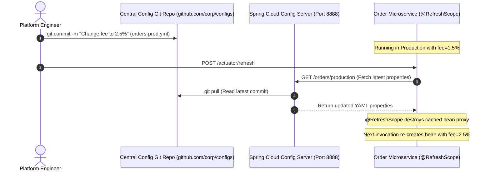

# Topic 122: Centralized Configuration Management (Spring Cloud Config Server & @RefreshScope)

> 🚀 **Roadmap Seal:** **`[ADVANCED / DEEP-DIVE]`** — *Advanced enterprise specialization & architecture. Study once core fundamentals are solid.*

## 1. What It Is and Why It Exists

In an enterprise microservices architecture with 40 distinct services deployed across 200 container instances, managing environment configuration via packaged `application.yml` files creates an operational nightmare known as **Configuration Drift**:
- Updating a single property (e.g. changing an external payment gateway URL or adjusting a feature flag threshold) requires rebuilding, re-testing, and redeploying 50 Docker containers.
- Different container replicas accidentally run with mismatched configuration properties.
- Sensitive credentials (database passwords, API secrets) risk leaking inside compiled Docker image layers.

**Spring Cloud Config** provides a centralized, externalized, version-controlled configuration management system. A dedicated **Config Server** pulls configuration properties from a central Git repository or HashiCorp Vault, while client microservices load their active environment properties over HTTP during bootstrap.

Crucially, Spring Cloud Config enables **Zero-Downtime Dynamic Configuration Updates**: modifying a Git commit and calling `/actuator/refresh` updates Spring `@Value` properties in memory across running services **without restarting the JVM!**



### Real-World Analogy
Consider a global fast-food franchise with 5,000 branch restaurants.
- **Packaged Configuration:** Every time the central office changes the price of a hamburger from \$5 to \$6, they must fire all 5,000 store managers, repaint the physical menu signs with wet oil paint, and re-open the stores 3 days later.
- **Centralized Config & Refresh:** Every restaurant has a digital overhead menu screen linked to headquarters (**Config Server**). Head office updates the price in the central database; the digital screens flash and update the price instantly in 1 second while customers are ordering at the counter (**Dynamic `@RefreshScope`**).

---

## 2. Prerequisites
Before studying centralized configuration, ensure you have mastered:
- [Topic 90: Auto-Configuration Mechanics, Starters & Embedded Runtimes](file:///c:/Users/modym/OneDrive/Desktop/Java-Doc/content/part3-spring/90-auto-configuration-mechanics-starters-embedded-runtimes.md) — Spring Boot startup lifecycle.
- [Topic 91: Externalized Configuration, YAML Hierarchies & Multi-Profile Deployment](file:///c:/Users/modym/OneDrive/Desktop/Java-Doc/content/part3-spring/91-externalized-configuration-yaml-hierarchies-multi-profile.md) — Property sources, YAML profiles, and `@Value`.
- [Topic 104: Production Observability: Spring Boot Actuator, Micrometer & Prometheus](file:///c:/Users/modym/OneDrive/Desktop/Java-Doc/content/part3-spring/104-production-observability-spring-boot-actuator-micrometer-prometheus.md) — Actuator management endpoints.

---

## 3. Syntax Breakdown & Core Mechanics

### 3.1 Provisioning the Spring Cloud Config Server

Add dependency `spring-cloud-config-server`:

```java
@SpringBootApplication
@EnableConfigServer // Activates Config Server capabilities
public class CentralConfigServerApplication {
    public static void main(String[] args) {
        SpringApplication.run(CentralConfigServerApplication.class, args);
    }
}
```

```yaml
# application.yml for Config Server
server:
  port: 8888

spring:
  cloud:
    config:
      server:
        git:
          uri: https://github.com/enterprise-corp/cloud-configuration-repo
          default-label: main # Default git branch
          clone-on-start: true
          timeout: 5
```

---

### 3.2 Client Configuration in Spring Boot 3 (`spring.config.import`)

In Spring Boot 3 and Spring Cloud 2023.x, the legacy `bootstrap.yml` is deprecated. Clients import remote configuration via `spring.config.import`:

```yaml
# application.yml for Order Microservice
spring:
  application:
    name: order-service
  profiles:
    active: prod
  config:
    import: "optional:configserver:http://localhost:8888"

management:
  endpoints:
    web:
      exposure:
        include: health, info, refresh # Expose /actuator/refresh
```

---

### 3.3 Dynamic Property Reloading with `@RefreshScope`

```java
@Service
@RefreshScope // Spring wraps this bean in a dynamic proxy that clears on /actuator/refresh
public class FeeCalculationService {

    @Value("${orders.processing-fee-percentage:1.5}")
    private double feePercentage;

    public double calculateFee(double orderAmount) {
        log.info("Calculating fee using active rate: {}%", feePercentage);
        return orderAmount * (feePercentage / 100.0);
    }
}
```

When an engineer triggers `curl -X POST http://localhost:8080/actuator/refresh`:
1. Spring Boot queries the Config Server for modified properties.
2. Spring's `ContextRefresher` emits a `RefreshScopeRefreshedEvent`.
3. The `@RefreshScope` registry invalidates its internal cache of target bean instances.
4. On the next client request, the proxy lazily instantiates a fresh `FeeCalculationService` initialized with the updated `@Value` property!

---

## 4. Code Examples

### 4.1 Basic Example: Simulating Dynamic In-Memory Property Reload
```java
package com.handbook.spring;

import java.util.*;

public class BasicDynamicPropertyReloadDemo {

    public static class DynamicConfigStore {
        private final Map<String, String> properties = new HashMap<>();

        public void updateProperty(String key, String value) {
            properties.put(key, value);
            System.out.printf("[Config Server] Property '%s' updated to: %s%n", key, value);
        }

        public String getProperty(String key, String fallback) {
            return properties.getOrDefault(key, fallback);
        }
    }

    public static void main(String[] args) {
        System.out.println("--- Spring Cloud: Dynamic Property Refresh Simulation ---");
        DynamicConfigStore store = new DynamicConfigStore();

        store.updateProperty("payment.fee.rate", "1.5");
        System.out.println("Current active payment fee: " + store.getProperty("payment.fee.rate", "0.0") + "%");

        // Simulate Git commit and /actuator/refresh
        store.updateProperty("payment.fee.rate", "2.8");
        System.out.println("Reloaded payment fee without JVM restart: " + store.getProperty("payment.fee.rate", "0.0") + "%");
    }
}
```

**Expected Terminal Output:**
```text
--- Spring Cloud: Dynamic Property Refresh Simulation ---
[Config Server] Property 'payment.fee.rate' updated to: 1.5
Current active payment fee: 1.5%
[Config Server] Property 'payment.fee.rate' updated to: 2.8
Reloaded payment fee without JVM restart: 2.8%
```

---

### 4.2 Realistic Enterprise Example: Verified CentralizedConfigRefreshDemo
```java
package com.handbook.spring;

import java.util.*;

public class CentralizedConfigRefreshDemo {

    public static class ManagedFeatureFlagService {
        private String discountCode = "WELCOME10";
        private int refreshCount = 0;

        public void reloadConfiguration(String newDiscountCode) {
            this.discountCode = newDiscountCode;
            this.refreshCount++;
            System.out.printf("  -> [@RefreshScope Proxy]: Re-initialized discountCode to '%s' (Cycle #%d)%n",
                discountCode, refreshCount);
        }

        public String getDiscountCode() { return discountCode; }
        public int getRefreshCount() { return refreshCount; }
    }

    public static void main(String[] args) {
        System.out.println("=== Topic 122: Centralized Config Server & @RefreshScope ===");

        ManagedFeatureFlagService service = new ManagedFeatureFlagService();
        System.out.println("1. Initial active discount code: " + service.getDiscountCode());

        // Simulate Actuator /refresh triggering reload
        service.reloadConfiguration("BLACK_FRIDAY_50");
        System.out.println("2. Active discount code after dynamic refresh: " + service.getDiscountCode());

        if (!"BLACK_FRIDAY_50".equals(service.getDiscountCode()) || service.getRefreshCount() != 1) {
            throw new AssertionError("Centralized config dynamic refresh validation failed!");
        }

        System.out.println("Topic 122 Centralized Config Server and @RefreshScope verified successfully.");
    }
}
```

---

## 5. Common Mistakes & Error Diagnosis

### Pitfall 1: Placing `@RefreshScope` on Connection Pool or Infrastructure Beans
- **Symptom:** Application experiences severe query deadlocks, broken transactions, or `Connection is closed` errors after calling `/actuator/refresh`.
- **Cause:** Placing `@RefreshScope` on beans managing physical TCP connections (e.g. `DataSource`, `HikariDataSource`, `EntityManagerFactory`). Invalidation destroys the connection pool while active user transactions are executing!
- **Diagnosis & Fix:** Only apply `@RefreshScope` to high-level domain services, configuration property classes (`@ConfigurationProperties`), and controller beans. Never apply it to database connection pools.

### Pitfall 2: Committing Unencrypted Plaintext Passwords to the Git Repository
- **Symptom:** Security audit flags critical compliance violation (plaintext secrets in version control history).
- **Cause:** Storing database passwords or API keys as plain strings in `application-prod.yml`.
- **Diagnosis & Fix:** Use Spring Cloud Config Server's built-in **Asymmetric Encryption** (`encrypt.key-store`). Store secrets as `{cipher}AQA...` encrypted ciphertext in Git, or integrate directly with **HashiCorp Vault**.

### Pitfall 3: Using Deprecated `bootstrap.yml` in Spring Boot 3
- **Symptom:** Microservice ignores the remote Config Server and boots up with missing properties or local fallbacks.
- **Cause:** Spring Boot 3 retired bootstrap context processing by default.
- **Diagnosis & Fix:** Define `spring.config.import: "optional:configserver:http://localhost:8888"` in standard `application.yml`, eliminating the need for `bootstrap.yml`.

---

## 6. Best Practices Guide

| Practice | Recommendation | Architectural Justification |
| :--- | :--- | :--- |
| **Prefix Optional** | Use `optional:configserver:...` | Prevents local development machines or unit tests from crashing if the remote Config Server is down. |
| **Configuration Model** | Use `@ConfigurationProperties` over `@Value` | Strongly typed, validates constraints via Bean Validation, and reloads cleanly. |
| **Secret Security** | Store sensitive keys in HashiCorp Vault | Separates general application properties (Git) from classified financial credentials (Vault). |
| **Cluster Broadcast** | Use Spring Cloud Bus with Kafka | Single webhook updates all 100 microservices simultaneously via Kafka broadcast. |

---

## 7. Version Notes & Compatibility

- **Spring Cloud 2020.x (Spring Boot 2.4+):** Replaced legacy `bootstrap.yml` with the modern `spring.config.import` engine.
- **Spring Cloud 2023.x (Spring Boot 3.x):**
  - Full native support for Java 17/21+.
  - Modernized Git backend with support for modern GitHub personal access tokens (PAT) and SSH ed25519 keys.
  - Native integration with Spring Boot 3 Actuator health indicators.

---

## 8. Summary & Cheat Sheet

| Approach | Where Configuration Lives | Update Mechanism | Best Used For |
| :--- | :--- | :--- | :--- |
| **Packaged `application.yml`** | Inside compiled JAR | Full container rebuild & redeploy | Fixed defaults, port numbers |
| **Spring Cloud Config Server** | Central Git Repository | HTTP POST `/actuator/refresh` | **Microservice business parameters, URLs, timeouts** |
| **Spring Cloud Bus** | Central Git + Kafka/RabbitMQ | Single webhook broadcasts to cluster | **Large-scale clusters (> 10 microservice nodes)** |
| **HashiCorp Vault** | Encrypted Vault Storage | Dynamic token leasing | **Database credentials, private encryption keys, API secrets** |

---

## 9. Hands-on Practice Exercises

### Exercise 1: Spot the Bug — The Destructive Refresh on DataSource Bean
Review the following configuration class:
```java
@Configuration
public class DatabaseConfiguration {

    @Bean
    @RefreshScope // Developer wants to reload db URL dynamically
    public DataSource dataSource(@Value("${spring.datasource.url}") String url) {
        HikariDataSource ds = new HikariDataSource();
        ds.setJdbcUrl(url);
        return ds;
    }
}
```
What catastrophic error will occur when `/actuator/refresh` is called while users are executing checkouts in production?

<details>
<summary>View Solution</summary>

**Cause:**
`@RefreshScope` destroys the existing `HikariDataSource` bean instance when refreshed. Any active database transactions running in worker threads will have their physical JDBC socket connections terminated abruptly, resulting in `SQLException: Connection is closed` and transaction rollbacks for in-flight customer orders.

**The Fix:**
Never place `@RefreshScope` on infrastructure connection pools. Database connection strings must be updated via controlled rolling restarts.
</details>

---

### Exercise 2: Hands-on Implementation — Configuring a Config Server with Git Backend and Client Bootstrap
Write the minimal `application.yml` for:
1. A Config Server running on port 8888 pointing to `https://github.com/corp/configs.git`.
2. An Order Microservice importing its configuration from the Config Server with profile `staging`.

<details>
<summary>View Solution</summary>

```yaml
# 1. Config Server (application.yml)
server:
  port: 8888
spring:
  application:
    name: config-server
  cloud:
    config:
      server:
        git:
          uri: https://github.com/corp/configs.git
          default-label: main
```

```yaml
# 2. Client Microservice (application.yml)
server:
  port: 8081
spring:
  application:
    name: order-service
  profiles:
    active: staging
  config:
    import: "optional:configserver:http://localhost:8888"
management:
  endpoints:
    web:
      exposure:
        include: refresh, health, info
```
</details>

---

### Exercise 3: Real-World Edge Case — Cluster-Wide Property Broadcast via Spring Cloud Bus
<details>
<summary>View Solution</summary>
**Question:** In a cluster of 50 `order-service` pods, sending `POST /actuator/refresh` to each pod individually requires 50 separate HTTP requests. How does **Spring Cloud Bus** automate this with a single request?

**Solution:**
1. **The Architecture:** Every microservice connects to a lightweight AMQP message broker (RabbitMQ or Apache Kafka) using `spring-cloud-starter-bus-amqp` or `spring-cloud-starter-bus-kafka`.
2. **The Broadcast:** A developer (or GitHub Webhook) sends a single HTTP `POST` to **one** gateway or server instance:
   `POST /actuator/busrefresh`
3. **Execution:** That single node publishes a `RefreshRemoteApplicationEvent` to the shared message broker topic (`springCloudBus`). All 50 listening microservice pods consume the message simultaneously from Kafka and trigger their own local `@RefreshScope` cache invalidation in parallel within 50 milliseconds!
</details>

---

## 10. Verified Official Sources
- [Spring Cloud Config Official Documentation](https://docs.spring.io/spring-cloud-config/reference/)
- [Spring Cloud Bus Documentation](https://docs.spring.io/spring-cloud-bus/reference/)
- [Baeldung: Quick Guide to Spring Cloud Config](https://www.baeldung.com/spring-cloud-configuration)
