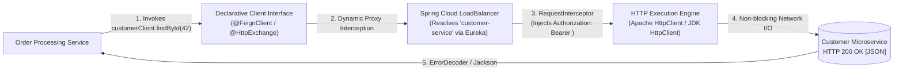

# Topic 123: Declarative Inter-Service REST Clients (OpenFeign & Spring 6 RestClient / @HttpExchange)

> 🚀 **Roadmap Seal:** **`[ADVANCED / DEEP-DIVE]`** — *Advanced enterprise specialization & architecture. Study once core fundamentals are solid.*

## 1. What It Is and Why It Exists

In a Service-Oriented Architecture (SOA), microservices constantly communicate with each other over HTTP: an Order Microservice calls the Customer Microservice to fetch billing addresses, contacts the Payment Microservice to authorize transactions, and notifies the Inventory Microservice to reserve stock.

### The Evolution of Spring HTTP Clients
Historically, developers executed HTTP calls using `RestTemplate`:
```java
// Legacy Verbose RestTemplate (Maintenance Overhead):
ResponseEntity<CustomerDto> response = restTemplate.exchange(
    "http://customer-service/api/v1/customers/" + id,
    HttpMethod.GET,
    new HttpEntity<>(headers),
    CustomerDto.class
);
```
This low-level approach forces developers to manually concatenate URL strings, serialize/deserialize JSON, construct `HttpEntity` wrappers, and parse generic exceptions.

Modern enterprise Spring provides two superior paradigms:
1. **Spring Cloud OpenFeign:** A declarative HTTP client framework where developers simply author a Java interface annotated with Spring MVC annotations; Spring synthesizes the HTTP implementation dynamically at runtime.
2. **Spring 6 `RestClient` & `@HttpExchange`:** The modern fluent client introduced in Spring Framework 6.1 (Spring Boot 3.2+), offering synchronous fluent chaining and declarative `@HttpExchange` interfaces directly in Spring Core without requiring external cloud starters!



### Real-World Analogy
Consider placing an order with a personal executive assistant.
- **`RestTemplate`:** You must personally look up the phone book, dial the international dialing code, wait for the line to ring, ask the receptionist for the operator, read the order specifications line-by-line, write the confirmation code on a napkin, and hang up the phone.
- **Declarative Feign / `@HttpExchange`:** You hand a pre-printed requisition form to your assistant (**The Interface Contract**). The assistant handles dialing, routing, retries, and language translation, placing the finished goods directly on your desk.

---

## 2. Prerequisites
Before studying declarative REST clients, ensure you have mastered:
- [Topic 92: Production REST Controller Architecture with Spring Web MVC](file:///c:/Users/modym/OneDrive/Desktop/Java-Doc/content/part3-spring/92-production-rest-controller-architecture-spring-web-mvc.md) — Spring MVC request mapping annotations.
- [Topic 120: Service Discovery & Dynamic Registration (Spring Cloud Eureka & Consul)](file:///c:/Users/modym/OneDrive/Desktop/Java-Doc/content/part3-spring/120-service-discovery-registration-eureka-consul.md) — Dynamic discovery and logical load balancing.

---

## 3. Syntax Breakdown & Core Mechanics

### 3.1 Declarative Clients with Spring Cloud OpenFeign

Add dependency `spring-cloud-starter-openfeign` and enable it in your configuration:

```java
@SpringBootApplication
@EnableFeignClients // Scans classpath for @FeignClient interfaces
public class OrderServiceApplication {}
```

#### Authoring the Client Interface:
```java
@FeignClient(
    name = "customer-service", // Logical Eureka service ID
    path = "/api/v1/customers",
    configuration = FeignClientConfiguration.class
)
public interface CustomerServiceClient {

    @GetMapping("/{id}")
    CustomerDto getCustomerById(@PathVariable("id") Long id);

    @PostMapping
    CustomerDto registerCustomer(@RequestBody CreateCustomerRequest request);
}
```

---

### 3.2 Propagating Security Credentials via `RequestInterceptor`

Microservice calls must pass the caller's JWT token downstream:

```java
@Configuration
public class FeignClientConfiguration {

    @Bean
    public RequestInterceptor bearerTokenRequestInterceptor() {
        return requestTemplate -> {
            ServletRequestAttributes attributes = (ServletRequestAttributes) RequestContextHolder.getRequestAttributes();
            if (attributes != null) {
                String authHeader = attributes.getRequest().getHeader("Authorization");
                if (authHeader != null && authHeader.startsWith("Bearer ")) {
                    requestTemplate.header("Authorization", authHeader);
                }
            }
        };
    }

    @Bean
    public ErrorDecoder customErrorDecoder() {
        return new CustomFeignErrorDecoder();
    }
}
```

---

### 3.3 Spring 6 Modern `RestClient` & `@HttpExchange`

Introduced in Spring Framework 6.1 (Spring Boot 3.2+), `RestClient` provides a fluent synchronous API:

```java
@Service
public class InventoryClientService {

    private final RestClient restClient;

    public InventoryClientService(RestClient.Builder builder) {
        this.restClient = builder
            .baseUrl("https://inventory.internal.corp")
            .defaultHeader("Accept", MediaType.APPLICATION_JSON_VALUE)
            .build();
    }

    public InventoryStatus checkStock(String sku) {
        return restClient.get()
            .uri("/api/v1/items/{sku}/stock", sku)
            .retrieve()
            .body(InventoryStatus.class);
    }
}
```

#### Declarative HTTP Interfaces (`@HttpExchange`):
```java
public interface PaymentHttpService {
    @PostExchange("/api/v1/payments")
    PaymentConfirmation authorizePayment(@RequestBody PaymentRequest request);
}
```

---

## 4. Code Examples

### 4.1 Basic Example: Simulating Declarative Interface Dynamic Proxy
```java
package com.handbook.spring;

import java.lang.reflect.InvocationHandler;
import java.lang.reflect.Method;
import java.lang.reflect.Proxy;

public class BasicFeignProxySimulationDemo {

    public interface OrderClientContract {
        String fetchOrder(String orderId);
    }

    public static class FeignInvocationHandler implements InvocationHandler {
        @Override
        public Object invoke(Object proxy, Method method, Object[] args) {
            String orderId = (String) args[0];
            System.out.printf("[Feign Proxy] Dynamic HTTP GET dispatched to http://order-service/orders/%s%n", orderId);
            return "{\"orderId\":\"" + orderId + "\",\"status\":\"PAID\",\"total\":450.00}";
        }
    }

    @SuppressWarnings("unchecked")
    public static void main(String[] args) {
        System.out.println("--- Spring Cloud OpenFeign: Dynamic Proxy Simulation ---");

        OrderClientContract client = (OrderClientContract) Proxy.newProxyInstance(
            OrderClientContract.class.getClassLoader(),
            new Class<?>[]{OrderClientContract.class},
            new FeignInvocationHandler()
        );

        String json = client.fetchOrder("ORD-1044");
        System.out.println("Received Payload: " + json);
    }
}
```

**Expected Terminal Output:**
```text
--- Spring Cloud OpenFeign: Dynamic Proxy Simulation ---
[Feign Proxy] Dynamic HTTP GET dispatched to http://order-service/orders/ORD-1044
Received Payload: {"orderId":"ORD-1044","status":"PAID","total":450.00}
```

---

### 4.2 Realistic Enterprise Example: Verified DeclarativeRestClientFeignDemo
```java
package com.handbook.spring;

import java.util.*;

public class DeclarativeRestClientFeignDemo {

    public record CustomerProfile(Long id, String name, String email, String tier) {}

    public static class DeclarativeServiceClientSimulator {
        private final Map<Long, CustomerProfile> mockDirectory = new HashMap<>();

        public DeclarativeServiceClientSimulator() {
            mockDirectory.put(42L, new CustomerProfile(42L, "Sarah Connor", "sarah@cyberdyne.corp", "VIP"));
            mockDirectory.put(99L, new CustomerProfile(99L, "John Connor", "john@resistance.org", "STANDARD"));
        }

        public CustomerProfile getCustomerById(Long id) {
            System.out.printf("  -> [Declarative Client Proxy]: Executed HTTP GET /api/v1/customers/%d%n", id);
            CustomerProfile profile = mockDirectory.get(id);
            if (profile == null) {
                throw new NoSuchElementException("HTTP 404: Customer not found: " + id);
            }
            return profile;
        }
    }

    public static void main(String[] args) {
        System.out.println("=== Topic 123: Declarative Inter-Service Clients (OpenFeign & RestClient) ===");

        DeclarativeServiceClientSimulator client = new DeclarativeServiceClientSimulator();
        CustomerProfile profile = client.getCustomerById(42L);

        System.out.printf("Received Profile: [%d] %s (%s) - Tier: %s%n",
            profile.id(), profile.name(), profile.email(), profile.tier());

        if (!"VIP".equals(profile.tier()) || !profile.name().equals("Sarah Connor")) {
            throw new AssertionError("Declarative client payload mapping failed!");
        }

        System.out.println("Topic 123 Declarative REST Clients verified successfully.");
    }
}
```

---

## 5. Common Mistakes & Error Diagnosis

### Pitfall 1: Missing JWT Token Propagation (Downstream HTTP 401)
- **Symptom:** User logs in with a valid JWT, but when the Order Service calls Customer Service via OpenFeign, the downstream service returns `401 Unauthorized`.
- **Cause:** OpenFeign client runs an independent HTTP connection pool; it does not automatically forward incoming headers from `HttpServletRequest`.
- **Diagnosis & Fix:** Implement a `RequestInterceptor` that reads the `Authorization` header from `RequestContextHolder` and attaches it to `RequestTemplate`.

### Pitfall 2: Confusing `RestClient` (Sync) with `WebClient` (Reactive)
- **Symptom:** Introducing unnecessary reactive dependencies (`spring-boot-starter-webflux`, `Mono`, `Flux`) into a traditional synchronous servlet microservice.
- **Cause:** Historically, developers used `WebClient` simply to obtain a fluent API.
- **Diagnosis & Fix:** In Spring Boot 3.2+, use **`RestClient`** for synchronous fluent calls, keeping your architecture clean and lightweight without WebFlux overhead.

### Pitfall 3: Not Handling HTTP 404 in OpenFeign (`FeignException$NotFound`)
- **Symptom:** Calling `customerClient.findById(999L)` throws an unhandled `FeignException` instead of returning an `Optional.empty()`.
- **Cause:** Feign treats any non-2xx HTTP response as an exception by default.
- **Diagnosis & Fix:** Configure `decode404 = true` in `@FeignClient`, or implement a custom `ErrorDecoder` that maps 404 status codes gracefully.

---

## 6. Best Practices Guide

| Practice | Recommendation | Architectural Justification |
| :--- | :--- | :--- |
| **Connection Pooling** | Back OpenFeign with Apache HttpClient 5 | Reuses persistent TCP connections; avoids socket exhaustion under high throughput. |
| **Timeout Safety** | Set `connectTimeout` (2s) and `readTimeout` (5s) | Prevents slow partner microservices from freezing client threads. |
| **Resilience Integration**| Wrap Feign calls with Resilience4j Circuit Breakers | Fails fast and triggers fallbacks during downstream service outages. |
| **Modern Baseline** | Use Spring 6 `@HttpExchange` for non-Eureka architectures | Built directly into Spring Framework without requiring extra Cloud starters. |

---

## 7. Version Notes & Compatibility

- **Spring Framework 5.x / Boot 2.x:** Rely on `RestTemplate` or reactive `WebClient`.
- **Spring Framework 6.1+ / Spring Boot 3.2+:**
  - Introduced `RestClient` as the modern synchronous alternative to `RestTemplate`.
  - Introduced `@HttpExchange`, `@GetExchange`, and `HttpServiceProxyFactory` as first-class core Spring features.
  - Spring Cloud 2023.x OpenFeign updated to support modern Java 17+ records and Jakarta annotations.

---

## 8. Summary & Cheat Sheet

| HTTP Client | Style | Concurrency Model | Dependency | Recommended Use Case |
| :--- | :--- | :--- | :--- | :--- |
| **`RestTemplate`** | Imperative | Synchronous Blocking | `spring-web` | Legacy applications (in maintenance mode). |
| **`RestClient`** | **Fluent Chained** | **Synchronous Blocking** | `spring-web` (Spring 6.1+) | **Standard microservices making external REST calls.** |
| **`WebClient`** | Fluent Chained | Reactive Non-Blocking | `spring-webflux` | Reactive WebFlux streaming and high-concurrency systems. |
| **Spring Cloud OpenFeign** | **Declarative Interface**| **Synchronous Blocking** | `spring-cloud-openfeign` | **Inter-service communication in Eureka / Spring Cloud microservices.** |
| **`@HttpExchange`** | **Declarative Interface**| **Pluggable (Sync/Async)**| `spring-web` (Spring 6+) | **Pure Spring Boot 3 apps without Spring Cloud dependencies.** |

---

## 9. Hands-on Practice Exercises

### Exercise 1: Spot the Bug — Missing RequestInterceptor for JWT Propagation
Review the following Feign client interface:
```java
@FeignClient(name = "billing-service")
public interface BillingClient {
    @GetMapping("/api/v1/invoices")
    List<InvoiceDto> getInvoices();
}
```
When invoked from an authenticated REST controller, `billing-service` rejects the call with `401 Unauthorized`. Why, and what component must be added?

<details>
<summary>View Solution</summary>

**Cause:**
OpenFeign does not automatically copy the `Authorization` header from the caller's incoming request. The outgoing HTTP request has no `Authorization: Bearer` token.

**The Fix:**
Register a `RequestInterceptor` bean that extracts the incoming token and injects it:
```java
@Bean
public RequestInterceptor bearerTokenInterceptor() {
    return template -> {
        ServletRequestAttributes attrs = (ServletRequestAttributes) RequestContextHolder.getRequestAttributes();
        if (attrs != null) {
            String token = attrs.getRequest().getHeader("Authorization");
            if (token != null) template.header("Authorization", token);
        }
    };
}
```
</details>

---

### Exercise 2: Hands-on Implementation — Declarative HTTP Interface with `@HttpExchange` and `RestClient`
Configure a declarative `@HttpExchange` client in pure Spring Boot 3.2 without using OpenFeign.

<details>
<summary>View Solution</summary>

```java
package com.handbook.spring.client;

import org.springframework.context.annotation.Bean;
import org.springframework.context.annotation.Configuration;
import org.springframework.web.bind.annotation.PathVariable;
import org.springframework.web.client.RestClient;
import org.springframework.web.client.support.RestClientAdapter;
import org.springframework.web.service.annotation.GetExchange;
import org.springframework.web.service.annotation.HttpExchange;
import org.springframework.web.service.invoker.HttpServiceProxyFactory;

@HttpExchange("/api/v1/users")
public interface UserHttpExchangeClient {
    @GetExchange("/{id}")
    UserDto findUserById(@PathVariable("id") Long id);
}

@Configuration
class HttpExchangeClientConfig {

    @Bean
    public UserHttpExchangeClient userClient(RestClient.Builder builder) {
        RestClient restClient = builder.baseUrl("https://user-service.internal").build();
        HttpServiceProxyFactory factory = HttpServiceProxyFactory
            .builderFor(RestClientAdapter.create(restClient))
            .build();
        return factory.createClient(UserHttpExchangeClient.class);
    }
}
```
</details>

---

### Exercise 3: Real-World Edge Case — Custom Feign ErrorDecoder Mapping Downstream 404 to Empty Optional
<details>
<summary>View Solution</summary>
**Question:** How does a custom `ErrorDecoder` transform downstream HTTP 404 responses into a domain exception (`CustomerNotFoundException`) rather than crashing with a raw `FeignException`?

**Solution:**
Implement `ErrorDecoder`:
```java
public class CustomFeignErrorDecoder implements ErrorDecoder {

    private final ErrorDecoder defaultDecoder = new Default();

    @Override
    public Exception decode(String methodKey, Response response) {
        if (response.status() == 404) {
            return new CustomerNotFoundException("Target resource not found for method: " + methodKey);
        }
        if (response.status() == 503) {
            return new ServiceUnavailableException("Downstream microservice temporarily unavailable.");
        }
        return defaultDecoder.decode(methodKey, response);
    }
}
```
</details>

---

## 10. Verified Official Sources
- [Spring Cloud OpenFeign Reference](https://docs.spring.io/spring-cloud-openfeign/reference/)
- [Spring Framework 6 Reference: RestClient](https://docs.spring.io/spring-framework/reference/integration/rest-clients.html#rest-restclient)
- [Spring Framework 6 Reference: HTTP Interfaces](https://docs.spring.io/spring-framework/reference/integration/rest-clients.html#rest-http-interface)
