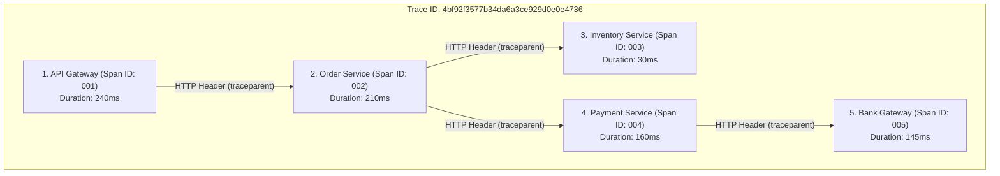

# Topic 124: Distributed Tracing & Correlation IDs (Micrometer Tracing, OpenTelemetry & Zipkin)

> 🚀 **Roadmap Seal:** **`[ADVANCED / DEEP-DIVE]`** — *Advanced enterprise specialization & architecture. Study once core fundamentals are solid.*

## 1. What It Is and Why It Exists

In a monolithic architecture, inspecting application logs is simple: an entire user transaction executes within a single JVM process on a single server. A single stack trace reveals the exact line of code that failed.

In an enterprise Service-Oriented Architecture (SOA), a single user click (e.g. *"Submit Order"*) cascades across multiple services over the network:
```
Client ──► API Gateway ──► Order Service ──► Inventory Service
                                       └──► Payment Service ──► External Visa Gateway
```
If the user encounters an HTTP 500 error or experiences a 6-second delay, inspecting the logs of individual microservices is like searching for a needle in a haystack of millions of log lines:
- Which service failed?
- Which intermediate network call caused the 6-second delay?
- How do you correlate the log message in `Order Service` with the log message in `Payment Service`?

**Distributed Tracing** solves this by assigning a globally unique identifier—**The Trace ID**—to the transaction at the API Gateway. As the request travels across network boundaries, the Trace ID is propagated inside HTTP headers (W3C TraceContext or B3). Every microservice injects this Trace ID into its local logging context (MDC), allowing developers to query a centralized log aggregator (ELK, Loki) and see the entire cross-network transaction reconstructed in chronological order.



### Real-World Analogy
Consider an international courier shipping parcel tracking number (**Trace ID**).
- When a package is dispatched from Tokyo to Cairo, it receives a barcode: `TRX-998124`.
- At Tokyo Airport (**Span 1**), the scanner records the departure time.
- At Dubai Hub (**Span 2**), the scanner records the customs inspection time.
- At Cairo Logistics (**Span 3**), the scanner records final delivery.
- If the parcel is delayed in Dubai, the customer looks up `TRX-998124` on the tracking website and immediately sees the exact transit station that caused the bottleneck.

---

## 2. Prerequisites
Before studying distributed tracing, ensure you have mastered:
- [Topic 90: Auto-Configuration Mechanics, Starters & Embedded Runtimes](file:///c:/Users/modym/OneDrive/Desktop/Java-Doc/content/part3-spring/90-auto-configuration-mechanics-starters-embedded-runtimes.md) — Spring Boot auto-configuration.
- [Topic 104: Production Observability: Spring Boot Actuator, Micrometer & Prometheus](file:///c:/Users/modym/OneDrive/Desktop/Java-Doc/content/part3-spring/104-production-observability-spring-boot-actuator-micrometer-prometheus.md) — Metrics and monitoring.
- [Topic 121: Enterprise API Gateway Architecture (Spring Cloud Gateway, Routing & Rate Limiting)](file:///c:/Users/modym/OneDrive/Desktop/Java-Doc/content/part3-spring/121-api-gateway-spring-cloud-gateway.md) — Edge routing and filter propagation.

---

## 3. Syntax Breakdown & Core Mechanics

### 3.1 The Great Transition: From Spring Cloud Sleuth to Micrometer Tracing

In Spring Boot 3, **Spring Cloud Sleuth was retired**. Distributed tracing was extracted and standardized directly into **Micrometer Tracing**, offering seamless interoperability with OpenTelemetry (OTel) and Brave (Zipkin).

#### Adding Dependencies:
```xml
<!-- 1. Micrometer Tracing Core API -->
<dependency>
    <groupId>io.micrometer</groupId>
    <artifactId>micrometer-tracing-bridge-brave</artifactId> <!-- or micrometer-tracing-bridge-otel -->
</dependency>

<!-- 2. Reporter to ship spans to Zipkin / Tempo -->
<dependency>
    <groupId>io.zipkin.reporter2</groupId>
    <artifactId>zipkin-reporter-brave</artifactId>
</dependency>
```

---

### 3.2 Externalized Configuration in `application.yml`

```yaml
management:
  tracing:
    sampling:
      probability: 1.0 # Sample 100% of transactions in staging (tune to 0.1 / 10% in high-traffic prod)
    propagation:
      type: W3C,B3 # Propagate both modern W3C TraceContext and legacy B3 headers
  zipkin:
    tracing:
      endpoint: http://zipkin-collector.internal:9411/api/v2/spans

logging:
  pattern:
    # Inject traceId and spanId directly into all log outputs
    level: "%5p [${spring.application.name:},%X{traceId:-},%X{spanId:-}]"
```

When configured, every log statement automatically formats with:
```text
INFO [order-service,4bf92f3577b34da6,00f067aa0ba902b7] Processing order payment...
```

---

### 3.3 Programmatic Tracing & Custom Spans

```java
@Service
public class OrderProcessingService {

    private final Tracer tracer;

    public OrderProcessingService(Tracer tracer) {
        this.tracer = tracer;
    }

    public void executeHeavyCalculation() {
        // Create custom child span for granular latency measurement
        Span customSpan = tracer.nextSpan().name("calculateTaxesAndDiscounts").start();
        try (Tracer.SpanInScope ws = tracer.withSpan(customSpan.start())) {
            customSpan.tag("tenant.id", "TENANT_ACME");
            // Perform computation...
        } finally {
            customSpan.end(); // Records latency duration
        }
    }
}
```

---

## 4. Code Examples

### 4.1 Basic Example: Simulating Trace Context & MDC Injection
```java
package com.handbook.spring;

import java.util.*;

public class BasicTraceContextDemo {

    public record TraceContext(String traceId, String spanId) {}

    public static void log(TraceContext ctx, String message) {
        System.out.printf("[%s,%s] %s%n", ctx.traceId(), ctx.spanId(), message);
    }

    public static void main(String[] args) {
        System.out.println("--- Spring Boot: Distributed Trace Context Simulation ---");
        String globalTraceId = UUID.randomUUID().toString().replace("-", "").substring(0, 16);

        TraceContext gatewaySpan = new TraceContext(globalTraceId, "span_gw_01");
        log(gatewaySpan, "Incoming POST /orders accepted at Gateway.");

        TraceContext orderServiceSpan = new TraceContext(globalTraceId, "span_order_02");
        log(orderServiceSpan, "Creating order entity and reserving inventory.");

        TraceContext paymentSpan = new TraceContext(globalTraceId, "span_pay_03");
        log(paymentSpan, "Payment authorized via external card gateway.");
    }
}
```

**Expected Terminal Output:**
```text
--- Spring Boot: Distributed Trace Context Simulation ---
[6a7b1c4e92d83f10,span_gw_01] Incoming POST /orders accepted at Gateway.
[6a7b1c4e92d83f10,span_order_02] Creating order entity and reserving inventory.
[6a7b1c4e92d83f10,span_pay_03] Payment authorized via external card gateway.
```

---

### 4.2 Realistic Enterprise Example: Verified DistributedTracingMdcDemo
```java
package com.handbook.spring;

import java.util.*;

public class DistributedTracingMdcDemo {

    public record TraceRecord(String serviceName, String traceId, String spanId, String message) {}

    public static class DistributedTraceAggregator {
        private final List<TraceRecord> auditLogs = new ArrayList<>();

        public void recordLog(String service, String traceId, String spanId, String msg) {
            TraceRecord record = new TraceRecord(service, traceId, spanId, msg);
            auditLogs.add(record);
            System.out.printf("  -> [%-15s] TraceId=%-16s | SpanId=%-12s | Log: %s%n",
                record.serviceName(), record.traceId(), record.spanId(), record.message());
        }

        public List<TraceRecord> getLogsForTrace(String traceId) {
            return auditLogs.stream().filter(r -> r.traceId().equals(traceId)).toList();
        }
    }

    public static void main(String[] args) {
        System.out.println("=== Topic 124: Distributed Tracing & Correlation IDs ===");

        DistributedTraceAggregator aggregator = new DistributedTraceAggregator();
        String sharedTraceId = "4bf92f3577b34da6";

        aggregator.recordLog("GATEWAY-SERVICE", sharedTraceId, "span-001", "Request routed to ORDER-SERVICE");
        aggregator.recordLog("ORDER-SERVICE",   sharedTraceId, "span-002", "Persisting order record to DB");
        aggregator.recordLog("PAYMENT-SERVICE", sharedTraceId, "span-003", "Executing credit card capture");

        List<TraceRecord> traceChain = aggregator.getLogsForTrace(sharedTraceId);
        System.out.println("Reconstructed cross-service trace chain size: " + traceChain.size());

        if (traceChain.size() != 3) {
            throw new AssertionError("Distributed trace aggregation failed!");
        }

        System.out.println("Topic 124 Distributed Tracing and MDC verified successfully.");
    }
}
```

---

## 5. Common Mistakes & Error Diagnosis

### Pitfall 1: Sampling Rate Left at 10% in Staging Environments
- **Symptom:** Developers report: *"I reproduced the bug, but when I open Zipkin/Tempo, the trace is missing!"*
- **Cause:** By default, distributed tracing samples only **10%** (`management.tracing.sampling.probability: 0.1`) to conserve bandwidth and storage.
- **Diagnosis & Fix:** In development, testing, and staging environments, set sampling probability to `1.0` (100%):
  ```yaml
  management:
    tracing:
      sampling:
        probability: 1.0
  ```

### Pitfall 2: Context Loss in Custom Asynchronous Worker Threads
- **Symptom:** Logs printed inside custom `CompletableFuture.runAsync()` or unmanaged `ExecutorService` lose their `traceId` and `spanId`.
- **Cause:** MDC is stored in `ThreadLocal`. Background threads in a raw thread pool do not inherit parent MDC context.
- **Diagnosis & Fix:** Always use Spring's `ThreadPoolTaskExecutor` decorated with `ContextSnapshotFactory` or wrap runnables using `ContextExecutorService`.

### Pitfall 3: Propagating Volatile PII in Distributed Baggage
- **Symptom:** Regulatory audit failure due to personal identity numbers or passwords appearing in HTTP headers across internal services.
- **Cause:** Distributed **Baggage** propagates key-value pairs across the entire network inside HTTP headers. Putting sensitive customer PII in baggage transmits plaintext credentials across unencrypted internal networks.
- **Diagnosis & Fix:** Only use Baggage for non-sensitive operational identifiers: `tenant_id`, `correlation_id`, `client_version`.

---

## 6. Best Practices Guide

| Practice | Recommendation | Architectural Justification |
| :--- | :--- | :--- |
| **Header Standard** | Use W3C TraceContext (`traceparent`) | The vendor-neutral industry standard supported across Java, Go, Node.js, and Python. |
| **Production Sampling**| Use Adaptive / Probabilistic Sampling (1% to 10%) | Prevents tracing storage systems from collapsing under millions of requests per second. |
| **Error Sampling** | Always force sample on HTTP 5xx errors | Guarantees that 100% of failed transactions are captured for diagnostic post-mortems. |
| **Log Format** | Standardize `%X{traceId}` in logging format | Allows instant one-click jump from a Grafana Loki log line to a Zipkin/Tempo trace graph. |

---

## 7. Version Notes & Compatibility

- **Spring Cloud Sleuth (Retired):** Deprecated with Spring Boot 2.7 and completely removed in Spring Boot 3.0.
- **Micrometer Tracing (Spring Boot 3.x):**
  - Standardized tracing facade part of the Micrometer ecosystem.
  - Native support for OpenTelemetry SDK (OTel) and OpenZipkin Brave.
  - Out-of-the-box support for Spring 6 `RestClient`, `WebClient`, and Spring Cloud OpenFeign.

---

## 8. Summary & Cheat Sheet

| Tracing Concept | Scope | Example | Description |
| :--- | :--- | :--- | :--- |
| **Trace ID** | Entire Distributed Transaction | `4bf92f3577b34da6` | Uniquely identifies the end-to-end user request across all services. |
| **Span ID** | Single Network Hop / Unit of Work| `00f067aa0ba902b7` | Identifies execution within a single microservice method or network call. |
| **Parent Span ID**| Immediate Caller Span | `001` | Links child spans to parent spans to form the call hierarchy tree. |
| **Baggage** | User-defined Context | `tenant_id=acme` | Custom key-value pairs propagated across all downstream services. |

---

## 9. Hands-on Practice Exercises

### Exercise 1: Spot the Bug — Trace Context Lost in Unwrapped ThreadPoolExecutor
Review the following code inside an Order Service:
```java
public void processOrder(Order order) {
    log.info("Starting order checkout..."); // Has traceId: 4bf92f35
    
    // Developer submits task to raw ExecutorService
    Executors.newSingleThreadExecutor().submit(() -> {
        log.info("Sending payment payload..."); // traceId is NULL!
    });
}
```
Why did the second log line lose its `traceId`, and what is the fix?

<details>
<summary>View Solution</summary>

**Cause:**
MDC is thread-local. Spawning an unmanaged thread from `Executors.newSingleThreadExecutor()` does not copy the calling thread's MDC context map.

**The Fix:**
Use Spring's managed `ThreadPoolTaskExecutor` with a `TaskDecorator`:
```java
@Autowired
private ThreadPoolTaskExecutor taskExecutor;

public void processOrder(Order order) {
    log.info("Starting order checkout...");
    taskExecutor.submit(() -> {
        log.info("Sending payment payload..."); // Preserves traceId!
    });
}
```
</details>

---

### Exercise 2: Hands-on Implementation — Adding Baggage (Tenant-ID) to Distributed Trace Context
Write a Spring Boot `@Component` that reads `X-Tenant-ID` from incoming HTTP headers and attaches it to the distributed tracing `Baggage` so all downstream OpenFeign calls propagate it automatically.

<details>
<summary>View Solution</summary>

```java
package com.handbook.spring.tracing;

import io.micrometer.tracing.BaggageManager;
import io.micrometer.tracing.Tracer;
import jakarta.servlet.FilterChain;
import jakarta.servlet.ServletException;
import jakarta.servlet.http.HttpServletRequest;
import jakarta.servlet.http.HttpServletResponse;
import org.springframework.stereotype.Component;
import org.springframework.web.filter.OncePerRequestFilter;

import java.io.IOException;

@Component
public class TenantBaggageFilter extends OncePerRequestFilter {

    private final Tracer tracer;

    public TenantBaggageFilter(Tracer tracer) {
        this.tracer = tracer;
    }

    @Override
    protected void doFilterInternal(HttpServletRequest request, 
                                    HttpServletResponse response, 
                                    FilterChain filterChain) throws ServletException, IOException {
        String tenantId = request.getHeader("X-Tenant-ID");
        if (tenantId != null && !tenantId.isBlank()) {
            tracer.createBaggageInScope("tenant.id", tenantId);
        }
        filterChain.doFilter(request, response);
    }
}
```
</details>

---

### Exercise 3: Real-World Edge Case — Visualizing Distributed Bottlenecks in Zipkin UI
<details>
<summary>View Solution</summary>
**Question:** When inspecting a trace in Zipkin where the total duration is 4,500ms, how do you distinguish whether the delay was caused by a slow database query, network latency, or an external third-party API timeout?

**Solution:**
Zipkin renders a horizontal Gantt-chart timeline representing every span in the trace hierarchy:
1. **Network vs Computation:** Look at the gap between the Client Send (`cs`) and Server Receive (`sr`) timestamps. A large gap indicates network transmission latency or gateway queueing.
2. **Database Queries:** If an ORM query span shows `SELECT * FROM orders WHERE ...` taking 4,200ms, the bottleneck is missing database indexes.
3. **External Third-Party APIs:** An outgoing HTTP span with tag `http.url = "https://api.stripe.com/charges"` that stays open for 4,000ms identifies external partner latency. The engineering team can immediately configure a Resilience4j TimeLimiter with a fallback.
</details>

---

## 10. Verified Official Sources
- [Micrometer Tracing Official Reference Documentation](https://micrometer.io/docs/tracing)
- [W3C Recommendation: Trace Context Standard](https://www.w3.org/TR/trace-context/)
- [OpenZipkin Architecture & Documentation](https://zipkin.io/pages/architecture.html)
