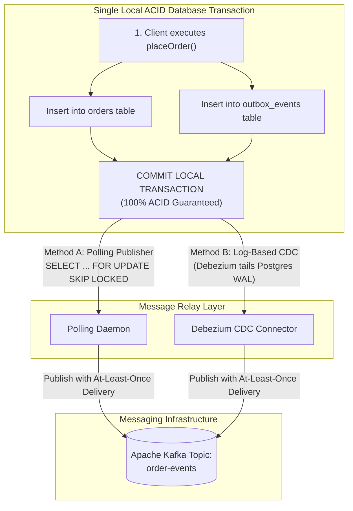

# Topic 126: Transactional Outbox Pattern & CDC for Zero-Loss Event Publishing

> 🚀 **Roadmap Seal:** **`[ADVANCED / DEEP-DIVE]`** — *Advanced enterprise specialization & architecture. Study once core fundamentals are solid.*

## 1. What It Is and Why It Exists

In modern enterprise microservices, services must frequently perform two actions atomically:
1. Update their local relational database (e.g. insert an `Order` record).
2. Publish an event to a message broker (e.g. publish `OrderCreatedEvent` to Apache Kafka) so downstream inventory and payment services can react.

### The Dual-Write Problem
Traditional Two-Phase Commit (2PC) / XA distributed transactions across heterogeneous databases and message brokers are notoriously fragile, slow, and unsupported by modern cloud message brokers like Kafka.

When a developer attempts to update a database and publish to Kafka sequentially in a standard method, a catastrophic failure mode is guaranteed to occur:

```
Scenario A: DB First, Kafka Second
1. db.save(order);             --> SUCCESS [Committed to DB]
2. kafkaTemplate.send(event);  --> CRASH! [Network timeout or Kafka broker down]
Result: Order exists in DB, but downstream services NEVER receive the event! Inconsistent State.

Scenario B: Kafka First, DB Second
1. kafkaTemplate.send(event);  --> SUCCESS [Event emitted to Kafka]
2. db.save(order);             --> CRASH! [Unique constraint violation or DB out of memory]
Result: Downstream services charge the customer's credit card for an order that DOES NOT EXIST in the DB!
```

### The Transactional Outbox Pattern
The **Transactional Outbox Pattern** completely eliminates the dual-write hazard. Instead of communicating directly with Kafka during the business transaction, the service writes the event into an **Outbox Table** (`outbox_events`) inside the **exact same local relational database transaction** using standard ACID guarantees.

A separate asynchronous message relay (either a polling publisher or a Change Data Capture tool like **Debezium**) reads from the outbox table and guarantees **At-Least-Once Delivery** to Kafka!



### Real-World Analogy
Consider sending a critical legal letter via postal mail.
- **The Dual-Write Disaster:** You sign the legal contract at your desk, walk out onto the street, and try to find a postal mail truck driving by. If a truck doesn't pass, you lose the contract or send a letter before signing it.
- **The Outbox:** Your office desk has a wooden tray labeled **OUTBOX**. When you sign the contract, you drop a copy into the Outbox tray (**Local Atomic Transaction**). Every hour, the mailroom clerk empties the Outbox tray and takes all letters to the post office (**Message Relay**). Even if the clerk is sick for 2 hours, the letter sits safely in the Outbox until the next delivery cycle.

---

## 2. Prerequisites
Before studying the Transactional Outbox pattern, ensure you have mastered:
- [Topic 97: Declarative @Transactional Boundaries, Pagination, Sorting & N+1 Prevention](file:///c:/Users/modym/OneDrive/Desktop/Java-Doc/content/part3-spring/97-declarative-transactional-boundaries-pagination-sorting-n-plus-one.md) — ACID local transaction semantics.
- [Topic 108: Event-Driven Enterprise Messaging with Apache Kafka](file:///c:/Users/modym/OneDrive/Desktop/Java-Doc/content/part3-spring/108-event-driven-enterprise-messaging-apache-kafka.md) — Kafka producer mechanics.
- [Topic 125: Kafka Production Resilience (Non-Blocking Retries & Dead Letter Topics @RetryableTopic)](file:///c:/Users/modym/OneDrive/Desktop/Java-Doc/content/part3-spring/125-kafka-resilience-retryable-topics-dlt.md) — Failure handling and retries.

---

## 3. Syntax Breakdown & Core Mechanics

### 3.1 The Outbox Database Schema

```sql
CREATE TABLE outbox_events (
    id UUID PRIMARY KEY,
    aggregate_type VARCHAR(64) NOT NULL,   -- e.g. "Order"
    aggregate_id VARCHAR(64) NOT NULL,     -- e.g. "ORD-9912"
    event_type VARCHAR(128) NOT NULL,      -- e.g. "OrderCreatedEvent"
    payload JSONB NOT NULL,                -- Full JSON serialized state
    created_at TIMESTAMP WITH TIME ZONE NOT NULL,
    processed BOOLEAN DEFAULT FALSE,
    processed_at TIMESTAMP WITH TIME ZONE
);

CREATE INDEX idx_outbox_unprocessed ON outbox_events (created_at) WHERE processed = FALSE;
```

---

### 3.2 Atomic Business Mutation inside Service Layer

```java
@Service
public class OrderService {

    private final OrderRepository orderRepository;
    private final OutboxEventRepository outboxRepository;
    private final ObjectMapper objectMapper;

    @Transactional // ACID: Both writes succeed or both rollback
    public Order placeOrder(CreateOrderCommand cmd) {
        // 1. Mutate business domain table
        Order order = new Order(cmd.customerId(), cmd.items(), cmd.totalAmount());
        order = orderRepository.save(order);

        // 2. Insert event record into outbox table in same transaction
        OutboxEvent event = new OutboxEvent(
            UUID.randomUUID(),
            "Order",
            order.getId().toString(),
            "OrderCreatedEvent",
            objectMapper.writeValueAsString(new OrderCreatedPayload(order)),
            Instant.now()
        );
        outboxRepository.save(event);

        return order;
    }
}
```

---

### 3.3 Message Relay Strategies

#### Approach A: Scheduled Polling Publisher (Simple, No Extra Infrastructure)
```java
@Component
public class OutboxPollingPublisher {

    private final OutboxEventRepository outboxRepository;
    private final KafkaTemplate<String, String> kafkaTemplate;

    @Scheduled(fixedDelay = 1000) // Poll every second
    @SchedulerLock(name = "outboxPublisherLock", lockAtMostFor = "10s")
    @Transactional
    public void publishPendingEvents() {
        // Query batch using SELECT ... FOR UPDATE SKIP LOCKED
        List<OutboxEvent> pending = outboxRepository.findTop50ByProcessedFalseOrderByCreatedAtAsc();

        for (OutboxEvent event : pending) {
            kafkaTemplate.send("order-events", event.getAggregateId(), event.getPayload())
                .whenComplete((result, ex) -> {
                    if (ex == null) {
                        event.setProcessed(true);
                        event.setProcessedAt(Instant.now());
                        outboxRepository.save(event);
                    }
                });
        }
    }
}
```

#### Approach B: Log-Based CDC with Debezium (High Throughput, Zero Database Polling)
In high-scale architectures, a dedicated **Debezium Kafka Connect** connector reads PostgreSQL Write-Ahead Logs (WAL) or MySQL binlog directly from disk. As soon as the transaction commits, Debezium streams the outbox row directly to Kafka with sub-second latency and zero database query overhead!

---

## 4. Code Examples

### 4.1 Basic Example: Simulating Atomic Local Outbox Insertion
```java
package com.handbook.spring;

import java.time.Instant;
import java.util.*;

public class BasicOutboxAtomicCommitDemo {

    public static class MockSqlTransaction {
        private final List<String> businessTable = new ArrayList<>();
        private final List<String> outboxTable = new ArrayList<>();

        public void executeAtomicOrder(String orderId, boolean failMidway) {
            System.out.println("[SQL TX] BEGIN TRANSACTION");
            businessTable.add("Order: " + orderId);
            System.out.println("  -> Written to 'orders' table.");

            if (failMidway) {
                System.out.println("[SQL TX] ROLLBACK! Business table and Outbox reverted completely.");
                businessTable.clear();
                outboxTable.clear();
                return;
            }

            outboxTable.add("OutboxEvent: OrderCreated [" + orderId + "]");
            System.out.println("  -> Written to 'outbox_events' table.");
            System.out.println("[SQL TX] COMMIT TRANSACTION: Both tables persisted atomically.");
        }

        public int getOutboxSize() { return outboxTable.size(); }
    }

    public static void main(String[] args) {
        System.out.println("--- Spring Data: Atomic Outbox Transaction Simulation ---");
        MockSqlTransaction tx = new MockSqlTransaction();
        tx.executeAtomicOrder("ORD-101", false);
        System.out.println("Verified outbox entries ready for asynchronous relay: " + tx.getOutboxSize());
    }
}
```

**Expected Terminal Output:**
```text
--- Spring Data: Atomic Outbox Transaction Simulation ---
[SQL TX] BEGIN TRANSACTION
  -> Written to 'orders' table.
  -> Written to 'outbox_events' table.
[SQL TX] COMMIT TRANSACTION: Both tables persisted atomically.
Verified outbox entries ready for asynchronous relay: 1
```

---

### 4.2 Realistic Enterprise Example: Verified TransactionalOutboxPatternDemo
```java
package com.handbook.spring;

import java.time.Instant;
import java.util.*;

public class TransactionalOutboxPatternDemo {

    public record OutboxRecord(UUID id, String aggregateId, String eventType, String payload, boolean processed) {}

    public static class OutboxRelayEngine {
        private final List<OutboxRecord> outboxStore = new ArrayList<>();
        private final List<String> kafkaTopic = new ArrayList<>();

        public void saveOrderWithOutbox(String orderId, String payload) {
            // Atomic insertion
            OutboxRecord record = new OutboxRecord(UUID.randomUUID(), orderId, "OrderPlaced", payload, false);
            outboxStore.add(record);
            System.out.printf("  -> [Atomic Commit]: Order %s & Outbox Record %s stored in DB.%n", orderId, record.id());
        }

        public void relayPendingEventsToKafka() {
            for (int i = 0; i < outboxStore.size(); i++) {
                OutboxRecord rec = outboxStore.get(i);
                if (!rec.processed()) {
                    kafkaTopic.add(rec.payload());
                    outboxStore.set(i, new OutboxRecord(rec.id(), rec.aggregateId(), rec.eventType(), rec.payload(), true));
                    System.out.printf("  -> [Relay Success]: Event %s streamed to Kafka topic.%n", rec.aggregateId());
                }
            }
        }

        public int getPublishedEventCount() { return kafkaTopic.size(); }
    }

    public static void main(String[] args) {
        System.out.println("=== Topic 126: Transactional Outbox Pattern & CDC ===");

        OutboxRelayEngine engine = new OutboxRelayEngine();
        engine.saveOrderWithOutbox("ORD-7701", "{\"total\":199.99,\"currency\":\"USD\"}");
        engine.saveOrderWithOutbox("ORD-7702", "{\"total\":54.50,\"currency\":\"USD\"}");

        engine.relayPendingEventsToKafka();
        System.out.println("Total events published to Kafka via Outbox: " + engine.getPublishedEventCount());

        if (engine.getPublishedEventCount() != 2) {
            throw new AssertionError("Transactional outbox event relay count mismatch!");
        }

        System.out.println("Topic 126 Transactional Outbox Pattern verified successfully.");
    }
}
```

---

## 5. Common Mistakes & Error Diagnosis

### Pitfall 1: Publishing Directly to Kafka Inside `@Transactional`
- **Symptom:** Ghost events appear in Kafka for orders that do not exist in the database.
- **Cause:** Calling `kafkaTemplate.send()` inside `@Transactional`. Kafka is an external system with no rollback capability; if the database transaction rolls back *after* `kafkaTemplate.send()` finishes, the message was already published.
- **Diagnosis & Fix:** Never call message brokers inside local database transactions. Write strictly to the local `outbox_events` table and let the message relay handle publishing.

### Pitfall 2: Table Contention with Concurrent Polling Publishers
- **Symptom:** Severe database row locking, query timeouts, and high CPU usage when multiple application pods execute polling queries.
- **Cause:** Using standard `SELECT * FROM outbox_events WHERE processed = false`. Multiple pods lock the same rows.
- **Diagnosis & Fix:** Always use `SELECT ... FOR UPDATE SKIP LOCKED` (available in PostgreSQL and MySQL 8+). Each pod locks and processes an independent batch of rows without blocking peer instances.

### Pitfall 3: Unbounded Outbox Table Growth
- **Symptom:** Database storage fills up with 20 million processed rows, degrading search queries.
- **Cause:** Forgetting to purge historical processed outbox entries.
- **Diagnosis & Fix:** Schedule a nightly job or use a Debezium Outbox Event Router that automatically deletes rows or drops processed partitions.

---

## 6. Best Practices Guide

| Practice | Recommendation | Architectural Justification |
| :--- | :--- | :--- |
| **Transaction Boundary** | Keep business write and outbox write in same `@Transactional` | Guarantees atomic consistency without distributed transactions. |
| **Relay Strategy** | Use Debezium CDC for high throughput (> 500 events/sec) | Sub-second latency; zero database read queries or polling overhead. |
| **Consumer Design** | Always implement Idempotent Consumers | The Outbox guarantees **At-Least-Once** delivery; network retries can deliver duplicates. |
| **Table Sanitation** | Implement automated partition rotation or TTL purges | Keeps outbox table index small and fast. |

---

## 7. Version Notes & Compatibility

- **Classical Microservices (Pre-2018):** Relied on unstable 2-Phase Commit (XA) protocols or fragile direct message publishing.
- **Modern Cloud Era (Spring Boot 3.x / Debezium 2.x):**
  - Transactional Outbox is recognized as the definitive enterprise standard for reliable microservice messaging.
  - Debezium provides out-of-the-box `io.debezium.transforms.outbox.EventRouter` single message transformation.

---

## 8. Summary & Cheat Sheet

| Mechanism | Polling Publisher | Log-Based CDC (Debezium) | Direct Kafka Call (Anti-Pattern) |
| :--- | :--- | :--- | :--- |
| **Data Consistency** | **100% Guaranteed (ACID)** | **100% Guaranteed (ACID)** | Broken (Dual-Write Failure) |
| **Database Overhead** | Moderate (Periodic SQL polling) | Minimal (Tails transaction log) | Low |
| **Latency** | 500ms – 2000ms | **Sub-second (10ms – 100ms)** | Immediate (but unsafe) |
| **Infrastructure** | Standard Spring Boot | Requires Kafka Connect cluster | Standard Spring Boot |
| **Recommended Scope** | Small to medium projects | **High-scale enterprise production**| Never in production |

---

## 9. Hands-on Practice Exercises

### Exercise 1: Spot the Bug — The Dual-Write Antipattern inside `@Transactional`
Review the following service method:
```java
@Service
public class PaymentProcessingService {

    @Autowired private PaymentRepository paymentRepo;
    @Autowired private KafkaTemplate<String, Object> kafkaTemplate;

    @Transactional
    public void capturePayment(Payment payment) {
        paymentRepo.save(payment);
        kafkaTemplate.send("payment-cleared-topic", payment.getId(), payment);
        // Method throws OptimisticLockingFailureException upon transaction commit!
    }
}
```
What fatal data inconsistency occurs when this method executes?

<details>
<summary>View Solution</summary>

**Cause:**
`kafkaTemplate.send()` publishes the event to the Kafka cluster immediately over the network. If the local database transaction rolls back upon method exit (due to an optimistic locking collision, database constraint failure, or crash), the payment was NEVER saved to the database! Downstream microservices consume the event and disburse money for a payment that does not legally exist.

**The Fix:**
Remove `kafkaTemplate.send()` from the method. Write an `OutboxEvent` to the local database in the same transaction.
</details>

---

### Exercise 2: Hands-on Implementation — Outbox Event Entity & Polling Message Relay
Write a complete Spring Data entity `OutboxEvent` and an atomic order checkout method satisfying the Transactional Outbox pattern.

<details>
<summary>View Solution</summary>

```java
package com.handbook.spring.outbox;

import jakarta.persistence.*;
import java.time.Instant;
import java.util.UUID;

@Entity
@Table(name = "outbox_events")
public class OutboxEvent {
    @Id
    private UUID id;
    private String aggregateType;
    private String aggregateId;
    private String eventType;
    
    @Column(columnDefinition = "TEXT")
    private String payload;
    
    private Instant createdAt;
    private boolean processed;

    public OutboxEvent() {}

    public OutboxEvent(String aggregateType, String aggregateId, String eventType, String payload) {
        this.id = UUID.randomUUID();
        this.aggregateType = aggregateType;
        this.aggregateId = aggregateId;
        this.eventType = eventType;
        this.payload = payload;
        this.createdAt = Instant.now();
        this.processed = false;
    }
    // Getters and Setters...
}
```
</details>

---

### Exercise 3: Real-World Edge Case — Handling Debezium Schema Evolution and Tombstone Records
<details>
<summary>View Solution</summary>
**Question:** In Debezium CDC outbox architectures, what is a **Tombstone Record**, and why does deleting an outbox row produce a null payload on the Kafka partition?

**Solution:**
1. **The Tombstone Concept:** In Apache Kafka, when a topic uses **Log Compaction**, publishing a message with a non-null key and a `null` value is called a **Tombstone Record**. It signals to Kafka's compaction cleaner thread that all historical versions of that key can be purged from disk.
2. **Debezium Behavior:** When a cleanup job executes `DELETE FROM outbox_events WHERE id = ...`, Debezium's CDC connector captures the delete event from the PostgreSQL WAL and emits a Tombstone record (`key: aggregateId, value: null`) to Kafka.
3. **Consumer Defense:** Kafka consumers listening to outbox topics must always verify payload nullability before deserializing:
   ```java
   @KafkaListener(topics = "order-events")
   public void consume(@Payload(required = false) OrderEvent event, @Header(KafkaHeaders.RECEIVED_KEY) String key) {
       if (event == null) {
           log.debug("Received tombstone record for key: {}. Skipping deletion event.", key);
           return;
       }
       processOrder(event);
   }
   ```
</details>

---

## 10. Verified Official Sources
- [Debezium Official Documentation: Outbox Event Router](https://debezium.io/documentation/reference/stable/transformations/outbox-event-router.html)
- [Microservices.io: Transactional Outbox Pattern](https://microservices.io/patterns/data/transactional-outbox.html)
- [Baeldung: The Outbox Pattern with Spring Boot](https://www.baeldung.com/spring-boot-outbox-pattern)
