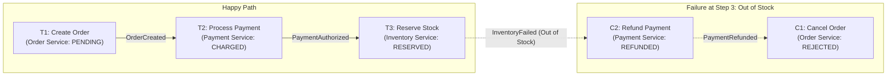

# Topic 127: Distributed Transactions & Saga Pattern in Microservices (Choreography vs Orchestration)

> 🚀 **Roadmap Seal:** **`[ADVANCED / DEEP-DIVE]`** — *Advanced enterprise specialization & architecture. Study once core fundamentals are solid.*

## 1. What It Is and Why It Exists

In a classical monolithic architecture, managing transactions across multiple tables is simple: the relational database enforces ACID properties within a single physical engine.

In a modern Microservices and Service-Oriented Architecture (SOA), **every microservice owns its private, decoupled database** (e.g. `Order DB`, `Inventory DB`, `Payment DB`). A single business operation—such as placing an order—requires mutating state across three independent database instances on different servers:
1. `Order Service`: Creates an order with status `PENDING`.
2. `Payment Service`: Debits the customer's credit card.
3. `Inventory Service`: Decrements product stock count.

### Why 2-Phase Commit (2PC) Fails in the Cloud
Historically, distributed systems used **Two-Phase Commit (2PC / XA)**. In 2PC, a central transaction coordinator locks rows across all participating databases simultaneously before committing.
In modern cloud networks:
- **Blocking Latency:** All databases hold exclusive row locks while waiting for slow network round trips.
- **Availability Hazard (CAP Theorem):** If a single network switch or database node experiences a 2-second hiccup, the entire distributed system halts, and transactions deadlock.
- Cloud-native message brokers (Kafka) and NoSQL datastores do not support XA transactions.

### The Saga Pattern (Eventual Consistency)
The **Saga Pattern** is the definitive architectural solution for distributed consistency. A Saga represents a sequence of local transactions:
$$T_1, T_2, T_3, \dots, T_n$$
Each local transaction updates its private database and publishes an event.

If any intermediate step fails (e.g. `Payment Service` reports insufficient funds at $T_2$), the Saga executes a backward sequence of **Compensating Transactions** ($C_1$):
$$C_1 \longleftarrow \text{Rolls back changes made by } T_1$$
Compensating transactions restore eventual consistency without distributed locks!



### Real-World Analogy
Consider booking an international vacation package through separate providers.
- You book an airline flight ticket (**$T_1$**).
- You book a hotel room (**$T_2$**).
- You attempt to book a rental car (**$T_3$**), but all rental cars are sold out!
- You do not freeze the global banking system with distributed locks. Instead, you call the hotel and cancel your reservation (**$C_2$ - Compensating Transaction**), and call the airline to claim a travel voucher (**$C_1$ - Compensating Transaction**). The vacation is cancelled cleanly.

---

## 2. Prerequisites
Before studying distributed sagas, ensure you have mastered:
- [Topic 97: Declarative @Transactional Boundaries, Pagination, Sorting & N+1 Prevention](file:///c:/Users/modym/OneDrive/Desktop/Java-Doc/content/part3-spring/97-declarative-transactional-boundaries-pagination-sorting-n-plus-one.md) — Local ACID boundaries.
- [Topic 108: Event-Driven Enterprise Messaging with Apache Kafka](file:///c:/Users/modym/OneDrive/Desktop/Java-Doc/content/part3-spring/108-event-driven-enterprise-messaging-apache-kafka.md) — Kafka pub/sub messaging.
- [Topic 126: Transactional Outbox Pattern & CDC for Zero-Loss Event Publishing](file:///c:/Users/modym/OneDrive/Desktop/Java-Doc/content/part3-spring/126-transactional-outbox-pattern-cdc-debezium.md) — Atomic local outbox event emission.

---

## 3. Syntax Breakdown & Core Mechanics

### 3.1 Saga Implementation Styles

#### Style A: Choreography-Based Saga (Decentralized Pub/Sub)
- Participating services communicate directly via Kafka events.
- There is no central orchestrator: `Order Service` publishes `OrderCreated`; `Payment Service` listens, charges money, and publishes `PaymentAuthorized`; `Inventory Service` listens and reserves stock.
- **Best For:** Simple workflows with 2 to 4 participating microservices.
- **Risk:** High coupling and "spaghetti event loops" when workflows grow to 10+ steps.

#### Style B: Orchestration-Based Saga (Central Coordinator)
- A dedicated **Saga Orchestrator** microservice acts as a state machine controller.
- The Orchestrator sends explicit command messages to worker services (e.g. `ProcessPaymentCommand`) and listens for replies (`PaymentSuccessReply` / `PaymentFailedReply`).
- **Best For:** Complex enterprise workflows with strict compliance, audits, and compensating rollbacks.

---

### 3.2 Authoring an Orchestration State Machine

```java
@Service
public class OrderSagaOrchestrator {

    private final KafkaTemplate<String, Object> kafkaTemplate;
    private final SagaStateRepository sagaRepository;

    @Transactional
    public void executeOrderSaga(OrderCreatedEvent event) {
        SagaInstance saga = new SagaInstance(event.orderId(), SagaState.STARTED);
        sagaRepository.save(saga);

        // Step 1: Dispatch Payment Command
        kafkaTemplate.send("payment-commands", new ProcessPaymentCommand(event.orderId(), event.amount()));
    }

    @KafkaListener(topics = "payment-replies")
    public void onPaymentReply(PaymentReply reply) {
        SagaInstance saga = sagaRepository.findByOrderId(reply.orderId());

        if (reply.isSuccess()) {
            saga.setState(SagaState.PAYMENT_COMPLETED);
            sagaRepository.save(saga);
            // Step 2: Dispatch Inventory Command
            kafkaTemplate.send("inventory-commands", new ReserveStockCommand(reply.orderId()));
        } else {
            // Trigger Compensation Sequence
            triggerCompensation(saga, "Payment Declined: " + reply.errorMessage());
        }
    }

    private void triggerCompensation(SagaInstance saga, String reason) {
        log.warn("SAGA FAILED: Triggering compensating transactions for order: {}. Reason: {}", 
            saga.getOrderId(), reason);
        saga.setState(SagaState.COMPENSATING);
        sagaRepository.save(saga);

        // Compensating Command: Cancel Order
        kafkaTemplate.send("order-commands", new CancelOrderCommand(saga.getOrderId(), reason));
    }
}
```

---

### 3.3 Semantic Rules for Compensating Transactions
A compensating transaction ($C_k$) is **NOT** an automatic rollback:
1. It is a brand new, forward-executing business action that counter-balances a previously committed step (e.g. issuing a refund, restoring stock, setting status to `CANCELLED`).
2. **Absolute Idempotency:** Compensating transactions can be redelivered multiple times by Kafka; they must execute idempotently without duplicating refunds.
3. **Guaranteed Eventual Success:** Compensating transactions must never give up; if a refund service is temporarily down, the orchestrator retries until it succeeds.

---

## 4. Code Examples

### 4.1 Basic Example: Simulating Forward & Compensating Saga Execution
```java
package com.handbook.spring;

import java.util.*;

public class BasicSagaWorkflowDemo {

    public static void main(String[] args) {
        System.out.println("--- Microservices: Saga Pattern Orchestration Simulation ---");

        boolean paymentSuccess = true;
        boolean inventoryAvailable = false; // Simulating failure at step 2!

        System.out.println("1. [T1] Order Created with status: PENDING");
        
        if (paymentSuccess) {
            System.out.println("2. [T2] Payment Authorized: $150.00 debited from credit card.");
        }

        if (!inventoryAvailable) {
            System.out.println("3. [T3 ERROR] Inventory Reservation FAILED: Out of stock!");
            System.out.println(">>> INITIATING COMPENSATING TRANSACTIONS <<<");
            System.out.println("4. [C2] COMPENSATE: Credit card refund of $150.00 credited back to customer.");
            System.out.println("5. [C1] COMPENSATE: Order status updated to REJECTED_OUT_OF_STOCK.");
            System.out.println("Saga completed cleanly with 100% eventual consistency.");
        }
    }
}
```

**Expected Terminal Output:**
```text
--- Microservices: Saga Pattern Orchestration Simulation ---
1. [T1] Order Created with status: PENDING
2. [T2] Payment Authorized: $150.00 debited from credit card.
3. [T3 ERROR] Inventory Reservation FAILED: Out of stock!
>>> INITIATING COMPENSATING TRANSACTIONS <<<
4. [C2] COMPENSATE: Credit card refund of $150.00 credited back to customer.
5. [C1] COMPENSATE: Order status updated to REJECTED_OUT_OF_STOCK.
Saga completed cleanly with 100% eventual consistency.
```

---

### 4.2 Realistic Enterprise Example: Verified SagaPatternOrchestrationDemo
```java
package com.handbook.spring;

import java.util.*;

public class SagaPatternOrchestrationDemo {

    public enum SagaStep { ORDER_PENDING, PAYMENT_CAPTURED, INVENTORY_RESERVED, COMPENSATED, COMPLETED }

    public static class OrderSagaCoordinator {
        private SagaStep currentStep = SagaStep.ORDER_PENDING;

        public void runSaga(boolean simulateInventoryFailure) {
            System.out.println("  -> [SAGA START]: Order ORD-8891 initialized.");
            currentStep = SagaStep.PAYMENT_CAPTURED;
            System.out.println("  -> [Step 1 SUCCESS]: Payment captured.");

            if (simulateInventoryFailure) {
                System.out.println("  -> [Step 2 FAILURE]: Inventory allocation rejected!");
                compensate();
            } else {
                currentStep = SagaStep.INVENTORY_RESERVED;
                System.out.println("  -> [Step 2 SUCCESS]: Inventory allocated.");
                currentStep = SagaStep.COMPLETED;
            }
        }

        private void compensate() {
            System.out.println("  -> [COMPENSATION TRIGGERED]: Refunding payment & cancelling order.");
            currentStep = SagaStep.COMPENSATED;
        }

        public SagaStep getCurrentStep() { return currentStep; }
    }

    public static void main(String[] args) {
        System.out.println("=== Topic 127: Distributed Transactions & Saga Pattern ===");

        OrderSagaCoordinator coordinator = new OrderSagaCoordinator();
        coordinator.runSaga(true); // Run with failure to test compensation

        System.out.println("Final Saga terminal state: " + coordinator.getCurrentStep());

        if (coordinator.getCurrentStep() != SagaStep.COMPENSATED) {
            throw new AssertionError("Saga compensation state verification failed!");
        }

        System.out.println("Topic 127 Saga Pattern and Orchestration verified successfully.");
    }
}
```

---

## 5. Common Mistakes & Error Diagnosis

### Pitfall 1: Non-Idempotent Compensating Actions (The Double-Refund Bug)
- **Symptom:** A network timeout during a compensating action causes the orchestrator to retry the refund command, resulting in the customer being refunded twice!
- **Cause:** Compensating transactions are executed over network queues that guarantee At-Least-Once delivery.
- **Diagnosis & Fix:** Always make compensating endpoints idempotent by passing a unique idempotency key (`idempotency_key = "refund-" + orderId`). The payment service must record processed refund keys and ignore duplicate attempts.

### Pitfall 2: Cyclic Event Dependencies in Choreography Sagas
- **Symptom:** Services trigger each other in an infinite storm of events, exhausting CPU and disk space.
- **Cause:** Service A emits an event that triggers Service B, which emits an event that triggers Service C, which inadvertently emits an event that re-triggers Service A.
- **Diagnosis & Fix:** When business logic spans more than 3 microservices, switch to **Orchestration-based Sagas** where the central state machine directs all commands.

### Pitfall 3: Dirty Reads of Intermediate Uncommitted Aggregate States
- **Symptom:** A customer sees an order status as `APPROVED` on their mobile app, but 2 seconds later it switches to `REJECTED`.
- **Cause:** Sagas lack ACID Isolation (the 'I' in ACID). Intermediate states are committed to the local database immediately.
- **Diagnosis & Fix:** Model intermediate states explicitly: use `PENDING_PAYMENT`, `PAYMENT_APPROVED`, `RESERVATION_PENDING` rather than binary `ACTIVE` / `INACTIVE`.

---

## 6. Best Practices Guide

| Practice | Recommendation | Architectural Justification |
| :--- | :--- | :--- |
| **Saga Style** | Orchestration for Core Financial Flows | Provides centralized visibility, explicit state machine transitions, and audit logging. |
| **Idempotence** | Enforce Idempotency on all commands and compensations | Protects against duplicate message deliveries in distributed event streams. |
| **Compensation Guarantee** | Compensations must never fail | Compensations must retry automatically until completion; if impossible, raise immediate human alerts. |
| **Timeout Limits** | Configure max step timeout policies | Prevents sagas from remaining stuck in `PENDING` indefinitely if a downstream service dies. |

---

## 7. Version Notes & Compatibility

- **Classical Monoliths (Java EE):** Relied on JTA / XA transactions (`UserTransaction`).
- **Modern Cloud Era (Spring Boot 3.x / Kafka 3.x):**
  - Sagas are the universally recognized architectural standard for distributed data consistency.
  - Native integration with Spring StateMachine and workflow engines (Temporal, Camunda, AWS Step Functions).

---

## 8. Summary & Cheat Sheet

| Dimension | Choreography Saga | Orchestration Saga | Two-Phase Commit (2PC) |
| :--- | :--- | :--- | :--- |
| **Coordination** | Decentralized (Event Pub/Sub) | **Central State Machine Coordinator** | Centralized Lock Coordinator |
| **Coupling** | Low (Loose event coupling) | Moderate (Orchestrator knows flow) | Extremely High |
| **Visibility** | Difficult to trace across services | **Easy to monitor in single dashboard**| Difficult |
| **Performance** | High (Asynchronous non-blocking) | **High (Asynchronous non-blocking)** | Extremely Poor (Blocking Locks) |
| **Best Used For** | Simple 2–3 step notification flows | **Core business workflows (Orders, Billing)** | Single RDBMS only |

---

## 9. Hands-on Practice Exercises

### Exercise 1: Spot the Bug — The Non-Idempotent Compensating Refund Trap
Review the following refund handler:
```java
@KafkaListener(topics = "compensate-refund-commands")
public void handleRefund(RefundCommand cmd) {
    accountRepository.creditBalance(cmd.userId(), cmd.amount());
}
```
If network packet drops cause Kafka to redeliver this command twice, what financial disaster occurs, and how is it corrected?

<details>
<summary>View Solution</summary>

**Cause:**
`creditBalance` increments the customer's balance every time it is called. If redelivered twice, the customer is credited twice their refund amount.

**The Fix:**
Enforce an idempotency check in the database using a unique transaction reference:
```java
@Transactional
public void handleRefund(RefundCommand cmd) {
    if (refundLedger.existsByRefundId(cmd.refundId())) {
        log.warn("Refund {} already processed. Ignoring duplicate command.", cmd.refundId());
        return;
    }
    accountRepository.creditBalance(cmd.userId(), cmd.amount());
    refundLedger.save(new ProcessedRefund(cmd.refundId(), cmd.amount(), Instant.now()));
}
```
</details>

---

### Exercise 2: Hands-on Implementation — Orchestration State Machine with Compensating Rollback
Implement an enum-based Saga State model with valid transitions and compensating rollback triggers.

<details>
<summary>View Solution</summary>

```java
package com.handbook.spring.saga;

public enum OrderSagaState {
    STARTED {
        @Override
        public OrderSagaState next(boolean success) {
            return success ? PAYMENT_SUBMITTED : ORDER_REJECTED;
        }
    },
    PAYMENT_SUBMITTED {
        @Override
        public OrderSagaState next(boolean success) {
            return success ? INVENTORY_RESERVED : COMPENSATING_PAYMENT;
        }
    },
    INVENTORY_RESERVED {
        @Override
        public OrderSagaState next(boolean success) {
            return success ? SAGA_COMPLETED : COMPENSATING_INVENTORY;
        }
    },
    COMPENSATING_PAYMENT {
        @Override
        public OrderSagaState next(boolean success) {
            return ORDER_REJECTED;
        }
    },
    COMPENSATING_INVENTORY {
        @Override
        public OrderSagaState next(boolean success) {
            return COMPENSATING_PAYMENT;
        }
    },
    SAGA_COMPLETED {
        @Override
        public OrderSagaState next(boolean success) { return this; }
    },
    ORDER_REJECTED {
        @Override
        public OrderSagaState next(boolean success) { return this; }
    };

    public abstract OrderSagaState next(boolean success);
}
```
</details>

---

### Exercise 3: Real-World Edge Case — Handling Out-of-Order Compensating Events
<details>
<summary>View Solution</summary>
**Question:** In high-concurrency event streams, what happens if an out-of-order network delay causes an `OrderCancelledEvent` (compensation) to arrive at the Payment Service *before* the original `OrderCreatedEvent` (forward action)?

**Solution:**
1. **The Out-of-Order Hazard:** If the Payment Service receives `CancelOrder` first, it finds no active payment record and ignores the message. A few seconds later, `CreateOrder` arrives and charges the customer, leaving the customer charged for a cancelled order!
2. **The Solution (Semantic Lock / Pre-Registration):**
   - When `CancelOrder` arrives for an unknown order, the Payment Service records an intentional **Cancellation Tombstone** in its database:
     ```sql
     INSERT INTO payment_records (order_id, status) VALUES ('ORD-99', 'CANCELLED_BEFORE_PAYMENT');
     ```
   - When the delayed `CreateOrder` command finally arrives, it checks the payment record, detects the `CANCELLED_BEFORE_PAYMENT` tombstone, and immediately halts without charging the customer!
</details>

---

## 10. Verified Official Sources
- [Microservices.io: Pattern: Saga](https://microservices.io/patterns/data/saga.html)
- [Chris Richardson: Microservices Patterns (Manning Publications)](https://www.manning.com/books/microservices-patterns)
- [Baeldung: The Saga Pattern in Microservices](https://www.baeldung.com/cs/saga-pattern-microservices)
