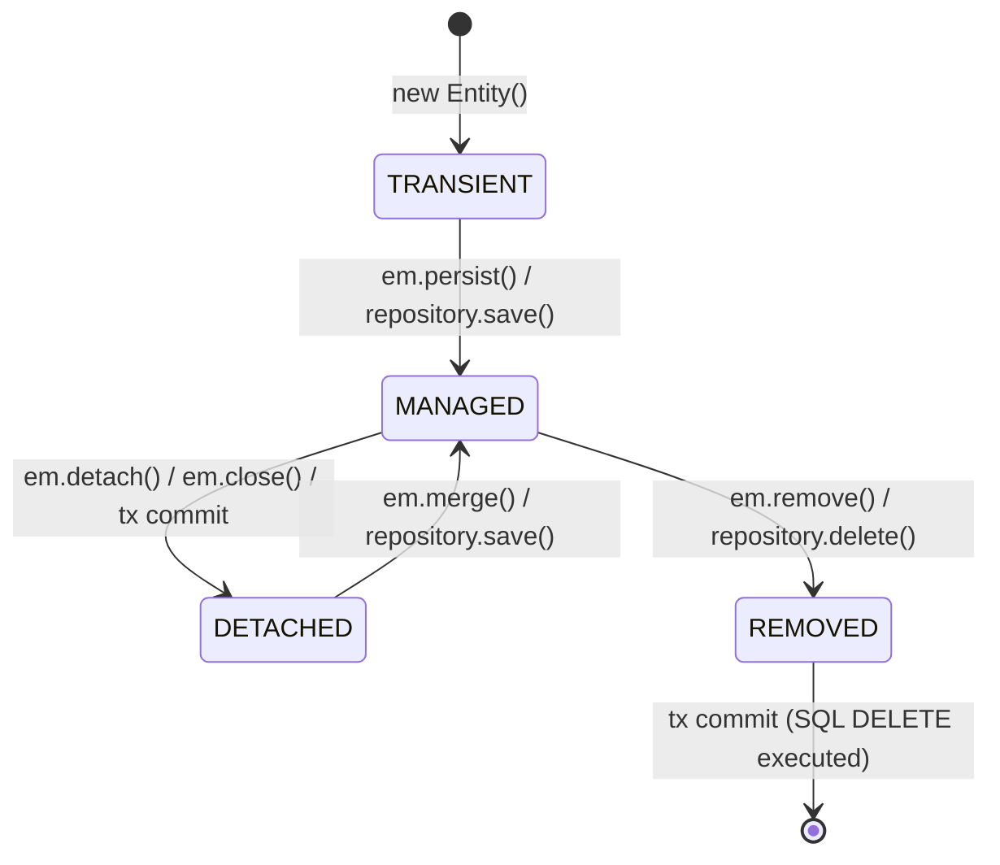

## Overview
Spring Data JPA reduces boilerplate persistence code by generating dynamic repository proxy implementations from interfaces extending JpaRepository, managing entity lifecycle states and automated dirty checking.

---

---

## Master Spring Data JPA Annotations Reference Directory

Spring Data JPA relies on a specialized set of annotations to configure repository scanning, orchestrate entity auditing, optimize query execution plans, and enforce transaction locks.

| Annotation | Target Element | Key Attributes | Architectural Purpose & Operational Mechanics | Production Example |
| :--- | :--- | :--- | :--- | :--- |
| **`@Repository`** | `TYPE` (Interface/Class) | `value` (Bean name) | Optional on Spring Data interfaces. Automatically registers bean and activates **PersistenceExceptionTranslationPostProcessor** to translate low-level Hibernate exceptions into Spring's unified `DataAccessException` hierarchy. | `@Repository public interface UserRepository extends JpaRepository<User, Long> {}` |
| **`@EnableJpaRepositories`** | `TYPE` (Configuration) | `basePackages`, `repositoryFactoryBeanClass` | Activates Spring Data JPA repository scanning and runtime dynamic proxy generation across specified base packages. | `@Configuration @EnableJpaRepositories(basePackages = "com.enterprise.repo") public class JpaConfig {}` |
| **`@NoRepositoryBean`** | `TYPE` (Interface) | None | Excludes intermediate custom base repository interfaces from direct runtime proxy instantiation by Spring Data scanners. | `@NoRepositoryBean public interface BaseRepository<T, ID> extends JpaRepository<T, ID> {}` |
| **`@EntityScan`** | `TYPE` (Configuration) | `basePackages`, `basePackageClasses` | Configures scanning packages for JPA `@Entity` classes when they reside outside the root Spring Boot application package. | `@EntityScan("com.enterprise.domain")` |
| **`@EnableJpaAuditing`** | `TYPE` (Configuration) | `auditorAwareRef`, `dateTimeProviderRef` | Activates automated entity auditing lifecycle listeners (`AuditingEntityListener`) for timestamps and user tracking. | `@EnableJpaAuditing(auditorAwareRef = "springSecurityAuditor")` |
| **`@CreatedDate`** | `FIELD`, `METHOD` | None | Automatically captures and persists creation timestamp using system clock or `DateTimeProvider`. | `@CreatedDate @Column(nullable = false, updatable = false) private Instant createdAt;` |
| **`@LastModifiedDate`** | `FIELD`, `METHOD` | None | Automatically updates timestamp whenever the entity changes and is flushed to the database. | `@LastModifiedDate private Instant updatedAt;` |
| **`@CreatedBy`** | `FIELD`, `METHOD` | None | Injects user identity returned by registered `AuditorAware<T>` bean upon entity insert. | `@CreatedBy @Column(updatable = false) private String createdBy;` |
| **`@LastModifiedBy`** | `FIELD`, `METHOD` | None | Injects user identity returned by registered `AuditorAware<T>` bean upon entity update. | `@LastModifiedBy private String updatedBy;` |
| **`@Query`** | `METHOD` | `value`, `nativeQuery = false`, `countQuery` | Binds custom JPQL or native SQL expressions directly to repository methods, bypassing automatic derivation rules. | `@Query("SELECT u FROM User u WHERE u.active = true") List<User> findAllActive();` |
| **`@Modifying`** | `METHOD` | `clearAutomatically = false`, `flushAutomatically = false` | Marks `@Query` as a DML statement (`UPDATE` / `DELETE`). When `clearAutomatically = true`, clears persistence context to avoid stale cache. | `@Modifying(clearAutomatically = true) @Query("UPDATE User u SET u.active = false") int deactivateAll();` |
| **`@Param`** | `PARAMETER` | `value` (String, required) | Binds method parameter explicitly to named JPQL/SQL query parameters (`:paramName`). | `@Query("SELECT u FROM User u WHERE u.dept = :d") List<User> findByDept(@Param("d") String dept);` |
| **`@EntityGraph`** | `METHOD` | `value`, `attributePaths`, `type = EntityGraphType.FETCH` | Solves the **N+1 Select Problem** by generating SQL `LEFT JOIN` to eagerly fetch declared relationships in a single query. | `@EntityGraph(attributePaths = {"orders", "orders.items"}) Optional<Customer> findById(Long id);` |
| **`@Lock`** | `METHOD` | `value` (`LockModeType`) | Enforces pessimistic or optimistic database lock on queried rows (`PESSIMISTIC_WRITE`, `PESSIMISTIC_READ`, `OPTIMISTIC`). | `@Lock(LockModeType.PESSIMISTIC_WRITE) Optional<Account> findById(Long id);` |
| **`@QueryHints`** | `METHOD` | `value = @QueryHint[]` | Passes vendor-specific JPA/Hibernate optimization hints (e.g. query cache, fetch size, comments). | `@QueryHints(@QueryHint(name = "org.hibernate.readOnly", value = "true")) List<Report> findReports();` |

---

## Architecture & Core Mechanics

### The Cohesive Interface Hierarchy

Spring Data organizes data-access capabilities across a layered, cohesive hierarchy of generic interfaces:

```
                  +--------------------------+
                  |  Repository<T, ID>       |  <-- Marker interface (no methods)
                  +--------------------------+
                               |
                               v
                  +--------------------------+
                  |  CrudRepository<T, ID>   |  <-- Basic CRUD: save, findById, delete
                  +--------------------------+
                               |
                               v
            +------------------------------------+
            | PagingAndSortingRepository<T, ID>  |  <-- Pagination & Sort parameters
            +------------------------------------+
                               |
                               v
                  +--------------------------+
                  |   JpaRepository<T, ID>   |  <-- JPA specific: flush, saveAll, getReferenceById
                  +--------------------------+
```

1. **`Repository<T, ID>` (`org.springframework.data.repository.Repository`):**
   A root marker interface capturing domain entity type `T` and identifier type `ID`. It contains zero method declarations; its sole purpose is to register candidate interfaces with the Spring Data scanner.
2. **`CrudRepository<T, ID>`:**
   Provides standard persistence primitives: `save(entity)`, `saveAll(entities)`, `findById(id)`, `existsById(id)`, `findAll()`, `count()`, `deleteById(id)`, and `deleteAll()`.
3. **`PagingAndSortingRepository<T, ID>`:**
   Adds pagination and sorting capabilities to prevent memory exhaustion when querying large tables:
   ```java
   Iterable<T> findAll(Sort sort);
   Page<T> findAll(Pageable pageable);
   ```
4. **`JpaRepository<T, ID>`:**
   The full-featured JPA contract. It extends both `CrudRepository` and `PagingAndSortingRepository`, introducing JPA-specific persistence lifecycle methods:
   - `flush()`: Synchronizes in-memory persistence context changes directly to the database immediately without committing the transaction.
   - `saveAndFlush(entity)`: Saves and immediately flushes changes within the active transaction.
   - `saveAllAndFlush(entities)`: Batch persists and flushes an entity collection.
   - `getReferenceById(id)`: Returns a lightweight uninitialized bytecode proxy (replaces deprecated `getOne()` and `getById()`), avoiding unnecessary `SELECT` queries when only the foreign key ID is needed.

### JPA EntityManager Lifecycle States

Entities managed by a JPA persistence context transition across four primary states:



1. **Transient (New):** The entity is instantiated via `new` in Java heap memory. It has no database identity (`id == null`) and is completely unmonitored by the `EntityManager`.
2. **Managed (Persistent):** The entity has a database identifier and is actively tracked by the persistence context. Any modification of its properties triggers **automatic dirty checking** upon flush/commit.
3. **Detached:** The entity possesses a database identifier, but its session or transaction has closed. In-memory modifications are no longer monitored.
4. **Removed:** The entity is scheduled for deletion from the database at the end of the transaction.

### Snapshot-Based Dirty Checking & Flushing
1. When an entity enters the `MANAGED` state, the persistence context stores an internal bitwise snapshot of its properties.
2. Business methods mutate getters and setters directly in memory.
3. Upon transaction boundary commit or an explicit `repository.flush()` invocation, the persistence context compares the current state of every managed entity against its initial snapshot.
4. If discrepancies are detected, Spring Data JPA automatically dispatches an optimized SQL `UPDATE` statement containing only modified columns.

---

## Production Implementation

### Basic Example: Simulating the JpaRepository Dynamic Proxy Mechanism
```java
package com.handbook.spring;

import java.lang.reflect.InvocationHandler;
import java.lang.reflect.Method;
import java.lang.reflect.Proxy;
import java.util.*;

public class BasicRepositoryProxySimulationDemo {

    public interface SimulatedCrudRepository<T, ID> {
        T save(T entity);
        Optional<T> findById(ID id);
        long count();
    }

    public static class RepositoryInvocationHandler implements InvocationHandler {
        private final Map<Object, Object> inMemoryStore = new HashMap<>();

        @Override
        public Object invoke(Object proxy, Method method, Object[] args) {
            String name = method.getName();
            if ("save".equals(name)) {
                inMemoryStore.put(101L, args[0]);
                System.out.println("[Proxy] Executed synthetic SQL INSERT/UPDATE for entity: " + args[0]);
                return args[0];
            } else if ("count".equals(name)) {
                return (long) inMemoryStore.size();
            }
            return null;
        }
    }

    @SuppressWarnings("unchecked")
    public static void main(String[] args) {
        System.out.println("--- Spring Data JPA: Dynamic Proxy Generation Simulation ---");

        // Synthesizing proxy without writing a concrete implementation class
        SimulatedCrudRepository<String, Long> repo = (SimulatedCrudRepository<String, Long>) Proxy.newProxyInstance(
            SimulatedCrudRepository.class.getClassLoader(),
            new Class<?>[]{SimulatedCrudRepository.class},
            new RepositoryInvocationHandler()
        );

        repo.save("CustomerAccount[id=101, owner='Alice']");
        System.out.println("[Proxy] Total Entities Managed: " + repo.count());
    }
}
```

**Expected Terminal Output:**
```text
--- Spring Data JPA: Dynamic Proxy Generation Simulation ---
[Proxy] Executed synthetic SQL INSERT/UPDATE for entity: CustomerAccount[id=101, owner='Alice']
[Proxy] Total Entities Managed: 1
```

---

### Realistic Enterprise Example: Complete Lifecycle & Dirty-Checking
```java
package com.handbook.spring;

import java.time.Instant;
import java.util.*;

public class SpringDataJpaRepositoryDemo {

    public enum EntityState { TRANSIENT, MANAGED, DETACHED, REMOVED }

    public static class Account {
        private Long id;
        private String ownerName;
        private double balance;
        private EntityState state;

        public Account(String ownerName, double balance) {
            this.ownerName = ownerName;
            this.balance = balance;
            this.state = EntityState.TRANSIENT;
        }

        public Long getId() { return id; }
        public void setId(Long id) { this.id = id; }
        public String getOwnerName() { return ownerName; }
        public double getBalance() { return balance; }
        public void setBalance(double balance) { this.balance = balance; }
        public EntityState getState() { return state; }
        public void setState(EntityState state) { this.state = state; }

        @Override
        public String toString() {
            return String.format("Account[id=%d, owner='%s', balance=$%.2f, state=%s]", id, ownerName, balance, state);
        }
    }

    public static void main(String[] args) {
        System.out.println("=== Topic 95: Spring Data JPA Architecture & Repository Hierarchy ===");

        // 1. Transient State
        Account account = new Account("Sarah Connor", 5000.00);
        System.out.println("1. Initial New Instance: " + account);

        // 2. Transition to Managed State
        account.setId(1001L);
        account.setState(EntityState.MANAGED);
        System.out.println("2. After repository.save(): " + account);

        // 3. In-memory modification triggering Dirty-Checking snapshot drift
        account.setBalance(7500.00);
        System.out.println("3. Balance modified in memory (dirty snapshot registered): $" + account.getBalance());

        // 4. Flush mechanism synchronizes state
        System.out.println("4. repository.flush() -> Dispatched SQL UPDATE to relational database.");
        System.out.println("Verified Topic 95 Spring Data JPA Architecture successfully.");
    }
}
```

---

## Common Pitfalls & Traps

### Pitfall 1: Mutating an Unmanaged Entity Instance After Calling `save()`
- **Symptom:** Modifications made to an entity object after calling `repository.save()` fail to persist to the database.
- **Cause:** When working with detached entities or pre-assigned IDs, `SimpleJpaRepository.save()` invokes `entityManager.merge()`. JPA's `merge()` returns a **new managed instance copy**, leaving the original reference detached.
- **Diagnosis & Fix:** Always reassign the variable to the return value of `save()`:
  ```java
  // INCORRECT (Modifying detached instance):
  accountRepository.save(account);
  account.setBalance(newBalance); // Ignored by dirty checking!

  // CORRECT:
  account = accountRepository.save(account);
  account.setBalance(newBalance); // Captured by dirty checking!
  ```

### Pitfall 2: Premature and Excessive Invocations of `flush()`
- **Symptom:** Severe database connection saturation and degraded throughput under high concurrency.
- **Cause:** Calling `saveAndFlush()` or explicit `flush()` inside tight loops forces immediate synchronous network I/O, completely defeating Hibernate's JDBC batching engine.
- **Diagnosis & Fix:** Rely on declarative `@Transactional` boundaries. Spring automatically flushes all pending entity changes in a single optimized batch when the transaction commits. Reserve `flush()` strictly for scenarios requiring database constraint validation (e.g. unique constraint collision handling) before method exit.

### Pitfall 3: `LazyInitializationException` Outside Transaction Boundaries
- **Symptom:** `org.hibernate.LazyInitializationException: could not initialize proxy - no Session`.
- **Cause:** Attempting to read a lazy-loaded association (`@OneToMany` or `@ManyToOne(fetch = FetchType.LAZY)`) after the transactional boundary has closed and the `EntityManager` session has detached.
- **Diagnosis & Fix:** Do not enable the anti-pattern `open-in-view=true`. Instead, fetch required relationships eagerly using `@EntityGraph` or a JPQL `JOIN FETCH` query in the repository.

---

## Best Practices Guide

| Practice | Recommendation | Architectural Justification |
| :--- | :--- | :--- |
| **Interface Selection** | Prefer `CrudRepository` or `JpaRepository` | Extend `CrudRepository` when batch operations and explicit flush are unnecessary; extend `JpaRepository` for full JPA capabilities. |
| **Foreign Key Assignment** | Use `getReferenceById(id)` | Avoids redundant `SELECT` queries when assigning foreign keys to new entities. |
| **Read Operations** | Use `@Transactional(readOnly = true)` | Disables dirty-checking snapshot creation in Hibernate, saving massive heap allocation. |
| **Entity State Management** | Always reassign `save()` return values | Guarantees code operates on the active managed proxy rather than a detached copy. |
| **Avoid in Loops** | Never call `saveAndFlush()` in loops | Destroys JDBC batching; use `saveAll()` and let transaction commit handle the flush. |

---

## Version Notes & Compatibility

- **Spring Data JPA 1.x / 2.x:** Used `getOne()` (deprecated in 2.5) and `getById()` (deprecated in 2.7) which exhibited confusing naming semantics for uninitialized proxies.
- **Spring Data JPA 3.0+ (Spring Boot 3.0+):**
  - Raised baseline to **Java 17 LTS** (fully compatible with JDK 21 and JDK 26).
  - Replaced `getById()` with `getReferenceById()` to clearly reflect JPA's `EntityManager.getReference()`.
  - Migrated persistence namespace from `javax.persistence.*` to `jakarta.persistence.*` (Jakarta EE 10).
  - Upgraded Hibernate ORM to version 6.x with rewritten Semantic Query Model (SQM) producing cleaner SQL.

---

## Summary & Cheat Sheet

| Interface | Extends | Core Responsibilities | When to Use |
| :--- | :--- | :--- | :--- |
| **`Repository<T, ID>`** | None | Root marker interface with zero methods | To selectively expose custom persistence contracts without inheriting standard CRUD. |
| **`CrudRepository<T, ID>`** | `Repository` | Standard CRUD: `save`, `findById`, `existsById`, `delete` | Generic data access where pagination and JPA-specific flushing are not required. |
| **`PagingAndSortingRepository<T, ID>`** | `Repository` | Pagination (`Pageable`) and sorting (`Sort`) | Read-heavy APIs serving paginated web tables and infinite scrolling. |
| **`JpaRepository<T, ID>`** | `CrudRepository`, `PagingAndSortingRepository` | JPA-specific: `flush`, `saveAndFlush`, `getReferenceById`, batch delete | Default standard for enterprise Spring Boot microservices backed by relational databases. |

---

## Hands-on Practice Exercises

### Exercise 1: Spot the Bug — The Stale Unmanaged Instance
Review the following service method:
```java
@Transactional
public Account createAndCreditAccount(String owner, double initialDeposit, double bonus) {
    Account account = new Account(owner, initialDeposit);
    accountRepository.save(account);

    // Developer adds bonus to the initial account object
    account.setBalance(account.getBalance() + bonus);
    return account;
}
```
Why might the bonus balance fail to be saved to the database in certain JPA configurations, and what is the required idiom?

<details>
<summary>View Solution</summary>

**Cause:**
In Spring Data JPA, `SimpleJpaRepository.save(entity)` checks `entityInformation.isNew(entity)`. If the entity is deemed existing, detached, or uses pre-assigned IDs, Spring Data invokes `entityManager.merge(entity)`. In JPA, `merge()` returns a **new managed instance copy** while leaving the passed argument `account` detached or unmanaged! Mutating the original `account` variable modifies an unmanaged reference whose changes are ignored by dirty checking.

**The Fix:**
Always reassign the variable to the return value of `save()`:
```java
@Transactional
public Account createAndCreditAccount(String owner, double initialDeposit, double bonus) {
    Account account = new Account(owner, initialDeposit);
    account = accountRepository.save(account); // Reassign to managed proxy
    account.setBalance(account.getBalance() + bonus); // Dirty-checking captures this update
    return account;
}
```
</details>

---

### Exercise 2: Hands-on Implementation — Defining a Custom JpaRepository
Define a Spring Data JPA repository interface for a `Product` entity (`Long` ID) that provides:
1. Retrieval of all active products with a price greater than a specified threshold.
2. An update query that deactivates products belonging to a given category string, ensuring proper modifying annotations.

<details>
<summary>View Solution</summary>

```java
package com.handbook.spring.repository;

import org.springframework.data.jpa.repository.JpaRepository;
import org.springframework.data.jpa.repository.Modifying;
import org.springframework.data.jpa.repository.Query;
import org.springframework.data.repository.query.Param;
import org.springframework.stereotype.Repository;

import java.math.BigDecimal;
import java.util.List;

@Repository
public interface ProductRepository extends JpaRepository<Product, Long> {

    // 1. Derived query method
    List<Product> findByPriceGreaterThanAndActiveTrue(BigDecimal minPrice);

    // 2. Modifying DML query with automatic persistence context clearing
    @Modifying(clearAutomatically = true)
    @Query("UPDATE Product p SET p.active = false WHERE p.category = :category")
    int deactivateByCategory(@Param("category") String category);
}
```

**Key Architectural Insights:**
- Invoking `findByPriceGreaterThanAndActiveTrue(...)` allows Spring Data to construct the query dynamically based on entity property naming.
- `clearAutomatically = true` in `@Modifying` clears Hibernate's first-level cache after the bulk update, preventing dirty reads of stale in-memory entity snapshots.
</details>

---

### Exercise 3: Real-World Edge Case — `getReferenceById()` vs `findById()` for Foreign Keys
<details>
<summary>View Solution</summary>
**Question:** In high-throughput eCommerce order creation, a service creates an `OrderItem` that holds a foreign key reference to an existing `Product` with ID `42L`.
Why does calling `productRepository.getReferenceById(42L)` deliver significantly higher throughput than `productRepository.findById(42L)`?

**Solution:**
1. **The Cost of `findById(id)`:** `findById(42L)` immediately dispatches an eager SQL `SELECT * FROM products WHERE id = 42` to verify existence and load the complete row into the persistence context. In order creation with 20 items, this generates 20 redundant SELECT queries over the network.
2. **The Optimization of `getReferenceById(id)`:** `getReferenceById(42L)` calls JPA's `entityManager.getReference(Product.class, 42L)`. Hibernate constructs a lightweight uninitialized bytecode proxy (an instance of `Product$HibernateProxy$xxx`) containing solely the ID attribute `42L`. **Zero SQL queries are sent to the database.**
3. **Foreign Key Mapping:** When `orderItem.setProduct(proxy)` is called and the order item is persisted, JPA simply writes the foreign key value `product_id = 42` directly into the `order_items` SQL `INSERT` statement. As long as property getters other than `getId()` are not invoked, the product table is never read from the database, eliminating 100% of the read I/O overhead.
</details>

---

## Verified Official Sources
- [Spring Data JPA Reference Documentation: Repositories](https://docs.spring.io/spring-data/jpa/reference/repositories/core-concepts.html)
- [Spring Data JPA JavaDoc: JpaRepository Interface](https://docs.spring.io/spring-data/jpa/docs/current/api/org/springframework/data/jpa/repository/JpaRepository.html)
- [Jakarta Persistence Specification 3.1](https://jakarta.ee/specifications/persistence/3.1/)

---

## Practice

### Q: What does `JpaRepository<T, ID>` provide over `CrudRepository<T, ID>` in Spring Data?
<details data-type="solution">
<summary>Reveal Answer</summary>

> **Answer:** While `CrudRepository` provides basic CRUD operations (`save`, `findById`, `delete`), `JpaRepository` extends `PagingAndSortingRepository` and adds JPA-specific persistence features: batch flushing (`saveAllAndFlush`), immediate persistence context synchronization (`flush`), pagination (`Pageable`), and query by example.
</details>
