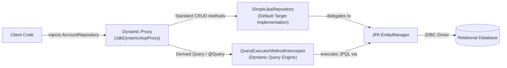
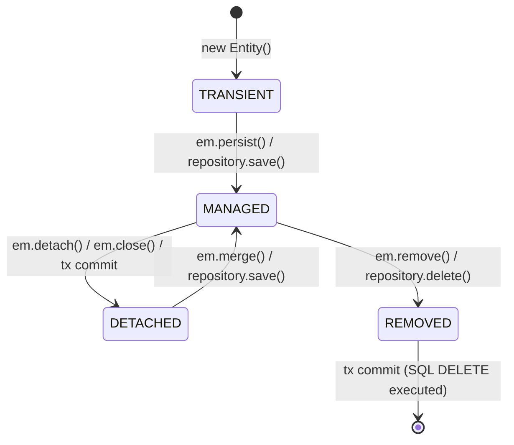

# Spring Data JPA Architecture, Repository Hierarchy & JpaRepository

In enterprise Java architectures, persistence historically required writing extensive boilerplate code: manually managing `EntityManager` transactions, writing repetitious CRUD methods, handling checked exceptions, and mapping result sets. **Spring Data JPA** transforms data access by introducing declarative repository abstraction. Rather than implementing repository classes manually, developers define interfaces extending Spring Data contracts, and the Spring container synthesizes high-performance proxy implementations at runtime.

---

## 1. The Spring Data Repository Interface Hierarchy

Spring Data structures data access capabilities across a layered, cohesive hierarchy of generic interfaces:

```
                  +--------------------------+
                  |  Repository<T, ID>       |  <-- Marker interface (no methods)
                  +--------------------------+
                               |
                               v
                  +--------------------------+
                  |  CrudRepository<T, ID>   |  <-- Basic CRUD: save, findById, delete
                  +--------------------------+
                               |
                               v
            +------------------------------------+
            | PagingAndSortingRepository<T, ID>  |  <-- Pagination & Sort parameters
            +------------------------------------+
                               |
                               v
                  +--------------------------+
                  |   JpaRepository<T, ID>   |  <-- JPA specific: flush, saveAll, getReferenceById
                  +--------------------------+
```

### Interface Responsibilities Breakdown

1. **`Repository<T, ID>`**:
   A root marker interface capturing the domain type `T` and identifier type `ID`. It contains no methods; its sole purpose is to declare the interface to the Spring Data component scanner.
2. **`CrudRepository<T, ID>`**:
   Provides standard persistence primitives: `save(entity)`, `findById(id)`, `existsById(id)`, `findAll()`, `count()`, `deleteById(id)`, and `deleteAll()`.
3. **`PagingAndSortingRepository<T, ID>`**:
   Introduces pagination and sorting methods: `findAll(Sort sort)` and `findAll(Pageable pageable)`.
4. **`JpaRepository<T, ID>`**:
   The full-featured JPA contract. It extends both `CrudRepository` and `PagingAndSortingRepository`, introducing JPA-specific persistence lifecycle methods:
   - `flush()`: Synchronizes in-memory persistence context changes directly to the underlying database immediately.
   - `saveAndFlush(entity)`: Saves and immediately flushes the entity within the current transaction.
   - `saveAllAndFlush(entities)`: Batch persists and flushes entities in a single step.
   - `getReferenceById(id)`: Returns a lazy Hibernate proxy without hitting the database immediately until a property is accessed.

---

## 2. Dynamic Runtime Proxy Generation

When Spring Boot boots up, `@EnableJpaRepositories` triggers `JpaRepositoryFactory`. For each interface extending `Repository`, Spring creates a `JdkDynamicAopProxy` or CGLIB proxy:



If the invoked method belongs to standard JPA operations (e.g. `save()`, `findById()`), the proxy delegates directly to `SimpleJpaRepository<T, ID>`. If the method is a custom derived method (e.g. `findByOwnerName(String name)`), Spring's `QueryExecutorMethodInterceptor` parses the method signature into an Abstract Syntax Tree (AST) and generates a JPQL query at runtime.

---

## 3. JPA EntityManager Lifecycle States

Entities in a JPA persistence context transition across four primary states:



1. **Transient (New)**:
   The entity is instantiated via `new` in Java heap memory. It has no database identity (`id == null`) and is not tracked by any persistence context.
2. **Managed (Persistent)**:
   The entity has a database identifier and is actively tracked by the `EntityManager`. Any mutation of its fields will be tracked automatically via **dirty checking** and written to the database during flush/commit without explicit calls to `update()`.
3. **Detached**:
   The entity has a database identifier, but its session or transaction has closed. State changes made in memory are no longer monitored.
4. **Removed**:
   The entity is scheduled for deletion from the database at the end of the transaction.

---

## 4. Dirty-Checking and the Flush Mechanism

Hibernate and JPA employ a **snapshot-based dirty checking** algorithm:
1. When an entity enters the `MANAGED` state (via `find()` or `persist()`), the persistence context stores an internal snapshot of its attribute values.
2. During application execution, business methods modify getters and setters directly in memory.
3. Upon transaction boundary commit or an explicit `repository.flush()` invocation, the persistence context compares the current state of the managed entity against its original snapshot.
4. If discrepancies are detected, Spring Data JPA automatically dispatches an optimized SQL `UPDATE` statement containing only modified values.

---

## 5. Architectural Comparison: Raw EntityManager vs Spring Data JPA

| Feature | Raw Jakarta EE `EntityManager` | Spring Data `JpaRepository` |
| :--- | :--- | :--- |
| **Boilerplate Code** | High (must write DAO classes, queries, typecasts) | Zero (interfaces generated at runtime) |
| **Paging & Sorting** | Manual `setFirstResult()`, `setMaxResults()`, query concatenation | Built-in `PageRequest.of(page, size, sort)` |
| **Query Generation** | Manual string manipulation prone to syntax errors | Auto-parsed method names (`findByEmailAndActiveTrue`) |
| **Exception Translation** | Throws vendor-specific `PersistenceException` | Translates automatically to Spring's `DataAccessException` hierarchy |
| **Testing Support** | Requires complex container simulation | Native slicing with `@DataJpaTest` |

---

## 6. Runnable Verification & Code Walkthrough

The executable architecture demo `examples/spring/SpringDataJpaRepositoryDemo.java` implements:
- A custom `Account` entity modeling all 4 JPA lifecycle states (`TRANSIENT`, `MANAGED`, `DETACHED`, `REMOVED`).
- A simulated generic `SimpleJpaRepository<T, ID>` implementing `JpaRepository<T, ID>`.
- A dynamic `RepositoryFactorySupport` using Java `Proxy` and `InvocationHandler` to dispatch both standard CRUD methods and dynamic derived queries (`findByOwnerName`).
- Dirty-checking snapshot comparison triggered upon `flush()`.

You can compile and run this verified demo directly on JDK 26:
```bash
javac -d examples/web/classes examples/spring/SpringDataJpaRepositoryDemo.java
java -ea -cp examples/web/classes com.handbook.spring.SpringDataJpaRepositoryDemo
```
