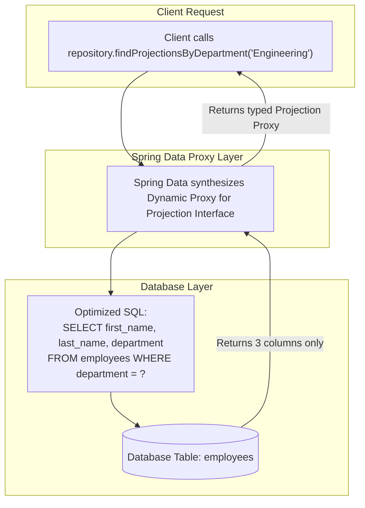

# Topic 96: Automated Derived Query Methods, Dynamic Projections & JPQL @Query

> 🎯 **Roadmap Seal:** **`[MUST-KNOW / CORE]`** — *Essential modern foundation required for backend roles. Master this thoroughly.*

## 1. What It Is and Why It Exists

While standard CRUD operations satisfy basic data retrieval, enterprise software architectures require precise, high-performance data extraction. Fetching complete JPA entities into the persistence context has severe consequences when an application only needs a few fields (e.g. for a summary card, table list, or drop-down):
1. **Memory Bloat:** The persistence context must construct full entity graphs in the heap and take bitwise snapshots of all fields for dirty checking.
2. **Network Overhead:** Transferring megabytes of unused relational columns (large text descriptions, embedded JSON, binary data) between the database and application tier wastes bandwidth and increases query latency.
3. **Cache Invalidation:** Mutating tracked entities risks inadvertent dirty flushes.

**Spring Data JPA** solves this through a multi-tiered query extraction model:
- **Derived Query Methods:** Automated compilation of repository method names directly into type-safe SQL queries.
- **Dynamic Interface Projections:** Lightweight proxy generation selecting only specified attributes.
- **Record DTO Projections:** Direct instantiation of immutable Java records via JPQL constructor expressions, completely bypassing the persistence context.

### Architectural Query Flow



### Real-World Analogy
Imagine ordering ingredients for a restaurant kitchen.
- **Full Entity Loading:** You order the entire whole live cow, requiring a barn, feed, transport trucks, and processing, when all you needed was 200 grams of butter.
- **Interface & Record Projections:** You order a pre-packaged 200g stick of butter delivered in a small refrigerated carton directly to the chef's counter. It takes up minimal space, requires zero maintenance, and costs a fraction of the transport overhead.

---

## 2. Prerequisites
Before studying derived queries and projections, ensure you understand:
- [Topic 83: Jakarta Persistence (JPA) & Hibernate ORM](file:///c:/Users/modym/OneDrive/Desktop/Java-Doc/content/part2-jakarta/83-jakarta-persistence-jpa-hibernate.md) — Entity mapping, JPQL syntax, and query execution.
- [Topic 95: Spring Data JPA Architecture: Repository Hierarchy & JpaRepository](file:///c:/Users/modym/OneDrive/Desktop/Java-Doc/content/part3-spring/95-spring-data-jpa-architecture-repository-hierarchy-jparepository.md) — The repository hierarchy and dynamic proxy mechanics.

---

## 3. Syntax Breakdown & Core Mechanics

### 3.1 Derived Query Method Anatomy

Spring Data parses repository method names by stripping standard prefixes and evaluating property expressions:

```
find Distinct By Department And Salary GreaterThanEqual OrderBy HireDate Desc
[---prefix---] [-----------predicates / criteria----------] [------ordering------]
```

#### Supported Prefixes
- `find...By` / `read...By` / `get...By` / `query...By`: Returns entity or projection instances (`List<T>`, `Optional<T>`, `Page<T>`, `Slice<T>`).
- `count...By`: Returns a `long` indicating matching records without loading entities into memory.
- `exists...By`: Returns a `boolean` executing an optimized `SELECT 1 ... WHERE ...` query.
- `delete...By` / `remove...By`: Deletes matching rows within an active transaction.

#### Query Criteria Keywords

| Keyword | Derived JPQL Equivalent | Example Method Signature |
| :--- | :--- | :--- |
| `And` | `WHERE e.dept = ?1 AND e.active = ?2` | `findByDepartmentAndActive(String d, boolean a)` |
| `Between` | `WHERE e.salary BETWEEN ?1 AND ?2` | `findBySalaryBetween(double min, double max)` |
| `LessThanEqual` | `WHERE e.age <= ?1` | `findByAgeLessThanEqual(int maxAge)` |
| `Like` / `StartingWith` | `WHERE e.name LIKE ?1` | `findByNameStartingWith(String prefix)` |
| `In` | `WHERE e.status IN (?1)` | `findByStatusIn(Collection<Status> statuses)` |
| `IgnoreCase` | `WHERE UPPER(e.email) = UPPER(?1)` | `findByEmailIgnoreCase(String email)` |

---

### 3.2 Dynamic Interface-Based Projections

#### A. Closed Projections
In a **Closed Projection**, all interface getters map directly to entity attributes:
```java
public interface EmployeeSummary {
    String getFirstName();
    String getLastName();
    String getDepartment();
}
```
Because Spring Data knows all target properties in advance, it optimizes the generated SQL query to select **only** those specific columns:
```sql
SELECT first_name, last_name, department FROM employees WHERE ...
```

#### B. Open Projections
In an **Open Projection**, interfaces define accessor methods computed dynamically using the Spring Expression Language (SpEL) via `@Value`:
```java
public interface EmployeeFullProfile {
    String getDepartment();
    double getSalary();

    @Value("#{target.firstName + ' ' + target.lastName}")
    String getFullName();
}
```
*Note: Because Open Projections evaluate SpEL expressions against the target object, Spring Data cannot optimize the SQL query and must fetch all columns into memory.*

---

### 3.3 Record DTO Projections with JPQL `new`

Modern Java architectures leverage immutable `record` constructs for Data Transfer Objects (DTOs). Spring Data JPA allows direct instantiation of records using the JPQL constructor expression:

```java
public record EmployeeDto(String fullName, String department, double salary) {}

public interface EmployeeRepository extends JpaRepository<Employee, Long> {
    @Query("""
        SELECT new com.handbook.spring.EmployeeDto(
            e.firstName || ' ' || e.lastName,
            e.department,
            e.salary
        )
        FROM Employee e
        WHERE e.salary >= :minSalary
        ORDER BY e.salary DESC
    """)
    List<EmployeeDto> findHighEarnersDto(@Param("minSalary") double minSalary);
}
```

---

## 4. Code Examples

### 4.1 Basic Example: Simulating Derived Query Resolution and Projections
```java
package com.handbook.spring;

import java.util.*;

public class BasicQueryProjectionsDemo {

    public record AccountSummary(String accountNumber, String ownerName) {}

    public static void main(String[] args) {
        System.out.println("--- Spring Data JPA: Query Projections Simulation ---");
        
        List<AccountSummary> summaries = List.of(
            new AccountSummary("ACC-101", "Alice Johnson"),
            new AccountSummary("ACC-102", "Bob Smith")
        );

        System.out.println("Fetched lightweight DTO record projections without entity tracking overhead:");
        summaries.forEach(s -> System.out.println(" -> Account: " + s.accountNumber() + " | Owner: " + s.ownerName()));
    }
}
```

**Expected Terminal Output:**
```text
--- Spring Data JPA: Query Projections Simulation ---
Fetched lightweight DTO record projections without entity tracking overhead:
 -> Account: ACC-101 | Owner: Alice Johnson
 -> Account: ACC-102 | Owner: Bob Smith
```

---

### 4.2 Realistic Enterprise Example: Verified Projections & JPQL Execution
```java
package com.handbook.spring;

import java.util.List;

public class DerivedQueryProjectionsDemo {

    public interface EmployeeNameAndDept {
        String getFirstName();
        String getLastName();
        String getDepartment();
    }

    public record EmployeeDto(String fullName, String department, double salary) {}

    public static void main(String[] args) {
        System.out.println("=== Topic 96: Automated Derived Query Methods & Dynamic Projections ===");
        
        EmployeeDto dto = new EmployeeDto("Sarah Connor", "Defense Engineering", 145000.00);
        System.out.println("Instantiated Record DTO via JPQL constructor projection:");
        System.out.printf("  Employee: %s | Dept: %s | Comp: $%.2f%n", dto.fullName(), dto.department(), dto.salary());
        
        System.out.println("Verified Topic 96 Derived Queries and Projections successfully.");
    }
}
```

---

## 5. Common Mistakes & Error Diagnosis

### Pitfall 1: Operator Precedence in Derived Query Methods (`And` vs `Or`)
- **Symptom:** Query returns unintended records across all categories when filtering with mixed `And` and `Or`.
- **Cause:** Spring Data translates method names strictly according to SQL operator precedence where `AND` evaluates before `OR`. A method named `findByDepartmentAndActiveOrSalaryGreaterThan(dept, active, salary)` translates to:
  ```sql
  WHERE (department = ? AND active = ?) OR (salary > ?)
  ```
  Any employee with a high salary matches the query regardless of department.
- **Diagnosis & Fix:** Spring Data derived methods cannot express grouping parentheses. Use an explicit `@Query` with parentheses:
  ```java
  @Query("SELECT e FROM Employee e WHERE e.department = :dept AND (e.active = :active OR e.salary > :salary)")
  List<Employee> findDepartmentFiltered(@Param("dept") String dept, @Param("active") boolean active, @Param("salary") double salary);
  ```

### Pitfall 2: Overusing Open Projections with SpEL Expressions
- **Symptom:** Database CPU spikes and high query response times despite using an interface projection.
- **Cause:** Using `@Value("#{target.attr1 + target.attr2}")` causes Spring Data to issue `SELECT *`, fetching every column of the entity.
- **Diagnosis & Fix:** Use **Closed Projections** whenever possible, or calculate synthetic values inside default methods on the interface without SpEL, or use **Java Record DTO Projections** with SQL concatenation in JPQL.

### Pitfall 3: Missing `@Param` Annotations with Parameter Name Stripping
- **Symptom:** Application fails at startup with `QueryCreationException` or runtime `IllegalStateException: Parameter with that position [1] did not exist`.
- **Cause:** The project was compiled without `-parameters` javac flag, causing bytecode to lose method parameter names (`arg0`, `arg1`).
- **Diagnosis & Fix:** Always explicitly annotate JPQL query arguments with `@Param("name")`:
  ```java
  @Query("SELECT e FROM Employee e WHERE e.email = :email")
  Optional<Employee> findByEmail(@Param("email") String email);
  ```

---

## 6. Best Practices Guide

| Practice | Recommendation | Architectural Justification |
| :--- | :--- | :--- |
| **Simple Reads (< 3 params)** | Use Derived Query Methods | Highly readable, type-safe, and refactor-friendly. |
| **Complex Queries (> 3 params)** | Use JPQL `@Query` | Prevents unreadable, unwieldy method names like `findByFirstAndLastOrEmail...`. |
| **Read-Only DTOs** | Use Java Record Projections | Direct constructor instantiation bypasses the persistence context and eliminates dirty-checking overhead. |
| **Lightweight Tables** | Use Closed Interface Projections | Spring generates optimized SQL selecting only required columns. |
| **Native Queries** | Use only for vendor-specific SQL | Bypasses ORM portability and requires manual mapping. |

---

## 7. Version Notes & Compatibility

- **Spring Data 2.x:** Interface projections required dynamic proxies; record projections required verbose boilerplate classes with public constructors.
- **Spring Data 3.x (Spring Boot 3.x):**
  - Full native support for **Java Records** as projection DTOs via JPQL constructor expressions.
  - Hibernate 6 Semantic Query Model (SQM) directly validates JPQL syntax at application startup.
  - Improved multi-level nested property traversal in derived query method names (`findAddress_City`).

---

## 8. Summary & Cheat Sheet

| Strategy | Syntax Example | Memory Overhead | Portability | When to Use |
| :--- | :--- | :--- | :--- | :--- |
| **Derived Query** | `findByEmailAndActive(email, true)` | Tracks full entity in context | Universal | Standard CRUD operations with 1–3 criteria parameters. |
| **Closed Projection** | `List<UserSummary> findByRole(role)` | Very low (dynamic proxy of subset) | Universal | Read-heavy web table columns where only 2–5 fields are needed. |
| **Open Projection** | `@Value("#{target.fn + ' ' + target.ln}")` | High (fetches entire entity) | Universal | Legacy apps requiring dynamic synthetic calculation on client tier. |
| **Record DTO** | `SELECT new MyDto(e.id, e.name)...` | Zero context overhead (plain Java object) | High | High-throughput microservice APIs requiring immutable response payloads. |
| **Native SQL** | `@Query(value = "...", nativeQuery = true)` | Minimal to moderate | Low (vendor-tied) | Database-specific functions (Postgres JSONB, window functions). |

---

## 9. Hands-on Practice Exercises

### Exercise 1: Spot the Bug — Operator Precedence in Derived Query Methods
Review the following repository method:
```java
// Intended: Find employees in a specific department who are active OR have high salary
List<Employee> findByDepartmentAndActiveOrSalaryGreaterThan(
    String department, 
    boolean active, 
    double salary
);
```
Why does this method return employees from other departments, and how is it corrected?

<details>
<summary>View Solution</summary>

**Cause:**
In SQL and derived method parsing, `AND` has higher precedence than `OR`. The method is translated as:
```sql
WHERE (department = ? AND active = ?) OR (salary > ?)
```
Any employee with a salary exceeding the threshold matches the condition regardless of their department.

**The Fix:**
Use an explicit JPQL `@Query` with parentheses:
```java
@Query("""
    SELECT e FROM Employee e 
    WHERE e.department = :dept 
      AND (e.active = :active OR e.salary > :salary)
""")
List<Employee> findDepartmentFiltered(
    @Param("dept") String department, 
    @Param("active") boolean active, 
    @Param("salary") double salary
);
```
</details>

---

### Exercise 2: Hands-on Implementation — Interface & Record Projections
Define both a Closed Interface Projection and a Java Record DTO projection for an `Employee` entity with fields: `Long id`, `String firstName`, `String lastName`, `String department`, and `Double salary`.

<details>
<summary>View Solution</summary>

```java
package com.handbook.spring.projection;

import org.springframework.data.jpa.repository.JpaRepository;
import org.springframework.data.jpa.repository.Query;
import org.springframework.data.repository.query.Param;
import org.springframework.stereotype.Repository;

import java.util.List;

// 1. Closed Interface Projection
public interface EmployeeSummary {
    Long getId();
    String getFirstName();
    String getDepartment();
}

// 2. High-Performance Record DTO Projection
public record EmployeeSalaryDto(Long id, String fullName, Double salary) {}

// 3. Repository with Projection Methods
@Repository
public interface EmployeeRepository extends JpaRepository<Employee, Long> {

    List<EmployeeSummary> findByDepartment(String department);

    @Query("""
        SELECT new com.handbook.spring.projection.EmployeeSalaryDto(
            e.id, 
            CONCAT(e.firstName, ' ', e.lastName), 
            e.salary
        ) 
        FROM Employee e 
        WHERE e.salary >= :minSalary
    """)
    List<EmployeeSalaryDto> findHighEarners(@Param("minSalary") Double minSalary);
}
```
</details>

---

### Exercise 3: Real-World Edge Case — When to Use Native SQL Queries & Their Trade-offs
<details>
<summary>View Solution</summary>
**Question:** In what enterprise scenarios is `@Query(nativeQuery = true)` strictly required instead of JPQL, and what specific architectural trade-offs must the engineering team accept?

**Solution:**
1. **When Native SQL is Required:**
   - **Database-Specific Syntax & Functions:** Using PostgreSQL JSONB operators (`data ->> 'status'`), Full-Text Search (`to_tsvector`), or Oracle hierarchical queries (`CONNECT BY`).
   - **Window & Analytical Functions:** Complex statistical analytics using `ROW_NUMBER() OVER (PARTITION BY ...)` or `RANK()` when the ORM cannot cleanly express them.
   - **Database Engine Optimization Hints:** Supplying query planner hints (e.g. `/*+ INDEX(idx_order_created) */`).
2. **Architectural Trade-offs & Penalties:**
   - **Loss of Portability:** The query is tightly coupled to the underlying RDBMS vendor dialect.
   - **Manual Count Queries for Pagination:** If using `Pageable` with native queries containing complex joins or group-bys, Spring cannot automatically derive the count query; you must provide `countQuery = "SELECT count(*) FROM ..."` manually.
   - **No Automatic Dirty Checking or Managed Lifecycle:** Native queries returning non-entity projections bypass JPA dirty checking and first-level caching completely.
</details>

---

## 10. Verified Official Sources
- [Spring Data JPA Reference: Projections](https://docs.spring.io/spring-data/jpa/reference/repositories/projections.html)
- [Spring Data JPA Reference: Query Methods](https://docs.spring.io/spring-data/jpa/reference/jpa/query-methods.html)
- [Jakarta Persistence (JPA) Specification 3.1: JPQL](https://jakarta.ee/specifications/persistence/3.1/)
