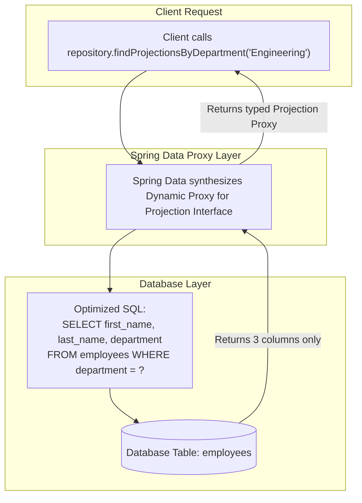

# Automated Derived Query Methods, Dynamic Projections & JPQL @Query

Spring Data JPA provides a multi-tiered query extraction model. While standard CRUD repositories satisfy elementary data access, production enterprise architectures require precise column extraction, complex relational joins, and selective projections to maintain low memory footprints and high query throughput.

---

## 1. Derived Query Method Mechanics

Spring Data's query creation mechanism parses method signatures into queries by stripping method prefixes and parsing domain entity property expressions.

```
find Distinct By Department And Salary GreaterThanEqual OrderBy HireDate Desc
[---prefix---] [-----------predicates / criteria----------] [------ordering------]
```

### Supported Method Prefix Constructs
- `find...By` / `read...By` / `get...By` / `query...By`: Returns entity or projection instances (`List<T>`, `Optional<T>`, `Page<T>`, `Slice<T>`).
- `count...By`: Returns a `long` indicating matching records without loading entities into memory.
- `exists...By`: Returns a `boolean` executing an optimized `SELECT 1 ... WHERE ...` query.
- `delete...By` / `remove...By`: Deletes matching rows within an active transaction.

### Query Keywords Matrix

| Keyword | Derived JPQL Equivalent | Example Method Signature |
| :--- | :--- | :--- |
| `And` | `WHERE e.dept = ?1 AND e.active = ?2` | `findByDepartmentAndActive(String d, boolean a)` |
| `Between` | `WHERE e.salary BETWEEN ?1 AND ?2` | `findBySalaryBetween(double min, double max)` |
| `LessThanEqual` | `WHERE e.age <= ?1` | `findByAgeLessThanEqual(int maxAge)` |
| `Like` / `StartingWith` | `WHERE e.name LIKE ?1` | `findByNameStartingWith(String prefix)` |
| `In` | `WHERE e.status IN (?1)` | `findByStatusIn(Collection<Status> statuses)` |
| `IgnoreCase` | `WHERE UPPER(e.email) = UPPER(?1)` | `findByEmailIgnoreCase(String email)` |

---

## 2. Dynamic Interface-Based Projections

Fetching full JPA entities causes the persistence context to track all attributes in the session cache. When an API endpoint only requires a subset of columns (such as a dropdown list or user summary card), fetching full entities wastes CPU and memory. Spring Data solves this via **Interface Projections**.



### A. Closed Projections
In a **Closed Projection**, all getter methods in the interface map directly to properties on the target entity:
```java
public interface EmployeeNameAndDept {
    String getFirstName();
    String getLastName();
    String getDepartment();
}
```
Because Spring Data knows all target properties in advance, it optimizes the generated SQL query to select **only** those specific columns rather than `SELECT *`.

### B. Open Projections
In an **Open Projection**, interfaces define accessor methods computed dynamically using the Spring Expression Language (SpEL) via `@Value`:
```java
public interface EmployeeSalarySummary {
    String getEmail();
    double getSalary();

    @Value("#{target.firstName + ' ' + target.lastName}")
    String getFullName();

    default String getCompensationTier() {
        return getSalary() > 100000 ? "TIER-1 (Executive)" : "TIER-2 (Standard)";
    }
}
```
*Note: Because Open Projections evaluate expressions against the target object, Spring Data cannot optimize the SQL query and must fetch the entire entity into memory.*

---

## 3. Record DTO Projections with JPQL `new`

Modern Java applications leverage immutable `record` constructs for Data Transfer Objects (DTOs). Spring Data JPA allows direct instantiation of records using the JPQL constructor expression:

```java
public record EmployeeDto(String fullName, String department, double salary) {}

public interface EmployeeRepository extends JpaRepository<Employee, Long> {
    @Query("""
        SELECT new com.handbook.spring.EmployeeDto(
            e.firstName || ' ' || e.lastName,
            e.department,
            e.salary
        )
        FROM Employee e
        WHERE e.salary >= :minSalary
        ORDER BY e.salary DESC
    """)
    List<EmployeeDto> findHighEarnersDto(@Param("minSalary") double minSalary);
}
```

### Key Advantages of Constructor Record Projections
1. **Zero Persistence Context Overhead**: Instantiated records are pure Java objects, completely untracked by the JPA session cache.
2. **Immutable & Thread-Safe**: Java records provide immutable data holders with built-in value-based equality and hash codes.
3. **Optimized SQL Generation**: Hibernate projects directly into the constructor arguments, bypassing entity instantiation entirely.

---

## 4. JPQL vs Native SQL Queries

| Feature | JPQL (`@Query("SELECT e FROM Employee e")`) | Native SQL (`nativeQuery = true`) |
| :--- | :--- | :--- |
| **Abstraction Level** | High (operates on Java entity & property names) | Low (operates directly on database tables and columns) |
| **Portability** | High across different RDBMS vendors | Low (tied to vendor SQL dialect, e.g. PostgreSQL, Oracle) |
| **Entity Mapping** | Automatic polymorphic resolution | Requires manual `@SqlResultSetMapping` for complex projections |
| **Use Cases** | 90% of business query operations | Vendor-specific functions (e.g. JSONB indexing, Window functions) |

---

## 5. Runnable Verification & Code Walkthrough

The executable architecture demo `examples/spring/DerivedQueryProjectionsDemo.java` implements:
- Derived query methods (`countByDepartment`, `existsByEmail`, `findBySalaryGreaterThanEqual`).
- Closed Interface Projections (`EmployeeNameAndDept`) extracting specific attributes.
- Open Interface Projections (`EmployeeSalarySummary`) with default method business logic tiering.
- JPQL `@Query` simulation with constructor expressions creating `EmployeeDto` record instances.

Compile and run the verified test:
```bash
javac -d examples/web/classes examples/spring/DerivedQueryProjectionsDemo.java
java -ea -cp examples/web/classes com.handbook.spring.DerivedQueryProjectionsDemo
```
