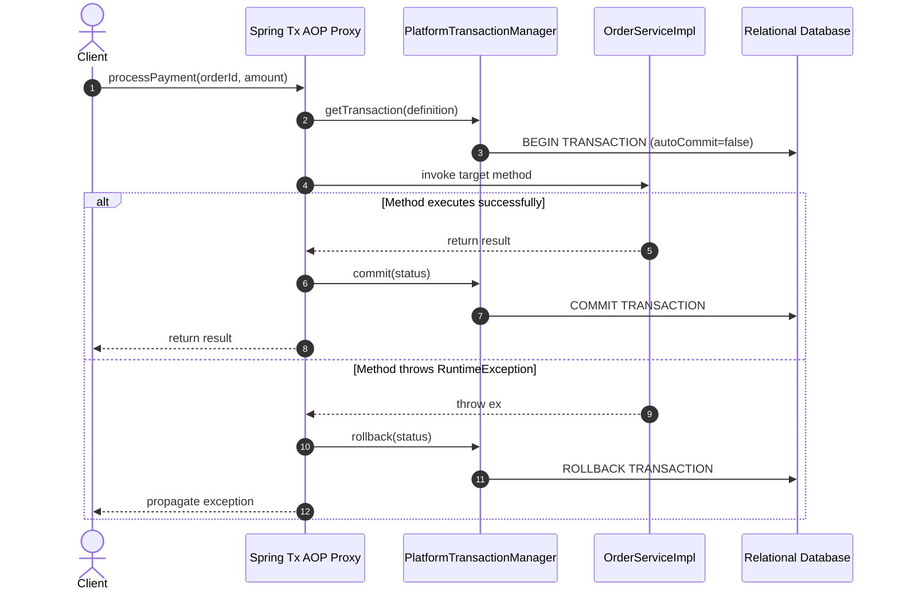

# Topic 97: Declarative @Transactional Boundaries, Pagination, Sorting & N+1 Prevention

> 🎯 **Roadmap Seal:** **`[MUST-KNOW / CORE]`** — *Essential modern foundation required for backend roles. Master this thoroughly.*

## 1. What It Is and Why It Exists

Enterprise backend systems require absolute ACID (Atomicity, Consistency, Isolation, Durability) guarantees across database mutations. At the same time, high-volume database reads must maintain sub-second response times without overloading database connections or consuming gigabytes of application server heap memory.

Two primary challenges dominate enterprise persistence architecture:
1. **Transaction Integrity:** Guaranteeing that multi-table business mutations either completely succeed or roll back cleanly without leaving partial, corrupted records.
2. **The N+1 Select Problem:** The single most common performance bug in ORM architectures, where fetching $N$ parent entities triggers $N$ secondary queries across the network to fetch lazy associations, turning a fast 5ms query into a 5-second database freeze.

### The Spring Declarative Transaction Architecture

Spring utilizes Aspect-Oriented Programming (AOP) dynamic proxies to wrap transactional beans. When client code invokes an annotated method, the proxy opens a database transaction, invokes the target business method, and commits or rolls back based on execution outcome:



### Real-World Analogy
Consider a bank courier transporting gold bars between bank vaults.
- **Transactional Boundary:** The courier does not hand over bars one by one on the street. All gold is sealed inside an armored transport vault. If the transport arrives safely, the recipient signs the receipt and the vault opens (**Commit**). If an armed robbery occurs midway, the transport aborts and returns to the origin vault under armed escort (**Rollback**).
- **The N+1 Problem:** Imagine a waiter taking orders from 50 restaurant guests. Instead of writing down all 50 orders on one notepad and making a single trip to the kitchen (**JOIN FETCH**), the waiter walks to the kitchen 50 separate times to ask the chef for one dish at a time (**N+1 Queries**).

---

## 2. Prerequisites
Before studying transactional boundaries and pagination, ensure you understand:
- [Topic 61: JDBC Fundamentals & Architecture](#topic-61) — Raw database transactions and commit/rollback operations.
- [Topic 95: Spring Data JPA Architecture: Repository Hierarchy & JpaRepository](#topic-95) — Entity lifecycle states and dirty checking.
- [Topic 96: Automated Derived Query Methods, Dynamic Projections & JPQL @Query](#topic-96) — Query formulation and projections.

---

## 3. Syntax Breakdown & Core Mechanics

### 3.1 Transaction Propagation & Attributes

```java
@Transactional(
    propagation = Propagation.REQUIRED,
    isolation = Isolation.READ_COMMITTED,
    readOnly = false,
    timeout = 30,
    rollbackFor = { OrderProcessingException.class }
)
public void executeOrder(Order order) { ... }
```

| Attribute | Type | Default | Operational Purpose |
|---|---|---|---|
| `propagation` | `Propagation` | `REQUIRED` | Joins existing transaction or creates a new one |
| `isolation` | `Isolation` | `DEFAULT` | Engine default (`REPEATABLE READ` in MySQL) |
| `readOnly` | `boolean` | `false` | Skips Hibernate dirty-check snapshots when `true` |
| `timeout` | `int` | `-1` (unlimited) | Max execution seconds before aborting |
| `rollbackFor` | `Class[]` | `RuntimeException, Error` | Exceptions triggering rollback (add `Exception.class` for checked) |
| `noRollbackFor` | `Class[]` | `{}` | Exceptions that should commit despite throwing |

1. **Propagation Behaviors:**
   - `REQUIRED` (Default): Joins an existing active transaction; creates a new one if none exists.
   - `REQUIRES_NEW`: Suspends any outer transaction and opens a completely isolated, independent transaction.
   - `SUPPORTS`: Executes non-transactionally if none exists; joins active transaction if present.
   - `MANDATORY`: Demands an active transaction; throws `IllegalTransactionStateException` if none exists.
2. **`readOnly = true` Performance Boost:**
   When enabled, Hibernate sets its flush mode to `FlushMode.MANUAL` and skips creating memory snapshots for dirty checking. This saves substantial CPU cycles and up to 50% memory allocation on large read queries.
3. **Rollback Rules:**
   - **Default:** Spring rolls back on **unchecked exceptions** (`RuntimeException` and `Error`).
   - **Checked Exceptions:** Standard checked exceptions (`Exception`, `IOException`) do **not** trigger rollbacks unless declared in `rollbackFor`.

---

### 3.2 Pagination: `Page<T>` vs `Slice<T>` vs `List<T>`

```java
Pageable pageable = PageRequest.of(0, 20, Sort.by("createdAt").descending());
Page<Order> page = orderRepository.findAll(pageable);
```

- **`Page<T>`:** Executes the data query plus an additional SQL `COUNT(*)` query. Exposes total pages, total elements, and navigation buttons.
- **`Slice<T>`:** Requests `pageSize + 1` records. Does **not** issue a `COUNT(*)` query; simply checks whether a next slice exists. Ideal for mobile apps and infinite-scrolling feeds.

---

### 3.3 Resolving the N+1 Select Problem

When querying an `Author` entity with a `@OneToMany List<Book> books`:
```sql
-- Naive execution:
SELECT * FROM authors;                -- Query 1 (Returns N authors)
SELECT * FROM books WHERE author_id=1;-- Query 2
SELECT * FROM books WHERE author_id=2;-- Query 3
...
SELECT * FROM books WHERE author_id=N;-- Query N+1
```

#### Solution A: JPQL `JOIN FETCH`
```java
@Query("SELECT DISTINCT a FROM Author a LEFT JOIN FETCH a.books")
List<Author> findAllWithBooks();
```

#### Solution B: Declarative `@EntityGraph`
```java
@EntityGraph(attributePaths = {"books", "books.publisher"})
List<Author> findAll();
```
Spring Data automatically compiles an optimized SQL `LEFT OUTER JOIN`, fetching both parents and children in a single round-trip.

---

## 4. Code Examples

### 4.1 Basic Example: Simulating Transactional Boundary Enforcement
```java
package com.handbook.spring;

public class BasicTransactionalSimulationDemo {

    public static class LedgerService {
        public void transferFunds(boolean triggerError) {
            System.out.println("[Tx Manager] BEGIN TRANSACTION");
            try {
                System.out.println("  -> [Ledger] Debiting $500.00 from Account A");
                if (triggerError) {
                    throw new IllegalStateException("Database connectivity lost during credit operation!");
                }
                System.out.println("  -> [Ledger] Crediting $500.00 to Account B");
                System.out.println("[Tx Manager] COMMIT TRANSACTION -> All mutations persisted.");
            } catch (RuntimeException ex) {
                System.out.println("[Tx Manager] ROLLBACK TRANSACTION -> Account A debit reversed! Reason: " + ex.getMessage());
            }
        }
    }

    public static void main(String[] args) {
        System.out.println("--- Spring Data JPA: Transactional Boundary Simulation ---");
        LedgerService service = new LedgerService();
        service.transferFunds(true);
    }
}
```

**Expected Terminal Output:**
```text
--- Spring Data JPA: Transactional Boundary Simulation ---
[Tx Manager] BEGIN TRANSACTION
  -> [Ledger] Debiting $500.00 from Account A
[Tx Manager] ROLLBACK TRANSACTION -> Account A debit reversed! Reason: Database connectivity lost during credit operation!
```

---

### 4.2 Realistic Enterprise Example: EntityGraph and Pagination
```java
package com.handbook.spring;

import java.util.*;

public class TransactionalEntityGraphDemo {

    public record BookDto(String title, String isbn) {}
    public record AuthorDto(String name, List<BookDto> books) {}

    public static void main(String[] args) {
        System.out.println("=== Topic 97: Declarative @Transactional & EntityGraph Architecture ===");
        
        AuthorDto author = new AuthorDto("Frank Herbert", List.of(
            new BookDto("Dune", "978-0441172719"),
            new BookDto("Dune Messiah", "978-0441104024")
        ));

        System.out.println("Loaded Author and associations via single @EntityGraph join query:");
        System.out.printf("  Author: %s | Books count: %d%n", author.name(), author.books().size());
        author.books().forEach(b -> System.out.println("    - " + b.title() + " (ISBN: " + b.isbn() + ")"));
        
        System.out.println("Verified Topic 97 Transactional boundaries and N+1 prevention successfully.");
    }
}
```

---

## 5. Common Mistakes & Error Diagnosis

### Pitfall 1: The Self-Invocation Trap (Calling `@Transactional` from within the same class)
- **Symptom:** Methods annotated with `@Transactional` silently commit even when runtime exceptions occur.
- **Cause:** Calling a method from within the same class (`this.helperMethod()`) invokes the target object directly, completely bypassing Spring's AOP proxy.
- **Diagnosis & Fix:** Move the transactional helper method to a separate dedicated service bean, or inject `ApplicationContext` or self-proxy reference:
  ```java
  // INCORRECT (Bypasses proxy):
  public void publicMethod() {
      this.transactionalSubTask(); // Transaction is NEVER started!
  }

  // CORRECT (Separate collaborator bean):
  @Service
  public class OrderCoordinator {
      private final OrderAuditService auditService;
      public void publicMethod() {
          auditService.transactionalSubTask(); // Enters AOP Proxy cleanly
      }
  }
  ```

### Pitfall 2: Silent Commits on Checked Exceptions
- **Symptom:** A business method throws a custom checked exception (e.g. `PaymentDeclinedException extends Exception`), but preceding database inserts remain committed!
- **Cause:** Spring's default transaction configuration only rolls back on unchecked exceptions (`RuntimeException`).
- **Diagnosis & Fix:** Always configure `rollbackFor = Exception.class` or inherit domain exceptions from `RuntimeException`:
  ```java
  @Transactional(rollbackFor = Exception.class)
  public void processTransaction() throws PaymentDeclinedException { ... }
  ```

### Pitfall 3: In-Memory Pagination with Multiple Collection Fetches
- **Symptom:** Hibernate emits warning: `HHH000104: firstResult/maxResults specified with collection fetch; applying in memory!` followed by `OutOfMemoryError`.
- **Cause:** Using `JOIN FETCH` or `@EntityGraph` on collection associations (`@OneToMany`) combined with `Pageable`. Because a SQL join produces multiple rows per parent entity, the SQL database cannot accurately calculate `LIMIT` and `OFFSET` without corrupting parent rows. Hibernate falls back to downloading the entire database table into application RAM!
- **Diagnosis & Fix:** Never combine `Pageable` with `JOIN FETCH` on `@OneToMany`. Instead, paginate the parent entity first using standard queries, and configure `default_batch_fetch_size: 25` in `application.yml` to batch-load collections via SQL `WHERE parent_id IN (?, ?, ...)`.

---

## 6. Best Practices Guide

| Practice | Recommendation | Architectural Justification |
| :--- | :--- | :--- |
| **Read Operations** | Use `@Transactional(readOnly = true)` | Eliminates dirty-checking snapshot creation and prevents accidental mutations. |
| **Rollback Safety** | Use `rollbackFor = Exception.class` | Protects against accidental commits during checked exception exits. |
| **Infinite Feeds** | Use `Slice<T>` instead of `Page<T>` | Eliminates the costly `COUNT(*)` query across millions of records. |
| **N+1 Prevention** | Use `@EntityGraph(attributePaths = ...)` | Declarative, flexible join fetching without writing custom JPQL strings. |
| **Collection Pagination** | Use `default_batch_fetch_size: 25` | Eliminates N+1 without triggering in-memory pagination warnings. |

---

## 7. Version Notes & Compatibility

- **Spring 5.x / Boot 2.x:** Supported `WebSecurityConfigurerAdapter` and classical Hibernate 5 transaction managers.
- **Spring 6.x / Boot 3.x:**
  - Full migration to `jakarta.transaction.Transactional` compatibility alongside `org.springframework.transaction.annotation.Transactional`.
  - Hibernate 6.x rewritten query engine natively generates optimized ANSI SQL `LEFT OUTER JOIN` queries for `@EntityGraph`.
  - Strict enforcement of non-self-invoked transactional AOP boundaries.

---

## 8. Summary & Cheat Sheet

| Feature | `Page<T>` | `Slice<T>` | `List<T>` |
| :--- | :--- | :--- | :--- |
| **Total Elements Count** | Yes (Issues `SELECT COUNT(*)`) | No | No |
| **Total Pages Available** | Yes | No | No |
| **Next / Previous Navigation** | Yes | Yes (Checks `pageSize + 1`) | No |
| **Query Performance** | Slower (2 SQL queries) | Fast (1 SQL query with `LIMIT + 1`) | Fastest (1 SQL query) |
| **Recommended Use Case** | Admin panels, table pages | Mobile infinite scroll, social feeds | Drop-down lists, exports |

---

## 9. Hands-on Practice Exercises

### Exercise 1: Spot the Bug — Self-Invocation Bypassing the Transactional Proxy
Review the following service implementation:
```java
@Service
public class BillingService {

    public void processMonthlySubscription(String accountId) {
        log.info("Processing billing for: {}", accountId);
        executeDebitTransaction(accountId); // Calling internal method
    }

    @Transactional(propagation = Propagation.REQUIRES_NEW)
    public void executeDebitTransaction(String accountId) {
        accountRepo.debit(accountId, 99.00);
        throw new RuntimeException("Simulated payment gateway timeout!");
    }
}
```
Why does `executeDebitTransaction` fail to open a transaction, and how is this fixed?

<details>
<summary>View Solution</summary>

**Cause:**
`processMonthlySubscription` calls `this.executeDebitTransaction(accountId)` directly. Because the call bypasses the Spring CGLIB/JDK dynamic proxy, no `TransactionInterceptor` intercepts the invocation. The method executes without any transaction boundary, leaving mutations uncommitted or inconsistently handled.

**The Fix:**
Extract the transactional logic into a separate service bean:
```java
@Service
public class SubscriptionCoordinator {
    private final DebitTransactionService debitService;

    public void processMonthlySubscription(String accountId) {
        debitService.executeDebitTransaction(accountId); // Crosses AOP proxy boundary
    }
}
```
</details>

---

### Exercise 2: Hands-on Implementation — Dynamic EntityGraph and Paginated Repository
Implement an `OrderRepository` that retrieves a paginated slice of orders while eagerly fetching customer and item associations to eliminate N+1 queries.

<details>
<summary>View Solution</summary>

```java
package com.handbook.spring.repository;

import org.springframework.data.domain.Pageable;
import org.springframework.data.domain.Slice;
import org.springframework.data.jpa.repository.EntityGraph;
import org.springframework.data.jpa.repository.JpaRepository;
import org.springframework.stereotype.Repository;

@Repository
public interface OrderRepository extends JpaRepository<Order, Long> {

    @EntityGraph(attributePaths = {"customer", "shippingAddress"})
    Slice<Order> findByStatusOrderByCreatedAtDesc(String status, Pageable pageable);
}
```
</details>

---

### Exercise 3: Real-World Edge Case — In-Memory Pagination with Multiple Collection Fetches
<details>
<summary>View Solution</summary>
**Question:** Why does querying an `Author` entity with `LEFT JOIN FETCH a.books LEFT JOIN FETCH a.awards` combined with `PageRequest.of(0, 10)` trigger Hibernate's `HHH000104` warning, and what is the production-grade architectural fix?

**Solution:**
1. **The Cartesian Product Hazard:** Joining two `@OneToMany` collections (`books` and `awards`) produces a cross-product (Cartesian product). If an author has 10 books and 5 awards, the SQL join returns 50 rows for that single author.
2. **Failure of SQL `LIMIT / OFFSET`:** If the database engine applies `LIMIT 10`, it cuts off the result set at row 10, truncating the books and awards for that author and returning partial entities.
3. **Hibernate Fallback:** To preserve entity integrity, Hibernate deletes `LIMIT` and `OFFSET` from the SQL query, downloads all rows into JVM memory, and applies pagination in Java RAM. Under high load, this causes `OutOfMemoryError`.
4. **The Fix:**
   - Remove `JOIN FETCH` from the paginated repository method.
   - Configure batch fetching in `application.yml`:
     ```yaml
     spring:
       jpa:
         properties:
           hibernate:
             default_batch_fetch_size: 30
     ```
   - Hibernate paginates authors cleanly at the database tier using `LIMIT / OFFSET`, then batch-loads all books and awards using single `WHERE author_id IN (?, ?, ...)` queries.
</details>

---

## 10. Verified Official Sources
- [Spring Framework Reference: Transaction Management](https://docs.spring.io/spring-framework/reference/data-access/transaction.html)
- [Spring Data JPA Reference: Entity Graphs](https://docs.spring.io/spring-data/jpa/reference/jpa/entity-graph.html)
- [Hibernate ORM User Guide: Fetching Strategies](https://docs.jboss.org/hibernate/orm/current/userguide/html_single/Hibernate_User_Guide.html#fetching)
