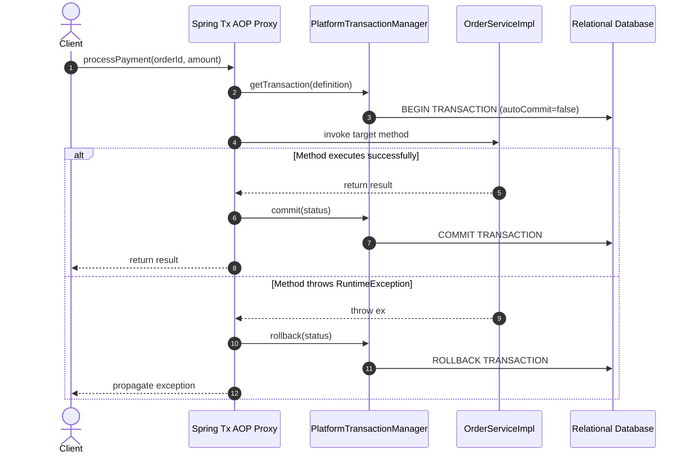

# Declarative @Transactional Boundaries, Pagination, Sorting & N+1 Prevention

Enterprise applications demand rock-solid transaction management to guarantee ACID properties across financial, inventory, and order processing workflows. At the same time, high-volume database reads must be shielded from classic performance pitfalls—most notoriously the **N+1 Select Problem**—while offering predictable pagination and sorting.

---

## 1. Declarative Transaction Management (`@Transactional`)

Spring's declarative transaction architecture uses Aspect-Oriented Programming (AOP). A dynamic proxy wraps the target service bean:



### Transaction Attributes & Configuration

1. **Propagation**:
   - `REQUIRED` (Default): Joins the current transaction if one exists; creates a new one if none exists.
   - `REQUIRES_NEW`: Suspends any existing transaction and opens an independent, isolated new transaction.
   - `SUPPORTS`: Executes non-transactionally if none exists; joins existing transaction if present.
   - `MANDATORY`: Demands an active transaction; throws `IllegalTransactionStateException` if none exists.
2. **`readOnly = true` Optimization**:
   When set to `true`, Spring sets the JDBC connection mode to read-only and instructs Hibernate to set the `FlushMode` to `MANUAL`. Crucially, Hibernate skips creating in-memory snapshot objects for dirty checking, conserving massive heap memory on large read operations.
3. **Rollback Semantics**:
   - By default, Spring rolls back transactions only on **unchecked exceptions** (`RuntimeException` and `Error`).
   - Checked exceptions (`Exception` / `IOException` / `SQLException`) do **not** trigger a rollback by default unless explicitly configured via:
     ```java
     @Transactional(rollbackFor = { CustomCheckedException.class })
     ```

---

## 2. Pagination & Sorting with Spring Data JPA

Handling large datasets requires pagination to prevent `OutOfMemoryError`. Spring Data provides `Pageable` and `Sort` abstractions:

```java
Pageable pageRequest = PageRequest.of(0, 20, Sort.by("orderDate").descending());
Page<Order> page = orderRepository.findByStatus("COMPLETED", pageRequest);

long totalElements = page.getTotalElements(); // Executes SELECT count(*)
int totalPages = page.getTotalPages();
List<Order> content = page.getContent();
```

### `Page<T>` vs `Slice<T>`
- **`Page<T>`**: Executes the main query plus an extra `COUNT(*)` query to calculate total elements and total pages. Ideal for standard UI pagination with page numbers.
- **`Slice<T>`**: Fetches `pageSize + 1` elements to know whether a next page exists without ever running a count query. Ideal for infinite scrolling mobile feeds where total count is unnecessary.

---

## 3. The N+1 Select Problem and Its Cure

The **N+1 Select Problem** is one of the most common and devastating performance bottlenecks in ORM applications.

### How the N+1 Problem Occurs
Consider an `Order` entity with a `@OneToMany` relationship to `OrderItem`, fetched lazily:
```java
List<CustomerOrder> orders = orderRepository.findAll(); // 1 Query: SELECT * FROM orders;
for (CustomerOrder order : orders) {
    // Accessing lazy collection triggers an individual query for EACH order!
    System.out.println(order.getItems().size()); // N Queries: SELECT * FROM order_items WHERE order_id = ?;
}
```
If there are 1,000 orders, your application issues **1,001 separate round-trip database queries**!

```mermaid
flowchart TD
    subgraph Problem: Unoptimized Lazy Fetch (N+1 Queries)
        P1["Query 1: SELECT * FROM orders (Returns N rows)"]
        P2["Query 2: SELECT * FROM order_items WHERE order_id = 1"]
        P3["Query 3: SELECT * FROM order_items WHERE order_id = 2"]
        P4["... Query N+1: SELECT * FROM order_items WHERE order_id = N"]
        P1 --> P2
        P2 --> P3
        P3 --> P4
    end

    subgraph Solution: @EntityGraph / JOIN FETCH (1 Query)
        S1["Query 1: SELECT o.*, i.* FROM orders o\nLEFT OUTER JOIN order_items i ON o.id = i.order_id"]
    end
```

### The Cure: `@EntityGraph` & `JOIN FETCH`

Spring Data JPA allows you to declare dynamic entity fetch plans using `@EntityGraph` or custom JPQL `JOIN FETCH`:

#### Option A: Using `@EntityGraph`
```java
public interface OrderRepository extends JpaRepository<CustomerOrder, Long> {
    @EntityGraph(attributePaths = {"items"})
    List<CustomerOrder> findAllWithItems();
}
```

#### Option B: Using JPQL `JOIN FETCH`
```java
public interface OrderRepository extends JpaRepository<CustomerOrder, Long> {
    @Query("SELECT o FROM CustomerOrder o LEFT JOIN FETCH o.items")
    List<CustomerOrder> findAllWithItemsJoinFetch();
}
```

Both approaches execute a **single SQL `LEFT OUTER JOIN`**, retrieving parent and child records in one database network round-trip, completely reducing query count from $N + 1$ to exactly $1$.

---

## 4. Architectural Summary

| Strategy | Number of Queries | Memory Impact | Best Use Case |
| :--- | :--- | :--- | :--- |
| **Lazy Loading (Default)** | $1 + N$ queries | Minimal initial, explosive on traversal | When child collection is rarely or never accessed |
| **`JOIN FETCH` / `@EntityGraph`** | Exactly $1$ query | Higher single-row width, zero query latency | When child collection is required immediately |
| **Batch Size (`@BatchSize(size = 50)`)** | $1 + \lceil N / 50 \rceil$ queries | Balanced | When joining large tables produces too many Cartesian product rows |

---

## 5. Runnable Verification & Code Walkthrough

The executable architecture demo `examples/spring/TransactionalEntityGraphDemo.java` implements:
- Declarative `@Transactional` proxy interceptor demonstrating automatic commit on success and rollback on `RuntimeException`.
- Precise SQL query execution counter simulating database round trips.
- Explicit demonstration of the unoptimized $N+1$ query problem (1 initial query + 3 sub-queries = 4 total queries).
- Verification of `@EntityGraph` / `JOIN FETCH` optimization reducing total SQL query executions to exactly 1.

Compile and run the verified test:
```bash
javac -d examples/web/classes examples/spring/TransactionalEntityGraphDemo.java
java -ea -cp examples/web/classes com.handbook.spring.TransactionalEntityGraphDemo
```
