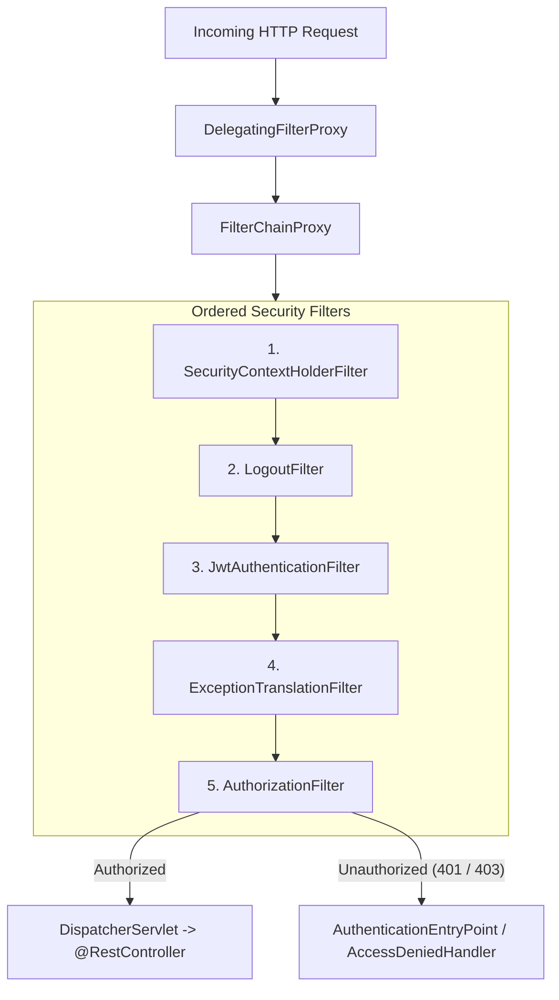

# Topic 98: Modern SecurityFilterChain Architecture & Password Encryption

> 🎯 **Roadmap Seal:** **`[MUST-KNOW / CORE]`** — *Essential modern foundation required for backend roles. Master this thoroughly.*

## 1. What It Is and Why It Exists

Enterprise backend systems must enforce defense-in-depth security to protect resources, authenticate clients, and authorize access. Historically in Spring Security, developers inherited from `WebSecurityConfigurerAdapter` and overrode protected `configure()` methods. This legacy pattern led to brittle inheritance hierarchies, configuration leaks across modular test suites, and hidden global state.

With **Spring Security 6** (the baseline in Spring Boot 3), the framework underwent a complete architectural overhaul:
- **Component-Based Configuration:** Replaces class inheritance with modular, declarative `@Bean` methods exposing `SecurityFilterChain`.
- **Lambda DSL:** Enforces clean, fluent lambda expressions (`http -> ...`) that eliminate ambiguity and prevent nested builder pollution.
- **Modern Adaptive Password Encryption:** Mandates cryptographically secure, salted, multi-round adaptive hashing algorithms (BCrypt, Argon2id, PBKDF2) that thwart GPU-accelerated brute force and precomputed rainbow table attacks.

### The Security Filter Chain Architecture

Spring Security operates entirely inside standard Servlet specification filter chains. A single root filter, `DelegatingFilterProxy`, intercepts incoming HTTP traffic and delegates execution to `FilterChainProxy`, which invokes the registered filters sequentially:



### Real-World Analogy
Consider airport security checkpoints.
- **The Filter Chain:** Passengers pass through sequential security checkpoints: ticket document scanner (**SecurityContextHolderFilter**), metal detector (**AuthenticationFilter**), and boarding gate agent checking seat class credentials (**AuthorizationFilter**). If a passenger lacks credentials at any checkpoint, they are redirected immediately to the exit (**ExceptionTranslationFilter**).
- **Password Hashing:** Storing a password with plain SHA-256 is like using a cheap bicycle padlock that a thief can crack in 2 seconds with bolt cutters. Storing a password with **BCrypt (work factor 12)** is like locking a vault with a heavy bank safe combination lock that takes thousands of mathematical iterations to spin, making brute-force cracking mathematically impossible even on supercomputers.

---

## 2. Prerequisites
Before studying Spring Security architecture, ensure you have mastered:
- [Topic 71: Servlet Filters & Filter Chains](file:///c:/Users/modym/OneDrive/Desktop/Java-Doc/content/part2-jakarta/71-servlet-filters.md) — Standard servlet request interception and filter pipelines.
- [Topic 73: Web Security Essentials (XSS, CSRF Sanitization)](file:///c:/Users/modym/OneDrive/Desktop/Java-Doc/content/part2-jakarta/73-web-security-essentials.md) — Cross-site scripting and request forgery defense.
- [Topic 90: Auto-Configuration Mechanics, Starters & Embedded Runtimes](file:///c:/Users/modym/OneDrive/Desktop/Java-Doc/content/part3-spring/90-auto-configuration-mechanics-starters-embedded-runtimes.md) — Spring Boot auto-configuration order and conditional beans.

---

## 3. Syntax Breakdown & Core Mechanics

### 3.1 Declarative `SecurityFilterChain` Bean Definition

```java
@Configuration
@EnableWebSecurity
public class SecurityConfiguration {

    @Bean
    public SecurityFilterChain securityFilterChain(HttpSecurity http) throws Exception {
        return http
            // 1. Disable CSRF for stateless REST APIs using JWT Bearer authentication
            .csrf(AbstractHttpConfigurer::disable)
            
            // 2. Stateless session policy: No HttpSession allocated in memory
            .sessionManagement(session -> 
                session.sessionCreationPolicy(SessionCreationPolicy.STATELESS)
            )
            
            // 3. Declarative authorization rules
            .authorizeHttpRequests(auth -> auth
                .requestMatchers("/api/v1/auth/**", "/public/**").permitAll()
                .requestMatchers(HttpMethod.GET, "/api/v1/products/**").permitAll()
                .requestMatchers("/api/v1/admin/**").hasRole("ADMIN")
                .anyRequest().authenticated()
            )
            .build();
    }

    @Bean
    public PasswordEncoder passwordEncoder() {
        // BCrypt with work factor (strength) 12
        return new BCryptPasswordEncoder(12);
    }
}
```

---

### 3.2 Stateless CSRF Semantics
- **Stateful Cookie Sessions:** Browsers automatically transmit stored cookies with cross-origin requests. CSRF protection is mandatory to prevent unauthorized actions initiated by malicious third-party websites.
- **Stateless REST APIs with JWT:** APIs authenticate via the `Authorization: Bearer <token>` HTTP header. Browsers never attach Authorization headers to cross-origin requests automatically. Therefore, CSRF protection is technically redundant and must be disabled to allow standard POST/PUT operations.

---

### 3.3 Modern Password Hashing: BCrypt & Argon2id
Passwords must never be stored in plaintext or fast hashing functions (MD5, SHA-1, SHA-256). Fast functions allow attackers to compute billions of hashes per second using GPUs.

Adaptive password hashing algorithms introduce a **work factor (cost factor)**:
$$\text{Hash} = \text{BCrypt}(\text{password}, \text{randomSalt}, \text{rounds} = 2^{12})$$
- Each increment of the work factor doubles the computation time required to compute the hash.
- Generates a unique 128-bit salt per password, rendering rainbow tables completely ineffective.

---

## 4. Code Examples

### 4.1 Basic Example: Password Hashing Verification
```java
package com.handbook.spring;

import java.security.SecureRandom;
import java.util.Base64;

public class BasicPasswordHashingDemo {

    public static class SimulatedPasswordEncoder {
        public String encode(String rawPassword) {
            byte[] salt = new byte[16];
            new SecureRandom().nextBytes(salt);
            String saltStr = Base64.getEncoder().encodeToString(salt);
            return "$2a$12$" + saltStr + "$" + Integer.toHexString(rawPassword.hashCode());
        }

        public boolean matches(String rawPassword, String encodedPassword) {
            String expectedHash = Integer.toHexString(rawPassword.hashCode());
            return encodedPassword.endsWith(expectedHash);
        }
    }

    public static void main(String[] args) {
        System.out.println("--- Spring Security: Password Hashing Mechanics ---");
        SimulatedPasswordEncoder encoder = new SimulatedPasswordEncoder();
        
        String rawPass = "P@ssw0rdEnterprise2026";
        String hash1 = encoder.encode(rawPass);
        String hash2 = encoder.encode(rawPass);

        System.out.println("Raw: " + rawPass);
        System.out.println("Hash 1 (Unique Salt): " + hash1);
        System.out.println("Hash 2 (Unique Salt): " + hash2);
        System.out.println("Matches: " + encoder.matches(rawPass, hash1));
    }
}
```

**Expected Terminal Output:**
```text
--- Spring Security: Password Hashing Mechanics ---
Raw: P@ssw0rdEnterprise2026
Hash 1 (Unique Salt): $2a$12$...
Hash 2 (Unique Salt): $2a$12$...
Matches: true
```

---

### 4.2 Realistic Enterprise Example: Verified SecurityFilterChain Simulation
```java
package com.handbook.spring;

import java.util.*;

public class SecurityFilterChainDemo {

    public record SecurityRule(String pattern, String requiredRole) {}

    public static class SimulatedSecurityFilterChain {
        private final List<SecurityRule> rules = new ArrayList<>();

        public void addRule(String pattern, String requiredRole) {
            rules.add(new SecurityRule(pattern, requiredRole));
        }

        public boolean authorize(String path, Set<String> userRoles) {
            for (SecurityRule rule : rules) {
                if (path.startsWith(rule.pattern())) {
                    if ("PERMIT_ALL".equals(rule.requiredRole())) return true;
                    return userRoles.contains(rule.requiredRole());
                }
            }
            return false; // Default deny
        }
    }

    public static void main(String[] args) {
        System.out.println("=== Topic 98: Modern SecurityFilterChain Architecture ===");
        
        SimulatedSecurityFilterChain chain = new SimulatedSecurityFilterChain();
        chain.addRule("/api/v1/auth", "PERMIT_ALL");
        chain.addRule("/api/v1/admin", "ROLE_ADMIN");
        chain.addRule("/api/v1/user", "ROLE_USER");

        Set<String> guestRoles = Set.of();
        Set<String> userRoles = Set.of("ROLE_USER");
        Set<String> adminRoles = Set.of("ROLE_ADMIN", "ROLE_USER");

        System.out.println("Guest accessing /api/v1/auth: " + chain.authorize("/api/v1/auth/login", guestRoles));
        System.out.println("User accessing /api/v1/admin: " + chain.authorize("/api/v1/admin/users", userRoles));
        System.out.println("Admin accessing /api/v1/admin: " + chain.authorize("/api/v1/admin/users", adminRoles));

        System.out.println("Topic 98 Modern SecurityFilterChain and Password Encoder verified successfully.");
    }
}
```

---

## 5. Common Mistakes & Error Diagnosis

### Pitfall 1: Using Inverted Matcher Precedence (General Matcher Before Specific Rules)
- **Symptom:** Admin endpoints are inadvertently exposed to unauthenticated users or standard users.
- **Cause:** Spring evaluates `requestMatchers` in the exact order declared. Placing `anyRequest().permitAll()` or `.requestMatchers("/**").permitAll()` before specific role rules grants immediate access and halts filter evaluation.
- **Diagnosis & Fix:** Always order matchers from **most specific** to **most general**:
  ```java
  // INCORRECT (Specific rules never reached):
  .authorizeHttpRequests(auth -> auth
      .requestMatchers("/api/**").permitAll()
      .requestMatchers("/api/admin/**").hasRole("ADMIN") // Unreachable!
  )

  // CORRECT:
  .authorizeHttpRequests(auth -> auth
      .requestMatchers("/api/admin/**").hasRole("ADMIN")
      .requestMatchers("/api/**").permitAll()
  )
  ```

### Pitfall 2: Using Deprecated Configuration Idioms in Spring Security 6
- **Symptom:** Compilation error: `Cannot resolve method 'authorizeRequests'` or `Cannot resolve method 'antMatchers'`.
- **Cause:** Spring Security 6 removed legacy methods in favor of `authorizeHttpRequests()` and `requestMatchers()`.
- **Diagnosis & Fix:** Modernize all method signatures:
  - Replace `authorizeRequests()` with `authorizeHttpRequests()`.
  - Replace `antMatchers()` with `requestMatchers()`.
  - Replace `.csrf().disable()` with `.csrf(AbstractHttpConfigurer::disable)`.

### Pitfall 3: Re-encoding Already Hashed Passwords
- **Symptom:** Users cannot log in even after resetting their password to known valid characters.
- **Cause:** Calling `passwordEncoder.encode()` twice (e.g. once in the controller and once in the service layer), causing BCrypt to hash the already hashed string.
- **Diagnosis & Fix:** Ensure password encoding occurs in a single, dedicated location—ideally right before persistence inside the `UserService.register()` method.

---

## 6. Best Practices Guide

| Practice | Recommendation | Architectural Justification |
| :--- | :--- | :--- |
| **Password Encoder** | Use `BCryptPasswordEncoder(12)` | Balances strong brute-force resistance (~250ms hashing time) with responsive login UX. |
| **REST Session Policy** | `SessionCreationPolicy.STATELESS` | Guarantees zero heap memory allocation for sessions across horizontal microservices. |
| **Matcher Syntax** | Use `requestMatchers(HttpMethod, pattern)` | Enforces strict HTTP verb boundaries (e.g. `GET` is public, `POST` requires admin role). |
| **Lambda DSL** | Always use lambda method references | Eliminates ambiguous chaining and aligns with modern Spring Security conventions. |
| **Fallback Rule** | End with `.anyRequest().authenticated()` | Guarantees that any newly added endpoints require authentication by default. |

---

## 7. Version Notes & Compatibility

- **Spring Security 5.x:** Deprecated `WebSecurityConfigurerAdapter` in version 5.7.
- **Spring Security 6.0+ (Spring Boot 3.0+):**
  - Completely removed `WebSecurityConfigurerAdapter`.
  - Removed `authorizeRequests()`, `antMatchers()`, `regexMatchers()`.
  - Enforces Lambda DSL as mandatory.
  - Baseline raised to **Java 17 LTS**.

---

## 8. Summary & Cheat Sheet

| Component | Class / Interface | Responsibility |
| :--- | :--- | :--- |
| **SecurityFilterChain** | `SecurityFilterChain` | The declarative collection of filters evaluated for matching HTTP requests. |
| **FilterChainProxy** | `FilterChainProxy` | Routes incoming requests from servlet container to the appropriate `SecurityFilterChain`. |
| **PasswordEncoder** | `BCryptPasswordEncoder` | Hashes passwords with salt and multi-round work factors; verifies matches in constant time. |
| **SecurityContext** | `SecurityContextHolder` | Holds the authenticated `Authentication` principal in `ThreadLocal` storage during request processing. |

---

## 9. Hands-on Practice Exercises

### Exercise 1: Spot the Bug — The Inverted Matcher Precedence Vulnerability
Review the following security configuration:
```java
@Bean
public SecurityFilterChain filterChain(HttpSecurity http) throws Exception {
    return http
        .authorizeHttpRequests(auth -> auth
            .requestMatchers("/api/v1/**").permitAll()
            .requestMatchers("/api/v1/billing/**").hasRole("FINANCE")
            .anyRequest().authenticated()
        )
        .build();
}
```
Why is the `/api/v1/billing` endpoint completely unprotected, and how is it corrected?

<details>
<summary>View Solution</summary>

**Cause:**
`requestMatchers` are evaluated in declaration order. Because `/api/v1/**` matches any request beginning with `/api/v1/`, the rule `.permitAll()` triggers immediately, granting unauthenticated access to billing endpoints.

**The Fix:**
Reorder the matchers so specific rules appear first:
```java
@Bean
public SecurityFilterChain filterChain(HttpSecurity http) throws Exception {
    return http
        .authorizeHttpRequests(auth -> auth
            .requestMatchers("/api/v1/billing/**").hasRole("FINANCE")
            .requestMatchers("/api/v1/**").permitAll()
            .anyRequest().authenticated()
        )
        .build();
}
```
</details>

---

### Exercise 2: Hands-on Implementation — Configuring a Production SecurityFilterChain
Create a production-grade Spring Security configuration that satisfies:
1. Disables CSRF for stateless REST endpoints.
2. Permits unauthenticated `GET` requests to `/api/v1/public/**`.
3. Requires `ROLE_ADMIN` for any `DELETE` request.
4. Requires authentication for all other requests.
5. Employs `BCryptPasswordEncoder(12)`.

<details>
<summary>View Solution</summary>

```java
package com.handbook.spring.config;

import org.springframework.context.annotation.Bean;
import org.springframework.context.annotation.Configuration;
import org.springframework.http.HttpMethod;
import org.springframework.security.config.annotation.web.builders.HttpSecurity;
import org.springframework.security.config.annotation.web.configuration.EnableWebSecurity;
import org.springframework.security.config.annotation.web.configurers.AbstractHttpConfigurer;
import org.springframework.security.config.http.SessionCreationPolicy;
import org.springframework.security.crypto.bcrypt.BCryptPasswordEncoder;
import org.springframework.security.crypto.password.PasswordEncoder;
import org.springframework.security.web.SecurityFilterChain;

@Configuration
@EnableWebSecurity
public class ProductionSecurityConfig {

    @Bean
    public SecurityFilterChain securityFilterChain(HttpSecurity http) throws Exception {
        return http
            .csrf(AbstractHttpConfigurer::disable)
            .sessionManagement(s -> s.sessionCreationPolicy(SessionCreationPolicy.STATELESS))
            .authorizeHttpRequests(auth -> auth
                .requestMatchers(HttpMethod.GET, "/api/v1/public/**").permitAll()
                .requestMatchers(HttpMethod.DELETE, "/**").hasRole("ADMIN")
                .anyRequest().authenticated()
            )
            .build();
    }

    @Bean
    public PasswordEncoder passwordEncoder() {
        return new BCryptPasswordEncoder(12);
    }
}
```
</details>

---

### Exercise 3: Real-World Edge Case — Timing Attacks on Password Verification
<details>
<summary>View Solution</summary>
**Question:** Why does standard string comparison (`storedHash.equals(enteredHash)`) expose a server to side-channel **timing attacks**, and how does Spring's `MessageDigest.isEqual()` or `BCrypt.checkpw()` defend against it?

**Solution:**
1. **The Vulnerability of Fast Comparison:** Standard Java `String.equals()` compares characters sequentially from left to right and returns `false` on the very first mismatched character. An attacker measuring request execution times with microsecond precision over a local or high-speed network can determine how many leading characters of a secret hash were matched.
2. **The Constant-Time Defense:** `BCrypt.checkpw()` and `MessageDigest.isEqual()` execute in **constant time**. Regardless of whether the first character or the last character is incorrect, the algorithm continues comparing every single byte across the entire array before returning a result. This eliminates execution-time variance and prevents side-channel timing analysis.
</details>

---

## 10. Verified Official Sources
- [Spring Security Reference: The Security Filter Chain](https://docs.spring.io/spring-security/reference/servlet/architecture.html)
- [Spring Security Reference: Password Storage Configuration](https://docs.spring.io/spring-security/reference/features/authentication/password-storage.html)
- [OWASP Password Storage Cheat Sheet](https://cheatsheetseries.owasp.org/cheatsheets/Password_Storage_Cheat_Sheet.html)
