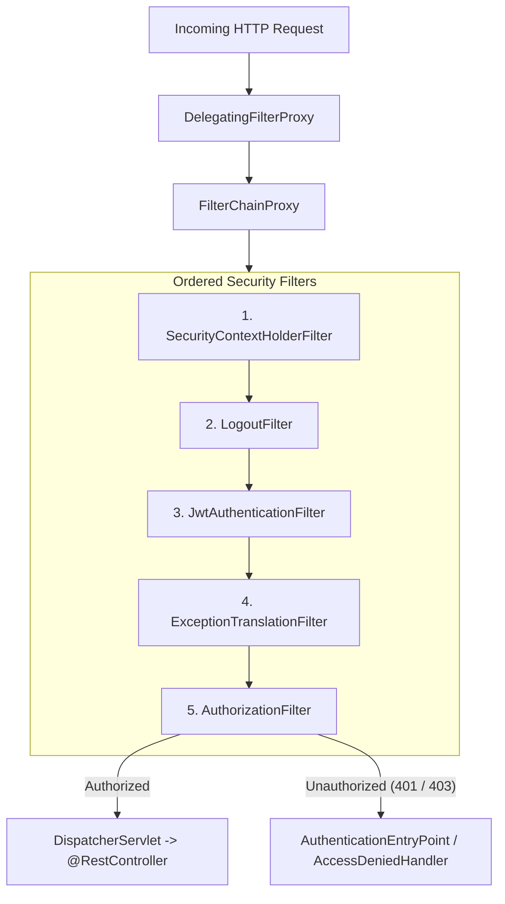

# Modern SecurityFilterChain Architecture & Password Encryption

Enterprise backend systems require robust defense-in-depth security architectures. With the release of Spring Security 6 (standard in Spring Boot 3), the framework underwent a monumental architectural modernization: retiring the cumbersome class-extension paradigm (`WebSecurityConfigurerAdapter`) in favor of modular, immutable, component-based `@Bean` declarations.

---

## 1. The Modern `SecurityFilterChain` Bean Pattern

In Spring Security 6, developers configure HTTP security by exposing a `@Bean` method that takes `HttpSecurity` and returns a `SecurityFilterChain`:

```java
@Configuration
@EnableWebSecurity
public class SecurityConfig {

    @Bean
    public SecurityFilterChain securityFilterChain(HttpSecurity http) throws Exception {
        return http
            .csrf(csrf -> csrf.disable()) // Disabled for stateless REST APIs
            .sessionManagement(session -> 
                session.sessionCreationPolicy(SessionCreationPolicy.STATELESS)
            )
            .authorizeHttpRequests(auth -> auth
                .requestMatchers("/api/v1/auth/**", "/public/**").permitAll()
                .requestMatchers("/api/v1/admin/**").hasRole("ADMIN")
                .anyRequest().authenticated()
            )
            .build();
    }
}
```



---

## 2. Why Disable CSRF for Stateless REST APIs?

Cross-Site Request Forgery (CSRF) is an exploit where a malicious website forces an authenticated user's browser to execute unwanted actions on a vulnerable site where they are logged in via ambient browser cookies (`JSESSIONID`).

- **Stateful Web Apps (Session-based)**: Browsers automatically attach session cookies to every cross-origin request. CSRF tokens are mandatory.
- **Stateless REST APIs (JWT / Bearer Tokens)**: The client application explicitly injects the token into the `Authorization: Bearer <token>` header. Browsers never automatically attach headers across origins. Therefore, **CSRF protection is redundant and must be disabled** to allow legitimate non-browser clients (mobile apps, microservices) to interact with the API.

---

## 3. Cryptographic Password Hashing with BCrypt

Storing passwords requires a slow, computationally expensive, salted hashing algorithm to withstand hardware acceleration (GPUs/ASICs).

```
$2a$12$e8xL2bVvKz5.gK7UqY8YxO8pQ5QxZ2k9u...
[--] [--] [---------------------] [--------------------------]
alg  cost         salt                      hash checksum
```

### BCrypt Anatomy:
1. **Identifier (`$2a$`)**: Indicates the BCrypt algorithm revision.
2. **Cost / Work Factor (`12`)**: logarithmic work factor ($2^{12} = 4,096$ key derivation rounds). As hardware improves, increasing the work factor future-proofs password defense without breaking existing hashes.
3. **Salt (22 chars base64 = 16 bytes)**: Cryptographically random salt generated per password, guaranteeing that two identical passwords produce completely distinct hashes.
4. **Checksum (31 chars base64 = 24 bytes)**: Resulting hash output.

---

## 4. Verification & Architecture Demo

The executable architecture demo `examples/spring/SecurityFilterChainDemo.java` implements:
- `BCryptPasswordEncoderSimulator` with random salting, key-stretching iterations, and constant-time equality comparisons (`MessageDigest.isEqual`) to defeat timing attacks.
- Declarative `SecurityFilterChain` with request pattern matching (`permitAll` vs `authenticated`).
- `AuthenticationManager` pipeline validating credentials and populating `GrantedAuthority` sets.

Compile and run the verified test:
```bash
javac -d examples/web/classes examples/spring/SecurityFilterChainDemo.java
java -ea -cp examples/web/classes com.handbook.spring.SecurityFilterChainDemo
```
