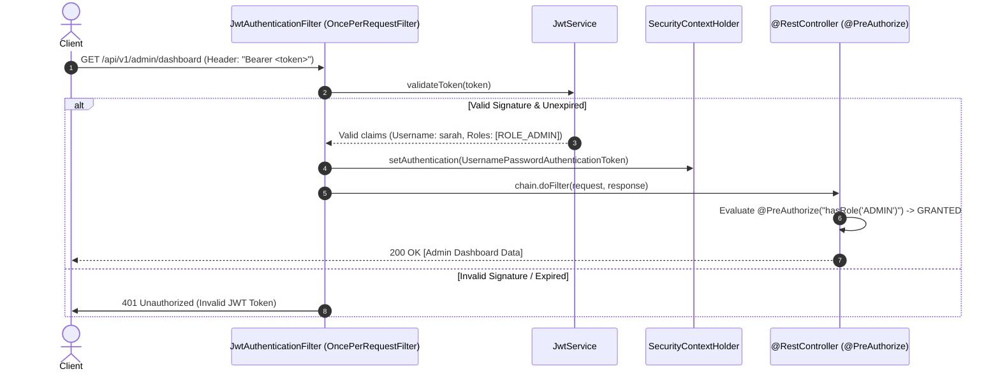

# Stateless REST Security with JWT & Method-Level Role Authorization

Modern microservice architectures require stateless, horizontally scalable authentication. In traditional monolithic web applications, user sessions were held in server memory (`HttpSession`). In distributed cloud clusters, sharing sessions across hundreds of container instances introduces caching latency and operational complexity. **JSON Web Tokens (JWT)** provide an industry-standard mechanism to achieve cryptographically verified, stateless security.

---

## 1. Anatomy of a JSON Web Token (JWT)

A JWT is a compact, URL-safe string containing three distinct segments separated by periods (`.`):

```
eyJhbGciOiJIUzI1NiIsInR5cCI6IkpXVCJ9.eyJzdWIiOiJhbGljZSIsInJvbGVzIjoiUk9MRV9BRE1JTiJ9.8Jk_29LmX...
[------------- Header -------------].[-------------- Payload --------------].[--- Signature ---]
```

1. **Header**: Declares the cryptographic algorithm (`HS256`, `RS256`) and token type (`JWT`).
2. **Payload (Claims)**: Contains standard claims (`sub` for username, `iat` for issued-at timestamp, `exp` for expiration) and custom claims (`roles`, `tenantId`, `email`).
3. **Signature**: Computed using the chosen algorithm over the Base64URL-encoded header and payload with a private secret key:
   $$\text{Signature} = \text{HMAC-SHA256}(\text{Base64}(H) + "." + \text{Base64}(P), \text{SecretKey})$$

Any unauthorized modification of the payload invalidates the signature, causing Spring Security to reject the token immediately.

---

## 2. Request Interception via `OncePerRequestFilter`

To authenticate requests, we implement a custom servlet filter extending `OncePerRequestFilter`:



---

## 3. Method-Level Security with `@PreAuthorize`

While `SecurityFilterChain` handles coarse-grained URL-based security, production enterprise systems require fine-grained access control enforced directly on service and controller methods.

Enabling method security in Spring Boot 3:
```java
@Configuration
@EnableMethodSecurity(prePostEnabled = true, securedEnabled = true)
public class MethodSecurityConfig {}
```

### Expressive SpEL Authorization Rules:
```java
@Service
public class OrderManagementService {

    // Any authenticated user can read orders
    @PreAuthorize("hasAnyRole('USER', 'ADMIN')")
    public OrderDto getOrderById(Long id) { ... }

    // Only administrators can cancel orders
    @PreAuthorize("hasRole('ADMIN')")
    public void cancelOrder(Long id) { ... }

    // Domain object ownership verification: user can only view their own orders
    @PreAuthorize("hasRole('ADMIN') or #username == authentication.name")
    public List<OrderDto> getOrdersForUser(String username) { ... }
}
```

---

## 4. Verification & Architecture Demo

The executable architecture demo `examples/spring/JwtRbacSecurityDemo.java` implements:
- HMAC-SHA256 token generation and validation using `javax.crypto.Mac`.
- Claims extraction (`sub`, `roles`, `exp`).
- `OncePerRequestFilter` simulation managing `SecurityContextHolder` thread-local lifecycle.
- Method-level authorization guard demonstrating successful execution for matching roles and HTTP 403 Forbidden rejection for unauthorized roles.
- Cryptographic tamper resistance test proving tampered payloads fail signature checks.

Compile and run the verified test:
```bash
javac -d examples/web/classes examples/spring/JwtRbacSecurityDemo.java
java -ea -cp examples/web/classes com.handbook.spring.JwtRbacSecurityDemo
```
