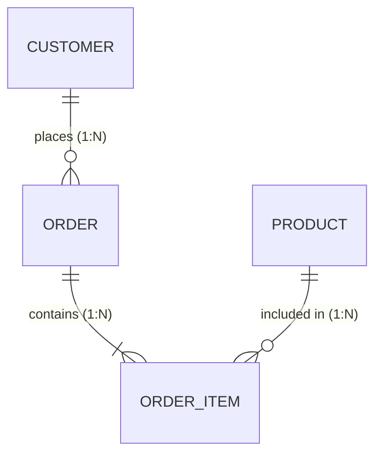

# Topic 120: Relational Database Fundamentals: Tables, Columns, Rows & Keys

> 🎯 **Roadmap Seal:** **`[MUST-KNOW / CORE]`** — *Essential modern foundation required for backend roles. Master this thoroughly.*

## 1. What It Is and Why It Exists

A **Relational Database Management System (RDBMS)** stores structured data in two-dimensional **tables** (also called *relations*) composed of rows and columns. Formulated by Edgar F. Codd in 1970, the relational model organizes data to eliminate duplicate values, protect data integrity, and allow flexible querying across related entities.

```text
+-------------------------------------------------------------+
|                     CUSTOMERS TABLE                         |
+----+------------+-----------+---------------------+---------+
| id | first_name | last_name | email               | status  |  <- Columns (Attributes)
+----+------------+-----------+---------------------+---------+
|  1 | Alice      | Smith     | alice@example.com   | ACTIVE  |  <- Row / Record (Tuple)
|  2 | Bob        | Jones     | bob@example.com     | ACTIVE  |
+----+------------+-----------+---------------------+---------+
  ^
  |
  +-- Primary Key (PK): Uniquely identifies each row
```

### Core Relational Concepts

| Term | Formal Term | Description | Real-World Analogy |
| :--- | :--- | :--- | :--- |
| **Table** | Relation | A structured collection of data organized in rows and columns. | An Excel spreadsheet sheet or filing drawer. |
| **Row** | Tuple / Record | A single instance or data item within a table. | One completed invoice or customer profile. |
| **Column** | Attribute / Field | A named attribute with a strict data type (e.g. `VARCHAR`, `INT`). | A specific column header on a form. |
| **Primary Key (PK)** | Candidate Key | A column (or set of columns) that uniquely identifies each row. Cannot be `NULL`. | A national ID number or passport number. |
| **Foreign Key (FK)** | Referencing Key | A column in one table pointing to the Primary Key of another table. | A customer ID written at the top of an order receipt. |

---

## 2. Table Relationships

Real-world applications model relationships between different entities:



### 1. One-to-One (1:1)
Each record in Table A relates to at most one record in Table B.
- *Example:* A `users` record has exactly one `user_profiles` record.
- *Implementation:* The foreign key in Table B is also marked `UNIQUE`.

### 2. One-to-Many (1:N)
A single record in Table A relates to multiple records in Table B, but each record in Table B belongs to only one record in Table A.
- *Example:* One `customer` has many `orders`.
- *Implementation:* The child table (`orders`) holds a `customer_id` Foreign Key column pointing to `customers.id`.

### 3. Many-to-Many (M:N)
Multiple records in Table A relate to multiple records in Table B.
- *Example:* An `order` contains many `products`, and a `product` appears in many `orders`.
- *Implementation:* Cannot be stored directly in two tables without data duplication. Requires an intermediate **Junction Table** (or bridge table, e.g., `order_items`) holding foreign keys to both parent tables:
  ```text
  orders (PK: id) <--- order_items (FK: order_id, FK: product_id) ---> products (PK: id)
  ```

---

## 3. Database Normalization (Junior Summary)

**Normalization** is the process of structuring relational tables to reduce data redundancy and prevent update/delete anomalies.

| Normal Form | Rule in Plain English | Practical Benefit |
| :--- | :--- | :--- |
| **1NF (First Normal Form)** | Every cell must hold a single atomic value (no comma-separated lists), and each row must have a unique identifier (Primary Key). | Enables standard filtering and indexing. |
| **2NF (Second Normal Form)** | Must be in 1NF, and all non-key columns must depend on the *entire* primary key (relevant for composite keys). | Prevents partial dependency anomalies. |
| **3NF (Third Normal Form)** | Must be in 2NF, and no non-key column should depend on another non-key column (no transitive dependencies). | If `zip_code` determines `city`, store city in a separate lookup table. |

> [!TIP]
> In typical web application backends, designing tables up to **3NF** is the industry standard for transactional (OLTP) databases.

---

## 4. Summary & Quick Reference

- **Relational databases** enforce schemas, data types, and constraints at the database engine level.
- **Primary Keys (PK)** guarantee uniqueness and provide high-speed indexed row lookups.
- **Foreign Keys (FK)** enforce referential integrity: the database rejects orders pointing to non-existent customers.
- **Junction tables** resolve Many-to-Many relationships cleanly with composite unique keys.
