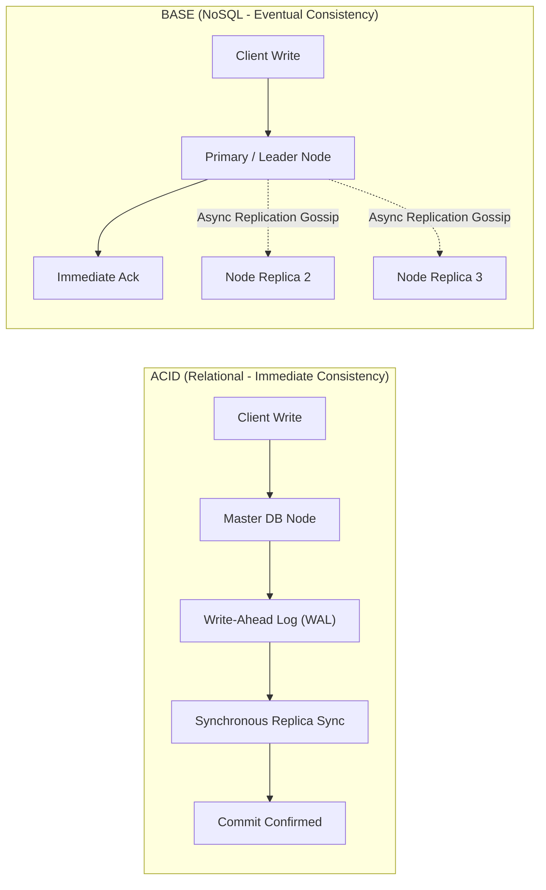

# Topic 130: SQL vs NoSQL: Paradigms, ACID vs BASE, and Architectural Trade-Offs

> 🎯 **Roadmap Seal:** **`[MUST-KNOW / CORE]`** — *Essential modern foundation required for backend roles. Master this thoroughly.*

In modern enterprise architectures, persistence is no longer a "one-size-fits-all" decision. For decades, the relational database management system (RDBMS) governed all enterprise persistence. However, the rise of massive horizontal web scale, unconstrained semi-structured data, and distributed microservices created the **NoSQL (Not Only SQL)** revolution. Choosing between SQL and NoSQL is not a matter of popularity—it is a rigorous architectural trade-off between consistency guarantees, query flexibility, write throughput, and operational data topology.

---

## 1. What It Is and Why It Exists

At the inception of enterprise software, data storage evolved from raw hierarchical files into the **Relational Model**, formalized by Edgar F. Codd in 1970. Relational databases enforce strict mathematical set theory, foreign keys, normalization rules, and strict schemas to eliminate data redundancy and preserve absolute integrity.

As internet-scale distributed systems emerged (e.g., Google, Amazon, Facebook in the 2000s), relational databases encountered fundamental physical bottlenecks:
1. **Vertical Scalability Limits:** Scaling a relational database traditionally meant purchasing larger, more expensive servers (CPUs, RAM, SAN arrays) because cross-table joins and multi-row transactions across a partitioned cluster introduce severe network latency.
2. **Schema Rigidity:** E-commerce catalogs, IoT sensor payloads, and social media interactions involve rapidly evolving, polymorphic data structures where adding a column to a table with 500 million rows causes disruptive table locks.
3. **Impedance Mismatch:** Object-oriented languages represent state as nested object graphs (e.g., an `Order` containing a list of `OrderItem` objects, a shipping `Address`, and a `PaymentProfile`). In relational databases, this single business object must be shredded across 4 distinct normalized tables linked by foreign keys, requiring expensive JOIN operations to assemble.

The **NoSQL movement** introduced non-relational storage engines optimized for specific access patterns, horizontal partitioning (sharding) across commodity compute nodes, and dynamic schemas.

### Real-World Analogy
- **SQL (Relational):** Imagine an **Automated Filing Cabinet in an Accounting Firm**. Every invoice must follow a standardized legal template: an exact 10-digit tax ID, strict column alignments, and a verified cross-reference stamp pointing to a client registered in the Master Client Drawer. If an invoice lacks a valid client stamp, the drawer mechanically ejects it. You can perform complex auditing audits across every drawer simultaneously, but modifying the dimensions of the paper slots requires re-engineering the entire steel cabinet.
- **NoSQL (Document-Oriented):** Imagine a **Digital Folder of Self-Contained Manilla Envelopes**. Each envelope represents a complete transaction (e.g., an Order). Inside the envelope, you drop a multi-page document containing the customer info, the line items, the tracking number, and even a custom promotional flyer if applicable. Different envelopes can contain different documents without breaking the filing system. When the filing cabinet gets full, you simply stack another cheap storage bin next to it on the shelf.

---

## 2. Prerequisites
Before analyzing database paradigms, you should understand:
- [Topic 16: Classes, Objects & Memory Layout](file:///c:/Users/modym/OneDrive/Desktop/Java-Doc/content/part1-core/16-classes-objects-memory-layout.md) — How Java represents complex state in heap memory.
- [Topic 61: JDBC Fundamentals](file:///c:/Users/modym/OneDrive/Desktop/Java-Doc/content/part1-core/61-jdbc-fundamentals.md) — How Java drives SQL queries across a physical network socket.
- [Topic 95: Spring Data JPA Architecture](file:///c:/Users/modym/OneDrive/Desktop/Java-Doc/content/part3-spring/95-spring-data-jpa-architecture-repository-hierarchy-jparepository.md) — Object-relational impedance mismatch in Spring applications.

---

## 3. Core Architectural Paradigms

```
+-----------------------------------------------------------------------------------------+
|                                PERSISTENCE TAXONOMY                                     |
+-----------------------------------------------------------------------------------------+
|                                                                                         |
|       +---------------------------------+     +----------------------------------+      |
|       |     RELATIONAL (SQL)            |     |        NON-RELATIONAL (NoSQL)    |      |
|       +---------------------------------+     +----------------------------------+      |
|       | Tables & Rows                   |     | Documents, Key-Value, Graphs     |      |
|       | Strict Declarative Schema (DDL) |     | Dynamic / Flexible Schema        |      |
|       | Relational JOINs & Foreign Keys |     | Embedded Arrays & Sub-documents  |      |
|       | ACID Transactions               |     | BASE / Eventual Consistency      |      |
|       | Vertical Scale (Scale-Up)       |     | Horizontal Scale (Scale-Out)     |      |
|       | Standardized SQL Syntax         |     | Engine-Specific APIs / MQL       |      |
|       +---------------------------------+     +----------------------------------+      |
|                        |                                        |                       |
|         [MySQL, PostgreSQL, Oracle]             [MongoDB, Redis, Cassandra, Neo4j]      |
+-----------------------------------------------------------------------------------------+
```

### 3.1 Relational Data Modeling (SQL)
In SQL databases (e.g., MySQL, PostgreSQL, MariaDB, Oracle):
- Data is decomposed into **Tables** consisting of typed **Columns** and bounded **Rows**.
- **Normalization (1NF through 3NF/BCNF):** Prevents update anomalies by ensuring every non-key attribute depends strictly on the primary key.
- Relationships between entities are established through **Primary Key (PK)** and **Foreign Key (FK)** constraints.
- Combining disparate entities requires relational algebra via `JOIN` clauses calculated at query runtime.

### 3.2 The Four Major NoSQL Storage Families
NoSQL is not a single technology; it encompasses four distinct structural paradigms:

| Family | Core Storage Model | Primary Representatives | Optimal Access Pattern / Use Case |
| :--- | :--- | :--- | :--- |
| **Document Store** | Semi-structured documents (JSON, BSON, XML) indexed by key | **MongoDB**, Couchbase | E-commerce catalogs, user profiles, CMS, polymorphic records |
| **Key-Value Store** | Hash map (opaque binary or string payload addressed by unique key) | **Redis**, Amazon DynamoDB | Low-latency caching, session state, distributed locks, rate limiters |
| **Wide-Column Store**| Multi-dimensional sparse matrix (Keyspace -> Column Families -> Rows) | **Apache Cassandra**, ScyllaDB | High-velocity time-series, IoT event logging, clickstream analytics |
| **Graph Database** | Nodes, directional edges, and properties (Graph theory) | **Neo4j**, Amazon Neptune | Social networks, fraud detection networks, knowledge graphs, recommendation engines |

---

## 4. ACID vs BASE Guarantees

The core design philosophy separating relational engines from distributed NoSQL stores centers on transactional guarantees.

### 4.1 ACID (Relational Guarantee)
Relational databases prioritize absolute data accuracy above all else:

1. **Atomicity:** All operations within a transaction unit succeed together or fail together completely (`COMMIT` vs `ROLLBACK`). If a funds transfer deducts \$500 from Account A but crashes before crediting Account B, the entire operation unwinds.
2. **Consistency:** A transaction can only transition the database from one valid state to another, strictly satisfying all declared constraints (Foreign Keys, Unique constraints, Check conditions).
3. **Isolation:** Concurrent transactions execute without cross-contamination. Isolation levels (`READ UNCOMMITTED`, `READ COMMITTED`, `REPEATABLE READ`, `SERIALIZABLE`) govern visibility between simultaneous executions.
4. **Durability:** Once a transaction is committed, its effects are guaranteed to survive physical hardware crashes or power outages via Write-Ahead Logging (WAL) or redo logs.

### 4.2 BASE (NoSQL Distributed Guarantee)
Many distributed NoSQL databases loosen immediate transactional guarantees to achieve horizontal scale and high availability:

1. **Basically Available:** The distributed cluster guarantees availability according to the CAP theorem; requests receive a response, even if some nodes are degraded or disconnected.
2. **Soft State:** The state of the system may fluctuate over time, even without explicit user interaction, as background replica synchronization takes place.
3. **Eventual Consistency:** If no further updates are applied to an item, all replicas across the cluster will eventually converge and return the identical value.



---

## 5. The CAP Theorem & Distributed Systems Reality

Formulated by Eric Brewer in 2000 and mathematically proven by Gilbert and Lynch in 2002, the **CAP Theorem** states that a distributed data store can guarantee at most **two out of the following three properties simultaneously** during a network partition:

1. **Consistency (C):** Every read receives the most recent write or an error (linearizability).
2. **Availability (A):** Every non-failing node returns a non-error response for every request (without guaranteeing it is the latest write).
3. **Partition Tolerance (P):** The system continues to operate despite an arbitrary number of messages being dropped or delayed by the physical network between nodes.

> [!IMPORTANT]
> **Partition Tolerance (P) is Non-Negotiable in Distributed Networks.**  
> Physical network cables get severed, cloud routers experience packet loss, and cross-datacenter links drop. Therefore, an architect cannot choose "CA". In the presence of a network partition (**P**), you must make an explicit trade-off between **Consistency (CP)** or **Availability (AP)**:
> - **CP (Consistency + Partition Tolerance):** The system rejects or delays writes and reads on isolated partitions to ensure dirty, stale, or conflicting data is never returned (e.g., MongoDB with `w: "majority"`, HBase).
> - **AP (Availability + Partition Tolerance):** Nodes in both partitions continue accepting reads and writes, sacrificing immediate consistency in favor of 100% uptime, resolving conflicts later via vector clocks or last-write-wins (e.g., Cassandra, CouchDB, DynamoDB).

---

## 6. Structural Comparison: Tables vs Documents

To understand how an application data model changes between SQL and NoSQL, examine how a customer order with items is modeled in each:

### 6.1 Relational Architecture (Normalized SQL Tables)
Data is split into 3 tables to prevent redundancy:

```sql
-- Table 1: customers
CREATE TABLE customers (
    id BIGINT PRIMARY KEY AUTO_INCREMENT,
    email VARCHAR(255) NOT NULL UNIQUE,
    full_name VARCHAR(150) NOT NULL
);

-- Table 2: orders
CREATE TABLE orders (
    id BIGINT PRIMARY KEY AUTO_INCREMENT,
    customer_id BIGINT NOT NULL,
    order_date DATETIME NOT NULL,
    total_amount DECIMAL(12, 2) NOT NULL,
    CONSTRAINT fk_orders_customer FOREIGN KEY (customer_id) REFERENCES customers(id)
);

-- Table 3: order_items
CREATE TABLE order_items (
    id BIGINT PRIMARY KEY AUTO_INCREMENT,
    order_id BIGINT NOT NULL,
    sku VARCHAR(64) NOT NULL,
    quantity INT NOT NULL,
    unit_price DECIMAL(10, 2) NOT NULL,
    CONSTRAINT fk_items_order FOREIGN KEY (order_id) REFERENCES orders(id) ON DELETE CASCADE
);
```

**Querying the full order requires relational JOINs:**
```sql
SELECT c.full_name, o.id, o.order_date, i.sku, i.quantity, i.unit_price
FROM orders o
INNER JOIN customers c ON o.customer_id = c.id
INNER JOIN order_items i ON o.id = i.order_id
WHERE o.id = 1001;
```

### 6.2 Document Architecture (Denormalized MongoDB BSON Document)
In a document store like MongoDB, the entire aggregate is stored as a single, self-contained JSON/BSON document inside an `orders` collection:

```json
{
  "_id": { "$oid": "664e10f92b498a3b8417c801" },
  "orderNumber": "ORD-2026-9901",
  "orderDate": { "$date": "2026-11-20T17:15:00Z" },
  "totalAmount": 149.98,
  "customer": {
    "customerId": 8812,
    "fullName": "Elena Vance",
    "email": "elena.vance@enterprise.com"
  },
  "items": [
    {
      "sku": "SENS-PRO-01",
      "name": "Industrial IoT Vibration Sensor",
      "quantity": 2,
      "unitPrice": 49.99
    },
    {
      "sku": "CBL-ARMOR-5M",
      "name": "Armored Ethernet Cable 5m",
      "quantity": 1,
      "unitPrice": 49.99
    }
  ],
  "shippingAddress": {
    "street": "104 Tech Boulevard",
    "city": "Austin",
    "state": "TX",
    "zipCode": "78701"
  }
}
```

**Querying the document requires a single primary key lookup without any JOIN operations:**
```javascript
db.orders.findOne({ "_id": ObjectId("664e10f92b498a3b8417c801") });
```

---

## 7. Comprehensive Architectural Decision Matrix

| Dimension | Relational Database (SQL - e.g., MySQL) | Document Store (NoSQL - e.g., MongoDB) |
| :--- | :--- | :--- |
| **Data Structure** | Strict tabular columns and rows | Dynamic hierarchical JSON/BSON documents |
| **Schema Validation** | Enforced at database level via DDL | Schema-on-read or optional JSON Schema validation |
| **Query Flexibility** | Advanced ad-hoc SQL, complex JOINs, window functions | Powerful document filters, Aggregation Pipelines; limited joins (`$lookup`) |
| **Relationships** | Strong Foreign Key integrity (`ON DELETE CASCADE`) | Embedded sub-documents or manual reference IDs |
| **Transaction Model** | Full multi-table ACID transactions | Multi-document ACID transactions supported, but single-document atomicity is preferred |
| **Scaling Strategy** | Vertical (Scale-Up via faster CPU/SSD) + Read Replicas | Horizontal (Scale-Out via native Sharding across nodes) |
| **Write Throughput** | Bounded by WAL disk sync and foreign key checks | Ultra-high ingestion throughput due to append-friendly engines |
| **Data Redundancy** | Minimized via Normalization (Single Source of Truth) | Controlled Denormalization for read performance |

---

## 8. Real-World Architectural Use Cases

```
+-----------------------------------------------------------------------------------------+
|                              PERSISTENCE SELECTION GUIDE                                |
+-----------------------------------------------------------------------------------------+
|                                                                                         |
|       CHOOSE SQL (e.g., MySQL, Postgres)          CHOOSE NoSQL (e.g., MongoDB)          |
|       ==================================          ============================          |
|       * Banking & Core Ledger Systems             * Product Catalogs (Variable Specs)   |
|       * Double-entry Bookkeeping                  * Content Management Systems (CMS)    |
|       * ERP & Supply Chain Management             * IoT Telemetry & Sensor Ingestion    |
|       * Complex Relational Reporting              * Mobile App Backends (JSON Payloads) |
|       * Strict Regulatory Compliance Data         * Real-time User Activity Feeds       |
|                                                                                         |
+-----------------------------------------------------------------------------------------+
```

### Scenario A: Banking Core Ledger & Financial Transactions -> **Choose SQL**
A banking transaction must debit Account 101 and credit Account 202. If any validation fails, the entire transaction must instantly abort. Data relationships between customers, loan officers, tax accounts, and ledgers are deeply interconnected, requiring strict foreign key enforcement. A relational database like MySQL or PostgreSQL with `SERIALIZABLE` or `REPEATABLE READ` isolation is non-negotiable.

### Scenario B: E-Commerce Product Catalog with Dynamic Attributes -> **Choose NoSQL**
An online electronics and apparel retailer sells 50,000 different products. A laptop has `cpuCores`, `ramGigabytes`, and `batteryWattHours`. A T-shirt has `fabricComposition`, `sizeChart`, and `washingInstructions`. In a relational database, this leads to an unwieldy **Entity-Attribute-Value (EAV)** anti-pattern requiring 12 joins per query. In MongoDB, each product is simply a JSON document storing its unique attributes naturally.

### Scenario C: Modern Polyglot Persistence
Enterprise applications frequently employ **Polyglot Persistence**—using both SQL and NoSQL engines within the same ecosystem:
- **MySQL / PostgreSQL:** Handles User Authentication, Payment Processing, Billing Invoices, and Legal Contracts (ACID guarantees).
- **MongoDB:** Handles Product Catalogues, Customer Review Metadata, and User Activity Timelines (Schema flexibility).
- **Redis:** Handles In-Memory Session Caching, JWT Blacklisting, and Distributed Rate-Limiting (Sub-millisecond latency).

---

## 9. Common Pitfalls & Anti-Patterns

### 1. Treating MongoDB as an Untyped "Garbage Dump"
**Mistake:** Storing completely unstructured data with arbitrary keys and zero validation just because "MongoDB is schema-less."  
**Impact:** Application code must be littered with hundreds of defensive null-checks (`if (doc.get("customer") != null && doc.get("customer").get("address") != null)`), causing unpredictable `NullPointerExceptions`.  
**Best Practice:** Enforce schema validation at the application level via domain models (e.g., Spring Data `@Document`) or using MongoDB JSON Schema validators (`$jsonSchema`).

### 2. Forcing Deep Relational Foreign Keys into NoSQL via `$lookup`
**Mistake:** Modeling data in MongoDB exactly like normalized SQL tables (e.g., `customers`, `orders`, `order_items`, `products`) and using nested `$lookup` pipelines to simulate 5-table relational joins.  
**Impact:** Disastrous performance. MongoDB is not optimized for multi-hop network joins across sharded collections. If your primary query pattern requires joining 5 entities together on every read, your domain model is fundamentally relational—use MySQL or PostgreSQL.

### 3. Using Relational Databases for Write-Heavy Append-Only Logging
**Mistake:** Writing millions of raw IoT telemetry sensor events per second directly into a heavily indexed MySQL table with foreign keys.  
**Impact:** Database connections get exhausted, B-tree indexes constantly rebalance under heavy lock contention, and disk IOPS spike to 100%.  
**Best Practice:** Stream time-series or sensor logs into Cassandra, MongoDB (Time Series Collections), or Elasticsearch.

---

## 10. Hands-on Practice Exercises

### Exercise 1: Spot the Bug (Unbounded Array Overflow Anti-Pattern)
A developer models IoT sensor telemetry by embedding an array of sensor readings inside a single MongoDB device document:
```json
{ "deviceId": "SENSOR-99", "readings": [ { "temp": 24.1, "ts": "2026-11-20T10:00:00Z" } ] }
```
*After 6 months of continuous operation, writes fail with `BSONObjectTooLarge: Document size exceeds 16MB`. Why?*

<details>
<summary>View Solution</summary>

BSON documents have an immutable hard physical limit of **16 MB**. An unbounded array storing millions of events eventually breaches this boundary.

**The Fix:**
Utilize the **Bucket Pattern** (grouping readings by day or hour into separate documents) or store each sensor reading as an independent document in a time-series collection.
</details>

### Exercise 2: Hands-on Implementation (Architectural Persistence Selection)
Classify which database engine (MySQL Relational vs MongoDB Document) should be chosen for each requirement:
1. Double-entry accounting ledger
2. E-commerce catalog with variable electronics/clothing specs
3. User shopping cart sessions

<details>
<summary>View Solution</summary>

1. **Double-entry accounting ledger:** MySQL Relational (Strict ACID, Foreign Keys, auditability).
2. **E-commerce catalog:** MongoDB Document (Dynamic polymorphic attributes, zero-join read performance).
3. **User shopping cart sessions:** Redis (In-memory key-value) or MongoDB Document (BSON TTL expiration).
</details>

### Exercise 3: Real-World Edge Case (CAP Theorem Partition Behavior)
During a network partition between two datacenters, what is the consequence of choosing a CP (Consistent / Partition Tolerant) system over an AP (Available / Partition Tolerant) system?

<details>
<summary>View Solution</summary>

A **CP system** rejects or halts writes on the isolated minority partition to prevent split-brain and dirty writes, sacrificing availability. An **AP system** continues accepting writes on both sides, keeping the service 100% available but allowing data versions to diverge until network connectivity is restored and resolved.
</details>

---

## 11. Verified Sources & Further Reading
- Codd, E. F. (1970). *A Relational Model of Data for Large Shared Data Banks*. Communications of the ACM.
- Brewer, E. (2012). *CAP Twelve Years Later: How the "Rules" Have Changed*. IEEE Computer.
- Martin Fowler (2012). *NoSQL Distilled: A Brief Guide to the Emerging World of Polyglot Persistence*.
- MongoDB Official Architecture Guide: *Data Model Design & Normalization vs Denormalization*.
