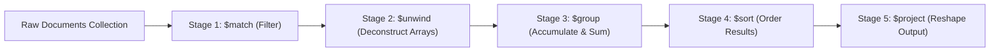

# Topic 133: NoSQL & MongoDB Mastery (Architecture, Compass, CRUD & Aggregation)

> 🚀 **Roadmap Seal:** **`[ADVANCED / DEEP-DIVE]`** — *Advanced enterprise specialization & architecture. Study once core fundamentals are solid.*

**MongoDB** is the industry-standard document database, designed from the ground up for high availability, horizontal scalability, and developer agility. By storing data in rich, binary-encoded JSON structures (**BSON**), MongoDB bridges the impedance mismatch between object-oriented programming languages and storage engines. Whether building dynamic e-commerce product catalogs, mobile application backends, or real-time event analytics engines, mastering MongoDB requires command over its native query language (MQL), its graphical management suite (**MongoDB Compass**), and its pipeline-based Aggregation Framework.

---

## 1. What It Is and Why It Exists

Traditional relational databases require data to be flattened into rigid two-dimensional tables with fixed schemas. In contrast, MongoDB represents entities as **Documents** grouped into **Collections**:

```
+-----------------------------------------------------------------------------------------+
|                              MONGODB STRUCTURAL HIERARCHY                               |
+-----------------------------------------------------------------------------------------+
|                                                                                         |
|   Database: "ecommerce_db"                                                              |
|      |                                                                                  |
|      +---> Collection: "products" (Equivalent to a Relational Table)                     |
|      |        |                                                                         |
|      |        +---> Document 1: { _id: ObjectId(...), name: "Laptop", specs: {...} }    |
|      |        +---> Document 2: { _id: ObjectId(...), name: "Shirt", sizes: [...] }     |
|      |                                                                                  |
|      +---> Collection: "orders"                                                         |
|               |                                                                         |
|               +---> Document 1: { _id: ObjectId(...), total: 99.50, items: [...] }      |
|                                                                                         |
+-----------------------------------------------------------------------------------------+
```

### Why BSON instead of plain JSON?
While JSON (JavaScript Object Notation) is human-readable and universal, it is inefficient for physical database storage:
1. **Limited Data Types:** Plain JSON only supports `string`, `number`, `boolean`, `array`, `object`, and `null`. It lacks native types for Dates, 64-bit integers (`long`), precise decimals (`Decimal128`), and raw binary data.
2. **Slow Parsing Performance:** In plain text JSON, locating the tenth field requires parsing and scanning all preceding text bytes.
3. **BSON (Binary JSON):** BSON stores field lengths, type headers, and binary offsets. This allows the MongoDB storage engine (**WiredTiger**) to perform instantaneous pointer jumping and index traversals directly on raw disk pages.

### Real-World Analogy
Imagine a **Medical Health Clinic Patient Record**:
- In a **Relational SQL Database**, a patient's visit is dissected into 6 tables: `patients`, `patient_blood_pressure_readings`, `patient_prescriptions`, `patient_allergies`, `patient_insurance_policies`, and `doctor_notes`. Looking up a patient's chart requires joining 6 tables across the entire clinic archive.
- In **MongoDB**, the patient's entire visit is a single **BSON Document**: the blood pressure reading is an embedded sub-object, allergies are an array of strings, and current prescriptions are an array of objects. Opening the patient's chart requires a single index lookup on their medical ID, fetching the complete record in sub-millisecond time.

---

## 2. Prerequisites
Before studying MongoDB, ensure you understand:
- [Topic 130: SQL vs NoSQL Architecture](file:///c:/Users/modym\OneDrive\Desktop\Java-Doc\content\part4-databases\130-sql-vs-nosql-architecture-tradeoffs.md) — Document models vs relational tables, BASE consistency.
- [Topic 26: Records (Java 16+)](file:///c:/Users/modym\OneDrive\Desktop\Java-Doc\content\part1-core\26-records.md) — Immutable data modeling and nested object hierarchies.

---

## 3. Environment Setup & GUI: MongoDB Compass

To develop with MongoDB locally, we utilize **MongoDB Community Server** alongside **MongoDB Compass**—the official graphical interactive management interface (comparable to phpMyAdmin for MySQL).

```
+-----------------------------------------------------------------------------------------+
|                             MONGODB COMPASS GUI WORKFLOW                                |
+-----------------------------------------------------------------------------------------+
|                                                                                         |
|    1. Install MongoDB Community Server & Compass from mongodb.com                       |
|    2. Launch MongoDB Compass                                                            |
|    3. Connect to Default URI:  mongodb://localhost:27017                                |
|    4. Click [Create Database] -> Name: "ecommerce_db", Collection: "products"           |
|    5. Use the visual tabs:                                                              |
|       - [Documents]   -> Visual CRUD, JSON/Tree views, and Filter bar                   |
|       - [Aggregations]-> Stage-by-stage pipeline designer with real-time preview        |
|       - [Schema]      -> Automated field type distribution and frequency analysis       |
|       - [Indexes]     -> Visual B-Tree index creation and size tracking                 |
|                                                                                         |
+-----------------------------------------------------------------------------------------+
```

### 3.1 Step-by-Step Installation
1. **Download:** Navigate to the MongoDB official website and download the **MongoDB Community Server** installer (MSI for Windows, DMG for macOS, or TGZ for Linux). Ensure the checkbox for **Install MongoDB Compass** is enabled.
2. **Verify Daemon:** Upon installation, MongoDB runs automatically as a system background service listening on TCP port `27017`.
3. **Launch Compass:** Open MongoDB Compass from your desktop applications.
4. **Establish Connection:** The connection URI defaults to `mongodb://localhost:27017`. Click **Connect**.

### 3.2 Containerized Alternative (Docker)
For developers who prefer zero-install containerized environments:

```bash
docker run --name mongodb-dev \
  -p 27017:27017 \
  -v mongo_data:/data/db \
  -d mongo:7.0
```

---

## 4. The Anatomy of an `ObjectId`

Every MongoDB document requires an immutable primary key stored in the `_id` field. If not provided during insertion, the driver or server automatically generates an **`ObjectId`**:

```
 0                   1                   2                   3
 0 1 2 3 4 5 6 7 8 9 0 1 2 3 4 5 6 7 8 9 0 1 2 3 4 5 6 7 8 9 0 1
+-+-+-+-+-+-+-+-+-+-+-+-+-+-+-+-+-+-+-+-+-+-+-+-+-+-+-+-+-+-+-+-+
|                      4-Byte Unix Timestamp                    |
+-+-+-+-+-+-+-+-+-+-+-+-+-+-+-+-+-+-+-+-+-+-+-+-+-+-+-+-+-+-+-+-+
|                    5-Byte Random Value                        |
+-+-+-+-+-+-+-+-+-+-+-+-+-+-+-+-+-+-+-+-+-+-+-+-+-+-+-+-+-+-+-+-+
|                  3-Byte Incrementing Counter                  |
+-+-+-+-+-+-+-+-+-+-+-+-+-+-+-+-+-+-+-+-+-+-+-+-+-+-+-+-+-+-+-+-+
                      Total Size: 12 Bytes
```

- **4-Byte Timestamp:** Represents the seconds since Unix epoch. This means `ObjectId` values are naturally sorted in chronological order of insertion! You can extract the exact creation timestamp of any document directly from its ID without storing a separate `created_at` field.
- **5-Byte Random Value:** Generated once per process/machine, preventing collisions across distributed clusters.
- **3-Byte Incrementing Counter:** Initialized to a random value, guaranteeing uniqueness across documents created within the same second on the same machine.

---

## 5. MongoDB Query Language (MQL): CRUD Operations

All queries can be authored directly in the **MongoDB Compass Filter Bar** or in the **`mongosh`** interactive terminal.

### 5.1 Create Operations (`insertOne`, `insertMany`)
```javascript
// Switch to our database
use ecommerce_db;

// Insert a single rich product document
db.products.insertOne({
    sku: "LAPTOP-X1",
    name: "ThinkPad Carbon X1 Gen 12",
    category: "Electronics",
    brand: "Lenovo",
    price: 1899.99,
    stock: 25,
    tags: ["laptop", "ultrabook", "business"],
    specs: {
        cpu: "Intel Core Ultra 7",
        ramGb: 32,
        storageGb: 1000,
        screenInches: 14.0
    },
    ratings: [
        { reviewer: "Alice", score: 5, comment: "Superb build quality" },
        { reviewer: "Bob", score: 4, comment: "Battery life could be better" }
    ],
    isActive: true,
    createdAt: new Date()
});

// Bulk insert multiple documents
db.products.insertMany([
    {
        sku: "MONITOR-4K",
        name: "Dell UltraSharp 32 4K",
        category: "Electronics",
        brand: "Dell",
        price: 649.50,
        stock: 40,
        tags: ["monitor", "4k", "ips"],
        specs: { resolution: "3840x2160", refreshRateHz: 60 },
        isActive: true,
        createdAt: new Date()
    },
    {
        sku: "CHAIR-ERG",
        name: "Herman Miller Aeron",
        category: "Furniture",
        brand: "Herman Miller",
        price: 1295.00,
        stock: 12,
        tags: ["furniture", "chair", "ergonomic"],
        specs: { size: "B", lumbarSupport: true },
        isActive: true,
        createdAt: new Date()
    },
    {
        sku: "KB-MECH",
        name: "Keychron Q1 Pro Wireless",
        category: "Accessories",
        brand: "Keychron",
        price: 199.00,
        stock: 0,
        tags: ["keyboard", "mechanical", "wireless"],
        specs: { switchType: "Red", hotSwappable: true },
        isActive: false,
        createdAt: new Date()
    }
]);
```

### 5.2 Read Operations & Filter Operators (`find`)

```javascript
// 1. Simple Equality Match
db.products.find({ category: "Electronics" });

// 2. Comparison Operators ($gt, $gte, $lt, $lte, $ne, $in)
// Find active products costing between $500 and $2000
db.products.find({
    isActive: true,
    price: { $gte: 500.00, $lte: 2000.00 }
});

// 3. Logical Operators ($and, $or, $nor)
// Find items that are either in category "Furniture" OR priced below $250
db.products.find({
    $or: [
        { category: "Furniture" },
        { price: { $lt: 250.00 } }
    ]
});

// 4. Dot-Notation for Nested Sub-Documents
// Find all products whose CPU specification contains "Intel"
db.products.find({ "specs.cpu": /^Intel/ });

// 5. Querying Inside Arrays ($elemMatch, $all, $size)
// Find products containing BOTH "laptop" and "business" tags
db.products.find({ tags: { $all: ["laptop", "business"] } });

// Find products that received at least one 5-star review
db.products.find({
    ratings: { $elemMatch: { score: 5 } }
});

// 6. Projections (Selecting specific fields - 1 = include, 0 = exclude)
// Return only name, price, and brand (suppressing default _id)
db.products.find(
    { category: "Electronics" },
    { _id: 0, name: 1, price: 1, brand: 1 }
);
```

### 5.3 Update Operations (`updateOne`, `updateMany`)

> [!WARNING]
> **Always use atomic field update operators like `$set`.**  
> If you call `db.products.updateOne({ sku: "LAPTOP-X1" }, { price: 1799.00 })` without `$set`, MongoDB will overwrite and replace the **entire document** with only `{ price: 1799.00 }`, erasing all other fields!

```javascript
// 1. Modify specific fields using $set and $currentDate
db.products.updateOne(
    { sku: "LAPTOP-X1" },
    {
        $set: { price: 1799.99, "specs.ramGb": 64 },
        $currentDate: { updatedAt: true }
    }
);

// 2. Increment numeric values atomically ($inc)
// Deduct 1 unit from stock safely
db.products.updateOne(
    { sku: "MONITOR-4K", stock: { $gte: 1 } },
    { $inc: { stock: -1 } }
);

// 3. Array Manipulation ($push, $addToSet, $pull)
// Add a new review to the ratings array
db.products.updateOne(
    { sku: "LAPTOP-X1" },
    {
        $push: {
            ratings: { reviewer: "Charlie", score: 5, comment: "Incredible screen" }
        }
    }
);

// Add a tag only if it doesn't already exist ($addToSet)
db.products.updateOne(
    { sku: "LAPTOP-X1" },
    { $addToSet: { tags: "thunderbolt4" } }
);

// 4. Upsert (Update if found, Insert if missing)
db.products.updateOne(
    { sku: "MOUSE-MX" },
    {
        $set: { name: "Logitech MX Master 3S", price: 99.99, category: "Accessories" },
        $setOnInsert: { createdAt: new Date() }
    },
    { upsert: true }
);
```

### 5.4 Delete Operations (`deleteOne`, `deleteMany`)
```javascript
// Delete a single document matching a key
db.products.deleteOne({ sku: "KB-MECH" });

// Delete all inactive products with 0 stock
db.products.deleteMany({
    isActive: false,
    stock: 0
});
```

---

## 6. The Aggregation Framework Deep Dive

The **Aggregation Framework** is MongoDB's powerhouse analytics and data transformation engine, modeled on the concept of data processing pipelines. Documents enter a multi-stage pipeline, where each stage transforms the documents and passes the output to the next stage.



### 6.1 Real-World Production Aggregation Pipeline
**Business Goal:** Calculate sales metrics by category: count total products, compute average price, identify the highest price, and list all distinct brands.

```javascript
db.products.aggregate([
    // Stage 1: Filter only active products priced above zero ($match)
    {
        $match: {
            isActive: true,
            price: { $gt: 0 }
        }
    },

    // Stage 2: Group by category and compute summary accumulators ($group)
    {
        $group: {
            _id: "$category",
            totalProducts: { $sum: 1 },
            averagePrice: { $avg: "$price" },
            maxPrice: { $max: "$price" },
            totalInventoryValue: { $sum: { $multiply: ["$price", "$stock"] } },
            brands: { $addToSet: "$brand" }
        }
    },

    // Stage 3: Reshape output fields and round numbers ($project)
    {
        $project: {
            _id: 0,
            category: "$_id",
            totalProducts: 1,
            averagePrice: { $round: ["$averagePrice", 2] },
            maxPrice: 1,
            totalInventoryValue: { $round: ["$totalInventoryValue", 2] },
            brands: 1
        }
    },

    // Stage 4: Sort by total inventory value in descending order ($sort)
    {
        $sort: { totalInventoryValue: -1 }
    }
]);
```

### 6.2 Breaking Down Arrays with `$unwind`
If documents contain an array of sub-documents (such as `ratings`), `$unwind` flattens the array by outputting one document for each element in the array:

```javascript
db.products.aggregate([
    { $match: { sku: "LAPTOP-X1" } },
    { $unwind: "$ratings" },
    {
        $group: {
            _id: "$sku",
            averageCustomerScore: { $avg: "$ratings.score" },
            reviewCount: { $sum: 1 }
        }
    }
]);
```

---

## 7. Indexing in MongoDB

Just like MySQL, unindexed queries in MongoDB cause a disastrous **Collection Scan (`COLLSCAN`)**, reading every document from disk.

### 7.1 Creating Indexes
```javascript
// Single Field Index on SKU (Unique)
db.products.createIndex({ sku: 1 }, { unique: true });

// Compound Index on Category and Price (Equality + Range)
db.products.createIndex({ category: 1, price: -1 });

// Multikey Index (Automatically created when indexing an array field)
db.products.createIndex({ tags: 1 });

// TTL (Time-To-Live) Index: Automatically deletes documents after 24 hours
// (Ideal for temporary user sessions or OTP tokens)
db.sessions.createIndex(
    { createdAt: 1 }, 
    { expireAfterSeconds: 86400 }
);
```

### 7.2 Inspecting Execution Plans via Compass & `explain()`
```javascript
db.products.find({ category: "Electronics", price: { $gte: 500 } }).explain("executionStats");
```
- In MongoDB Compass, switch to the **Explain Plan** tab and click **Execute Explain**.
- Verify that `stage` displays **`IXSCAN`** (Index Scan) followed by **`FETCH`**, rather than **`COLLSCAN`**.

---

## 8. Common Pitfalls & Anti-Patterns

### 1. The Unbounded Array Anti-Pattern
**Mistake:** Embedding an array inside a document that grows indefinitely without bounds (e.g., storing all user comments or IoT sensor readings inside a single document array).  
**Consequence:** BSON documents have a hard physical limit of **16 MB**. Once the document exceeds 16MB, MongoDB throws an unrecoverable write exception. Furthermore, repeatedly expanding documents on disk causes massive memory fragmentation.  
**Best Practice:** Use the **Bucket Pattern** or store child records in a separate collection with a parent reference ID.

### 2. Overusing `$lookup` to Re-create Relational JOINs
**Mistake:** Shredding data across 8 collections and using multiple `$lookup` stages in aggregation pipelines to join them together.  
**Consequence:** `$lookup` cannot leverage sharded cross-node partitioning effectively and performs an internal nested-loop join in memory, killing database throughput. If your data consists of deeply interconnected relations, use MySQL or PostgreSQL.

### 3. Case-Sensitive Sorting Without Collation
In MongoDB, default string sorting places uppercase letters before lowercase letters (`"Apple"`, `"Banana"`, `"apple"`). To perform case-insensitive sorting, always specify a Collation with `strength: 2`.

---

## 9. Hands-on Practice Exercises

### Exercise 1: Spot the Bug (Accidental Document Replacement)
A developer runs:
```javascript
db.users.updateOne({ email: 'user@test.com' }, { status: 'ACTIVE' });
```
Afterward, all other fields (`name`, `passwordHash`, `addresses`) vanished from the document. Why?

<details>
<summary>View Solution</summary>

Without the `$set` operator, MongoDB treats the second parameter as a full document replacement.

**The Fix:**
```javascript
db.users.updateOne({ email: 'user@test.com' }, { $set: { status: 'ACTIVE' } });
```
</details>

### Exercise 2: Hands-on Implementation (Aggregation Average Price Query)
Write an aggregation pipeline to find active products in `'Electronics'` and compute their average price and maximum price.

<details>
<summary>View Solution</summary>

```javascript
db.products.aggregate([
    { $match: { category: 'Electronics', isActive: true } },
    { $group: { _id: null, avgPrice: { $avg: '$price' }, maxPrice: { $max: '$price' } } }
]);
```
</details>

### Exercise 3: Real-World Edge Case (ObjectId Extraction Without Extra Columns)
How can you sort documents by exact creation time and extract their creation date without adding a `createdAt` column in MongoDB?

<details>
<summary>View Solution</summary>

The first 4 bytes of every MongoDB `ObjectId` store the Unix epoch seconds. Documents sorted by `_id ASC` are naturally ordered chronologically, and calling `doc._id.getTimestamp()` extracts the exact creation Instant.
</details>

---

## 10. Verified Sources & Further Reading
- [MongoDB 7.0 Official Manual: Data Models & BSON Spec](https://www.mongodb.com/docs/manual/core/data-modeling-introduction/)
- [MongoDB Aggregation Framework Pipeline Stages](https://www.mongodb.com/docs/manual/reference/operator/aggregation-pipeline/)
- [MongoDB Compass User Guide & Schema Analyzer](https://www.mongodb.com/docs/compass/current/)
- Daniel Coupal, Ken Algieri — *Designing MongoDB Data Models (MongoDB University)*.
