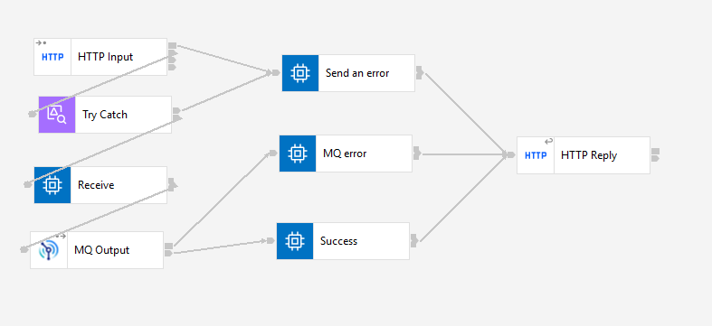
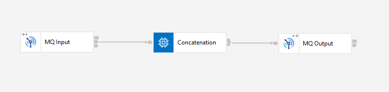
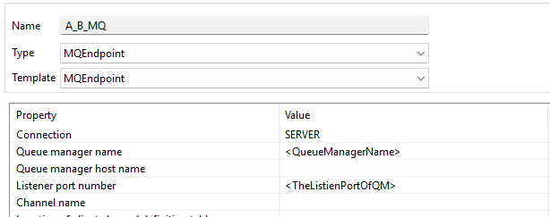

1. Open MQ Explorer as administrator.
2. Create a new queue manager.
3. Create 2 local queues.
4. Create 2 applications in ACE, each with a message flow.
   > Note: The first application receives `FirstName` and `LastName`, generates an `Id` in the program, and passes the three values to the first queue. The second application concatenates `FirstName` and `LastName` into `FullName` and passes the result to the second queue.
5. Add a message flow to each application.
6. Build the flow of the first application.
   
7. Build the flow of the second application (with the MQ nodes).
   
8. Configure the nodes.
9. In the first application, use this code in the Compute node to receive the data:
   ```esql
   SET OutputRoot.JSON.Data.Id = UUIDASCHAR;
   SET OutputRoot.JSON.Data.FirstName = InputRoot.JSON.Data.FirstName;
   SET OutputRoot.JSON.Data.LastName = InputRoot.JSON.Data.LastName;
   ```
10. In the second application, add this code:
    ```esql
    SET OutputRoot.JSON.Data.Id = InputRoot.JSON.Data.Id;
    SET OutputRoot.JSON.Data.FullName =
        InputRoot.JSON.Data.FirstName || ' ' || InputRoot.JSON.Data.LastName;
    ```
Method: Direct connection to the queue manager
11. Create the integration node linked with the queue manager.
12. Create a BAR file for the 2 projects and deploy it to the integration node.

Method: Connection using a Policy
11. Create the integration node without linking it to a queue manager.
12. Verify the queue manager name and port using commands.
    ```bash
    dspmq
    runmqsc <QM_NAME>
    DISPLAY LSSTATUS(*) PORT
    ```
13. Create a Policy Project.
14. Add a policy to the Policy Project and configure it as shown in the image.
    
15. Add the policy to the `MQInput` and `MQOutput` nodes using this format:
    ```text
    {PolicyProjectName}:PolicyName
    ```
16. Deploy the Policy Project to the integration node first, then create the BAR file for the 2 projects and deploy it. (Alternatively, include the Policy Project in the BAR.)
